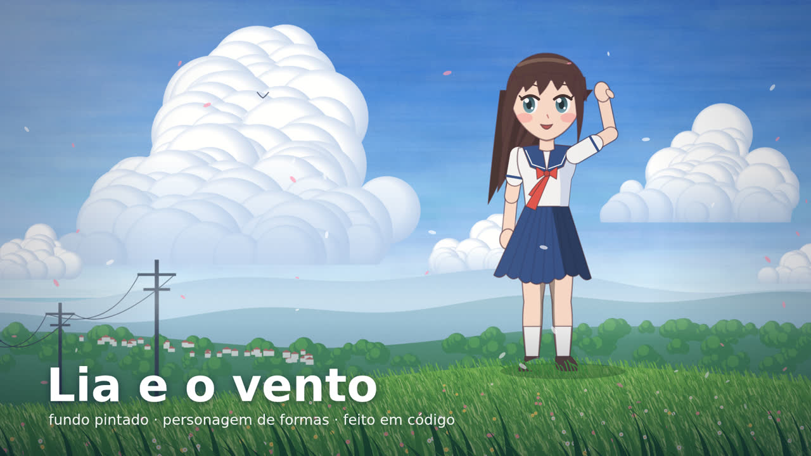
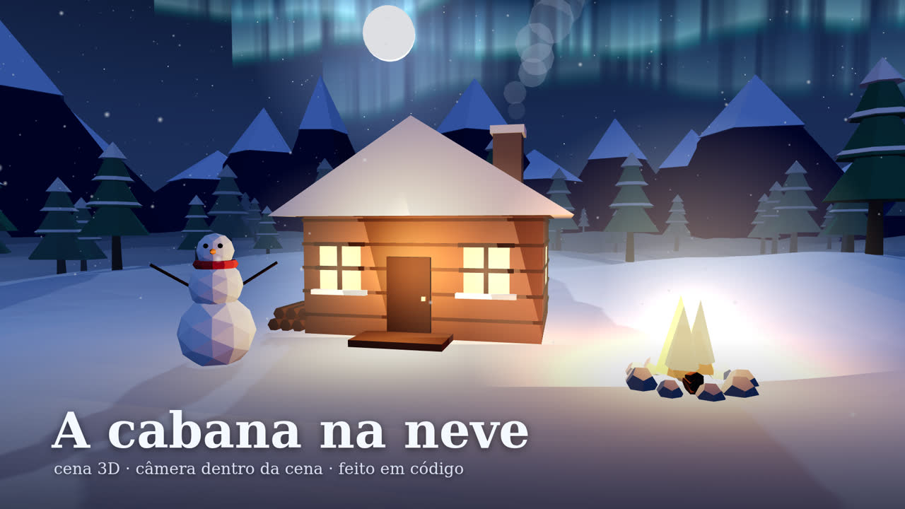
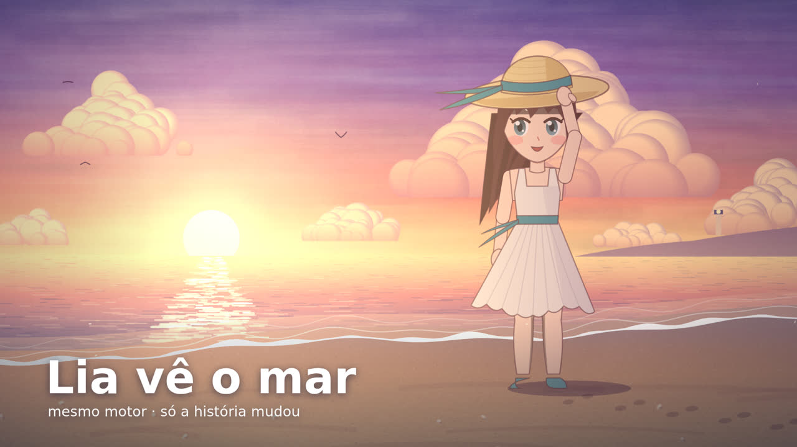
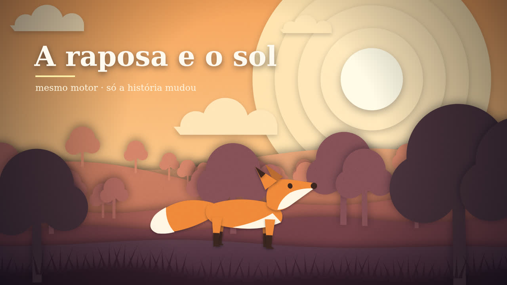

# filme-em-codigo — um motor por estilo

**🇧🇷 [Português](README.md) · 🇺🇸 [English](README.en.md) · 🇪🇸 [Español](README.es.md)**

<sub>Os motores de exemplo deste kit foram escritos pelo Claude Fable 5.2.</sub>

Você pede um vídeo para a IA e a personagem muda de rosto a cada tomada, o filme acaba em poucos
segundos e cada tentativa nova gasta crédito. Aqui o caminho é outro: o Claude **escreve um
programa que desenha o filme**, quadro por quadro. Sem modelo de vídeo e sem placa de vídeo.

O método tem nome: **um motor por estilo**. Você cria o motor de um estilo uma vez. Depois,
filme novo é só trocar a história. E o mesmo código dá sempre o mesmo vídeo.

| | |
|---|---|
|  **camadas-planas** · recorte de papel |  **fundo-pintado** · fundo pintado + personagem de formas |
|  **cena-3d** · mundo 3D com a câmera dentro |  **marionete** · uma ilustração mexida por áreas |

Os quatro quadros acima saíram dos motores deste repositório, nesta ordem: código → quadros →
som → MP4.

## Como funciona

1. **O motor** é uma página (HTML + JavaScript) que sabe desenhar um estilo. Ela tem uma função,
   `desenhar(t)`, que desenha o quadro do segundo `t`.
2. **A história** é um arquivo pequeno, `historia.json`: título, cores, lugar, hora, roupa, ação.
3. **O render** abre a página num navegador sem tela, pede cada quadro (`t = 0`, `t = 1/30`,
   `t = 2/30`...) e guarda cada um como imagem.
4. **O som** também é conta: o motor calcula cada amostra, nas mesmas marcas de tempo da imagem.
5. **O FFmpeg** junta os quadros e o som num MP4.

Como o tempo não vem do relógio e os sorteios têm semente, **renderizar duas vezes dá os mesmos
quadros** (o teste do kit compara o hash).

## Um motor por estilo: a prova

Mesmo motor, mesmos arquivos de código. Só o `historia.json` mudou.

| `historia.json` | `historia-2.json` |
|---|---|
|  |  |
| colina, de dia, uniforme, acena | praia, entardecer, vestido e chapéu, segura o chapéu |
|  |  |
| noite, lua, pinheiros, vaga-lumes | manhã, sol, árvores redondas |

A Lia tem o mesmo rosto nas duas porque é o mesmo código que a desenha. No `fundo-pintado`, o
motor tem cerca de 46 KB de código; cada história tem menos de 1 KB.

## O que você precisa

| O quê | Para quê | Como conferir |
|---|---|---|
| Node 22 ou mais novo | rodar o render | `node --version` |
| Chrome ou Chromium | tirar os quadros (sem abrir janela) | o render acha sozinho; ou `CHROME_PATH=/caminho` |
| FFmpeg | juntar quadros e som em MP4 | `ffmpeg -version` |
| Claude Code | escrever motores e histórias novas | só para criar; para rodar os exemplos, não precisa |

Não tem `npm install`. A three.js (para o exemplo 3D) já está em `vendor/three`.

## Começar

```bash
git clone https://github.com/inematds/filme-em-codigo.git
cd filme-em-codigo

# renderizar um exemplo (sai em saida/fundo-pintado/fundo-pintado.mp4)
node ferramentas/render.mjs exemplos/fundo-pintado

# o mesmo motor com outra história
node ferramentas/render.mjs exemplos/fundo-pintado --historia historia-2.json

# só 3 quadros soltos, para olhar antes de renderizar tudo
node ferramentas/render.mjs exemplos/cena-3d --quadros 1,5,9

# assistir no navegador, com som, sem renderizar
node ferramentas/ver.mjs exemplos/marionete
```

## O processo, do início ao fim

Quem faz: 🧠 você com o Claude · ⚙️ script · 🤖 `claude -p` (o Claude sem conversa, numa linha de comando).

| # | Passo | Comando / ação | Quem |
|---|---|---|---|
| 1 | Escolher o jeito de animar | ler [METODOS.md](METODOS.md): camadas-planas, fundo-pintado, cena-3d ou marionete | 🧠 |
| 2 | Escolher o estilo | pegar um bloco em [prompts/estilos/](prompts/estilos/README.md) ou descrever o seu | 🧠 |
| 3 | Criar o motor (uma vez por estilo) | pedido [prompts/01-criar-motor.md](prompts/01-criar-motor.md), em conversa nova | 🧠 |
| 4 | Conferir 3 quadros soltos | `node ferramentas/render.mjs meus/<estilo> --quadros 1,4,7` e olhar; até 3 rodadas | 🧠 + ⚙️ |
| 5 | Assistir no navegador (opcional) | `node ferramentas/ver.mjs meus/<estilo>` | ⚙️ |
| 6 | Renderizar o filme | `node ferramentas/render.mjs meus/<estilo>` → `saida/<estilo>/<estilo>.mp4` | ⚙️ |
| 7 | Ajustar com palavras | "mais devagar", "luz mais quente", na mesma conversa; repetir 4 e 6 | 🧠 |
| 8 | Filme novo no mesmo motor | pedido [prompts/02-nova-historia-mesmo-motor.md](prompts/02-nova-historia-mesmo-motor.md): só um `historia-N.json` | 🧠 ou 🤖 |
| 9 | Renderizar a nova história | `node ferramentas/render.mjs meus/<estilo> --historia historia-N.json` | ⚙️ |
| 10 | Conferir que nada quebrou | `bash tests/rodar.sh` | ⚙️ |
| 11 | (Opcional) dar textura num gerador de vídeo | [prompts/06-hibrido-modelo-de-video.md](prompts/06-hibrido-modelo-de-video.md); fora do kit, pago | 🧠 |

Passo 8 sem conversa:

```bash
# --allowedTools deixa o Claude ler, criar arquivo e rodar só o render (testado em 19/11/2026)
claude -p "Use o motor de exemplos/camadas-planas. Não altere o motor. Crie exemplos/camadas-planas/historia-3.json: a raposa numa floresta de outono, de dia. Renderize com node ferramentas/render.mjs exemplos/camadas-planas --historia historia-3.json e diga o caminho do MP4." \
  --allowedTools "Read" "Write" "Glob" "Grep" "Bash(node ferramentas/render.mjs:*)"
```

## Os 4 jeitos de animar

| Jeito | O que é | Exemplo | Quando usar |
|---|---|---|---|
| **camadas-planas** | formas planas em camadas; o fundo anda menos que a frente | [exemplos/camadas-planas](exemplos/camadas-planas) | recorte de papel, xilogravura, giz, vetor |
| **fundo-pintado** | cenário pintado uma vez + personagem de formas animada por cima | [exemplos/fundo-pintado](exemplos/fundo-pintado) | personagem com rosto, estilo anime simples |
| **cena-3d** | um mundo 3D com luz e sombra, e a câmera andando dentro | [exemplos/cena-3d](exemplos/cena-3d) | passeio de câmera, profundidade, maquete |
| **marionete** | uma ilustração pronta, entortada por pequenas áreas | [exemplos/marionete](exemplos/marionete) | você já tem o desenho e quer só dar vida |

Detalhes, forças e fraquezas de cada um: [METODOS.md](METODOS.md).

## Medido nesta máquina

Render dos exemplos em 19/11/2026: 10 segundos de filme, 1920×1080, 30 quadros por segundo
(300 quadros), **só CPU, sem placa de vídeo**, 4 navegadores em paralelo, teto de 8 GB de memória.
Cada linha vem do `medida.json` do exemplo.

| Exemplo | Render completo | Por quadro | Núcleos usados (média) | Memória (pico) | MP4 |
|---|---|---|---|---|---|
| camadas-planas | 30,8 s | 87 ms | 3,4 de 20 | 2,6 GB | 5,5 MB |
| fundo-pintado | 25,5 s | 62 ms | 3,6 de 20 | 2,5 GB | 9,1 MB |
| cena-3d | 45,3 s | 104 ms | 10,7 de 20 | 2,3 GB | 7,3 MB |
| marionete | 37,0 s | 98 ms | 3,2 de 20 | 3,1 GB | 5,4 MB |

Máquina: CPU Arm Cortex-X925 de 20 núcleos, Linux, Chrome 158 (WebGL calculado pela CPU,
SwiftShader), FFmpeg 6.1.1. Em outra máquina os tempos mudam. O que custa de verdade é a conversa
com o Claude, não o render: [CUSTO.md](CUSTO.md).

Para medir na sua: `bash ferramentas/medir-tudo.sh`.

## O que tem aqui

| Pasta / arquivo | O que é |
|---|---|
| `exemplos/<jeito>/` | um motor de cada jeito: `index.html`, `motor.js`, `historia.json`, `medida.json`, `quadro.jpg` |
| `comum/filme.js` | a parte igual de todo motor: lê a história, cria a tela, combina com o render, player de pré-visualização |
| `comum/som.js` | som feito em código: nota, sino, corda, vento, batida, eco de sala |
| `ferramentas/render.mjs` | página → quadros PNG → som WAV → MP4. Sem dependência de npm |
| `ferramentas/ver.mjs` | assistir o motor no navegador |
| `ferramentas/medir-tudo.sh` | renderiza todos os exemplos e grava as medidas |
| `prompts/` | os 6 pedidos prontos e a [biblioteca de estilos](prompts/estilos/README.md) (31 estilos) |
| `tests/` | render curto, mesmo código = mesmos quadros, MP4 com vídeo e som |
| `vendor/three/` | three.js 0.187.0 (licença MIT), para o exemplo 3D rodar sem internet |

## O contrato do motor

Todo motor expõe isto na página (quem cria é o `comum/filme.js`):

```js
window.FILME = {
  largura, altura, fps, duracao,
  tela,          // o canvas onde tudo é desenhado
  pronto,        // promessa: resolve quando história e imagens carregaram
  desenhar(t),   // desenha o quadro do segundo t — conta pura, sem relógio e sem memória
  som(),         // devolve { taxa, esq, dir }: as amostras do som, calculadas em código
};
```

Três regras fazem o método funcionar:

- **`desenhar(t)` não lembra do quadro anterior.** Vento, partícula, câmera: tudo sai de `t`.
- **Sorteio só com semente** (`Filme.sorteio(semente)`). Nada de `Math.random`.
- **Nada da história dentro do motor.** O que muda entre episódios mora no `historia.json`.

## Pedidos prontos

| Arquivo | Para quê |
|---|---|
| [01-criar-motor.md](prompts/01-criar-motor.md) | criar o motor de um estilo, com conferência de 3 quadros |
| [02-nova-historia-mesmo-motor.md](prompts/02-nova-historia-mesmo-motor.md) | filme novo sem mexer no motor |
| [03-com-sua-referencia.md](prompts/03-com-sua-referencia.md) | partir de uma imagem sua |
| [04-grade-storyboard.md](prompts/04-grade-storyboard.md) | grade 2×2 de quadros-chave → animação que passa de um ao outro |
| [05-gastar-menos.md](prompts/05-gastar-menos.md) | as alavancas de custo, em pedidos |
| [06-hibrido-modelo-de-video.md](prompts/06-hibrido-modelo-de-video.md) | usar o MP4 como referência num gerador de vídeo (só documentado) |
| [estilos/](prompts/estilos/README.md) | 31 estilos "mesmo estilo, sua ideia", pelos 4 jeitos |

## Testes

```bash
bash tests/rodar.sh
```

Para cada exemplo: renderiza 1 segundo, confere que o MP4 tem vídeo e som, renderiza de novo em
outro lançamento (com 1, 2 e 3 navegadores) e compara o hash dos quadros, confere que os quadros
mudam com o tempo, e que a segunda história dá outro filme no mesmo motor. Rodam sem internet.

"Mesmo código = mesmo vídeo" foi conferido **na mesma máquina e no mesmo navegador**. Entre
máquinas diferentes, as fontes de letra e a versão do navegador podem mudar alguns pixels.

## O que este método não faz

Fotorrealismo, rosto humano realista, luta, dança, fala com boca sincronizada. Veja
[LIMITES.md](LIMITES.md), com as saídas: o caminho híbrido e o Blender.

## Kits irmãos

- **video-codigo**: vídeo em HTML/Canvas com voz local presa à palavra — https://inematds.github.io/video-codigo/guia/
- **sincronia-em-codigo**: relógio único para imagem, contador e som; séries por planilha — https://inematds.github.io/sincronia-em-codigo/guia/
- **estilo-em-skill**: o estilo de um vídeo vira uma skill reutilizável — https://inematds.github.io/estilo-em-skill/guia/

Repositórios de código aberto que servem a este método, conferidos um a um: [REFERENCIAS.md](REFERENCIAS.md).

## Licença

MIT. Veja [LICENSE](LICENSE). A three.js em `vendor/three` tem licença MIT própria (`vendor/three/LICENSE`).
Conteúdo aberto e gratuito do INEMA.CLUB.
