<!-- Anexo da fonte (filme-em-codigo). Texto original em inglês, completo; só foi tirado o ruído da página (botões "Copy", menu de navegação). Tradução: ../biblioteca-pt/02-filmes-16x9.md. Crédito e licença: ../LEIA.md. -->

[← index](../biblioteca-original.md) · [português](../biblioteca-pt/02-filmes-16x9.md) · [credit and licence](../LEIA.md)

## 16:9 films made in code

Each card has a prompt for the same style with your idea, and the exact prompt for that film.

[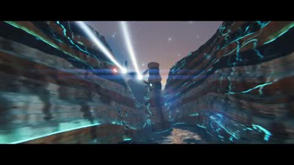](https://github.com/inematds/filme-em-codigo/releases/download/fonte-v1/wide_canyon.mp4)  
[▶ Watch the video: wide_canyon.mp4](https://github.com/inematds/filme-em-codigo/releases/download/fonte-v1/wide_canyon.mp4)

*Raymarched sci-fi*

### Canyon Run

A ship flies down a glowing canyon, banks through a rock arch and breaks out under a ringed planet at sunrise.

**Same style, your idea**

```text
Make a 5 to 10 second 16:9 animated film about [YOUR IDEA HERE]. Style: a raymarched science fiction flight, built entirely in code. Draw the whole world with one signed-distance-field fragment shader (terrain, rock arches, a ship with a glowing engine, a ringed planet), raymarched at half resolution, then pass it through a film pipeline: bright pass, anamorphic streaks, bloom, screen-space god rays, depth of field with radial motion blur, chromatic aberration, grain and a 2.39:1 letterbox. Design one continuous camera move with banking and a reveal at the end. Teal shadows, orange light. Every frame is a pure function of the frame number. No text. Synthesised score and engine sound.
```

**Copy this exact film · Exact prompt**

```text
Make an 8 second 16:9 raymarched sci-fi film in code. A small ship with a glowing engine flies fast down a deep canyon lit by glowing seams, banks hard through a natural rock arch, then bursts out over open desert under a huge ringed planet at sunrise. One signed-distance-field shader draws everything, followed by anamorphic streaks, bloom, god rays, depth of field, radial motion blur, chromatic aberration, grain and a 2.39:1 letterbox. Teal and orange grade. No text. Synth pulse score with an engine roar and a swell on the reveal.
```

[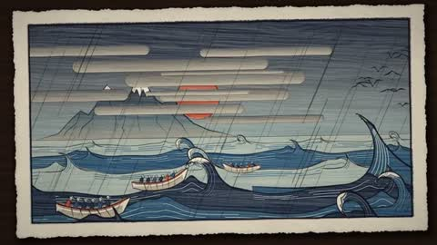](https://github.com/inematds/filme-em-codigo/releases/download/fonte-v1/wide_woodblock.mp4)  
[▶ Watch the video: wide_woodblock.mp4](https://github.com/inematds/filme-em-codigo/releases/download/fonte-v1/wide_woodblock.mp4)

*Animated woodblock print*

### Storm at Sea

Three fishing boats ride a storm as a giant wave rises, curls and collapses, and the sky clears to a red sun.

**Same style, your idea**

```text
Make a 5 to 10 second 16:9 animated film about [YOUR IDEA HERE]. Style: an animated Japanese woodblock print, built entirely in code and never pretending to be 3D. Draw the artwork as flat 2D shapes on three separate printing plates (a light colour block, a deep colour block and a black key-line block), in a palette of Prussian blue, indigo, pale blue-grey, cream and one red. Then print the plates with a shader: slight misregistration between plates, wood grain inside the flat colours, paper fibre, uneven ink and a deckled sheet with a border. Stylise water, cloud and wind as bold curling shapes with fingers of foam. Animate on twos or threes like a print coming to life. One clear event and a final image that lands. No text. Sparse music with wooden percussion.
```

**Copy this exact film · Exact prompt**

```text
Make a 9 second 16:9 animated woodblock print in code. Three small fishing boats ride a storm sea drawn in Prussian blue and indigo with pale foam. A giant wave rises behind them, curls over with clawed fingers of foam and collapses, the boats ride through, and the sky clears to a red sun. Draw three flat printing plates (light block, deep block, black key block) on canvases and print them in a shader with misregistration, wood grain, paper fibre and a deckled sheet. Animate on twos. No text. Taiko, flute and sea sound.
```

[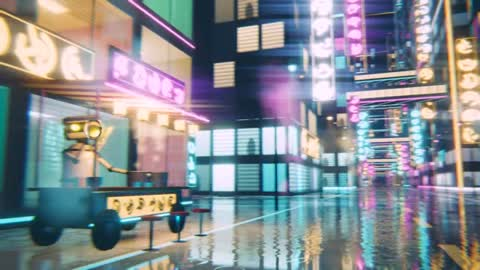](https://github.com/inematds/filme-em-codigo/releases/download/fonte-v1/wide_neon.mp4)  
[▶ Watch the video: wide_neon.mp4](https://github.com/inematds/filme-em-codigo/releases/download/fonte-v1/wide_neon.mp4)

*Rain-soaked neon megacity*

### Neon Rain

The camera rises from a street cart up a tower face and crests the roofline to reveal the whole city.

**Same style, your idea**

```text
Make a 5 to 10 second 16:9 animated film about [YOUR IDEA HERE]. Style: a rain-soaked neon megacity at night, built in code with three.js. Instanced towers with interior-mapped lit rooms, glowing signs with invented glyphs (no real words), wet streets with a planar reflection pass, falling rain and steam. Film it with an HDR pipeline: dual-filter bloom, anamorphic streaks, motion blur, slight chromatic aberration, raindrops on the lens, grain and a teal and magenta grade. One designed camera move from an intimate street-level detail to a wide reveal of the whole city. No text. Synth pads, rain and a low bass swell on the reveal.
```

**Copy this exact film · Exact prompt**

```text
Make an 8 second 16:9 neon city film in code. Open at street level on a steaming noodle cart under an awning in heavy rain, reflections in the wet road. The camera rises fast up a tower face past dozens of lit rooms, crests the roofline and reveals the megacity to the horizon with flying traffic and glowing signs. Planar reflections, HDR bloom, anamorphic streaks, motion blur, lens raindrops, grain, teal and magenta grade. Signs use invented glyphs only. Synth pad score, rain, and a bass swell on the reveal.
```

[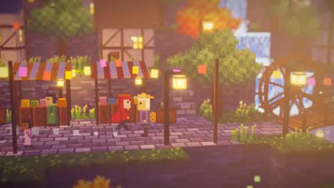](https://github.com/inematds/filme-em-codigo/releases/download/fonte-v1/wide_pixel.mp4)  
[▶ Watch the video: wide_pixel.mp4](https://github.com/inematds/filme-em-codigo/releases/download/fonte-v1/wide_pixel.mp4)

*HD-2D pixel art diorama*

### Lantern Village

A hero in a red cloak runs through a lantern-lit mountain village at dusk and watches fireworks over the valley.

**Same style, your idea**

```text
Make a 5 to 10 second 16:9 animated film about [YOUR IDEA HERE]. Style: an HD-2D pixel-art diorama, built in code. Draw every sprite and tile in code from one fixed 32-colour palette, with chunky pixels and hand-placed dithering, and animate the characters as short sprite cycles. Stand the flat sprites up in a 3D miniature set and light and film it like a model: warm point lights with shadows, volumetric dusk light shafts, pixel-snapped reflective water, a tilt-shift lens with strong depth of field, and HDR bloom. One slow dolly move following the hero, ending on a wide view. No text. Chiptune melody with soft modern reverb and small sound effects.
```

**Copy this exact film · Exact prompt**

```text
Make a 10 second 16:9 HD-2D pixel-art film in code. A hero in a red cloak runs along the terrace of a lantern-lit mountain village at dusk, through the village, and stops at the edge to watch fireworks burst over the valley and reflect in the water. All sprites and tiles drawn in code from a 32-colour palette, placed in a 3D diorama with lantern point lights and shadows, volumetric dusk shafts, pixel-snapped water reflections, tilt-shift depth of field and bloom. Chiptune score with firework pops.
```

[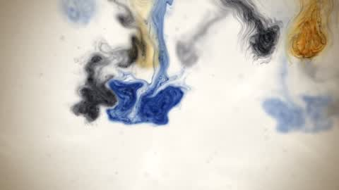](https://github.com/inematds/filme-em-codigo/releases/download/fonte-v1/wide_ink.mp4)  
[▶ Watch the video: wide_ink.mp4](https://github.com/inematds/filme-em-codigo/releases/download/fonte-v1/wide_ink.mp4)

*Ink in water and particle swarm*

### Ink Crane

Ink plumes bloom in water, then tens of thousands of particles sweep out and form a crane taking off, before it bursts back into ink.

**Same style, your idea**

```text
Make a 5 to 10 second 16:9 animated film about [YOUR IDEA HERE]. Build it entirely in code as macro photography of ink in water: a luminous pale paper background lit from behind, with plumes of black and deep-blue ink plus exactly one accent plume of gold, each curling into vortex caps with fine fibrous filaments driven by a curl-noise flow field so they fold and stretch like real ink. Tens of thousands of fine particles carried by the same flow condense out of the ink into a murmuration that sweeps across the frame and resolves into the subject as a clear, original silhouette, which holds for a beat with one living motion before bursting back into drifting ink blooms. Use very shallow depth of field with soft bokeh on near particles, a slow drifting camera that pulls back from a close opening and racks focus from the ink to the subject and back, motion blur on fast particles, subtle refraction and caustic shimmer as if seen through water, pigment-style colour mixing, a warm paper vignette and fine grain. No text or narration; a quiet drone with sparse plucked notes and soft water sounds timed to the drops, the flock, the reveal and the dissolve.
```

**Copy this exact film · Exact prompt**

```text
Make a 9.6 second 16:9 film, 30 fps, entirely in code, no narration or text, shot like macro photography of ink in water. On luminous warm off-white paper lit from behind, plumes of black and deep indigo-blue ink descend from the top of frame and curl into twin-vortex mushroom caps with fine fibrous filaments that fold and stretch like real ink, with one plume of gold that glitters. Open very close on a black and a blue plume as the lens finds focus, then pull back and drift right to reveal the gold. Tiny dark specks appear inside the ink, then tens of thousands of them stream out as a motion-blurred murmuration that sweeps low across the frame, curves up the right side and condenses mid-frame into an original crane taking off: neck stretched up and forward, long legs trailing, gold crown, feathered wings beating slowly. Rack focus from the ink to the bird so the ink becomes soft colour behind it. Hold for a beat and a half, then the crane bursts into fresh black, blue and gold ink blooms and its particles drift away as focus returns to the ink. Very shallow depth of field with soft bokeh discs, gentle water refraction and caustic shimmer, warm paper vignette, fine grain. Sound: low drone, sparse koto-like plucks, underwater drops, a soft whoosh for the flock, a bell when the bird forms, wingbeats, a dissolving wash.
```

[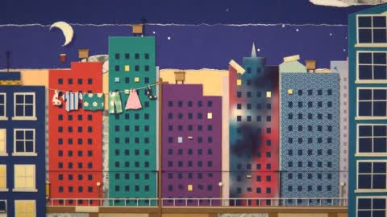](https://github.com/inematds/filme-em-codigo/releases/download/fonte-v1/wide_collage.mp4)  
[▶ Watch the video: wide_collage.mp4](https://github.com/inematds/filme-em-codigo/releases/download/fonte-v1/wide_collage.mp4)

*Cut-paper collage*

### Paper Morning

A paper city wakes at dawn, a tram crosses the bridge, and a paper cat leaps between rooftops, scattering newsprint birds.

**Same style, your idea**

```text
Make a 5 to 10 second 16:9 animated film about [YOUR IDEA HERE]. Build it entirely in code as stop-motion cut-paper collage. Every element is a piece of paper from a small paper-piece system: procedurally generated stocks (coloured sugar paper, kraft, newsprint with abstract unreadable type, graph paper, marbled paper, tissue, torn magazine halftone, patterned origami paper), a cut style (scissor-cut with slightly faceted edges, or hand-torn with a white fibrous deckle), slight curl, and a soft contact shadow that grows and softens as the piece lifts off the sheet. Layer the pieces on a textured backing board, some held with masking tape or a visible pin, and build characters as jointed cut-out puppets with paper fasteners. Animate on twos: pieces slide, hinge and get swapped for replacement shapes, with small frame-to-frame jitter and shadows that flicker as if re-photographed under a rostrum camera. Stage foreground, midground and background on multiplane layers with a designed pan and a push-in on the main character. Finish on the whole collage seen flat on the backing board with tape at the corners. Add a final camera pass with lamp falloff, slight lens softness and grain. No text, no narration; a small music-box tune plus paper foley on the visible events. Original designs only.
```

**Copy this exact film · Exact prompt**

```text
Make a 10 second 16:9 stop-motion cut-paper collage film, built entirely in code, of a city waking up. Every element is a piece of paper from a procedural paper-piece system: coloured sugar paper, kraft, newsprint with abstract unreadable type, graph paper, marbled paper, tissue, magazine halftone and patterned origami paper, either scissor-cut with faceted edges or hand-torn with a white fibrous deckle, each with slight curl and a soft contact shadow that grows with lift. Layer them on a grey textured backing board with masking tape strips, map pins and brass fasteners. Open at night on colourful tower blocks under torn indigo sky bands with a pinned crescent moon. Re-paper the sky band by band into dawn colours, lift the moon away, raise a torn orange sun with rotating ray wedges behind the towers, and flip tiny window squares from navy to yellow. A yellow paper tram crosses a kraft arched bridge over a sliding marbled river; washing of origami paper flutters on a line. Push in on a charcoal torn-paper cat with marbled orange stripes asleep on a windowsill: it wakes, stretches, arches, crouches and leaps the gap to the next rooftop, scattering a flock of newsprint birds. Pull back to the whole collage flat on the board with tape at the corners, the last strip pressed on. Animate on twos with replacement shapes, jitter and flickering shadows, multiplane parallax, rostrum-camera lamp falloff and grain. Music-box tune and paper foley, no text.
```

[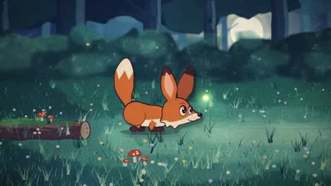](https://github.com/inematds/filme-em-codigo/releases/download/fonte-v1/wide_cel.mp4)  
[▶ Watch the video: wide_cel.mp4](https://github.com/inematds/filme-em-codigo/releases/download/fonte-v1/wide_cel.mp4)

*Classic hand-drawn cel animation*

### Firefly Glade

A fox cub stalks a firefly, pounces, tumbles and sneezes, and the sneeze lifts hundreds of fireflies out of the grass.

**Same style, your idea**

```text
Make a 5 to 10 second 16:9 animated film about [YOUR IDEA HERE]. Build it entirely in code as classic hand-drawn cel animation in the tradition of 1940s and 1950s American feature animation, with original characters and world only. Paint the backgrounds procedurally as four or five flat watercolour and gouache layers (wet-edge washes, pigment granulation, soft bleeds, dry-brush foliage, a little pencil under-drawing) in a warm storybook palette, and move them as a multiplane camera with the far layers softer and a designed push, pan or pull-back. Draw the characters each frame as inked and painted cels from deformable 2D splines: flat opaque fills with a slightly uneven paint edge inside a tapering ink line, some self-colour lines, a soft cel shadow on the background. Animate with the classic principles from a keyed pose sheet, on ones for fast action and twos elsewhere: anticipation, squash and stretch, overlapping action and follow-through, arcs, slow in and out, strong silhouettes. Add hand-drawn effects cels (ripples, sparkles, dust puffs, soft glows) and photograph everything through one shader pass that adds paper tooth, cel flicker and weave, cel dust, fine grain, gate weave, gentle vignette and warm print colour. Give it a small arc with an opening image, an event and a final image that lands. No text or narration; synthesise an orchestral storybook score and sound effects timed to the action.
```

**Copy this exact film · Exact prompt**

```text
Make a 10 second 16:9 animated film, 30 fps, built entirely in code, in the style of classic hand-drawn cel animation of 1940s and 1950s American features, with original designs only. Moonlit forest glade: five procedurally painted watercolour and gouache layers (sky with a full moon and stars, misty far trunks, middle trees, a glade floor with grass, wildflowers, a pond, a mossy log and red mushrooms, a dark foreground of trunks, leaves and ferns), moved as a multiplane camera with far layers softer. An original fox cub with oversized dark-tipped ears, cream bib and tail tip and dark socks, drawn as inked and painted cels from deformable splines, on ones for fast action and twos elsewhere. 0 to 2 s: it stalks a firefly resting on a seed head. 2 to 2.6 s: crouch and haunch wiggle. 2.6 to 3.1 s: stretched pounce, the firefly zips off, full squash on landing with dust puffs. 3.1 to 4 s: tumble, sits up dizzy with circling stars. 4.9 to 5.6 s: nose twitch, "ah, ah", big sneeze. 5.6 to 7.5 s: a ring crosses the grass and hundreds of fireflies rise in a wave, glowing on the paintings and reflecting in the pond. The cub looks up in wonder, the firefly lands on its nose, and the camera pulls back wide. Finish with grain, gate weave, cel dust and shadow, vignette, warm print colour. Storybook orchestral score and cartoon sound effects, no text.
```

[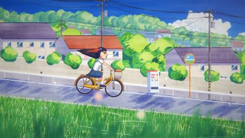](https://github.com/inematds/filme-em-codigo/releases/download/fonte-v1/wide_anime.mp4)  
[▶ Watch the video: wide_anime.mp4](https://github.com/inematds/filme-em-codigo/releases/download/fonte-v1/wide_anime.mp4)

*2D anime film*

### Level Crossing, Summer

A girl coasts downhill on her bicycle, brakes at a level crossing as a train blasts past, then looks up at the summer sky over the sea.

**Same style, your idea**

```text
Make a 5 to 10 second 16:9 animated film about [YOUR IDEA HERE]. Style: flat 2D Japanese theatrical anime made the traditional way, built entirely in code with no 3D. Backgrounds are painted poster-colour art in separate depth layers for multiplane moves: saturated summer sky, big cumulus clouds in two or three flat tones with soft brushed edges, detailed everyday scenery in correct flat perspective, crisp light with saturated blue-violet shadows and visible brush texture. Characters are original designs drawn as flat cels: thin, slightly varied dark-brown outline, flat base colours, exactly one hard-edged shadow tone and a small highlight, hair and clothing as separate shapes. Animate with strong key poses held for 2 to 6 frames, on twos and threes, with follow-through on hair, clothes and ribbons, a blink and a mouth change, and held cels where only hair and clothes move. Effects (wind streaks, speed lines, dust, birds, petals) are drawn shapes on threes. Finish with an anime photography pass: multiplane pan and slow truck-in, highlight bloom and diffusion, lens flare and warm light leak, out-of-focus foreground particles, heat shimmer, slight colour fringing and fine film grain. At least four shots with anime-style cutting, including one extreme close-up of the eyes and one wide final shot. No text or narration; soft piano-led music and sound effects on the visible events.
```

**Copy this exact film · Exact prompt**

```text
Make a 10 second 16:9 flat 2D Japanese theatrical-anime style film, all in code, no 3D. Painted poster-colour backgrounds in several depth layers: deep cobalt summer sky, towering cumulonimbus in three flat tones with soft brushed edges, a seaside hillside town of tiled roofs, lavender shadows, utility poles with sagging wires, a level crossing, glittering sea. An original girl with long ink-blue hair, vermilion ribbon bow, white blouse with mint sailor collar, navy pleated skirt and a mustard bicycle with a basket, drawn as flat cels with a thin varied dark-brown line, one hard shadow tone and a small highlight. Eight shots: side tracking shot of her coasting downhill, hair streaming; low angle of the crossing signal flashing as the striped barrier drops; she brakes, foot down, hair swinging forward; from behind her a train blasts past filling the frame with speed lines, window flashes, flying petals, hair and ribbon whipped sideways; extreme close-up of her eyes squinting, blinking, then opening wide with sea reflected; the train clears to reveal town, sea and giant cloud with birds and a sun flare; medium close-up as she looks up and smiles; wide final tilt-up over the town as the gates lift. Characters animated on twos with held poses and follow-through, effects on threes, multiplane camera with slow truck-ins, bloom, lens flare, light leak, heat shimmer, slight colour fringing, fine grain. No text. Music: gentle piano and pads, cicadas, crossing bell, train roar, sea.
```

[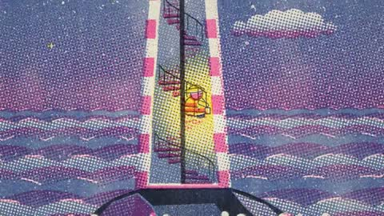](https://github.com/inematds/filme-em-codigo/releases/download/fonte-v1/wide_riso.mp4)  
[▶ Watch the video: wide_riso.mp4](https://github.com/inematds/filme-em-codigo/releases/download/fonte-v1/wide_riso.mp4)

*Risograph print*

### The Lighthouse

A lighthouse keeper lights the lamp, and the beam reveals a whale in overprint.

**Same style, your idea**

```text
Make a 5 to 10 second 16:9 animated film about [YOUR IDEA HERE]. Style: a risograph print animation, built entirely in code as flat 2D artwork. Draw the picture as four greyscale ink plates (fluorescent pink, medium blue, yellow and black) on canvases, with bold simple shapes designed so the inks overlap into new colours. Then print them in a shader: each plate through its own halftone screen (dots, lines or grain), multiply overprint, a different small misregistration on every print, roller banding, patchy solids, pinholes and cream paper with tooth. Hold each print for two or three frames so the picture jitters like a stack of prints flipped through. One event, and a final image that uses overprint for a reveal. No text. Warm lo-fi music and soft mechanical print sounds.
```

**Copy this exact film · Exact prompt**

```text
Make a 9 to 10 second 16:9 risograph print animation in code. Night sea in blue, a lighthouse on a rock and its keeper. He lights the lamp, a yellow beam sweeps across the water, and where the beam overprints the blue sea it reveals a huge whale passing under the surface in pink and blue overprint. Four ink plates (fluorescent pink, blue, yellow, black) printed in a shader with halftone screens, misregistration, roller banding, pinholes and cream paper. Held on twos and threes. No text.
```

[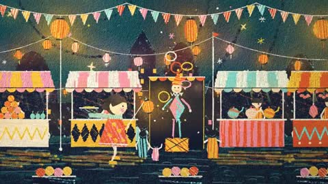](https://github.com/inematds/filme-em-codigo/releases/download/fonte-v1/wide_pastel.mp4)  
[▶ Watch the video: wide_pastel.mp4](https://github.com/inematds/filme-em-codigo/releases/download/fonte-v1/wide_pastel.mp4)

*Oil pastel and gouache*

### The Lantern That Got Away

A girl walks a lantern-lit night market, and a lantern floats up into the stars.

**Same style, your idea**

```text
Make a 5 to 10 second 16:9 animated film about [YOUR IDEA HERE]. It must look like a scan of oil pastel and gouache on dark coloured paper (deep teal or brick red), drawn in a naive, bold, geometric mid-century picture-book manner with a limited palette of five or six colours. Draw everything as flat 2D shapes, then build a real stroke engine: every shape is filled with visible directional pastel strokes that skip over the paper tooth and leave the paper showing through, edges are rough and slightly overshoot, colours layer where they overlap, there are scraped-back sgraffito highlights and soft finger smudges for glow, and flat matte gouache areas with faint brush drag sit beside the waxy pastel. Use heavy paper grain lit from one side so the tooth is visible everywhere. Animate it like paint-on-paper animation: strokes re-draw every two or three frames so the whole picture boils gently, characters move on twos, and moving things leave faint smears of pigment behind them. Stage a small scene with foreground, midground and background on a multiplane camera with one designed move, and give it a clear arc: an opening image, something that happens, and a final image that lands. No text, no narration; a simple hand-played music bed with sound effects on the visible events.
```

**Copy this exact film · Exact prompt**

```text
Make a 10 second 16:9 animated film, 1920x1080 at 30 fps, no text, that looks like a scan of oil pastel and gouache on dark teal paper in a naive, geometric mid-century picture-book manner. Palette: cream, vermilion, warm yellow, pink, indigo and aqua only. Build a stroke engine: every shape is filled with visible directional pastel strokes that skip over the paper tooth, overshoot their rough edges and let the paper show through; flat matte gouache areas sit beside them; add scraped sgraffito highlights and finger smudges, on heavy paper grain lit from the upper left. Re-draw the strokes every two or three frames so the picture boils, and let moving things leave faint smears. Scene: a night market under strings of paper lanterns and bunting. A girl in a red spotted coat with an aqua scarf carries a lantern on a stick past striped stalls with steaming pots, kettles and a fruit pyramid. A juggler in a diamond costume tosses five rings on a crate. At the butcher's stall a white dog leaps, steals a chain of sausages and runs back past her while the butcher throws up his arms. One lantern slips its string and floats up; she stops and watches. Multiplane camera tracks sideways with her, then tilts up and pulls back. Final image: the lantern small among thick pastel stars and a crescent moon above the glowing market. Music: a toy-piano waltz with market murmur, footsteps, a twang and a closing bell.
```

[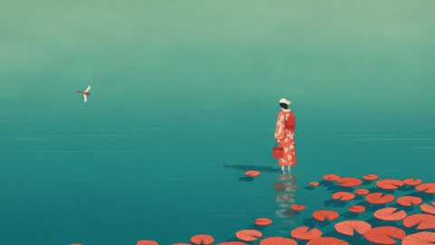](https://github.com/inematds/filme-em-codigo/releases/download/fonte-v1/wide_lily.mp4)  
[▶ Watch the video: wide_lily.mp4](https://github.com/inematds/filme-em-codigo/releases/download/fonte-v1/wide_lily.mp4)

*Flat minimalist illustration*

### Shallows

A woman in a coral robe wades two slow steps through endless teal shallows, and lifts her head as a petal lands.

**Same style, your idea**

```text
Make a 5 to 10 second 16:9 animated film about [YOUR IDEA HERE]. Style: contemporary flat minimalist illustration with a Japanese print feeling. One huge calm colour field that grades smoothly from a pale hazy tone at the top to a deep tone at the bottom, with no horizon line, so most of the frame is empty. A strict palette of four: the field colour range, one saturated accent (coral-vermilion), a warm cream, and near-black. Flat shapes with crisp edges, no outlines, one or two flat shading tones only. Describe surfaces with very few marks: thin pale concentric lines, faint long horizontal bands, a soft dark cast shadow, a broken wobbling reflection, offset shadow shapes under floating objects. One small subject placed off centre, with a cluster of accent-coloured shapes in one foreground corner. Cover everything with fine even print grain and slight paper texture so it reads as a printed illustration. Animate like a moving illustration, on twos, with great restraint: one or two slow deliberate actions, small secondary sway and settle, one tiny creature crossing the empty space, and a single very slow push-in with slight parallax between foreground, subject and distance. End on a quiet final gesture and one last small event. Sound: very sparse, air, soft foley on the visible actions, one or two distant koto-like plucks.
```

**Copy this exact film · Exact prompt**

```text
Make a 9 second 16:9 animated film, 30 fps, in a contemporary flat minimalist illustration style with a Japanese print feeling. A huge calm field of teal grades from soft sage-green haze at the top to deep blue-green water at the bottom with no horizon; most of the frame is empty. Palette is strictly teal, one coral-vermilion, warm cream and near-black. Flat crisp shapes, no outlines, one or two flat shading tones, fine even print grain and paper texture over everything. Right of centre, a small woman seen from behind stands in the shallows, head bowed: coral robe with cream blossom pattern, red sash with a boxy knot, cream headscarf over dark hair, small red bag. Coral lily pads with a notch and thin radial veins cluster in the lower right, each with a dark teal shadow offset beneath. Animate on twos with great restraint: a red dragonfly darts left to right in hops; she takes two slow steps left and stops, hem and sleeve swaying; thin pale broken ripple rings expand and fade from each step; her wobbly broken reflection shivers; one small pad is nudged aside; a koi's shadow glides under the pads; faint long wave bands slide; haze drifts. Very slow push-in with slight parallax. Final image: a cream petal falls, she lifts her head to the empty distance, the petal lands and a last ripple spreads. Sound: air, soft water steps, a few koto plucks.
```

[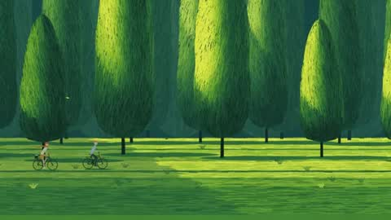](https://github.com/inematds/filme-em-codigo/releases/download/fonte-v1/wide_trees.mp4)  
[▶ Watch the video: wide_trees.mp4](https://github.com/inematds/filme-em-codigo/releases/download/fonte-v1/wide_trees.mp4)

*Hatched gouache illustration*

### The Avenue

Two cyclists ride through an avenue of towering, hatch-drawn trees as wind ripples the strokes and sunlight catches them.

**Same style, your idea**

```text
Make a 5 to 10 second 16:9 animated film about [YOUR IDEA HERE]. Style: a contemporary gouache and coloured-pencil illustration built almost entirely from fine hatching, honestly flat, like a scanned hand-made picture that moves. Use extreme scale contrast: huge simple forms fill nearly the whole frame, ranked in depth, and tiny figures act in a thin strip at the bottom. Keep everything in one colour family, from a luminous light tone through a mid tone to deep, near-black shadow, with the only other colours as tiny accents on the figures. Every large form is a crisp flat silhouette with no outline, and its volume is drawn only by thousands of short, slightly curved strokes that follow the form like brushed fur: light strokes on the lit side, dark on the shadow side, densest and darkest at the base. Depth comes from tone: near forms saturated and contrasted, far ones flatter and bluer, deep shadow in the gaps. The ground is flat horizontal bands of light and shade with long shadows lying across it. Matte paint, fine paper grain, no gradients except those made by stroke density. Animate it as a moving illustration: hatching redraws on threes so it shimmers, a slow wind sends waves through the strokes, bands of sun and cloud shadow drift across the scene, the figures act on twos, and the camera makes a slow multiplane pan with clear parallax, then a gentle tilt to reveal the full scale. End on the figures small at the edge of frame as light reaches them. No text, no narration; soft natural ambience, a few sound effects on visible events, and a gentle plucked or piano phrase.
```

**Copy this exact film · Exact prompt**

```text
Make a 9 second 16:9 animated film in the style of a contemporary gouache and coloured-pencil illustration built almost entirely from fine hatching. Enormous, tall, bullet-shaped clipped trees fill nearly the whole frame in four ranks of depth; two tiny cyclists cross a thin strip of banded lawn at the very bottom. Everything is one family of greens, luminous yellow-lime in the light through leaf green to deep blue-green and near-black in shadow, with deep teal gaps; the only other colours are a red cap, an orange skirt, a pale blue shirt, a cream boater and black bicycles. Each tree is a flat crisp silhouette whose volume is drawn with thousands of short, slightly curved strokes following the form downward, lime on the lit left, dark on the right, darkest at the base of the crown above a thin dark trunk. Nearer trees are saturated, farther ones flatter and bluer. Matte paint, fine paper grain, no outlines. A breeze ripples the hatching in waves and sways the crowns from the top; the hatching redraws on threes. A cloud shadow drifts across the lawn and up the trees. The camera tracks slowly sideways with the cyclists with clear parallax; the rear rider, scarf trailing, catches up; a bell rings, birds lift from a crown, leaves drift down; the camera tilts up the towering trees. Final image: the cyclists small at the far right edge as sunlight reaches them. Sound: wind in leaves, freewheel ticks, a bicycle bell, birdsong, a gentle piano phrase.
```

[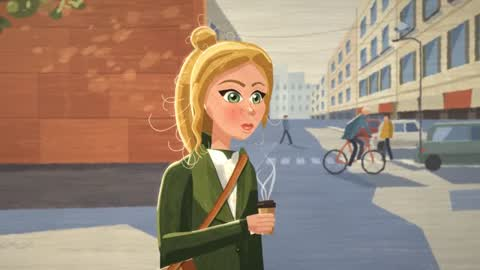](https://github.com/inematds/filme-em-codigo/releases/download/fonte-v1/wide_street.mp4)  
[▶ Watch the video: wide_street.mp4](https://github.com/inematds/filme-em-codigo/releases/download/fonte-v1/wide_street.mp4)

*Painterly animation concept art*

### Morning, Looking Up

A woman with a coffee walks along a sunlit wall, hears a bicycle bell, looks up and starts to smile.

**Same style, your idea**

```text
Make a 5 to 10 second 16:9 animated film about [YOUR IDEA HERE]. Style: painted feature-animation visual-development art, as if from a film's art book. Build everything from flat cut-gouache shapes with hard chiselled edges and no outlines; every form gets a base colour, one flat shadow shape and one flat light shape, with a few thin dry-brush streaks left visible and paper grain over the whole image. Stage one original stylised character in a waist-up medium shot with large expressive eyes, bold upper lashes, a clear catchlight, a simplified nose, a strong simple lip shape and a warm cheek blush. Hair is big simple masses with a handful of fine bright wisps catching the light. Use strong low sunlight from one side: a hot rim along hair and shoulder, warm bounce in the shadows, cool blue-grey cast shadows. Paint the background as looser, softer, lower-contrast blocks with simplified details and a couple of small moving figures reduced to brush shapes. Keep the palette earthy and sunlit with one cool shadow colour. Animate a single clear character moment on ones and twos with anticipation, overshoot, a held pose, a blink and a change of expression, plus overlapping action on hair and clothes. Slow camera push-in with slight parallax. Sound: gentle ambience, effects on the visible events and one warm musical chord at the emotional beat.
```

**Copy this exact film · Exact prompt**

```text
Make a 5 second 16:9 animated film at 30 fps in the style of painted feature-animation visual-development art: flat cut-gouache shapes with hard chiselled edges and no outlines, each form a base colour plus one flat shadow and one flat light shape, visible dry-brush streaks and paper grain. Waist-up medium shot of an original stylised young woman: golden hair in a loose top knot with a side-swept fringe and fine rim-lit flyaway wisps, large green eyes with bold upper lashes and a catchlight, freckles, warm cheek blush, coral lips, olive coat with wide lapels, cream shirt, tan crossbody strap and bag, paper coffee cup with steam. Low sun from behind left gives a hot rim on hair and shoulder. Background in loose, softer blocks: terracotta wall with shifting dappled light on the left, pale cream buildings with slate-blue windows on the right, slate-blue street shadows, parked cars. She walks in, a cyclist rings a bell, a pigeon takes off from a lamp, her eyes dart up, her head follows with a small intake of breath, eyes wide, lips parted; she holds, blinks, and begins to smile as a breeze lifts her hair. A passer-by crosses behind. Slow push-in with parallax, ending on her upturned face. Animate on ones and twos with overlapping hair, collar and strap. Sound: soft city morning, footsteps that stop, bicycle bell, wings, one warm chord blooming.
```

[](https://github.com/inematds/filme-em-codigo/releases/download/fonte-v1/wide_bricks.mp4)  
[▶ Watch the video: wide_bricks.mp4](https://github.com/inematds/filme-em-codigo/releases/download/fonte-v1/wide_bricks.mp4)

*Toy brick stop-motion*

### Liftoff on the Baseplate

Loose toy bricks hop into place to build a rocket and gantry, a little figure pushes the lever, and the rocket lifts off on brick-built fire and smoke.

**Same style, your idea**

```text
Make a 5 to 10 second 16:9 animated film about [YOUR IDEA HERE]. Style: a toy-brick stop-motion film built entirely in code (Remotion + three.js), with no text on screen. Build a generic, unbranded brick system: a small catalogue of parts (1x1, 1x2, 2x2, 2x4 bricks, plates one third as high, slopes, round 1x1s, a few translucent pieces) with studs, slightly bevelled edges and tiny gaps, everything on a fixed stud grid and drawn with InstancedMesh; no logos, no real sets, and any figures are an original design (rounded-cube head with two dot eyes, tapered block body, peg hands). Material: glossy ABS with clear-coat reflections of a softbox, faint subsurface glow, hairline scratches, fingerprints, dust specks, mould seam lines and slight shade differences between bricks. Shoot it like real tabletop stop motion: a studded baseplate on a wooden table in front of a brick-built backdrop, a warm practical key light with soft shadows and slight flicker between exposures, a macro lens with shallow depth of field and creamy bokeh, animation at 12 exposures a second with small position jitter, squash-and-settle when pieces land, and no motion blur. All effects (smoke, fire, water, explosions) are made of bricks and round studs that pop on and off, never particles. Give it a designed camera move from stud-level macro to a wide final image, and synthesised sound: a plastic click for every brick, a marimba and music-box score, and small, playful effects.
```

**Copy this exact film · Exact prompt**

```text
Make a 10 second 16:9 toy-brick stop-motion film in code (Remotion + three.js), no text. Build a generic brick system: 1x1, 1x2, 2x2, 2x4 bricks, plates one third as high, slopes, round 1x1s and translucent pieces, with studs, bevelled edges and tiny gaps, all on a stud grid as InstancedMesh; no logos. Glossy ABS with clear-coat softbox reflections, scratches, fingerprints, dust, mould seams and shade variation. Animate at 12 exposures a second with position jitter, light flicker and no motion blur; macro lens with shallow depth of field. Scene: a green baseplate on a wooden table with a hazard-striped launch pad. Open at stud level; loose bricks hop from a scattered pile and click into place with a squash, building a red-and-white rocket and a yellow gantry as the camera cranes up. Two original figures (rounded-cube head, two dot eyes, tapered block body, peg hands) watch; one hop-runs to a brick control desk and pushes a lever; a translucent light pole steps red, yellow, green. The rocket lifts off on glowing translucent fire bricks and a growing column of white and grey smoke bricks that tumble across the baseplate and knock over a brick tree; the other figure throws its arms up. Tilt and pull back to the rocket small against a blue brick sky wall with a pixel sun and brick clouds on sticks, smoke settling. Sound: plastic clicks per brick, marimba and music-box build-up, a small playful rumble with a slide whistle.
```

[](https://github.com/inematds/filme-em-codigo/releases/download/fonte-v1/wide_redhair.mp4)  
[▶ Watch the video: wide_redhair.mp4](https://github.com/inematds/filme-em-codigo/releases/download/fonte-v1/wide_redhair.mp4)

*Illustrated character portrait*

### Afternoon Light, red hair

The same six seconds with the red-haired character: she blinks as her hair and earrings sway in the late sun, then a close-up as she lifts her brows, blinks and smiles.

**Same style, your idea**

```text
Make a 5 to 10 second 16:9 animated film about [YOUR IDEA HERE]. Bring one supplied still illustration to life as an image puppet, without redrawing it: a single full-screen shader samples the picture with bicubic filtering through small, softly masked displacement fields, so everything that is not moving stays exactly as drawn. Lift loose hair off the background as a colour-keyed layer over a painted-out plate and sway it with a travelling breeze, none at the roots and most at the tips. Swing jewellery as small pendulums about their hooks over painted-out patches. Blink by sliding the drawn lash line down a painted lid between lid curves traced from the image. Glance by sliding iris and pupil along those curves. Brows and smile are tiny local warps. Add soft moving leaf dapple and a slow warm sun drift on the background only, never on skin. Two shots: a wide of the whole picture with a very slow push, then a hard cut to an enlarged close-up for the glance, blink and smile. Very light grain; quiet bed of warm air, breeze, leaves and two piano notes on the smile.
```

**Copy this exact film · Exact prompt**

```text
Animate the supplied illustration public/wide/redhair.png (red-haired woman in a red polka-dot sundress with gold disc earrings by a teal door, sunlit cream wall with window and leaf shadow) as a 6 second, 1920x1080, 24 fps film without redrawing it. One full-screen shader samples the image with Catmull-Rom filtering through small masked displacement fields. Shot 1, frames 0-65: full picture, 3% push-in; loose hair lifted off the background as a colour-keyed layer over a painted-out plate and swayed by a travelling sine breeze (about 4 px at tips, none at the scalp); earrings as pendulums about their hooks over painted-out patches; 1.25 px breath in the chest; ties and hem barely move; blink closed on frame 22 over 7 frames, made by sliding the drawn lash band down a painted lid between traced lid curves; soft noise dapple and warm sun drift on wall and door only. Hard cut at frame 66 to a 3.56x close-up centred near (730, 276) in source pixels with a 4.6% push: eyes start 3 px to screen right and return to camera by frame 81, blink closed on 94, brows lift 2.7 px from 110 to 121, mouth corners rise 3 px and cheeks 1 px from 112 to 130, held. Light grain. Audio: warm air, breeze, faint leaves, low F pad, piano A4 and C5 at 4.75 and 5.15 s.
```

[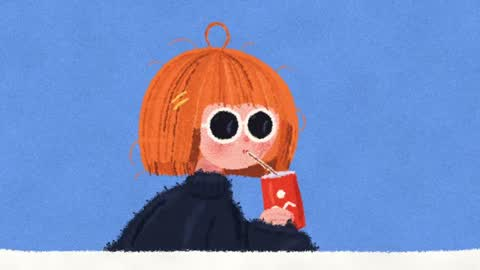](https://github.com/inematds/filme-em-codigo/releases/download/fonte-v1/wide_sip.mp4)  
[▶ Watch the video: wide_sip.mp4](https://github.com/inematds/filme-em-codigo/releases/download/fonte-v1/wide_sip.mp4)

*Chalky pastel character illustration*

### Fizz

A girl with an orange bob sips a soda, lets her sunglasses slip down her nose, and smiles.

**Same style, your idea**

```text
Make a 5 to 10 second 16:9 animated film about [YOUR IDEA HERE]. Render it as a chalky gouache and dry pastel illustration with no outlines: every shape is a flat matte fill with a soft, broken, stippled edge, covered in fine speckled pigment grain with occasional lighter and darker flecks. Describe form only with a few darker and lighter dry-brush strokes whose bristles skip and break. Fuzzy materials (knitwear, hair ends) get short fibres sticking out of the silhouette; cheeks get stippled blush and freckles. Palette: one flat cornflower-blue ground with a thin off-white strip at the bottom, plus saturated orange, tomato red, dark navy, warm pink skin, cream white and a single small yellow accent. Compose one simple, appealing character with big shapes and tiny features, off-centre in a wide frame with generous empty flat colour. Animate it like hand-drawn paper animation: poses on twos, held moments, one small charming piece of acting with anticipation and overlap (hair, cloth or accessories following through), and texture and stroke edges that boil gently every three frames as if redrawn. One held shot with at most a very slow push-in. No text, logos or words. Audio: a quiet, sunny lo-fi bed and small, soft sounds on each visible action.
```

**Copy this exact film · Exact prompt**

```text
A 5 second 16:9 hand-animated character vignette in soft chalky gouache and dry pastel with heavy speckled pigment grain and no outlines. Flat cornflower-blue background, a thin off-white strip along the bottom, lots of empty blue to the right. Left of centre, bust view, a girl facing three-quarters right: a big round orange bob with a blunt fringe, painted as a flat orange shape with darker and lighter dry-brush strands fanning from the crown, a ragged brown hem, thin flyaway strands, a wiry hair loop standing up on top and a small yellow clip. Round white-framed sunglasses with near-black lenses, rosy stippled cheeks, freckles, tiny red smile. Oversized dark navy roll-neck sweater with a fuzzy dry-brush edge. She holds a plain red can with a white dot-and-wave mark and a white straw. Action: she sips, cheek pulling in, drink rising up the straw, two small gulps; releases the straw and lowers the can; nods quickly so the sunglasses slip down her nose and two small dot eyes peek over the rims; blinks; then tilts her head with happy closed eyes and a bigger smile. Hair loop and flyaways bob with overlap. Animated on twos, with stroke edges and grain boiling every three frames. Very slow push-in. Audio: lazy electric-piano chords, soft bass, can fizz, straw slurp, a small "ahh", a plastic click as the glasses land, a tiny bell on the last smile.
```

[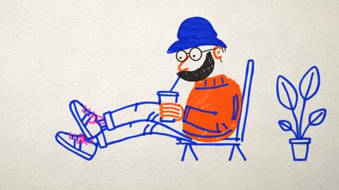](https://github.com/inematds/filme-em-codigo/releases/download/fonte-v1/wide_marker.mp4)  
[▶ Watch the video: wide_marker.mp4](https://github.com/inematds/filme-em-codigo/releases/download/fonte-v1/wide_marker.mp4)

*Marker line and neon crayon*

### Last Sip

A bearded man in a bucket hat lounges in a chair, sips his drink, bobs his foot and glances sideways.

**Same style, your idea**

```text
Make a 5 to 10 second 16:9 animated film about [YOUR IDEA HERE]. It must look like a hand drawing photographed on warm off-white cold-pressed paper with visible tooth and soft, uneven window light. Use exactly this kit: a thick cobalt-blue round-tip marker for all line work (confident, slightly wobbly, round ends, darker where strokes overlap, solid areas coloured in with visible marker laps); fluorescent orange wax crayon for one or two large fills, scribbled in a single diagonal direction with paper flecks showing through and no blue outline around the fill; small hot-pink marker accents; a few thin black pen details. Leave most of the subject and all of the background as bare paper. Simplified, charming, slightly naive proportions; one seated or lounging character and one or two simple props. Give the character a small, well-timed piece of acting with a secondary flop or settle. Animate on threes like real paper animation: every drawing is redrawn, so lines boil, the crayon scribble shifts, and the paper tooth changes with each drawing. Locked-off camera, no text. Audio: a quiet, lazy bed plus small sounds on each visible action.
```

**Copy this exact film · Exact prompt**

```text
Make a 5 second 16:9 animated film that looks like a hand drawing photographed on warm off-white cold-pressed paper with visible tooth and soft window light falling off towards the corners. Use only a thick cobalt-blue round-tip marker line (slightly wobbly, darker where strokes overlap), fluorescent orange wax crayon scribbled in one diagonal direction with paper flecks showing through, small hot-pink marker accents and a few thin black pen details. Subject: a bearded man in a solid-blue bucket hat and round black glasses with dot eyes, an orange crayon nose and ear, a scribbled black pen beard and an oversized orange roll-neck sweater with no outline, only blue fold lines. He lounges in a low blue-line chair, legs in baggy cuffed trousers stretched to the left, big sneakers with pink laces and bows, a blue-line potted plant on the right, and lots of bare paper. Action: he blinks, brings a lidded cup with a straw towards his face and leans in for two sips, lowers it, tips his head back and swallows, then his raised foot bobs twice with the pink bow flopping, and he blinks and glances sideways. Animate on threes with line boil, the crayon scribble and paper texture changing with every drawing. No text. Audio: a quiet, lazy electric-piano and bass bed with a straw slurp, a gulp, two soft foot taps and a tiny tick on the glance.
```

[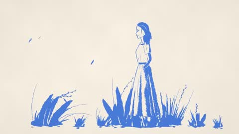](https://github.com/inematds/filme-em-codigo/releases/download/fonte-v1/wide_bluecrayon.mp4)  
[▶ Watch the video: wide_bluecrayon.mp4](https://github.com/inematds/filme-em-codigo/releases/download/fonte-v1/wide_bluecrayon.mp4)

*One-colour crayon print*

### Into the Wind

A woman stands in tall grass as a gust crosses the page, lifts her hair and skirt, and she closes her eyes into it.

**Same style, your idea**

```text
Make a 5 to 10 second 16:9 animated film about [YOUR IDEA HERE]. Style: a one-colour lithographic crayon drawing on warm cream paper, photographed frame by frame. Use a single cornflower-blue wax crayon and nothing else: no second colour, no grey tones, no black outlines, no gradients. Build every image from only two kinds of mark: solid blue shadow shapes with dry, grainy, broken edges and visible stroke direction where the crayon skips over the paper tooth, and a few thin, sensitive thick-and-thin contour lines for lit edges, faces and cloth folds. Everything in light is left as bare paper, including thin paper slivers inside the dark masses. Elegant, realistic-leaning proportions like fashion or editorial illustration. Compose wide, with most of the sheet empty. Held camera, no cuts. Animate on threes, with the crayon grain, strokes and contours re-drawn on every new drawing so they gently shimmer like hand-drawn animation on paper. One small, well-timed piece of acting plus natural secondary motion (hair, cloth, plants). No text. Sound: a quiet natural bed and small soft sounds on the visible actions.
```

**Copy this exact film · Exact prompt**

```text
Make a 5 second 16:9 hand-drawn animated film, 30 fps, animated on threes, that looks like a one-colour lithographic crayon drawing photographed frame by frame. Medium: a single cornflower-blue wax crayon on warm cream paper, no other colour, no grey, no outlines in black. The picture is built from two things only: solid blue shadow shapes with dry, grainy, broken edges and visible stroke direction where the crayon skips over paper tooth, and a few thin, sensitive thick-and-thin contour lines; all lit areas are bare paper. Wide composition with most of the sheet empty. Right of centre, a slender woman in profile facing left stands in tall grass: shoulder-length dark hair as one solid blue mass, loose short-sleeved blouse drawn only in line, dark sash, long full skirt with long blue fold-shadow wedges, one hand in her pocket. Around her feet, fans of broad pointed leaves and spiky grass in solid blue with thin seed-head stems; a second stand of grass far left, small tufts between. Action: she stands still and blinks; a gust arrives from the left, the grass bends in a wave that travels across the frame, small leaves blow across the empty paper; her skirt presses to her legs and billows behind, hair and sash stream back; she lifts her face into the wind, breathes in and closes her eyes; everything settles. Held camera. Crayon texture and contours re-drawn every third frame so they shimmer. Sound: soft wind passing left to right, grass hiss, cloth flaps, four soft piano notes.
```

[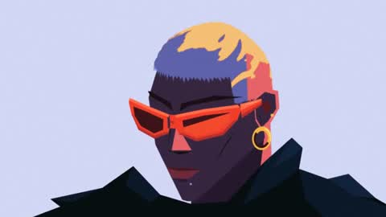](https://github.com/inematds/filme-em-codigo/releases/download/fonte-v1/wide_shades.mp4)  
[▶ Watch the video: wide_shades.mp4](https://github.com/inematds/filme-em-codigo/releases/download/fonte-v1/wide_shades.mp4)

*Flat-shadow anime portrait*

### Shades

A character in red sunglasses lifts and turns their head as hard light sweeps across, re-cutting the flat shadow shapes.

**Same style, your idea**

```text
Make a 5 to 10 second 16:9 animated film about [YOUR IDEA HERE]. Style: bold flat-colour anime fashion illustration made only of hard-edged flat shapes with crisp anti-aliased edges, no outlines and no gradients. Empty pale lavender background, deep plum and near-black shadow masses, one or two saturated accents (red, gold), violet shadow and warm yellow light on hair with a ragged flame-like terminator of pointed tongues and droplets, coral for lit skin as a few precise angular facets and a straight rim strip. Angular, confident, simplified drawing with few shapes. Hard directional light that moves during the shot so the shadow shapes re-cut consistently across the forms (derive them from a hidden simple 3D form, render flat). Small, well-timed character acting with anticipation and settle, secondary motion on jewellery and cloth, a travelling glint on glossy surfaces. Character animated on twos, slow camera push on ones, faint film grain and very slight softness over everything. Quiet moody pad with small sounds on the visible actions.
```

**Copy this exact film · Exact prompt**

```text
Make a 5 second 16:9 animated film, 30 fps, in a bold flat-colour anime fashion-illustration style: only hard-edged flat shapes with crisp anti-aliased edges, no outlines, no gradients, on an empty pale lavender background (#d0d5f3). Wide close-up of an original character: cropped textured hair, sharp angular red wraparound sunglasses with dark maroon lenses split by a bright red reflection, heavy black wedge eyebrows, wine-coloured lips, a gold hoop earring, a high near-black coat collar with a few dark navy planes. Skin is deep plum shadow; lit skin is coral; hair shadow is violet (#5c60a9); lit hair is warm yellow (#f3bd72) with a ragged flame-like terminator of pointed tongues and droplets and a thin orange fringe. Start head-down in three-quarter view, lit from behind: yellow cap on the hair, a straight coral rim strip down the back of the head and neck, one coral triangle on the nose. After a tiny anticipation dip the head lifts and turns toward camera (about 1.0 to 2.6 s) while the light sweeps overhead to the front: the rim strip narrows away, the yellow re-cuts across the hair, an angular coral plane opens down the far side of the face. A two-bar pale glint crosses the sunglasses at 2.6 to 3.2 s, the hoop swings and settles, the collar shifts with follow-through, and at 3.9 s one eyebrow lifts with a half smile. Character on twos, slow camera push on ones, faint film grain, very slight softness. Quiet cool pad, cloth rustle, gold tinkles, a glassy ping on the glint.
```

[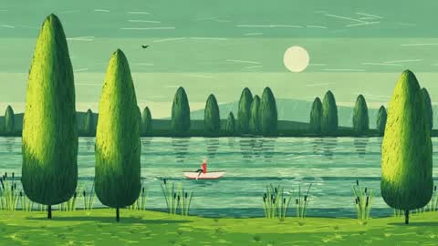](https://github.com/inematds/filme-em-codigo/releases/download/fonte-v1/wide_trees2.mp4)  
[▶ Watch the video: wide_trees2.mp4](https://github.com/inematds/filme-em-codigo/releases/download/fonte-v1/wide_trees2.mp4)

*Gouache and hatched brush, reused engine*

### Slow River

A second film made with the engine from The Avenue: a rower pulls a small boat across a river between tall hatched poplars.

**Same style, your idea**

```text
Make a 5 to 10 second 16:9 animated film about [YOUR IDEA HERE]. Style: a contemporary gouache and coloured-pencil illustration built almost entirely from fine hatching, honestly flat, like a scanned hand-made picture that moves. Use extreme scale contrast: huge simple forms fill nearly the whole frame, ranked in depth, and tiny figures act in a thin strip at the bottom. Keep everything in one colour family, from a luminous light tone through a mid tone to deep, near-black shadow, with the only other colours as tiny accents on the figures. Every large form is a crisp flat silhouette with no outline, and its volume is drawn only by thousands of short, slightly curved strokes that follow the form like brushed fur: light strokes on the lit side, dark on the shadow side, densest and darkest at the base. Depth comes from tone: near forms saturated and contrasted, far ones flatter and bluer, deep shadow in the gaps. The ground is flat horizontal bands of light and shade with long shadows lying across it. Matte paint, fine paper grain, no gradients except those made by stroke density. Animate it as a moving illustration: hatching redraws on threes so it shimmers, a slow wind sends waves through the strokes, bands of sun and cloud shadow drift across the scene, the figures act on twos, and the camera makes a slow multiplane pan with clear parallax, then a gentle tilt to reveal the full scale. End on the figures small at the edge of frame as light reaches them. No text, no narration; soft natural ambience, a few sound effects on visible events, and a gentle plucked or piano phrase.
```

**Copy this exact film · Exact prompt**

```text
A 5 second, 30 fps, 16:9 flat gouache and coloured-pencil animation of a riverbank, locked off with a barely perceptible drift right and push in. Left: two tall flame-shaped poplars, right: a third, each a flat dark green silhouette covered in short directional pencil hatching, lit yellow-green from the left, deep green in shadow. Foreground: a bright lawn-green bank with cattail reeds swaying. Middle: a river of flat horizontal teal and pale green bands with loose white pencil ripples that re-draw every third frame. A small cream rowing boat with a red stripe, one rower in a red shirt and straw boater, glides slowly left to right. Far bank: a row of small teal poplars with broken reflections, pale hills, banded green sky, a cream sun, two dark birds crossing. Cold-pressed paper grain, limited green, teal, cream and red palette.
```

[](https://github.com/inematds/filme-em-codigo/releases/download/fonte-v1/wide_redhair2.mp4)  
[▶ Watch the video: wide_redhair2.mp4](https://github.com/inematds/filme-em-codigo/releases/download/fonte-v1/wide_redhair2.mp4)

*Illustrated character portrait, reused engine*

### Afternoon Light, by the sea

The red-haired character with the same acting, moved to a sunlit seaside promenade.

**Same style, your idea**

```text
Make a 5 to 10 second 16:9 animated film about [YOUR IDEA HERE]. Bring one supplied still illustration to life as an image puppet, without redrawing it: a single full-screen shader samples the picture with bicubic filtering through small, softly masked displacement fields, so everything that is not moving stays exactly as drawn. Lift loose hair off the background as a colour-keyed layer over a painted-out plate and sway it with a travelling breeze, none at the roots and most at the tips. Swing jewellery as small pendulums about their hooks over painted-out patches. Blink by sliding the drawn lash line down a painted lid between lid curves traced from the image. Glance by sliding iris and pupil along those curves. Brows and smile are tiny local warps. Add soft moving leaf dapple and a slow warm sun drift on the background only, never on skin. Two shots: a wide of the whole picture with a very slow push, then a hard cut to an enlarged close-up for the glance, blink and smile. Very light grain; quiet bed of warm air, breeze, leaves and two piano notes on the smile.
```

**Copy this exact film · Exact prompt**

```text
Flat illustrated style, clean shapes, soft warm afternoon sun from the right, slight paper grain. A young woman with long wavy red hair, gold coin drop earrings and a red sundress with white polka dots stands, arms behind her back, in front of a low whitewashed sea wall on a seaside promenade. Behind her: calm turquoise sea with a few glints, a hazy far headland on the right, pale blue sky warming to cream at the horizon, two small soft clouds, a bougainvillea branch with magenta bracts swaying in from the top right. Wide shot: her hair sways in the breeze, earrings swing, she blinks and glances aside. Hard cut to a close-up of her face: she looks back to camera, blinks, then raises her brows and smiles gently. Sea wash, distant gulls, two soft piano notes.
```

[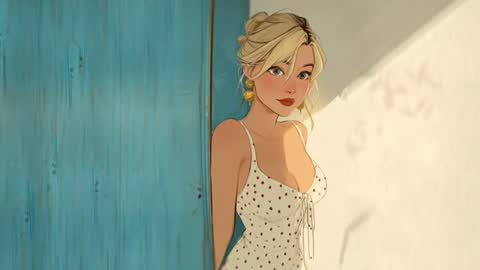](https://github.com/inematds/filme-em-codigo/releases/download/fonte-v1/wide_sundress.mp4)  
[▶ Watch the video: wide_sundress.mp4](https://github.com/inematds/filme-em-codigo/releases/download/fonte-v1/wide_sundress.mp4)

*Illustrated character portrait*

### Afternoon Light

A still illustration brought to life in code. In the wide shot she blinks as her hair and gold earrings sway in the late sun, then a cut to a close-up as she glances to camera, lifts her brows, blinks and smiles. Six seconds, made by Fable 5.2.
