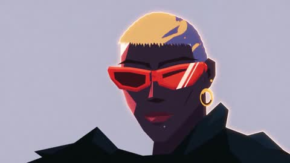
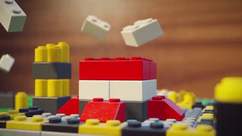
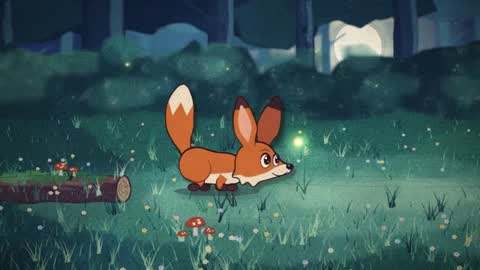
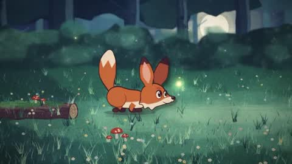
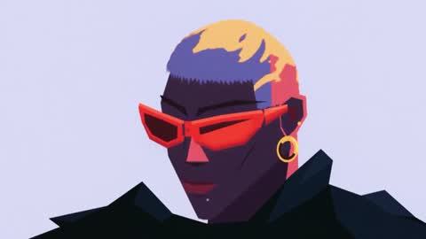

<!-- Anexo da fonte (filme-em-codigo). Texto original em inglês, completo; só foi tirado o ruído da página (botões "Copy", menu de navegação). Tradução: ../biblioteca-pt/03-seedance.md. Crédito e licença: ../LEIA.md. -->

[← index](../biblioteca-original.md) · [português](../biblioteca-pt/03-seedance.md) · [credit and licence](../LEIA.md)

## Make it richer with Seedance 2.5

Use a finished code film as the reference video and ask an AI video model to add detail while keeping the shot. In Claude, connect Higgsfield (its connector lets Claude call the video models from the chat), start a new chat, attach your MP4, paste a prompt below and fill in the brackets. Set the model and resolution, and match the length to your film. Start with the short prompt: it gave the clearest change.

*Enhance prompt*

### Same shot, more detail and animation

**Prompt**

```text
Settings: [MODEL, for example Seedance 2.5], [RESOLUTION, for example 1080p or 4K], [LENGTH: the same as the reference video, in seconds].

Use the attached reference video as the locked blueprint for this shot, and re-render it as a far richer, more detailed and more fluidly animated version of the same film.

KEEP EXACTLY THE SAME:
- Composition and framing: every element stays where it is in the frame.
- Camera: the same camera position, the same move and the same speed.
- Action and timing: the same events in the same order at the same moments, and the same cuts.
- Style: the same medium, colour palette, character designs and overall look. This is [STYLE, for example: a toy-brick stop-motion film / a hand-drawn cel animation / a gouache illustration]. Do not change it to another style and do not make it photorealistic.

ENHANCE STRONGLY:
- Detail: add much more fine detail everywhere. Richer surface texture and material on every object, intricate background detail, more depth layers, small props and natural variation where the reference is flat or plain.
- Animation: make all motion much smoother and more fluid, with full in-between frames and no stutter or held poses. Add natural weight, anticipation, overlap and follow-through, so characters and objects move in a realistic, physically believable and dynamic way.
- Secondary motion: hair, cloth, leaves, water, dust and small objects react to the main action and to the air.
- Effects: add much more atmosphere and many more effects. [EFFECTS, for example: volumetric light rays, drifting dust and pollen, glowing embers, smoke with real turbulence, sparks, reflections, soft bloom, depth of field].
- Lighting: richer, more dimensional light with soft shadows, bounce light and highlights that respond to the movement.

WHAT HAPPENS, in order: [DESCRIBE THE ACTION OF THE REFERENCE VIDEO IN TWO OR THREE SENTENCES].

The result should look like the high-budget finished version of the reference: the same shot, far more detailed, far more alive. No text, no logos, no new characters, no new camera angles.
```

[](https://github.com/inematds/filme-em-codigo/releases/download/fonte-v1/seedance_shades_grain.mp4)  
[▶ Watch the video: seedance_shades_grain.mp4](https://github.com/inematds/filme-em-codigo/releases/download/fonte-v1/seedance_shades_grain.mp4)

*Short prompt, used in the video*

### Shades, smoother and grainier

The anime portrait from the video, re-rendered by Seedance 2.5 from the code film. A short prompt that asks for a clearly different look gave smoother motion, film grain, rim light and painterly shading, while the character, pose, timing and framing stayed the same. 1080p, 5 seconds.

**Prompt**

```text
Using the Higgsfield connector, re-render the attached video with [MODEL, for example Seedance 2.5] at [RESOLUTION, for example 1080p or 4K], [LENGTH: the same as my video, for example 5] seconds, using my video as the reference.

Re-render this shot with clearly smoother, more fluid motion and a cinematic filmic look: visible organic film grain, soft painterly shading and rim light on the face, subtle depth and texture instead of flat vector fills. Keep the same character, pose, timing and framing.
```

[](https://github.com/inematds/filme-em-codigo/releases/download/fonte-v1/wide_bricks.mp4)  
[▶ Watch the video: wide_bricks.mp4](https://github.com/inematds/filme-em-codigo/releases/download/fonte-v1/wide_bricks.mp4)

*Code*

[](https://github.com/inematds/filme-em-codigo/releases/download/fonte-v1/sd_bricks.mp4)  
[▶ Watch the video: sd_bricks.mp4](https://github.com/inematds/filme-em-codigo/releases/download/fonte-v1/sd_bricks.mp4)

*Seedance 2.5*

### Liftoff on the Baseplate

Seedance 2.5 kept every shot, the timing and the camera move. It made the plastic, the light and the smoke look more like a real tabletop shoot, and it swapped our brick-built sky wall for a wooden wall. The change is modest, not dramatic. Cost: 160 credits for 10 seconds at 1080p, one take.

**Prompt used**

```text
Use the reference video as the exact blueprint: keep the same shots, timing, camera moves, composition and every action. Re-render it as a real, high-budget tabletop stop-motion film shot on a macro lens: glossy injection-moulded plastic toy bricks with fine scratches, dust and fingerprints, a real studded green baseplate on a wooden table, soft warm studio key light with real contact shadows, shallow depth of field with creamy bokeh. Loose bricks hop and click into place to build the red-and-white rocket and yellow striped gantry, the little blocky figure pushes the lever, the signal lamp turns green, and the rocket lifts off on glowing translucent plastic flame pieces with a billowing column of white and grey brick smoke, sparks and drifting dust motes. Rich detail, cinematic lighting, subtle lens breathing, 12 frames per second stop-motion cadence. No logos, no text.
```

[](https://github.com/inematds/filme-em-codigo/releases/download/fonte-v1/wide_cel.mp4)  
[▶ Watch the video: wide_cel.mp4](https://github.com/inematds/filme-em-codigo/releases/download/fonte-v1/wide_cel.mp4)

*Code*

[](https://github.com/inematds/filme-em-codigo/releases/download/fonte-v1/sd_cel.mp4)  
[▶ Watch the video: sd_cel.mp4](https://github.com/inematds/filme-em-codigo/releases/download/fonte-v1/sd_cel.mp4)

*Seedance 2.5*

### Firefly Glade

Seedance 2.5 kept the fox cub's whole performance and the camera pull-back. The backgrounds are a little softer and richer and the firefly glow is fuller, but the picture stays very close to the code film. Cost: 160 credits for 10 seconds at 1080p, one take.

**Prompt used**

```text
Use the reference video as the exact blueprint: keep the same shot, timing, camera move, composition and every action of the fox cub. Re-render it as lavish classic hand-drawn feature animation: richly painted watercolour and gouache forest backgrounds with deep layered trees, mist, moonbeams through the canopy, dewy grass, wildflowers, a reflective pond and mossy logs; the fox cub as a beautifully inked and painted original character with expressive eyes, soft fur detail, squash and stretch and follow-through on ears and tail. He stalks a firefly, wiggles, pounces and lands flat with dust puffs, tumbles, sits up dizzy, sneezes, and the sneeze lifts hundreds of glowing fireflies in a wave that lights the whole glade and reflects in the pond; a firefly lands on his nose as the camera pulls back. Volumetric glow, floating pollen, gentle film grain, multiplane depth. No text.
```

[](https://github.com/inematds/filme-em-codigo/releases/download/fonte-v1/wide_shades.mp4)  
[▶ Watch the video: wide_shades.mp4](https://github.com/inematds/filme-em-codigo/releases/download/fonte-v1/wide_shades.mp4)

*Code*

[](https://github.com/inematds/filme-em-codigo/releases/download/fonte-v1/sd_shades.mp4)  
[▶ Watch the video: sd_shades.mp4](https://github.com/inematds/filme-em-codigo/releases/download/fonte-v1/sd_shades.mp4)

*Seedance 2.5*

### Shades, with the long enhance prompt

This run used the enhance prompt above, with separate keep and enhance lists. Seedance 2.5 still returned an almost exact copy of the code film: the same flat shapes, with no visible extra detail or effects in the frames checked. With a video reference, the model follows the reference far more than the words. The short prompt in the first card of this section gave the clearer change. Cost: 80 credits for 5 seconds at 1080p, one take.

**Prompt used**

```text
The enhance prompt above, with the style set to a bold flat-colour anime fashion illustration and the effects set to a glint on the sunglasses, rim light, bloom, dust motes and film grain.
```
