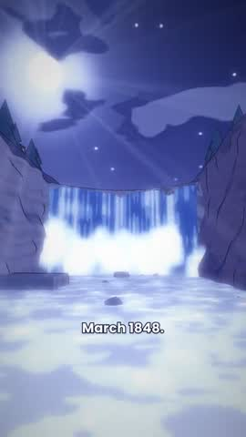
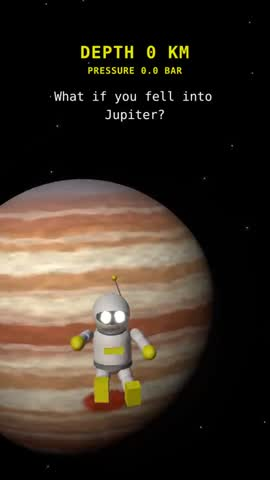
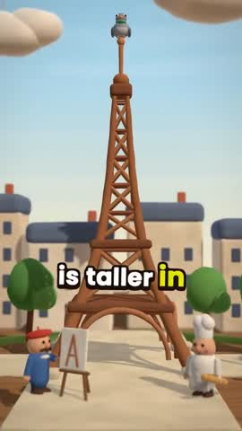
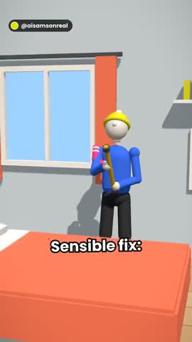
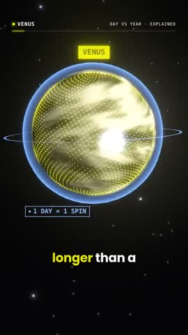
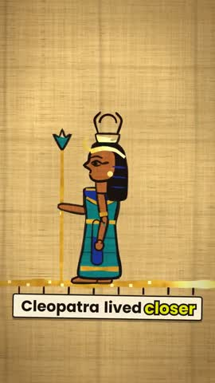
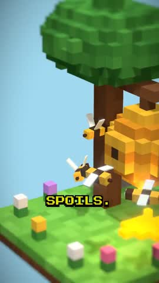
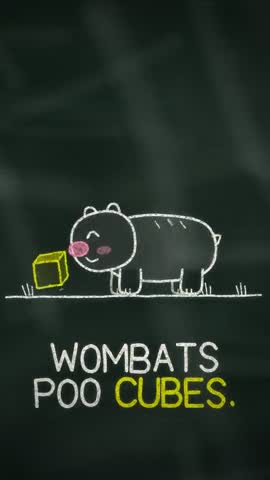
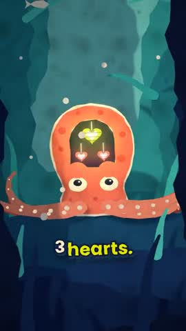
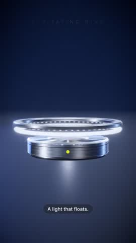

<!-- Anexo da fonte (filme-em-codigo). Texto original em inglês, completo; só foi tirado o ruído da página (botões "Copy", menu de navegação). Tradução: ../biblioteca-pt/04-shorts.md. Crédito e licença: ../LEIA.md. -->

[← index](../biblioteca-original.md) · [português](../biblioteca-pt/04-shorts.md) · [credit and licence](../LEIA.md)

## Vertical shorts

[](https://github.com/inematds/filme-em-codigo/releases/download/fonte-v1/x4_niagara_kokoro.mp4)  
[▶ Watch the video: x4_niagara_kokoro.mp4](https://github.com/inematds/filme-em-codigo/releases/download/fonte-v1/x4_niagara_kokoro.mp4)

*Code-drawn anime film*

### The Night Niagara Falls Stopped

**Same style, your idea**

```text
Make a 10 to 20 second vertical animated short about [YOUR IDEA HERE]. Build it entirely in code with three.js, no image or video model, and make the 3D read as hand-drawn 2D anime: cel shading with exactly two hard tones per surface, a slightly wobbly brushed shadow edge, cool blue-violet shadows, and navy ink outlines (inverted hull on characters and props, a depth edge pass on scenery). Paint skies and backgrounds in shaders with gradients and noise: banded gradient, two-tone clouds, layered hazy ridges. Add depth haze, screen-space light shafts from the sun or moon, soft bloom on light sources, a gentle vignette and fine grain. Animate characters on twos and water, mist or smoke on threes, with cameras moving smoothly on ones. Use original chibi-proportioned characters with one warm accent colour against a cool scene, and give one of them a small warm light that casts a hard-edged glow. Use at least five shots with designed transitions (whip pan with smear, a shape wipe made from something in the story, a match cut on a glowing object, a flash cut), real acting in every shot (anticipation, squash, overshoot, hair and scarf follow-through), and a final wide shot that lands the last line. Narration by a calm storyteller voice, 40 to 55 words. Captions: one clean white line with a thin dark outline in the lower third. Sound: soft pad and music-box melody with sound effects on the key words.
```

**Copy this exact film · Exact prompt**

```text
Make a 21 second vertical (1080x1920, 30 fps) pure-code anime short in three.js: cel shading with two hard tones and cool violet shadows, navy ink outlines, painted shader skies, haze, light shafts, soft bloom, fine grain. Characters animate on twos, water and mist on threes. Calm British male narrator, word for word: "March, eighteen forty-eight. One night, Niagara Falls went silent. Wind had jammed Lake Erie's ice into the river's mouth. By morning, people walked out onto the bare riverbed. They found old muskets and bayonets in the mud. For over a day, the falls only dripped. Then the ice broke, and the roar came home." Shot 1: moonlit horseshoe falls in a pine gorge, the water thins to strands and stops, whip pan up. Shot 2: aerial painted map, white ice floes blown down the lake slam into the river mouth, the river below drains; ice-shard wipe. Shot 3: dawn, a small girl in a red coat and yellow scarf with a lantern hops off a rock and walks the muddy riverbed behind her tan dog, push in on the lantern. Shot 4: match cut from the lantern, the dog digs and tugs a musket out of the mud, she recoils, a bayonet glints. Shot 5: low angle of both on a boulder under the dripping cliff as the sky runs dawn, day, dusk, night. Shot 6: night, the ice jam bursts toward camera with a white flash; water wipe to the girl raising her lantern as the falls pour back. White subtitle line with thin dark outline, lower third. Soft pad and music box, roar that dies and returns.
```

[](https://github.com/inematds/filme-em-codigo/releases/download/fonte-v1/x4_jupiter_kokoro.mp4)  
[▶ Watch the video: x4_jupiter_kokoro.mp4](https://github.com/inematds/filme-em-codigo/releases/download/fonte-v1/x4_jupiter_kokoro.mp4)

*What-if 3D character*

### What If You Fell Into Jupiter?

**Same style, your idea**

```text
Make a 10 to 20 second vertical animated short about [YOUR IDEA HERE]. Build it entirely in code with Remotion and three.js at 1080x1920 and 30 fps, with no image or video model. Use at least five shots with designed transitions, real acting in every shot, and time each visual beat to the word that names it. Add neural TTS narration, burned-in captions, and synthesized music about 20 dB under the voice with sound effects on the key words. Use the faceless "what if" format: one big question, one simple original 3D character who really acts, and a journey that escalates through at least five very different environments made with shader skies, fog and particles. Put a ticking yellow (#E3E302) monospace counter at the top with one main reading and one smaller reading, and make it jump with every beat. Show one short typewriter caption per beat in white monospace on a black bar. End on a shot nobody predicts that lands the last line.
```

**Copy this exact film · Exact prompt**

```text
Make a 22 second vertical "what if" short. Build it entirely in code with Remotion and three.js at 1080x1920 and 30 fps, with no image or video model. Use at least five shots with designed transitions, real acting in every shot, and time each visual beat to the word that names it. Add neural TTS narration, burned-in captions, and synthesized music about 20 dB under the voice with sound effects on the key words. Narration, word for word: "What if you fell into Jupiter? You hit the sky at a hundred and seventy thousand kilometres an hour. Ammonia clouds. Winds over five hundred kilometres an hour. A hundred and fifty kilometres down: twenty-three times Earth's pressure, and oven hot. There is no ground. The gas just thickens into liquid. You never land. You become Jupiter." Follow one small original robot astronaut with glowing eyes and an antenna. Shot 1: he floats and waves in front of banded Jupiter. Shot 2: he hits the atmosphere inside an orange entry fireball with speed streaks. Shot 3: he tumbles through pale ammonia cloud with wind lines. Shot 4: the sky turns brown and dark, debris streaks past, he is squeezed and strains. Shot 5: grey murk with no ground in sight. Shot 6: he dissolves into a shower of yellow sparks that drift down and join the planet. At the top, a yellow (#E3E302) monospace counter reads DEPTH in km and a smaller PRESSURE in bar, jumping on every beat and ending "off scale". Captions: one typewriter line in white monospace on a black bar under the counter.
```

[](https://github.com/inematds/filme-em-codigo/releases/download/fonte-v1/x4_eiffel_kokoro.mp4)  
[▶ Watch the video: x4_eiffel_kokoro.mp4](https://github.com/inematds/filme-em-codigo/releases/download/fonte-v1/x4_eiffel_kokoro.mp4)

*Claymation diorama*

### The Eiffel Tower Is Taller in Summer

**Same style, your idea**

```text
Make a 10 to 20 second vertical animated short about [YOUR IDEA HERE]. Build it entirely in code with Remotion and three.js at 1080x1920 and 30 fps, with no image or video model. Use at least five shots with designed transitions, real acting in every shot, and time each visual beat to the word that names it. Add neural TTS narration, burned-in captions, and synthesized music about 20 dB under the voice with sound effects on the key words. Make it a stop-motion claymation diorama on a tabletop set. Model everything as soft, slightly lumpy clay by displacing vertices with noise, add a fingerprint-like bump in the shading, and use matte materials, warm practical lighting, soft shadows and shallow depth of field. Animate on twos with a little per-pose jitter so surfaces boil. Give the main object a face or a clear personality, add two or three small original clay characters who react, and show any number with a physical clay prop such as a ruler. Captions: chunky rounded white letters with a dark outline, two or three words at a time, the spoken word in yellow (#E3E302).
```

**Copy this exact film · Exact prompt**

```text
Make a 19 second vertical stop-motion claymation short. Build it entirely in code with Remotion and three.js at 1080x1920 and 30 fps, with no image or video model. Use at least five shots with designed transitions, real acting in every shot, and time each visual beat to the word that names it. Add neural TTS narration, burned-in captions, and synthesized music about 20 dB under the voice with sound effects on the key words. Narration, word for word: "The Eiffel Tower is taller in summer. Its iron swells in the heat, so the whole tower stretches. From deepest winter to hottest summer, estimates say up to fifteen centimetres. The sunny side grows more, so the top leans away from the sun. When it cools down, it shrinks right back. Only the pigeon notices." Everything looks hand-made from modelling clay on a tabletop Paris set: lumpy rounded shapes, matte materials, warm light, soft shadows, shallow depth of field, motion on twos with a little surface jitter. Shot 1: a brown clay Eiffel Tower in a square with a painter at an easel, a baker and a pigeon on the tip. Shot 2: a clay sun with a face leans in and the tower stretches. Shot 3: a yellow clay ruler beside the tip, with the pigeon rising from 0 to 15 cm. Shot 4: the top bends away from the sun while the sun looks surprised. Shot 5: evening, the tower shrinks back and the sun smiles. Shot 6: night close-up of the pigeon looking around. Captions: chunky rounded white letters with a dark outline, two or three words at a time, the spoken word in yellow (#E3E302).
```

[](https://github.com/inematds/filme-em-codigo/releases/download/fonte-v1/x4_sock_kokoro.mp4)  
[▶ Watch the video: x4_sock_kokoro.mp4](https://github.com/inematds/filme-em-codigo/releases/download/fonte-v1/x4_sock_kokoro.mp4)

*Unnecessary engineering comedy*

### The Sock Finder Nobody Needed

**Same style, your idea**

```text
Make a 10 to 20 second vertical animated short about [YOUR IDEA HERE]. Build it entirely in code with Remotion and three.js at 1080x1920 and 30 fps, with no image or video model. Use at least five shots with designed transitions, real acting in every shot, and time each visual beat to the word that names it. Add neural TTS narration, burned-in captions, and synthesized music about 20 dB under the voice with sound effects on the key words. Use the "unnecessary engineering" comedy format: an everyday problem, then four fixes that escalate from sensible to absurd, then a punchline that makes all of it pointless. Bright, clean low-poly 3D set with a faceless mannequin who does real comic acting (double takes, slumps, a victory pose). Build each contraption from yellow metal tubing and grey clamps, assembling piece by piece with snappy overshoot, and whip the camera between gags. White heavy captions with a thick black outline, two or three words at a time, and a small handle pill in the top-left.
```

**Copy this exact film · Exact prompt**

```text
Make a 17 second vertical "unnecessary engineering" comedy short. Build it entirely in code with Remotion and three.js at 1080x1920 and 30 fps, with no image or video model. Use at least five shots with designed transitions, real acting in every shot, and time each visual beat to the word that names it. Add neural TTS narration, burned-in captions, and synthesized music about 20 dB under the voice with sound effects on the key words. Narration, deadpan, word for word: "You've lost one sock. Sensible fix: a magnet on a string. Socks aren't magnetic. So, a sock-sniffing robot dog. It just stares at you. Useless. So, a conveyor through the whole house. Still nothing. Fine. Launch the satellite. Sock located. It was on your foot the whole time." Bright low-poly 3D bedroom with a coral bed, grey walls, a window and a plant. A faceless white mannequin in a blue jumper, black trousers and a yellow beanie wears one pink striped sock. Shot 1: he shrugs at the camera. Shot 2: a red magnet on a string dangles over the floor and finds nothing. Shot 3: a robot dog built from yellow tubing and grey clamps sniffs, then just stares at him. Shot 4: a conveyor of yellow tubing runs through the room carrying a cactus and a big red button. Shot 5: he slams the button and looks up. Shot 6: a pink targeting ring from the satellite lands on his own foot, and he slumps. White heavy captions with a thick black outline, two or three words at a time, and a small @aisamsonreal pill in the top-left.
```

[](https://github.com/inematds/filme-em-codigo/releases/download/fonte-v1/x4_venus_kokoro.mp4)  
[▶ Watch the video: x4_venus_kokoro.mp4](https://github.com/inematds/filme-em-codigo/releases/download/fonte-v1/x4_venus_kokoro.mp4)

*Glowing 3D explainer*

### On Venus, a Day Is Longer Than a Year

**Same style, your idea**

```text
Make a 10 to 20 second vertical animated short about [YOUR IDEA HERE]. Build it entirely in code with Remotion and three.js at 1080x1920 and 30 fps, with no image or video model. Use at least five shots with designed transitions, real acting in every shot, and time each visual beat to the word that names it. Add neural TTS narration, burned-in captions, and synthesized music about 20 dB under the voice with sound effects on the key words. Make it a dark glowing 3D explainer: near-black space, glowing yellow (#E3E302) line work, blue rim light, objects drawn as dotted particles with shader detail, and soft bloom. Turn the key comparison into a race the viewer can read at a glance, with two markers and two big glowing counters running side by side. Pop a mono uppercase label chip on each word it names, keep a thin top bar with a progress line, and show centred bold captions with the spoken word in yellow. End on a view from the ground, then a direct question to the viewer as a big title.
```

**Copy this exact film · Exact prompt**

```text
Make a 20 second vertical dark glowing explainer. Build it entirely in code with Remotion and three.js at 1080x1920 and 30 fps, with no image or video model. Use at least five shots with designed transitions, real acting in every shot, and time each visual beat to the word that names it. Add neural TTS narration, burned-in captions, and synthesized music about 20 dB under the voice with sound effects on the key words. Narration, word for word: "On Venus, a day is longer than a year. One spin takes two hundred and forty three Earth days. One lap of the Sun? Just two hundred and twenty five. The year wins. It's the hottest planet: hot enough to melt lead. And it spins backwards, so the Sun rises in the west. Would you wait for that sunrise?" Near-black space with stars, glowing yellow (#E3E302) line work and blue rim light, a thin top bar with a progress line. Shot 1: a dotted-particle Venus with swirling cloud and a VENUS label chip. Shot 2: a marker crawls round the planet's spin while a blue counter runs to 243 Earth days. Shot 3: pull back to the Sun and a glowing orbit arc; a second marker races round it while two counters, YEAR and DAY, run side by side and the year finishes first at 225. Shot 4: a small rover on the surface beside a block of lead that slumps and melts, with HOTTEST PLANET and LEAD chips. Shot 5: the planet spins backwards. Shot 6: from the surface, the Sun rises over black mountains with a WEST chip, then the question appears as a big title. Centred bold captions with the spoken word in yellow.
```

[](https://github.com/inematds/filme-em-codigo/releases/download/fonte-v1/x4_cleopatra_kokoro.mp4)  
[▶ Watch the video: x4_cleopatra_kokoro.mp4](https://github.com/inematds/filme-em-codigo/releases/download/fonte-v1/x4_cleopatra_kokoro.mp4)

*Ink and gold papyrus scroll*

### Cleopatra Was Closer to the Moon Landing

**Same style, your idea**

```text
Make a 10 to 20 second vertical animated short about [YOUR IDEA HERE]. Build it entirely in code with three.js through @remotion/three, 1080x1920 at 30 fps, styled as an ink and gold papyrus scroll. The background is a warm procedural papyrus surface (crossed fibres, strip seams, flecks and grain in a shader) that a roller unrolls in the first second and that the camera then travels along. Draw everything as geometry: black brush lines as tapered, slightly wobbling ribbons that draw on along their length with a dry-brush edge, and flat ochre, teal, lapis and cream fills that paint in behind the lines with visible alternating brush wipes. Use gold leaf for the one thing that carries the idea (a timeline, a path, a measurement): patchy leaf tone, a travelling glint, and a bright star riding the tip as it draws. Design original profile figures in an ancient Egyptian wall-painting manner and make them act: turns with squash, pointing, anticipation before effort, overshoot on landings, small secondary motion. Use at least five shots joined by whip pans along the scroll, and one wide shot where the scroll rolls 90 degrees so the whole diagram fills the tall frame, with big gold numerals outlined in dark ink for any numbers. End on one quiet, symbolic image that lands the last line. Captions: bold dark lettering on a cream strip with an ink border, the spoken word highlighted in #E3E302 with a dark outline. Music: plucked oud-like line over a drone and soft frame drum, with paper, brush and chime effects on the key words. Verify every fact first and keep all numbers to scale.
```

**Copy this exact film · Exact prompt**

```text
Make a 21 second vertical animated short (1080x1920, 30 fps) built entirely in code with three.js through @remotion/three, styled as an ink and gold papyrus scroll. A procedural papyrus shader (crossed fibres, seams, grain) is unrolled by a roller. A gold-leaf timeline with century ticks draws on with a glinting star at its tip. Art is black brush-line ribbons that draw on, with flat ochre, teal and lapis fills that paint in with visible brush wipes. Shot 1: an original Egyptian queen in profile with a staff turns right and points as a gold crescent appears, then turns left as a small pyramid appears. Shot 2: whip pan left to three builders hauling a block on a sledge toward a pyramid that paints up course by course under a gold sun, stamp "2560 BC". Shot 3: travel right as a gold bracket draws and a numeral counts to 2,530 YEARS, arriving at the queen, label "30 BC". Shot 4: travel right, counter to 1,998 YEARS, a small lander descends into a lapis night sky, squashes on touchdown with dust puffs, label "1969". Shot 5: the scroll rolls 90 degrees to show the whole timeline vertical with both brackets and big gold numerals 2,530 and 1,998. Shot 6: push in on the queen shading her eyes, whip to a ribbed footprint beside a pyramid-shaped shadow. Captions: bold dark lettering on a cream strip, spoken word in #E3E302 with a dark outline. Warm female narrator: "Cleopatra lived closer to the Moon landing than to the building of the Great Pyramid. It was finished around 2560 BC. Cleopatra died in 30 BC, 2,530 years later. The Moon landing came in 1969, only 1,998 years after her. To her, the pyramids were ancient history."
```

[](https://github.com/inematds/filme-em-codigo/releases/download/fonte-v1/x4_honey_kokoro.mp4)  
[▶ Watch the video: x4_honey_kokoro.mp4](https://github.com/inematds/filme-em-codigo/releases/download/fonte-v1/x4_honey_kokoro.mp4)

*Voxel diorama*

### Honey Almost Never Spoils

**Same style, your idea**

```text
Make a 10 to 20 second vertical animated short about [YOUR IDEA HERE]. Build it entirely in code with Remotion and three.js at 1080x1920 and 30 fps, with no image or video model. Use at least five shots with designed transitions, real acting in every shot, and time each visual beat to the word that names it. Add neural TTS narration, burned-in captions, and synthesized music about 20 dB under the voice with sound effects on the key words. Make it a voxel diorama: every object is built from chunky cubes (InstancedMesh) on floating square bases, seen from a three-quarter isometric camera that orbits and dives between sets. Things assemble and come apart cube by cube with bouncy timing, liquids flow as falling glowing cubes, and small cube characters with simple faces react. Add warm bloom on anything that glows, soft shading in the corners and tilt-shift blur at the top and bottom. Captions: chunky pixel-style white capitals with a black outline, the spoken word in yellow (#E3E302).
```

**Copy this exact film · Exact prompt**

```text
Make a 20 second vertical voxel diorama short. Build it entirely in code with Remotion and three.js at 1080x1920 and 30 fps, with no image or video model. Use at least five shots with designed transitions, real acting in every shot, and time each visual beat to the word that names it. Add neural TTS narration, burned-in captions, and synthesized music about 20 dB under the voice with sound effects on the key words. Narration, word for word: "Honey almost never spoils. Legend says a jar from an Egyptian tomb was still sweet after three thousand years. That story is shaky. The chemistry is not. Honey is less than a fifth water, and it's acidic. Bees add an enzyme that makes hydrogen peroxide, so germs struggle to grow. Keep it sealed, and it keeps." Everything is chunky cubes on floating square bases, seen from a three-quarter isometric camera that orbits and dives between sets, with warm bloom and tilt-shift blur. Shot 1: a green meadow with a voxel tree, a golden beehive and striped bees. Shot 2: inside a torch-lit Egyptian tomb, an original voxel archaeologist in a hat lifts the lid off a clay pot. Shot 3: pull back to the whole tomb as a cutaway box glowing in the dark. Shot 4: fast dive through dark blue space with cubes streaking past. Shot 5: a glass jar fills with falling glowing honey cubes while a few pale blue water cubes are squeezed out, and small purple and green germ cubes with faces look worried. Shot 6: a bee drops a white sparkle into the jar and the germs back away. Shot 7: a yellow lid lands on the jar. Captions: chunky pixel-style white capitals with a black outline, the spoken word in yellow (#E3E302).
```

[](https://github.com/inematds/filme-em-codigo/releases/download/fonte-v1/x4_wombat_kokoro.mp4)  
[▶ Watch the video: x4_wombat_kokoro.mp4](https://github.com/inematds/filme-em-codigo/releases/download/fonte-v1/x4_wombat_kokoro.mp4)

*Chalkboard line animation*

### Wombats Poo Cubes

**Same style, your idea**

```text
Make a 10 to 20 second vertical animated short about [YOUR IDEA HERE]. Style: a chalkboard line animation built entirely in code (2D canvas or SVG inside Remotion, no stock images, no fonts). A dark green-black slate with dusty smudges, faint scratches and old eraser marks. Everything is drawn in textured chalk strokes that draw on with a visible stick of chalk at the tip, with slight wobble and line boil re-drawn every third frame, and a grainy, broken chalk edge. Colours: white chalk plus yellow #E3E302 for the hero object, with a little pink and blue for labelled parts. Include one original cute chalk character who acts with anticipation, squash and stretch and a proud reaction, posed on twos. Include at least one labelled diagram with short hand-lettered labels and pulsing arrows, and one simple physical demonstration where objects fall with weight, bounce, squash and puff dust. Use at least five shots on one continuous board: the camera slides along the board following a moving object, and felt-eraser wipes clear the board and leave smears between sections. End on a big hand-drawn number or word that lands the last line, with a small flourish. Captions: hand-lettered chalk capitals, two or three words at a time, the spoken word in yellow. Narration: 40 to 55 words, warm and amused, every fact verified on the web first. Sound: light pizzicato tune, chalk scratches on draw-ons, soft thuds and plops, eraser swishes, a chime on the final beat.
```

**Copy this exact film · Exact prompt**

```text
Make an 18.8 second vertical (1080x1920, 30 fps) chalkboard line animation built entirely in code with 2D canvas in Remotion. Dark green-black slate with dusty smudges and eraser marks; everything in textured chalk strokes that draw on with a visible chalk stick, line boil on threes; white chalk plus yellow #E3E302, pink and blue. Narration (warm, amused female voice): "Wombats poo cubes. Really. The last stretch of the gut has stiff bands and stretchy bands. They squeeze at different speeds, and that shapes the corners. Cubes stay put on the rocks and logs wombats mark. A round one would roll right off. And one wombat can make up to a hundred a night." Shot 1: an original cute chalk wombat waddles in, squats, plops a yellow cube, turns to admire it, plops a second that tumbles right as the camera slides. Shot 2: cutaway wombat with pink coiled gut, last stretch circled yellow, zoomed tube with blue STIFF and pink wavy STRETCHY bands, a lump turning square, note "YANG + HU, 2018-2021"; a cube drops out and pulls the camera down. Shot 3: cross-section ring, blue arcs FAST, pink arcs SLOW, arrows pulsing, lump becomes a square with corner marks. Eraser wipe. Shot 4: cubes thud onto a slanted rock and a log and stay, wombat peeks, yellow marker arcs. Shot 5: a pink ball drawn beside them rolls off. Eraser wipe. Shot 6: cubes stack into a pyramid, wombat bucks the last on top, big yellow "100", moon and stars. Captions: hand-lettered chalk capitals, two or three words, spoken word yellow. Pizzicato music, chalk scratches, plops.
```

[](https://github.com/inematds/filme-em-codigo/releases/download/fonte-v1/x4_octopus_kokoro.mp4)  
[▶ Watch the video: x4_octopus_kokoro.mp4](https://github.com/inematds/filme-em-codigo/releases/download/fonte-v1/x4_octopus_kokoro.mp4)

*Paper-cut shadowbox*

### An Octopus Has Three Hearts

**Same style, your idea**

```text
Make a 10 to 20 second vertical animated short about [YOUR IDEA HERE]. Build it entirely in code with Remotion and three.js at 1080x1920 and 30 fps, with no image or video model. Use at least five shots with designed transitions, real motion in every shot, and time each visual beat to the word that names it. Add neural TTS narration, burned-in captions, and synthesized music about 20 dB under the voice with sound effects on the key words. Make it a layered paper-cut shadowbox: flat cut-paper layers stacked in depth with real soft shadows between them, visible paper grain and slightly uneven hand-cut edges. Use a limited palette of four colours plus yellow (#E3E302) as the one accent. Build one original paper puppet character from jointed strips that curl and uncurl with follow-through, and show the inner workings of the subject as glowing paper lanterns behind a cut-out window. Move the camera slowly through the layers with parallax, and push through a window in one layer to change scene. Captions: bold cream cut-paper letters with a drop shadow, two or three words at a time, the spoken word in yellow.
```

**Copy this exact film · Exact prompt**

```text
Make an 18 second vertical paper-cut shadowbox short. Build it entirely in code with Remotion and three.js at 1080x1920 and 30 fps, with no image or video model. Use at least five shots with designed transitions, real motion in every shot, and time each visual beat to the word that names it. Add neural TTS narration, burned-in captions, and synthesized music about 20 dB under the voice with sound effects on the key words. Narration, word for word: "An octopus has three hearts. Two pump blood through the gills. One main heart feeds the body. Its blood is blue, because it carries oxygen with copper, not iron. But when it swims, the main heart stops. Swimming wears it out fast. So an octopus would rather crawl." Everything is flat cut paper stacked in depth with soft shadows between layers, visible paper grain and slightly uneven hand-cut edges, in navy, teal, coral and cream with yellow (#E3E302) as the one accent. Shot 1: an original coral paper octopus with white dots and big eyes sits among teal kelp layers; a window in its head shows three small paper hearts hanging like lanterns. Shot 2: push in through the window to a coral arch where two glowing hearts hang beside comb-like green gills and a yellow main heart hangs above. Shot 3: a layered blue paper drop of blood. Shot 4: cream O2 discs drift around the drop. Shot 5: the octopus swims up with arms trailing and the yellow heart goes dark. Shot 6: it droops with tired eyes. Shot 7: it settles and crawls along the seabed with arms curling, the yellow heart glowing again. Captions: bold cream cut-paper letters with a drop shadow, two or three words at a time, the spoken word in yellow.
```

[](https://github.com/inematds/filme-em-codigo/releases/download/fonte-v1/x4_halo_kokoro.mp4)  
[▶ Watch the video: x4_halo_kokoro.mp4](https://github.com/inematds/filme-em-codigo/releases/download/fonte-v1/x4_halo_kokoro.mp4)

*Studio product film*

### Halo: a product film

**Same style, your idea**

```text
Make a 10 to 20 second vertical animated short about [YOUR IDEA HERE]. Treat it as a dark studio product film built in code with real time 3D: the hero object in machined aluminium, frosted glass and one glowing light element, floating in a soft blue-black void with softbox environment reflections and physically based materials, including anisotropic brushed metal. Put a real shadow-casting light inside the glowing element so light visibly spills and moves across surfaces. Use slow orbiting and craning cameras with shallow depth of field and rack focus, soft bloom and a fine vignette. Structure it as six or seven shots joined by designed transitions (whip pan, zoom-blur dive, light-flash cut): a reveal as the light switches on, a materials close-up, an exploded view where every part slides apart in sequence with thin leader-line labels and then reassembles, a macro pass along a brushed surface, the product in use with simple original mannequin hands, a top-down view, and a final hero shot with the product name as a thin, wide-tracked wordmark. Name each feature with a thin wide-tracked white title at the top, put one short caption line per beat in a translucent pill, and use a single yellow #E3E302 accent only (a power dot and the wordmark underline). Narration: one calm, confident line per beat, 30 to 45 words in total, ending on the product name, over a slow glassy pad with soft whooshes and a closing chime.
```

**Copy this exact film · Exact prompt**

```text
Make a 22 second vertical (1080x1920) cinematic product film in code (Remotion + three.js) for an invented desk lamp called Halo: a low machined aluminium puck base with a frosted glass centre lens and a small yellow #E3E302 power dot, and a thin aluminium ring with a glowing frosted diffuser that floats above it. Dark blue-black studio void, softbox environment reflections, anisotropic brushed metal, a real spotlight inside the ring casting a moving pool of light and shadows, depth of field with rack focus, soft bloom, fine vignette. Shots: (1) LEDs chase on and the ring rises as the camera cranes up; (2) close orbit of the base edge, tilt and rack focus up to the ring; (3) whip pan to an exploded view, eight parts sliding apart in sequence with thin labelled call-outs, then snapping back; (4) zoom-blur dive into a macro skim across the brushed top plate; (5) the ring lifts and glides over two simple mannequin hands sketching an ellipse on paper; (6) crane to top-down through the ring as it follows the pencil; (7) light flash to the hero shot with the thin wide wordmark HALO and a yellow underline. Thin wide-tracked white titles name each feature; captions in a translucent pill. Calm British male narration, slow: "A light that floats. Machined aluminium. Frosted glass. Every part, made to vanish. Brushed by hand, to a whisper. It lifts, and follows your hands as you work. Light, exactly where you need it. Halo."
```
