<!-- Anexo da fonte (filme-em-codigo). Texto original em inglês, completo; só foi tirado o ruído da página (botões "Copy", menu de navegação). Tradução: ../biblioteca-pt/05-um-roteiro-14-estilos.md. Crédito e licença: ../LEIA.md. -->

[← index](../biblioteca-original.md) · [português](../biblioteca-pt/05-um-roteiro-14-estilos.md) · [credit and licence](../LEIA.md)

## One script, 14 styles

The same Genghis Khan script, rebuilt in a different style each time.

[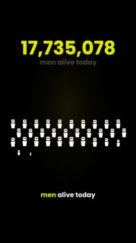](https://github.com/inematds/filme-em-codigo/releases/download/fonte-v1/genghis_brand_gideon.mp4)  
[▶ Watch the video: genghis_brand_gideon.mp4](https://github.com/inematds/filme-em-codigo/releases/download/fonte-v1/genghis_brand_gideon.mp4)

*AI Samson style*

### AI Samson style

**Same style, your idea**

```text
Make a 10 to 20 second vertical animated short about [YOUR IDEA HERE]. Tone: a confident tech-explainer that builds a claim and then pokes a hole in it. First write a 5 or 6 line script (40 to 55 words, under 20 seconds spoken), fact-check every claim on the web and list the sources. Write numbers as words for the voice and digits in the captions. Beat structure: a hook line with a glowing counter over a grid of simple block people that link up to one glowing hero; an evidence line inside a rounded app window; a statistic line where one of twelve figures lights up; a map line where a region wipes in and an empire spreads from a pulsing dot, then horizontal bars compare sizes; a reversal line where a tilted "CASE CLOSED?" stamp gets struck through; and a payoff question where the hero at the root of a family tree turns into an outlined figure with a question mark. Style: flat SVG motion graphics on pure black #000000 with a fine dark dot grid and a soft central vignette, a single yellow accent #E3E302 with soft glows, white text and mid grey #5A5A5A lines, dark rounded panels #141414 with three window dots, Poppins Bold type with tabular figures, and simple block characters (a rounded square head with a black visor slot over a tapered body). Camera: a very slow drift and breathing scale on the whole frame, scene fades of about 0.3 s, back-eased pops on every element, and an 8-frame shake on the reversal. Keep all text white or yellow on black for contrast. Captions: Poppins Bold 92 px, white with an 8 px black outline, two or three words per page near the bottom, the spoken word in yellow #E3E302. Music: a dark synth arpeggio around 116 bpm that drops out for the reversal. Sound effects: ticks under the counter, risers and shimmers on key numbers, a record scratch on the reversal and a low synth stab on the twist. Build it in Remotion (React) with three.js, 1080x1920 at 30 fps, keying every cut, event and sound to word timestamps from the voice. Synthesise all music and effects in code, with the music about 20 dB under the voice and the effects just below it.
```

**Copy this exact film · Exact prompt**

```text
Recreate this 26 second vertical motion-graphics short about Genghis Khan's descendants exactly as described. Narration, word for word (about 26 seconds): "About twenty million men alive today may descend from one man: Genghis Khan. In 2003, geneticists found that one in twelve men across a huge stretch of Asia carried almost the same Y chromosome. It seemed to spread with the Mongol Empire, the largest land empire in history. Case closed? Not quite. DNA from Mongol graves of his time showed a different line. So the world's most famous family tree might belong to someone else." Look: all SVG on black #000000 with a fine dot grid (#1C1C1C every 40 px) and a vignette with a faint yellow-olive glow in the middle. Yellow #E3E302 is the only accent, with soft glows, plus white text, grey #5A5A5A lines and dark panels #141414 with #2A2A2A borders. Type is Poppins Bold with tabular figures. Characters are "block" people: a rounded square head with a black visor slot over a tapered body. Panels are rounded app windows with three corner dots, the first yellow. Camera: the whole frame drifts and breathes very slowly, each scene fades in over about 0.3 s and scales up gently, and on "Not" the frame shakes for 8 frames. Scenes: (1) A glowing yellow counter climbs to 20,000,000 from "About" to "today" with "men alive today" while 60 white block people pop in below; on "descend" grey lines draw from each to one point and they dim; on "one" a big glowing yellow person pops up there; "Genghis Khan" rises in yellow. (2) 5.0 s: a window titled "Y chromosome study" with "2003" huge and twelve test tubes popping in, the eighth filling yellow on "found". (3) 7.45 s: "1 in 12" over twelve block people, the eighth lighting yellow on "twelve". (4) 8.3 s: a dark map of Eurasia draws its outline; the region wipes in yellow east to west on "huge", rings pop on "carried" with "Asia"; on "spread" a glowing yellow empire grows from a pulsing dot in Mongolia with "Mongol Empire"; on "largest" the map slides up over horizontal bars: Mongol 24.0 (yellow), Russian 22.8, Qing 14.7 and Roman 5.0 million km². (5) 16.35 s: a "Case file" window; a yellow "CASE CLOSED?" stamp slams in tilted, and on "Not" it greys, turns and a white strike draws through it, with "Not quite" below. (6) 18.45 s: four isometric grave boxes that gain white edges on "graves", with "Mongol graves" and "1130 to 1250"; a white bead helix rises and forks on "different" into a grey "expected" branch and a glowing yellow "different line" branch, each ending in a Y chromosome glyph. (7) 22.05 s: a family tree of block people under a glowing yellow root and "Genghis Khan"; on "might" a white strike crosses the name, and on "someone" the root becomes an outlined figure with a yellow question mark and "someone else?" appears. Captions: Poppins Bold 92 px, white with an 8 px black outline and a 3 px shadow, about 330 px above the bottom, two or three words per page, the spoken word in yellow #E3E302. Music: a dark A minor synth arpeggio of detuned saws through a low-pass filter at 116 bpm with a deep bass note each bar, ducking out for "Not quite". Sound effects: fast ticks while the counter climbs, a riser and shimmer on "twelve", a riser on "spread", a record scratch on "Not", a low synth stab on "different" and a long shimmer on "someone". Technical setup: Remotion (React) with three.js, 1080x1920 at 30 fps, about 26 seconds. Make the voice with any text to speech engine, get word timestamps, and key every cut, event and sound to the start of its word. Burn the captions in. Synthesise all music and effects in code, with no samples. Mix the music about 20 dB under the voice and ducked under speech, with the effects just below the voice.
```

[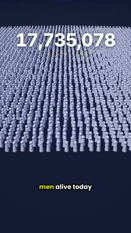](https://github.com/inematds/filme-em-codigo/releases/download/fonte-v1/genghis_data_gideon.mp4)  
[▶ Watch the video: genghis_data_gideon.mp4](https://github.com/inematds/filme-em-codigo/releases/download/fonte-v1/genghis_data_gideon.mp4)

*3D data*

### 3D data

**Same style, your idea**

```text
Make a 10 to 20 second vertical animated short about [YOUR IDEA HERE]. Tone: a data-journalism explainer that builds a case with numbers and then overturns it. First write a 5 or 6 line script (40 to 55 words, under 20 seconds spoken), fact-check every claim on the web and list the sources. Write numbers as words for the voice and digits in the captions. Beat structure: a hook line with a huge counter climbing over a field of thousands of tiny 3D figures that link up to one glowing hero; an evidence line in a lab with a rotating glowing double helix; a statistic line with a small group where one figure lights up; a map line using a 3D column map of the region that rises and floods with colour; a comparison line with 3D bars and floating values; a reversal line where the theory columns collapse and a red strike crosses the claim; and a payoff question on a glowing node graph where the hero's label swaps to a question. Style: three.js on near-black navy #060a16 with a faint blue floor grid, instanced geometry, emissive accents in gold #ffc23d, cyan #4cc9f0 and red #ff5470, no ink lines or blur. Overlay HTML type in Inter (numbers at weight 800 with tabular figures, subtitles at 600) that fades and pops in on each word. Camera: smooth keyed glides within a beat and hard cuts between beats, with a white flash on the reversal. Captions: Poppins Bold 92 px, white with an 8 px black outline, two or three words per page near the bottom, the spoken word in yellow #E3E302. Music: a dark synth arpeggio around 116 bpm that drops out for the reversal. Sound effects: ticks under the counter, risers and shimmers on the key numbers, a record scratch on the reversal and a low synth stab on the twist. Build it in Remotion (React) with three.js, 1080x1920 at 30 fps, keying every cut, event and sound to word timestamps from the voice. Synthesise all music and effects in code, with the music about 20 dB under the voice and the effects just below it.
```

**Copy this exact film · Exact prompt**

```text
Recreate this 26 second vertical 3D data-visualisation short about Genghis Khan's descendants exactly as described. Narration, word for word (about 26 seconds): "About twenty million men alive today may descend from one man: Genghis Khan. In 2003, geneticists found that one in twelve men across a huge stretch of Asia carried almost the same Y chromosome. It seemed to spread with the Mongol Empire, the largest land empire in history. Case closed? Not quite. DNA from Mongol graves of his time showed a different line. So the world's most famous family tree might belong to someone else." Look: three.js on near-black navy #060a16 with a dark floor #0a1124 and a faint blue grid #13204a, a cool hemisphere light and a white key, no ink lines or blur, saturation up 10 percent. Accents: gold #ffc23d, cyan #4cc9f0 and red #ff5470 as glowing emissives. An HTML type layer uses Inter, numbers at weight 800 with tabular figures and subtitles at 600, with a soft dark shadow. Camera: keyed glides with hard cuts at 5.15, 7.6, 8.5, 15.0, 16.6, 18.6 and 22.2 s. Beats: (1) A field of 9,900 tiny white instanced men seen low, then a crane up and back as "20,000,000" climbs from "About" to "today" with "men alive today" in gold; on "descend" 700 rays draw up to one gold man on a light column and the crowd dims to slate #55648f; "Genghis Khan" pops in gold. (2) A lab with a rotating double helix of glowing beads and a scan plane, "2003" huge and "geneticists scan the Y chromosome" in cyan. (3) Twelve men on a platform with "1 in 12"; one turns gold on "twelve". (4) Top-down on a 3D column map of Eurasia, one box per 2.5 degree land cell: the sampled region rises in gold east to west on "huge" with "a huge stretch of Asia" and "almost the same Y chromosome"; on "spread" the empire floods out from Mongolia in red raised columns with "Mongol Empire". (5) Four 3D bars grow to Mongol 24.0 (glowing red), Russian 22.8, Qing 14.7 and Roman 5.0 under "largest land empires, million km²", with values floating above. (6) Back over the map with "CASE CLOSED?" tilted; on "Not" a white flash, the gold columns collapse to grey and a red strike crosses it, with "Not quite." in red. (7) A grave pin as the map darkens; a cyan helix rises and forks on "different", with "Mongol graves", "his time: 1130 to 1250" and "expected vs a different line". (8) A glowing node-and-line family tree under a gold "Genghis Khan" root, which greys on "might" and becomes cyan "someone else?" on "someone". Captions: Poppins Bold 92 px, white with an 8 px black outline and a 3 px shadow, about 330 px above the bottom, two or three words per page, the spoken word in yellow #E3E302. Music: a dark A minor synth arpeggio of detuned saws through a low-pass filter at 116 bpm with a deep bass note each bar, ducking out for "Not quite". Sound effects: fast ticks while the counter climbs, a riser and shimmer on "twelve", a riser on "spread", a record scratch on "Not", a low synth stab on "different" and a long shimmer on "someone". Technical setup: Remotion (React) with three.js, 1080x1920 at 30 fps, about 26 seconds. Make the voice with any text to speech engine, get word timestamps, and key every cut, event and sound to the start of its word. Burn the captions in. Synthesise all music and effects in code, with no samples. Mix the music about 20 dB under the voice and ducked under speech, with the effects just below the voice.
```

[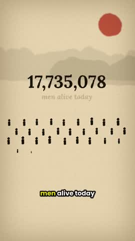](https://github.com/inematds/filme-em-codigo/releases/download/fonte-v1/genghis_ink_gideon.mp4)  
[▶ Watch the video: genghis_ink_gideon.mp4](https://github.com/inematds/filme-em-codigo/releases/download/fonte-v1/genghis_ink_gideon.mp4)

*Ink scroll*

### Ink scroll

**Same style, your idea**

```text
Make a 10 to 20 second vertical animated short about [YOUR IDEA HERE]. Tone: a calm, scholarly history story with one twist. First write a 5 or 6 line script (40 to 55 words, under 20 seconds spoken), fact-check every claim on the web and list the sources. Write numbers as words for the voice and digits in the captions. Beat structure: a hook line with a big number counting up over a crowd of tiny brush figures that link to one hero; an evidence line with a large date and a brush-drawn instrument; a statistic line with figures popping in and one turning red; a map line where an outline draws itself and a red wash spreads, with hanging scroll banners as a bar chart; a reversal line where one ink slash cuts across a "case closed" card; and a payoff question where a red seal with a question mark stamps over the hero's seal. Style: a sumi-e handscroll on warm rice paper #efe4cc with grain and a brown vignette, ink #161310 and #3b342c, seal red #b3261e, Lora Bold serif type with italic subtitles. Draw everything as SVG through a turbulence displacement filter so it looks brushed, animate strokes drawing on, and give seals a speckled stamp texture. Lay the story out as one long scroll of 1080 px panels and glide the camera sideways from panel to panel on each beat with washed mountains drifting slower behind for parallax and a small shake on the reversal. Captions: Poppins Bold 92 px, white with an 8 px black outline, two or three words per page near the bottom, the spoken word in yellow #E3E302. Music: breathy flute phrases on a pentatonic scale over slow low zither plucks. Sound effects: deep taiko hits on the hook, the reversal and the reveal, and a soft shimmer on the key statistic. Build it in Remotion (React) with three.js, 1080x1920 at 30 fps, keying every cut, event and sound to word timestamps from the voice. Synthesise all music and effects in code, with the music about 20 dB under the voice and the effects just below it.
```

**Copy this exact film · Exact prompt**

```text
Recreate this 26 second vertical short about Genghis Khan's descendants as a sumi-e ink handscroll, exactly as described. Narration, word for word (about 26 seconds): "About twenty million men alive today may descend from one man: Genghis Khan. In 2003, geneticists found that one in twelve men across a huge stretch of Asia carried almost the same Y chromosome. It seemed to spread with the Mongol Empire, the largest land empire in history. Case closed? Not quite. DNA from Mongol graves of his time showed a different line. So the world's most famous family tree might belong to someone else." Look: brush ink on rice paper #efe4cc with multiplied paper grain and a brown inner vignette; ink #161310 and #3b342c, translucent brown washes and seal red #b3261e. Draw everything in SVG through a turbulence displacement filter so edges look brushed, draw strokes on with stroke-dash, and give red seals a speckled stamp texture. Type is Lora Bold in ink with italic subtitles; seals use a heavy CJK serif. Washed mountains drift at a quarter of the camera speed, and a red sun sits top right until 16 s. Camera: one long scroll of seven 1080 px panels; the camera glides sideways to the next panel at 0, 5.0, 7.45, 8.3, 16.4, 18.45 and 22.05 s with a 0.7 s ease and a slight sway, plus an 8-frame shake on "Not". Panels: (1) A counter climbs to 20,000,000 from "About" to "today" with "men alive today"; 54 brush figures pop in below; on "descend" ink threads draw from each to one point and they fade; on "one" a big hatted figure pops there; on "Genghis" a red seal 成吉思汗 stamps above, and "Genghis Khan" appears on "Khan". (2) "2003" in huge numerals, a brush microscope drawn stroke by stroke on "geneticists", and three test tubes, the middle one red. (3) "1 in 12" with twelve figures popping in, the eighth turning red on "twelve". (4) Eurasia outlines itself, a dark wash region wipes in east to west on "huge" and red dots pop on "carried" with "Asia"; on "spread" a red wash empire grows from Mongolia as six brush riders ride out, with "Mongol Empire" in red; on "largest" the map slides up and four hanging scroll banners unroll by area: Mongol 24.0 (red), Russian 22.8, Qing 14.7 and Roman 5.0 million km². (5) A card between scroll rods reads "Case closed?", a red 結案 seal stamps on "closed", and on "Not" one thick ink slash cuts across with splatter and "Not quite." appears. (6) A grave mound washes in, bones appear on "graves" with "Mongol graves" and "of his time, 1130 to 1250", a helix rises from it and forks on "different" into a faint "expected" branch and a red "a different line" branch. (7) A family tree of brush figures branches down from "family" under the seal and "the most famous family tree"; the seal fades on "might", and on "someone" a red seal with a question mark stamps in with "someone else?" in red italics. Captions: Poppins Bold 92 px, white with an 8 px black outline and a 3 px shadow, about 330 px above the bottom, two or three words per page, the spoken word in yellow #E3E302. Music: breathy bamboo-flute phrases on A minor pentatonic over slow low zither plucks. Sound effects: deep taiko hits at the start and on "Khan", "closed", "Not", "different" and "someone", a shimmer on "twelve" and a soft gallop under the riders. Technical setup: Remotion (React) with three.js, 1080x1920 at 30 fps, about 26 seconds. Make the voice with any text to speech engine, get word timestamps, and key every cut, event and sound to the start of its word. Burn the captions in. Synthesise all music and effects in code, with no samples. Mix the music about 20 dB under the voice and ducked under speech, with the effects just below the voice.
```

[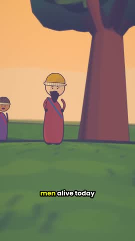](https://github.com/inematds/filme-em-codigo/releases/download/fonte-v1/genghis_toon_gideon.mp4)  
[▶ Watch the video: genghis_toon_gideon.mp4](https://github.com/inematds/filme-em-codigo/releases/download/fonte-v1/genghis_toon_gideon.mp4)

*Cartoon 3D*

### Cartoon 3D

**Same style, your idea**

```text
Make a 10 to 20 second vertical animated short about [YOUR IDEA HERE]. Tone: a science-meets-history twist where a famous claim gets overturned. First write a 5 or 6 line script (40 to 55 words, under 20 seconds spoken), fact-check every claim on the web and list the sources. Write numbers as words for the voice and digits in the captions. Beat structure: a hook line with a huge number, shown as a crowd popping in behind one hero figure; an evidence line with scientists and a line of people where one turns gold; a spread line on a wide crane shot over the landscape with riders or travellers crossing it; a "Case closed? Not quite." style reversal with a flash, record scratch and a question mark; a new-evidence line at a dig site; and a payoff question where the hero vanishes and a big question mark takes his place. Style: flat 2D hand-drawn characters on camera-facing billboards (plum ink outline #241726, flat fills, big white eyes, blinking) inside a 3D toon-shaded world of simple primitives, with a post pass of near-black 5 px ink lines from depth edges, background blur on close shots, cool shadows, warm highlights and a soft vignette. Sky from #4f8fdc to a pale horizon, switching to golden, dusk or night blue when the mood changes. Use a rolling 3D landscape with period props that fit the topic, and golden light for the first and last beats. Camera: one shot per beat, each a smootherstep glide with a slow push-in, hard cuts, gentle rolls, a white flash after the hook and a short camera kick on every big hit. Captions: Poppins Bold 92 px, white with an 8 px black outline, two or three words per page near the bottom, the spoken word in yellow #E3E302. Music: a pentatonic plucked-string melody with soft taiko drums that drops out for the reversal. Sound effects: galloping or travel sounds, a shimmer on the evidence, a record scratch on the reversal and a deep drum on the final reveal. Build it in Remotion (React) with three.js, 1080x1920 at 30 fps, keying every cut, event and sound to word timestamps from the voice. Synthesise all music and effects in code, with the music about 20 dB under the voice and the effects just below it.
```

**Copy this exact film · Exact prompt**

```text
Recreate this 26 second vertical cartoon short about Genghis Khan's descendants exactly as described. Narration, word for word (about 26 seconds): "About twenty million men alive today may descend from one man: Genghis Khan. In 2003, geneticists found that one in twelve men across a huge stretch of Asia carried almost the same Y chromosome. It seemed to spread with the Mongol Empire, the largest land empire in history. Case closed? Not quite. DNA from Mongol graves of his time showed a different line. So the world's most famous family tree might belong to someone else." Look: flat 2D hand-drawn characters on camera-facing billboards (plum ink outline #241726, flat fills, big white eyes, blinking, oval contact shadows) inside a 3D toon-shaded world of simple primitives with a hard two-tone shading ramp. A post pass adds near-black ink lines about 5 px thick from depth edges, background lens blur on close shots, a cool blue lift in the shadows, warm highlights, 8 percent extra saturation and a soft vignette. The world: rolling green steppe hills (#c9e0a0 grass texture) under a sky from #4f8fdc to #d8e6f2, pale blue painted mountains in the distance, scattered white felt gers (#f2ead8 with red #c0352a and blue #2f5a9a bands and red doors), a lone hill, an excavation pit with dark earth, and a giant cartoon family tree on a far hill (brown bark #7a5236, round foliage clouds #4f9a46 and #6fb85a). The first and last beats are golden light (sky #ffb46a to #f2c69a). The khan wears a red robe, a gold fur hat, a blue sash, a black beard and moustache; the nomads wear blue, purple, olive and rust robes with fur hats; the scientists wear white coats. Beats: (1) 0 to 4.95 s: low close angle on the khan standing proudly on his hill, hands on hips; from "About" to "Khan" a crowd of 34 nomads pops in behind him row by row, waving; a white flash at 4.85 s. (2) 4.95 to 12.45 s, "In 2003": two scientists, one with a clipboard, in front of a line of twelve nomads; on "twelve" one man turns gold and the scientist looks shocked; on "chromosome" a DNA helix pops up above them. (3) 12.45 to 16.5 s, "It seemed to spread": a wide high crane over the steppe and gers as nine riders on horseback gallop across the hills. (4) 16.5 to 18.35 s, "Case closed?": a close two-shot of the scientists, smug with a thumbs up; on "Not" one throws up his arms, a question mark appears, a white flash, and the camera roll flips with a kick. (5) 18.35 to 21.95 s, "DNA from Mongol graves": a digger in a sun hat points at bones in the pit with cooler shadows; on "DNA" a helix appears and on "different" the digger jumps in shock under a question mark, with a kick. (6) 21.95 s to the end, golden: the khan stands proudly under the giant family tree ringed by 26 happy nomads; on "someone" he vanishes and a big question mark takes his place while the crowd turns shocked. Camera: each shot is a smootherstep glide with a slow creeping push-in, hard cuts between shots, 2 to 4 degree rolls, and a 7-frame decaying camera kick on big hits. Captions: Poppins Bold 92 px, white with an 8 px black outline and a 3 px shadow, about 330 px above the bottom, two or three words per page, the spoken word in yellow #E3E302. Music: an A minor pentatonic melody on a plucked zither with a low zither bass and soft taiko-style drums at 120 bpm, dropping almost to silence for "Not quite". Sound effects: a soft hoof gallop at the start and a long gallop under the riders, a sparkling shimmer on "twelve" and "chromosome", a record scratch on "Not", and a deep drum hit on "someone". Technical setup: Remotion (React) with three.js, 1080x1920 at 30 fps, about 26 seconds. Make the voice with any text to speech engine, get word timestamps, and key every cut, event and sound to the start of its word. Burn the captions in. Synthesise all music and effects in code, with no samples. Mix the music about 20 dB under the voice and ducked under speech, with the effects just below the voice.
```

[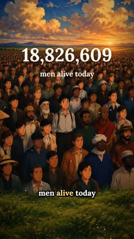](https://github.com/inematds/filme-em-codigo/releases/download/fonte-v1/style_ghibli_julian.mp4)  
[▶ Watch the video: style_ghibli_julian.mp4](https://github.com/inematds/filme-em-codigo/releases/download/fonte-v1/style_ghibli_julian.mp4)

*Painted anime film (Studio Ghibli-like)*

### Painted anime film

**Same style, your idea**

```text
Make a 10 to 20 second vertical animated short about [YOUR IDEA HERE]. Tone: a short history or science story with one twist. First write a 5 or 6 line script (40 to 55 words, under 20 seconds spoken), fact-check every claim on the web and list the sources. Write numbers as words for the voice and digits in the captions. Beat structure: a hook line with a big number over a wide establishing image; a hero line; an evidence line with a statistic shown as a grid of tokens where one lights up; a map or diagram line on a styled panel over a blurred, darkened keyframe; a reversal line where a claim gets struck through; and a payoff question. Plan about seven keyframes, one per beat. Style for every keyframe: hand-painted Japanese animated feature film look, lush gouache and watercolour background painting, soft fluffy cumulus clouds, warm nostalgic golden light, gentle simple character designs with small expressive faces, cel-shaded characters over richly painted scenery. Write each keyframe prompt as the subject, then that style sentence, then "Vertical 9:16 portrait composition with the main subject in the middle of the frame and a calmer lower quarter. No text, no letters, no logos, no watermark." and generate them at 9:16. Animate each keyframe in one WebGL shader: make a depth map with a monocular depth model, offset the lookup by depth for a parallax camera, sway the near foreground, drift the far sky sideways strongly, and use no line boil (a line boil is a small noise warp that steps 8 times a second). Camera: a slow dreamy drift (zoom easing from 1.06 to 1.14 with a gentle sideways sine sway and a slow rise). Transitions: a 0.6 s cross dissolve. Labels on their words: Lora Bold serif in warm white #fffaf0 with a soft dark shadow, accent #ffd27a. Panels and overlays: the same palette, plus floating warm light motes, a soft vignette and fine film grain. Captions: Lora Bold at 92 px, white with an 8 px black outline, two or three words per page near the bottom, spoken word in #FFD27A. Music: breathy flute phrases on a pentatonic scale over slow low zither plucks. Sound effects: deep drum hits on the hook, the reversal and the reveal, and a shimmer on the key statistic. Build it in Remotion (React) with three.js, 1080x1920 at 30 fps, keying every cut, event and sound to word timestamps from the voice. Synthesise all music and effects in code, with the music about 20 dB under the voice and the effects just below it.
```

**Copy this exact film · Exact prompt**

```text
Recreate this 26 second vertical short about Genghis Khan's descendants in one consistent illustrated look, exactly as described. Narration, word for word (about 26 seconds): "About twenty million men alive today may descend from one man: Genghis Khan. In 2003, geneticists found that one in twelve men across a huge stretch of Asia carried almost the same Y chromosome. It seemed to spread with the Mongol Empire, the largest land empire in history. Case closed? Not quite. DNA from Mongol graves of his time showed a different line. So the world's most famous family tree might belong to someone else." Look: hand-painted Japanese animated feature film look, lush gouache and watercolour background painting, soft fluffy cumulus clouds, warm nostalgic golden light, gentle simple character designs with small expressive faces, cel-shaded characters over richly painted scenery. First generate seven keyframe images at 9:16 (1080x1920) with these exact prompts, in beat order: 1. crowd: "a vast crowd of hundreds of ordinary men of many different backgrounds standing shoulder to shoulder across a wide plain, the crowd stretching all the way to the horizon, seen from slightly above. Style: hand-painted Japanese animated feature film look, lush gouache and watercolour background painting, soft fluffy cumulus clouds, warm nostalgic golden light, gentle simple character designs with small expressive faces, cel-shaded characters over richly painted scenery. Vertical 9:16 portrait composition with the main subject in the middle of the frame and a calmer lower quarter. No text, no letters, no logos, no watermark." 2. khan: "Genghis Khan, the 13th century Mongol ruler, with a fur-trimmed pointed helmet, long thin moustache and a deel robe, sitting proudly on a sturdy steppe horse on a grassy hill, heroic low angle, centred. Style: hand-painted Japanese animated feature film look, lush gouache and watercolour background painting, soft fluffy cumulus clouds, warm nostalgic golden light, gentle simple character designs with small expressive faces, cel-shaded characters over richly painted scenery. Vertical 9:16 portrait composition with the main subject in the middle of the frame and a calmer lower quarter. No text, no letters, no logos, no watermark." 3. lab: "two geneticists in white lab coats in a modern genetics laboratory, studying a large glowing DNA double helix model, racks of test tubes, a microscope and sample trays. Style: hand-painted Japanese animated feature film look, lush gouache and watercolour background painting, soft fluffy cumulus clouds, warm nostalgic golden light, gentle simple character designs with small expressive faces, cel-shaded characters over richly painted scenery. Vertical 9:16 portrait composition with the main subject in the middle of the frame and a calmer lower quarter. No text, no letters, no logos, no watermark." 4. army: "a long column of Mongol horsemen with banners riding out across the endless Eurasian steppe, clouds of dust, distant mountains, epic sense of scale. Style: hand-painted Japanese animated feature film look, lush gouache and watercolour background painting, soft fluffy cumulus clouds, warm nostalgic golden light, gentle simple character designs with small expressive faces, cel-shaded characters over richly painted scenery. Vertical 9:16 portrait composition with the main subject in the middle of the frame and a calmer lower quarter. No text, no letters, no logos, no watermark." 5. case: "a detective's wooden desk under a lamp with a thick closed case file folder, a magnifying glass, a cup of tea and an old map of Asia, moody and mysterious. Style: hand-painted Japanese animated feature film look, lush gouache and watercolour background painting, soft fluffy cumulus clouds, warm nostalgic golden light, gentle simple character designs with small expressive faces, cel-shaded characters over richly painted scenery. Vertical 9:16 portrait composition with the main subject in the middle of the frame and a calmer lower quarter. No text, no letters, no logos, no watermark." 6. grave: "archaeologists excavating an ancient Mongol burial mound at dusk, a skeleton partly uncovered in the dig, brushes and trowels, a faint glowing DNA strand rising out of the grave. Style: hand-painted Japanese animated feature film look, lush gouache and watercolour background painting, soft fluffy cumulus clouds, warm nostalgic golden light, gentle simple character designs with small expressive faces, cel-shaded characters over richly painted scenery. Vertical 9:16 portrait composition with the main subject in the middle of the frame and a calmer lower quarter. No text, no letters, no logos, no watermark." 7. tree: "a gigantic ancient family tree whose branches spread across the whole sky, hundreds of tiny portrait medallions hanging from the branches, and at the root a mysterious hooded silhouette. Style: hand-painted Japanese animated feature film look, lush gouache and watercolour background painting, soft fluffy cumulus clouds, warm nostalgic golden light, gentle simple character designs with small expressive faces, cel-shaded characters over richly painted scenery. Vertical 9:16 portrait composition with the main subject in the middle of the frame and a calmer lower quarter. No text, no letters, no logos, no watermark." Animate each keyframe in one WebGL shader: make a depth map with a monocular depth model, offset the lookup by depth for a parallax camera, sway the near foreground, drift the far sky sideways strongly, and use no line boil (a line boil is a small noise warp that steps 8 times a second). Camera on each keyframe: a slow dreamy drift (zoom easing from 1.06 to 1.14 with a gentle sideways sine sway and a slow rise). Transition between segments: a 0.6 s cross dissolve. On-screen labels: Lora Bold serif in warm white #fffaf0 with a soft dark shadow, accent #ffd27a. Map panel skin: pale sea #cfe3ea, parchment land #e9e2c6, olive lines #5b6b4a, an amber region rgba(232,160,60,0.55), a red empire rgba(200,80,60,0.45), orange dots #e08a2c, paper texture. Texture overlays: floating warm light motes, a soft vignette and fine film grain. Timeline: 0 to 2.3 s, crowd: a counter climbs to 20,000,000 from "About" to "today", with "men alive today" on "men". 2.3 to 5.05 s, khan: "Genghis Khan" on "Genghis". 5.05 to 7.6 s, lab: "2003" and "geneticists" on their words. 7.6 to 8.45 s, the crowd zoomed to 1.35x: "1 in 12" over a 6 by 2 grid of rounded pill tokens popping in, the eighth glowing in the accent colour on "twelve". 8.45 to 12.6 s, the army blurred and darkened behind a rounded map panel of Asia: the sampled region wipes in east to west on "huge" and dots pop on "carried", with "a huge stretch of Asia" and "the same Y chromosome" on "Y". 12.6 to 14.45 s, clear army: "Mongol Empire". 14.45 to 16.55 s, map again: the empire floods out from a pulsing Mongolia marker, with "largest land empire" and "24 million km²". 16.55 to 18.6 s, case: "CASE CLOSED?", struck through by an accent bar on "Not" as "Not quite." appears in the accent. 18.6 to 22.15 s, grave: "Mongol graves", "1130 to 1250" on "time" and "a different line" in the accent. 22.15 s to the end, tree: "most famous family tree", replaced on "someone" by "someone else?" in the accent. Labels fade and rise in over 0.2 s. Captions: burn in word-by-word captions in Lora Bold at 92 px, white with an 8 px black outline and a 3 px shadow, two or three words per page, centred about 330 px above the bottom, with the spoken word in #FFD27A. Music: soft breathy bamboo-flute phrases on an A minor pentatonic scale over slow low zither plucks every 1.2 seconds. Sound effects: deep taiko hits at the start and on "Khan", at 12.6 s, "closed", "Not", "different" and "someone", a shimmer on "twelve" and a quiet hoof gallop under the army. Technical setup: Remotion (React) with three.js, 1080x1920 at 30 fps, about 26 seconds. Make the voice with any text to speech engine, get word timestamps, and key every cut, event and sound to the start of its word. Burn the captions in. Synthesise all music and effects in code, with no samples. Mix the music about 20 dB under the voice and ducked under speech, with the effects just below the voice.
```

[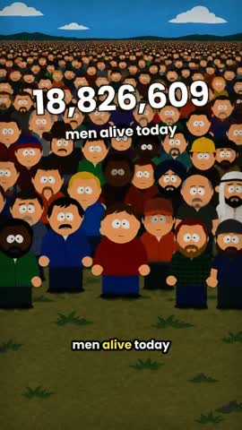](https://github.com/inematds/filme-em-codigo/releases/download/fonte-v1/style_paper_julian.mp4)  
[▶ Watch the video: style_paper_julian.mp4](https://github.com/inematds/filme-em-codigo/releases/download/fonte-v1/style_paper_julian.mp4)

*Construction-paper cartoon (South Park-like)*

### Construction-paper cartoon

**Same style, your idea**

```text
Make a 10 to 20 second vertical animated short about [YOUR IDEA HERE]. Tone: a short history or science story with one twist. First write a 5 or 6 line script (40 to 55 words, under 20 seconds spoken), fact-check every claim on the web and list the sources. Write numbers as words for the voice and digits in the captions. Beat structure: a hook line with a big number over a wide establishing image; a hero line; an evidence line with a statistic shown as a grid of tokens where one lights up; a map or diagram line on a styled panel over a blurred, darkened keyframe; a reversal line where a claim gets struck through; and a payoff question. Plan about seven keyframes, one per beat. Style for every keyframe: crude construction-paper cutout cartoon, flat simple shapes, characters with big round heads and simple dot eyes, bright flat colours, deliberately rough cutout stop-motion look, original characters. Write each keyframe prompt as the subject, then that style sentence, then "Vertical 9:16 portrait composition with the main subject in the middle of the frame and a calmer lower quarter. No text, no letters, no logos, no watermark." and generate them at 9:16. Animate each keyframe in one WebGL shader: make a depth map with a monocular depth model, offset the lookup by depth for a parallax camera, sway the near foreground, drift the far sky sideways gently, and add a full-strength line boil (a line boil is a small noise warp that steps 8 times a second). Camera: a stop-motion jitter (a new tiny random offset, scale and rotation every 3 frames, on threes). Transitions: hard cuts. Labels on their words: Poppins ExtraBold in white with a thick 10 px black stroke, rotated minus 3 degrees, accent #ffde3b. Panels and overlays: the same palette, plus a faint diagonal paper texture with a soft inner shadow. Captions: Poppins Bold at 92 px, white with an 8 px black outline, two or three words per page near the bottom, spoken word in #FFDE3B. Music: a bouncy pentatonic plucked-string melody with soft drums around 120 bpm that drops out for the reversal. Sound effects: a gallop or travel sound under the action, a shimmer on the key number, a record scratch on the reversal and a deep drum on the reveal. Build it in Remotion (React) with three.js, 1080x1920 at 30 fps, keying every cut, event and sound to word timestamps from the voice. Synthesise all music and effects in code, with the music about 20 dB under the voice and the effects just below it.
```

**Copy this exact film · Exact prompt**

```text
Recreate this 26 second vertical short about Genghis Khan's descendants in one consistent illustrated look, exactly as described. Narration, word for word (about 26 seconds): "About twenty million men alive today may descend from one man: Genghis Khan. In 2003, geneticists found that one in twelve men across a huge stretch of Asia carried almost the same Y chromosome. It seemed to spread with the Mongol Empire, the largest land empire in history. Case closed? Not quite. DNA from Mongol graves of his time showed a different line. So the world's most famous family tree might belong to someone else." Look: crude construction-paper cutout cartoon, flat simple shapes, characters with big round heads and simple dot eyes, bright flat colours, deliberately rough cutout stop-motion look, original characters. First generate seven keyframe images at 9:16 (1080x1920) with these exact prompts, in beat order: 1. crowd: "a vast crowd of hundreds of ordinary men of many different backgrounds standing shoulder to shoulder across a wide plain, the crowd stretching all the way to the horizon, seen from slightly above. Style: crude construction-paper cutout cartoon, flat simple shapes, characters with big round heads, dot eyes and mitten hands, bright flat colours, deliberately rough and childish cutout animation look like a satirical adult animated sitcom, original characters. Vertical 9:16 portrait composition with the main subject in the middle of the frame and a calmer lower quarter. No text, no letters, no logos, no watermark." 2. khan: "Genghis Khan, the 13th century Mongol ruler, with a fur-trimmed pointed helmet, long thin moustache and a deel robe, sitting proudly on a sturdy steppe horse on a grassy hill, heroic low angle, centred. crude construction-paper cutout cartoon, flat simple shapes, characters with big round heads and simple dot eyes, bright flat colours, deliberately rough cutout stop-motion look, original characters. Vertical 9:16, subject centred, simple lower quarter, no text or logos." 3. lab: "two geneticists in white lab coats in a modern genetics laboratory, studying a large glowing DNA double helix model, racks of test tubes, a microscope and sample trays. Style: crude construction-paper cutout cartoon, flat simple shapes, characters with big round heads, dot eyes and mitten hands, bright flat colours, deliberately rough and childish cutout animation look like a satirical adult animated sitcom, original characters. Vertical 9:16 portrait composition with the main subject in the middle of the frame and a calmer lower quarter. No text, no letters, no logos, no watermark." 4. army: "a long column of Mongol horsemen with banners riding out across the endless Eurasian steppe, clouds of dust, distant mountains, epic sense of scale. crude construction-paper cutout cartoon, flat simple shapes, characters with big round heads and simple dot eyes, bright flat colours, deliberately rough cutout stop-motion look, original characters. Vertical 9:16, subject centred, simple lower quarter, no text or logos." 5. case: "a detective's wooden desk under a lamp with a thick closed case file folder, a magnifying glass, a cup of tea and an old map of Asia, moody and mysterious. Style: crude construction-paper cutout cartoon, flat simple shapes, characters with big round heads, dot eyes and mitten hands, bright flat colours, deliberately rough and childish cutout animation look like a satirical adult animated sitcom, original characters. Vertical 9:16 portrait composition with the main subject in the middle of the frame and a calmer lower quarter. No text, no letters, no logos, no watermark." 6. grave: "archaeologists excavating an ancient Mongol burial mound at dusk, a skeleton partly uncovered in the dig, brushes and trowels, a faint glowing DNA strand rising out of the grave. crude construction-paper cutout cartoon, flat simple shapes, characters with big round heads and simple dot eyes, bright flat colours, deliberately rough cutout stop-motion look, original characters. Vertical 9:16, subject centred, simple lower quarter, no text or logos." 7. tree: "a gigantic ancient family tree whose branches spread across the whole sky, hundreds of tiny portrait medallions hanging from the branches, and at the root a mysterious hooded silhouette. crude construction-paper cutout cartoon, flat simple shapes, characters with big round heads and simple dot eyes, bright flat colours, deliberately rough cutout stop-motion look, original characters. Vertical 9:16, subject centred, simple lower quarter, no text or logos." Animate each keyframe in one WebGL shader: make a depth map with a monocular depth model, offset the lookup by depth for a parallax camera, sway the near foreground, drift the far sky sideways gently, and add a full-strength line boil (a line boil is a small noise warp that steps 8 times a second). Camera on each keyframe: a stop-motion jitter (a new tiny random offset, scale and rotation every 3 frames, on threes). Transition between segments: hard cuts. On-screen labels: Poppins ExtraBold in white with a thick 10 px black stroke, rotated minus 3 degrees, accent #ffde3b. Map panel skin: sky blue sea #5aa9e6, grass green land #7cc36e, thick black 6 px lines #1d1d1d, a yellow region rgba(255,222,59,0.9), a red empire rgba(230,60,50,0.85), black dots, square corners. Texture overlays: a faint diagonal paper texture with a soft inner shadow. Timeline: 0 to 2.3 s, crowd: a counter climbs to 20,000,000 from "About" to "today", with "men alive today" on "men". 2.3 to 5.05 s, khan: "Genghis Khan" on "Genghis". 5.05 to 7.6 s, lab: "2003" and "geneticists" on their words. 7.6 to 8.45 s, the crowd zoomed to 1.35x: "1 in 12" over a 6 by 2 grid of rounded pill tokens popping in, the eighth glowing in the accent colour on "twelve". 8.45 to 12.6 s, the army blurred and darkened behind a rounded map panel of Asia: the sampled region wipes in east to west on "huge" and dots pop on "carried", with "a huge stretch of Asia" and "the same Y chromosome" on "Y". 12.6 to 14.45 s, clear army: "Mongol Empire". 14.45 to 16.55 s, map again: the empire floods out from a pulsing Mongolia marker, with "largest land empire" and "24 million km²". 16.55 to 18.6 s, case: "CASE CLOSED?", struck through by an accent bar on "Not" as "Not quite." appears in the accent. 18.6 to 22.15 s, grave: "Mongol graves", "1130 to 1250" on "time" and "a different line" in the accent. 22.15 s to the end, tree: "most famous family tree", replaced on "someone" by "someone else?" in the accent. Labels fade and rise in over 0.2 s. Captions: burn in word-by-word captions in Poppins Bold at 92 px, white with an 8 px black outline and a 3 px shadow, two or three words per page, centred about 330 px above the bottom, with the spoken word in #FFDE3B. Music: an A minor pentatonic melody on a plucked zither with a low zither bass and soft taiko-style drums at 120 bpm, dropping almost to silence for "Not quite". Sound effects: a soft hoof gallop at the start and a long gallop under the army, a sparkling shimmer on "twelve" and "chromosome", a record scratch on "Not" and a deep drum hit on "someone". Technical setup: Remotion (React) with three.js, 1080x1920 at 30 fps, about 26 seconds. Make the voice with any text to speech engine, get word timestamps, and key every cut, event and sound to the start of its word. Burn the captions in. Synthesise all music and effects in code, with no samples. Mix the music about 20 dB under the voice and ducked under speech, with the effects just below the voice.
```

[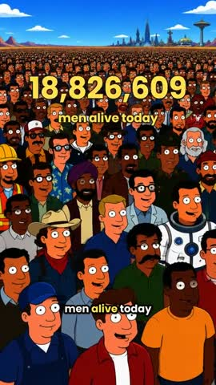](https://github.com/inematds/filme-em-codigo/releases/download/fonte-v1/style_sitcom_julian.mp4)  
[▶ Watch the video: style_sitcom_julian.mp4](https://github.com/inematds/filme-em-codigo/releases/download/fonte-v1/style_sitcom_julian.mp4)

*Prime-time TV cartoon (Simpsons / Futurama-like)*

### Prime-time TV cartoon

**Same style, your idea**

```text
Make a 10 to 20 second vertical animated short about [YOUR IDEA HERE]. Tone: a short history or science story with one twist. First write a 5 or 6 line script (40 to 55 words, under 20 seconds spoken), fact-check every claim on the web and list the sources. Write numbers as words for the voice and digits in the captions. Beat structure: a hook line with a big number over a wide establishing image; a hero line; an evidence line with a statistic shown as a grid of tokens where one lights up; a map or diagram line on a styled panel over a blurred, darkened keyframe; a reversal line where a claim gets struck through; and a payoff question. Plan about seven keyframes, one per beat. Style for every keyframe: classic American prime-time TV cartoon look, bold clean black outlines, flat cel colours, original characters with big round eyes and natural varied skin tones, saturated sunny palette, retro sci-fi sitcom energy. Write each keyframe prompt as the subject, then that style sentence, then "Vertical 9:16 portrait composition with the main subject in the middle of the frame and a calmer lower quarter. No text, no letters, no logos, no watermark." and generate them at 9:16. Animate each keyframe in one WebGL shader: make a depth map with a monocular depth model, offset the lookup by depth for a parallax camera, sway the near foreground, drift the far sky sideways at a medium pace, and use no line boil (a line boil is a small noise warp that steps 8 times a second). Camera: a punch-in (a 9 percent zoom pop at each cut that settles fast, then a slow creep and sway). Transitions: a 0.12 s white flash. Labels on their words: Poppins ExtraBold in yellow #ffe14d with a 9 px near-black #1b1b1b stroke, accent #ff6b3d. Panels and overlays: the same palette, plus no texture overlay. Captions: Poppins Bold at 92 px, white with an 8 px black outline, two or three words per page near the bottom, spoken word in #FFE14D. Music: a bouncy pentatonic plucked-string melody with soft drums around 120 bpm that drops out for the reversal. Sound effects: a gallop or travel sound under the action, a shimmer on the key number, a record scratch on the reversal and a deep drum on the reveal. Build it in Remotion (React) with three.js, 1080x1920 at 30 fps, keying every cut, event and sound to word timestamps from the voice. Synthesise all music and effects in code, with the music about 20 dB under the voice and the effects just below it.
```

**Copy this exact film · Exact prompt**

```text
Recreate this 26 second vertical short about Genghis Khan's descendants in one consistent illustrated look, exactly as described. Narration, word for word (about 26 seconds): "About twenty million men alive today may descend from one man: Genghis Khan. In 2003, geneticists found that one in twelve men across a huge stretch of Asia carried almost the same Y chromosome. It seemed to spread with the Mongol Empire, the largest land empire in history. Case closed? Not quite. DNA from Mongol graves of his time showed a different line. So the world's most famous family tree might belong to someone else." Look: classic American prime-time TV cartoon look, bold clean black outlines, flat cel colours, original characters with big round eyes and natural varied skin tones, saturated sunny palette, retro sci-fi sitcom energy. First generate seven keyframe images at 9:16 (1080x1920) with these exact prompts, in beat order: 1. crowd: "a vast crowd of hundreds of ordinary men of many different backgrounds standing shoulder to shoulder across a wide plain, the crowd stretching all the way to the horizon, seen from slightly above. classic American prime-time TV cartoon look, bold clean black outlines, flat cel colours, original characters with big round eyes and natural varied skin tones, saturated sunny palette, retro sci-fi sitcom energy. Vertical 9:16, subject centred, simple lower quarter, no text or logos." 2. khan: "Genghis Khan, the 13th century Mongol ruler, with a fur-trimmed pointed helmet, long thin moustache and a deel robe, sitting proudly on a sturdy steppe horse on a grassy hill, heroic low angle, centred. classic American prime-time TV cartoon look, bold clean black outlines, flat cel colours, original characters with big round eyes and natural varied skin tones, saturated sunny palette, retro sci-fi sitcom energy. Vertical 9:16, subject centred, simple lower quarter, no text or logos." 3. lab: "two geneticists in white lab coats in a modern genetics laboratory, studying a large glowing DNA double helix model, racks of test tubes, a microscope and sample trays. classic American prime-time TV cartoon look, bold clean black outlines, flat cel colours, original characters with big round eyes and natural varied skin tones, saturated sunny palette, retro sci-fi sitcom energy. Vertical 9:16, subject centred, simple lower quarter, no text or logos." 4. army: "a long column of Mongol horsemen with banners riding out across the endless Eurasian steppe, clouds of dust, distant mountains, epic sense of scale. classic American prime-time TV cartoon look, bold clean black outlines, flat cel colours, original characters with big round eyes and natural varied skin tones, saturated sunny palette, retro sci-fi sitcom energy. Vertical 9:16, subject centred, simple lower quarter, no text or logos." 5. case: "a detective's wooden desk under a lamp with a thick closed case file folder, a magnifying glass, a cup of tea and an old map of Asia, moody and mysterious. classic American prime-time TV cartoon look, bold clean black outlines, flat cel colours, original characters with big round eyes and natural varied skin tones, saturated sunny palette, retro sci-fi sitcom energy. Vertical 9:16, subject centred, simple lower quarter, no text or logos." 6. grave: "archaeologists excavating an ancient Mongol burial mound at dusk, a skeleton partly uncovered in the dig, brushes and trowels, a faint glowing DNA strand rising out of the grave. classic American prime-time TV cartoon look, bold clean black outlines, flat cel colours, original characters with big round eyes and natural varied skin tones, saturated sunny palette, retro sci-fi sitcom energy. Vertical 9:16, subject centred, simple lower quarter, no text or logos." 7. tree: "a gigantic ancient family tree whose branches spread across the whole sky, hundreds of tiny portrait medallions hanging from the branches, and at the root a mysterious hooded silhouette. classic American prime-time TV cartoon look, bold clean black outlines, flat cel colours, original characters with big round eyes and natural varied skin tones, saturated sunny palette, retro sci-fi sitcom energy. Vertical 9:16, subject centred, simple lower quarter, no text or logos." Animate each keyframe in one WebGL shader: make a depth map with a monocular depth model, offset the lookup by depth for a parallax camera, sway the near foreground, drift the far sky sideways at a medium pace, and use no line boil (a line boil is a small noise warp that steps 8 times a second). Camera on each keyframe: a punch-in (a 9 percent zoom pop at each cut that settles fast, then a slow creep and sway). Transition between segments: a 0.12 s white flash. On-screen labels: Poppins ExtraBold in yellow #ffe14d with a 9 px near-black #1b1b1b stroke, accent #ff6b3d. Map panel skin: sky blue sea #58b8f5, green land #9ad86a, black 5 px lines #1b1b1b, a yellow region rgba(255,225,77,0.95), an orange empire rgba(255,107,61,0.85), black dots. Texture overlays: no texture overlay. Timeline: 0 to 2.3 s, crowd: a counter climbs to 20,000,000 from "About" to "today", with "men alive today" on "men". 2.3 to 5.05 s, khan: "Genghis Khan" on "Genghis". 5.05 to 7.6 s, lab: "2003" and "geneticists" on their words. 7.6 to 8.45 s, the crowd zoomed to 1.35x: "1 in 12" over a 6 by 2 grid of rounded pill tokens popping in, the eighth glowing in the accent colour on "twelve". 8.45 to 12.6 s, the army blurred and darkened behind a rounded map panel of Asia: the sampled region wipes in east to west on "huge" and dots pop on "carried", with "a huge stretch of Asia" and "the same Y chromosome" on "Y". 12.6 to 14.45 s, clear army: "Mongol Empire". 14.45 to 16.55 s, map again: the empire floods out from a pulsing Mongolia marker, with "largest land empire" and "24 million km²". 16.55 to 18.6 s, case: "CASE CLOSED?", struck through by an accent bar on "Not" as "Not quite." appears in the accent. 18.6 to 22.15 s, grave: "Mongol graves", "1130 to 1250" on "time" and "a different line" in the accent. 22.15 s to the end, tree: "most famous family tree", replaced on "someone" by "someone else?" in the accent. Labels fade and rise in over 0.2 s. Captions: burn in word-by-word captions in Poppins Bold at 92 px, white with an 8 px black outline and a 3 px shadow, two or three words per page, centred about 330 px above the bottom, with the spoken word in #FFE14D. Music: an A minor pentatonic melody on a plucked zither with a low zither bass and soft taiko-style drums at 120 bpm, dropping almost to silence for "Not quite". Sound effects: a soft hoof gallop at the start and a long gallop under the army, a sparkling shimmer on "twelve" and "chromosome", a record scratch on "Not" and a deep drum hit on "someone". Technical setup: Remotion (React) with three.js, 1080x1920 at 30 fps, about 26 seconds. Make the voice with any text to speech engine, get word timestamps, and key every cut, event and sound to the start of its word. Burn the captions in. Synthesise all music and effects in code, with no samples. Mix the music about 20 dB under the voice and ducked under speech, with the effects just below the voice.
```

[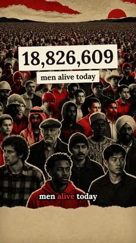](https://github.com/inematds/filme-em-codigo/releases/download/fonte-v1/style_vox_julian.mp4)  
[▶ Watch the video: style_vox_julian.mp4](https://github.com/inematds/filme-em-codigo/releases/download/fonte-v1/style_vox_julian.mp4)

*Paper cutout collage (Vox-style)*

### Paper cutout collage

**Same style, your idea**

```text
Make a 10 to 20 second vertical animated short about [YOUR IDEA HERE]. Tone: a short history or science story with one twist. First write a 5 or 6 line script (40 to 55 words, under 20 seconds spoken), fact-check every claim on the web and list the sources. Write numbers as words for the voice and digits in the captions. Beat structure: a hook line with a big number over a wide establishing image; a hero line; an evidence line with a statistic shown as a grid of tokens where one lights up; a map or diagram line on a styled panel over a blurred, darkened keyframe; a reversal line where a claim gets struck through; and a payoff question. Plan about seven keyframes, one per beat. Style for every keyframe: editorial paper cutout collage explainer, layered torn paper shapes, halftone archival photo cutouts, risograph grain, cream, black and vivid red palette, hand-cut edges with soft drop shadows, documentary explainer graphic style. Write each keyframe prompt as the subject, then that style sentence, then "Vertical 9:16 portrait composition with the main subject in the middle of the frame and a calmer lower quarter. No text, no letters, no logos, no watermark." and generate them at 9:16. Animate each keyframe in one WebGL shader: make a depth map with a monocular depth model, offset the lookup by depth for a parallax camera, sway the near foreground, drift the far sky sideways very slightly, and add a half-strength line boil (a line boil is a small noise warp that steps 8 times a second). Camera: a slow pan-and-zoom (zoom 1.02 to 1.12 with a sideways pan that alternates direction every segment). Transitions: a 0.35 s slide in from the right with a 4 degree tilt and a drop shadow. Labels on their words: Lora Bold in black #111111 on a cream paper box #f4ecd8 rotated minus 1.5 degrees, accent red #e1251b. Panels and overlays: the same palette, plus a halftone dot screen, a paper texture and fine grain. Captions: Lora Bold at 92 px, white with an 8 px black outline, two or three words per page near the bottom, spoken word in #E1251B. Music: a dark synth arpeggio around 116 bpm that drops out for the reversal. Sound effects: ticks under the counter, risers and shimmers on the key numbers, a record scratch on the reversal and a low synth stab on the twist. Build it in Remotion (React) with three.js, 1080x1920 at 30 fps, keying every cut, event and sound to word timestamps from the voice. Synthesise all music and effects in code, with the music about 20 dB under the voice and the effects just below it.
```

**Copy this exact film · Exact prompt**

```text
Recreate this 26 second vertical short about Genghis Khan's descendants in one consistent illustrated look, exactly as described. Narration, word for word (about 26 seconds): "About twenty million men alive today may descend from one man: Genghis Khan. In 2003, geneticists found that one in twelve men across a huge stretch of Asia carried almost the same Y chromosome. It seemed to spread with the Mongol Empire, the largest land empire in history. Case closed? Not quite. DNA from Mongol graves of his time showed a different line. So the world's most famous family tree might belong to someone else." Look: editorial paper cutout collage explainer, layered torn paper shapes, halftone archival photo cutouts, risograph grain, cream, black and vivid red palette, hand-cut edges with soft drop shadows, documentary explainer graphic style. First generate seven keyframe images at 9:16 (1080x1920) with these exact prompts, in beat order: 1. crowd: "a vast crowd of hundreds of ordinary men of many different backgrounds standing shoulder to shoulder across a wide plain, the crowd stretching all the way to the horizon, seen from slightly above. editorial paper cutout collage explainer, layered torn paper shapes, halftone archival photo cutouts, risograph grain, cream, black and vivid red palette, hand-cut edges with soft drop shadows, documentary explainer graphic style. Vertical 9:16, subject centred, simple lower quarter, no text or logos." 2. khan: "Genghis Khan, the 13th century Mongol ruler, with a fur-trimmed pointed helmet, long thin moustache and a deel robe, sitting proudly on a sturdy steppe horse on a grassy hill, heroic low angle, centred. editorial paper cutout collage explainer, layered torn paper shapes, halftone archival photo cutouts, risograph grain, cream, black and vivid red palette, hand-cut edges with soft drop shadows, documentary explainer graphic style. Vertical 9:16, subject centred, simple lower quarter, no text or logos." 3. lab: "two geneticists in white lab coats in a modern genetics laboratory, studying a large glowing DNA double helix model, racks of test tubes, a microscope and sample trays. editorial paper cutout collage explainer, layered torn paper shapes, halftone archival photo cutouts, risograph grain, cream, black and vivid red palette, hand-cut edges with soft drop shadows, documentary explainer graphic style. Vertical 9:16, subject centred, simple lower quarter, no text or logos." 4. army: "a long column of Mongol horsemen with banners riding out across the endless Eurasian steppe, clouds of dust, distant mountains, epic sense of scale. editorial paper cutout collage explainer, layered torn paper shapes, halftone archival photo cutouts, risograph grain, cream, black and vivid red palette, hand-cut edges with soft drop shadows, documentary explainer graphic style. Vertical 9:16, subject centred, simple lower quarter, no text or logos." 5. case: "a detective's wooden desk under a lamp with a thick closed case file folder, a magnifying glass, a cup of tea and an old map of Asia, moody and mysterious. editorial paper cutout collage explainer, layered torn paper shapes, halftone archival photo cutouts, risograph grain, cream, black and vivid red palette, hand-cut edges with soft drop shadows, documentary explainer graphic style. Vertical 9:16, subject centred, simple lower quarter, no text or logos." 6. grave: "archaeologists excavating an ancient Mongol burial mound at dusk, a skeleton partly uncovered in the dig, brushes and trowels, a faint glowing DNA strand rising out of the grave. editorial paper cutout collage explainer, layered torn paper shapes, halftone archival photo cutouts, risograph grain, cream, black and vivid red palette, hand-cut edges with soft drop shadows, documentary explainer graphic style. Vertical 9:16, subject centred, simple lower quarter, no text or logos." 7. tree: "a gigantic ancient family tree whose branches spread across the whole sky, hundreds of tiny portrait medallions hanging from the branches, and at the root a mysterious hooded silhouette. editorial paper cutout collage explainer, layered torn paper shapes, halftone archival photo cutouts, risograph grain, cream, black and vivid red palette, hand-cut edges with soft drop shadows, documentary explainer graphic style. Vertical 9:16, subject centred, simple lower quarter, no text or logos." Animate each keyframe in one WebGL shader: make a depth map with a monocular depth model, offset the lookup by depth for a parallax camera, sway the near foreground, drift the far sky sideways very slightly, and add a half-strength line boil (a line boil is a small noise warp that steps 8 times a second). Camera on each keyframe: a slow pan-and-zoom (zoom 1.02 to 1.12 with a sideways pan that alternates direction every segment). Transition between segments: a 0.35 s slide in from the right with a 4 degree tilt and a drop shadow. On-screen labels: Lora Bold in black #111111 on a cream paper box #f4ecd8 rotated minus 1.5 degrees, accent red #e1251b. Map panel skin: cream sea #efe6d0, tan land #d8cdb0, black 3 px lines, a red region rgba(225,37,27,0.75), a black empire rgba(17,17,17,0.55), red dots, paper texture. Texture overlays: a halftone dot screen, a paper texture and fine grain. Timeline: 0 to 2.3 s, crowd: a counter climbs to 20,000,000 from "About" to "today", with "men alive today" on "men". 2.3 to 5.05 s, khan: "Genghis Khan" on "Genghis". 5.05 to 7.6 s, lab: "2003" and "geneticists" on their words. 7.6 to 8.45 s, the crowd zoomed to 1.35x: "1 in 12" over a 6 by 2 grid of rounded pill tokens popping in, the eighth glowing in the accent colour on "twelve". 8.45 to 12.6 s, the army blurred and darkened behind a rounded map panel of Asia: the sampled region wipes in east to west on "huge" and dots pop on "carried", with "a huge stretch of Asia" and "the same Y chromosome" on "Y". 12.6 to 14.45 s, clear army: "Mongol Empire". 14.45 to 16.55 s, map again: the empire floods out from a pulsing Mongolia marker, with "largest land empire" and "24 million km²". 16.55 to 18.6 s, case: "CASE CLOSED?", struck through by an accent bar on "Not" as "Not quite." appears in the accent. 18.6 to 22.15 s, grave: "Mongol graves", "1130 to 1250" on "time" and "a different line" in the accent. 22.15 s to the end, tree: "most famous family tree", replaced on "someone" by "someone else?" in the accent. Labels fade and rise in over 0.2 s. Captions: burn in word-by-word captions in Lora Bold at 92 px, white with an 8 px black outline and a 3 px shadow, two or three words per page, centred about 330 px above the bottom, with the spoken word in #E1251B. Music: a dark A minor synth arpeggio of detuned saw waves through a low-pass filter at 116 bpm with a deep bass note every bar, ducking out for "Not quite". Sound effects: a fast run of ticks while the counter climbs, a noise riser into "twelve" with a bright shimmer, a riser on "spread", a record scratch on "Not", a low synth stab on "different" and a long shimmer on "someone". Technical setup: Remotion (React) with three.js, 1080x1920 at 30 fps, about 26 seconds. Make the voice with any text to speech engine, get word timestamps, and key every cut, event and sound to the start of its word. Burn the captions in. Synthesise all music and effects in code, with no samples. Mix the music about 20 dB under the voice and ducked under speech, with the effects just below the voice.
```

[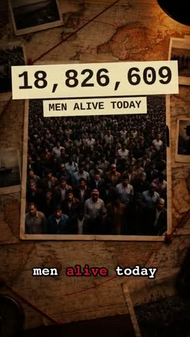](https://github.com/inematds/filme-em-codigo/releases/download/fonte-v1/style_mapdoc_julian.mp4)  
[▶ Watch the video: style_mapdoc_julian.mp4](https://github.com/inematds/filme-em-codigo/releases/download/fonte-v1/style_mapdoc_julian.mp4)

*Documentary map desk (Johnny Harris-style)*

### Documentary map desk

**Same style, your idea**

```text
Make a 10 to 20 second vertical animated short about [YOUR IDEA HERE]. Tone: a short history or science story with one twist. First write a 5 or 6 line script (40 to 55 words, under 20 seconds spoken), fact-check every claim on the web and list the sources. Write numbers as words for the voice and digits in the captions. Beat structure: a hook line with a big number over a wide establishing image; a hero line; an evidence line with a statistic shown as a grid of tokens where one lights up; a map or diagram line on a styled panel over a blurred, darkened keyframe; a reversal line where a claim gets struck through; and a payoff question. Plan about seven keyframes, one per beat. Style for every keyframe: documentary explainer shot on a vintage paper map table, hand-drawn red marker lines, push pins and red string, taped polaroid photos and archival clippings, warm practical desk lighting, top-down tabletop photography. Write each keyframe prompt as the subject, then that style sentence, then "Vertical 9:16 portrait composition with the main subject in the middle of the frame and a calmer lower quarter. No text, no letters, no logos, no watermark." and generate them at 9:16. Animate each keyframe in one WebGL shader: make a depth map with a monocular depth model, offset the lookup by depth for a parallax camera, sway the near foreground, keep the sky still, and use no line boil (a line boil is a small noise warp that steps 8 times a second). Camera: a slow pan-and-zoom (zoom 1.02 to 1.12 with a sideways pan that alternates direction every segment). Transitions: a 0.4 s cross dissolve. Labels on their words: an uppercase bold typewriter monospace in dark brown #1b1410 on a taped parchment box rgba(240,226,180,0.94) rotated minus 2 degrees, accent red #c8102e. Panels and overlays: the same palette, plus a warm vignette and fine grain. Captions: a monospaced typewriter face (Courier style) at 92 px, white with an 8 px black outline, two or three words per page near the bottom, spoken word in #C8102E. Music: breathy flute phrases on a pentatonic scale over slow low zither plucks. Sound effects: deep drum hits on the hook, the reversal and the reveal, and a shimmer on the key statistic. Build it in Remotion (React) with three.js, 1080x1920 at 30 fps, keying every cut, event and sound to word timestamps from the voice. Synthesise all music and effects in code, with the music about 20 dB under the voice and the effects just below it.
```

**Copy this exact film · Exact prompt**

```text
Recreate this 26 second vertical short about Genghis Khan's descendants in one consistent illustrated look, exactly as described. Narration, word for word (about 26 seconds): "About twenty million men alive today may descend from one man: Genghis Khan. In 2003, geneticists found that one in twelve men across a huge stretch of Asia carried almost the same Y chromosome. It seemed to spread with the Mongol Empire, the largest land empire in history. Case closed? Not quite. DNA from Mongol graves of his time showed a different line. So the world's most famous family tree might belong to someone else." Look: documentary explainer shot on a vintage paper map table, hand-drawn red marker lines, push pins and red string, taped polaroid photos and archival clippings, warm practical desk lighting, top-down tabletop photography. First generate seven keyframe images at 9:16 (1080x1920) with these exact prompts, in beat order: 1. crowd: "a vast crowd of hundreds of ordinary men of many different backgrounds standing shoulder to shoulder across a wide plain, the crowd stretching all the way to the horizon, seen from slightly above. documentary explainer shot on a vintage paper map table, hand-drawn red marker lines, push pins and red string, taped polaroid photos and archival clippings, warm practical desk lighting, top-down tabletop photography. Vertical 9:16, subject centred, simple lower quarter, no text or logos." 2. khan: "Genghis Khan, the 13th century Mongol ruler, with a fur-trimmed pointed helmet, long thin moustache and a deel robe, sitting proudly on a sturdy steppe horse on a grassy hill, heroic low angle, centred. documentary explainer shot on a vintage paper map table, hand-drawn red marker lines, push pins and red string, taped polaroid photos and archival clippings, warm practical desk lighting, top-down tabletop photography. Vertical 9:16, subject centred, simple lower quarter, no text or logos." 3. lab: "two geneticists in white lab coats in a modern genetics laboratory, studying a large glowing DNA double helix model, racks of test tubes, a microscope and sample trays. documentary explainer shot on a vintage paper map table, hand-drawn red marker lines, push pins and red string, taped polaroid photos and archival clippings, warm practical desk lighting, top-down tabletop photography. Vertical 9:16, subject centred, simple lower quarter, no text or logos." 4. army: "a long column of Mongol horsemen with banners riding out across the endless Eurasian steppe, clouds of dust, distant mountains, epic sense of scale. documentary explainer shot on a vintage paper map table, hand-drawn red marker lines, push pins and red string, taped polaroid photos and archival clippings, warm practical desk lighting, top-down tabletop photography. Vertical 9:16, subject centred, simple lower quarter, no text or logos." 5. case: "a detective's wooden desk under a lamp with a thick closed case file folder, a magnifying glass, a cup of tea and an old map of Asia, moody and mysterious. documentary explainer shot on a vintage paper map table, hand-drawn red marker lines, push pins and red string, taped polaroid photos and archival clippings, warm practical desk lighting, top-down tabletop photography. Vertical 9:16, subject centred, simple lower quarter, no text or logos." 6. grave: "archaeologists excavating an ancient Mongol burial mound at dusk, a skeleton partly uncovered in the dig, brushes and trowels, a faint glowing DNA strand rising out of the grave. documentary explainer shot on a vintage paper map table, hand-drawn red marker lines, push pins and red string, taped polaroid photos and archival clippings, warm practical desk lighting, top-down tabletop photography. Vertical 9:16, subject centred, simple lower quarter, no text or logos." 7. tree: "a gigantic ancient family tree whose branches spread across the whole sky, hundreds of tiny portrait medallions hanging from the branches, and at the root a mysterious hooded silhouette. documentary explainer shot on a vintage paper map table, hand-drawn red marker lines, push pins and red string, taped polaroid photos and archival clippings, warm practical desk lighting, top-down tabletop photography. Vertical 9:16, subject centred, simple lower quarter, no text or logos." Animate each keyframe in one WebGL shader: make a depth map with a monocular depth model, offset the lookup by depth for a parallax camera, sway the near foreground, keep the sky still, and use no line boil (a line boil is a small noise warp that steps 8 times a second). Camera on each keyframe: a slow pan-and-zoom (zoom 1.02 to 1.12 with a sideways pan that alternates direction every segment). Transition between segments: a 0.4 s cross dissolve. On-screen labels: an uppercase bold typewriter monospace in dark brown #1b1410 on a taped parchment box rgba(240,226,180,0.94) rotated minus 2 degrees, accent red #c8102e. Map panel skin: a brown leather surround #6b4a2c, parchment land #ead9b0, brown lines #5a4630, a faint red region and empire, red dots #c8102e, red marker arcs drawn from Mongolia to the edges of the empire and a pulsing red pin. Texture overlays: a warm vignette and fine grain. Timeline: 0 to 2.3 s, crowd: a counter climbs to 20,000,000 from "About" to "today", with "men alive today" on "men". 2.3 to 5.05 s, khan: "Genghis Khan" on "Genghis". 5.05 to 7.6 s, lab: "2003" and "geneticists" on their words. 7.6 to 8.45 s, the crowd zoomed to 1.35x: "1 in 12" over a 6 by 2 grid of rounded pill tokens popping in, the eighth glowing in the accent colour on "twelve". 8.45 to 12.6 s, the army blurred and darkened behind a rounded map panel of Asia: the sampled region wipes in east to west on "huge" and dots pop on "carried", with "a huge stretch of Asia" and "the same Y chromosome" on "Y". 12.6 to 14.45 s, clear army: "Mongol Empire". 14.45 to 16.55 s, map again: the empire floods out from a pulsing Mongolia marker, with "largest land empire" and "24 million km²". 16.55 to 18.6 s, case: "CASE CLOSED?", struck through by an accent bar on "Not" as "Not quite." appears in the accent. 18.6 to 22.15 s, grave: "Mongol graves", "1130 to 1250" on "time" and "a different line" in the accent. 22.15 s to the end, tree: "most famous family tree", replaced on "someone" by "someone else?" in the accent. Labels fade and rise in over 0.2 s. Captions: burn in word-by-word captions in a monospaced typewriter face (Courier style) at 92 px, white with an 8 px black outline and a 3 px shadow, two or three words per page, centred about 330 px above the bottom, with the spoken word in #C8102E. Music: soft breathy bamboo-flute phrases on an A minor pentatonic scale over slow low zither plucks every 1.2 seconds. Sound effects: deep taiko hits at the start and on "Khan", at 12.6 s, "closed", "Not", "different" and "someone", a shimmer on "twelve" and a quiet hoof gallop under the army. Technical setup: Remotion (React) with three.js, 1080x1920 at 30 fps, about 26 seconds. Make the voice with any text to speech engine, get word timestamps, and key every cut, event and sound to the start of its word. Burn the captions in. Synthesise all music and effects in code, with no samples. Mix the music about 20 dB under the voice and ducked under speech, with the effects just below the voice.
```

[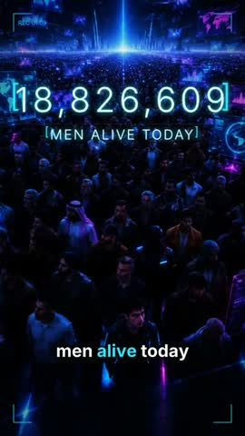](https://github.com/inematds/filme-em-codigo/releases/download/fonte-v1/style_future_julian.mp4)  
[▶ Watch the video: style_future_julian.mp4](https://github.com/inematds/filme-em-codigo/releases/download/fonte-v1/style_future_julian.mp4)

*Futuristic 3D (Holographic sci-fi)*

### Futuristic 3D

**Same style, your idea**

```text
Make a 10 to 20 second vertical animated short about [YOUR IDEA HERE]. Tone: a short history or science story with one twist. First write a 5 or 6 line script (40 to 55 words, under 20 seconds spoken), fact-check every claim on the web and list the sources. Write numbers as words for the voice and digits in the captions. Beat structure: a hook line with a big number over a wide establishing image; a hero line; an evidence line with a statistic shown as a grid of tokens where one lights up; a map or diagram line on a styled panel over a blurred, darkened keyframe; a reversal line where a claim gets struck through; and a payoff question. Plan about seven keyframes, one per beat. Style for every keyframe: ultra futuristic cinematic 3D render, holographic interfaces and floating data panels, neon cyan and magenta light, glass and chrome surfaces, volumetric light rays, deep blue darkness, high-end sci-fi. Write each keyframe prompt as the subject, then that style sentence, then "Vertical 9:16 portrait composition with the main subject in the middle of the frame and a calmer lower quarter. No text, no letters, no logos, no watermark." and generate them at 9:16. Animate each keyframe in one WebGL shader: make a depth map with a monocular depth model, offset the lookup by depth for a parallax camera, sway the near foreground, drift the far sky sideways very slightly, and use no line boil (a line boil is a small noise warp that steps 8 times a second). Camera: a slow pan-and-zoom (zoom 1.02 to 1.12 with a sideways pan that alternates direction every segment). Transitions: a 0.25 s glitch (8 flicker steps with sideways offsets and a hue shift). Labels on their words: Inter Light uppercase in ice white #e8fbff with 0.12 em tracking, a cyan #29e3ff glow and cyan square brackets either side, accent cyan #29e3ff. Panels and overlays: the same palette, plus cyan HUD corner brackets, a REC timecode in the top left, a sweeping scan line, horizontal scanlines and a vignette. Captions: Inter at 92 px, white with an 8 px black outline, two or three words per page near the bottom, spoken word in #29E3FF. Music: a dark synth arpeggio around 116 bpm that drops out for the reversal. Sound effects: ticks under the counter, risers and shimmers on the key numbers, a record scratch on the reversal and a low synth stab on the twist. Build it in Remotion (React) with three.js, 1080x1920 at 30 fps, keying every cut, event and sound to word timestamps from the voice. Synthesise all music and effects in code, with the music about 20 dB under the voice and the effects just below it.
```

**Copy this exact film · Exact prompt**

```text
Recreate this 26 second vertical short about Genghis Khan's descendants in one consistent illustrated look, exactly as described. Narration, word for word (about 26 seconds): "About twenty million men alive today may descend from one man: Genghis Khan. In 2003, geneticists found that one in twelve men across a huge stretch of Asia carried almost the same Y chromosome. It seemed to spread with the Mongol Empire, the largest land empire in history. Case closed? Not quite. DNA from Mongol graves of his time showed a different line. So the world's most famous family tree might belong to someone else." Look: ultra futuristic cinematic 3D render, holographic interfaces and floating data panels, neon cyan and magenta light, glass and chrome surfaces, volumetric light rays, deep blue darkness, high-end sci-fi. First generate seven keyframe images at 9:16 (1080x1920) with these exact prompts, in beat order: 1. crowd: "a vast crowd of hundreds of ordinary men of many different backgrounds standing shoulder to shoulder across a wide plain, the crowd stretching all the way to the horizon, seen from slightly above. ultra futuristic cinematic 3D render, holographic interfaces and floating data panels, neon cyan and magenta light, glass and chrome surfaces, volumetric light rays, deep blue darkness, high-end sci-fi. Vertical 9:16, subject centred, simple lower quarter, no text or logos." 2. khan: "Genghis Khan, the 13th century Mongol ruler, with a fur-trimmed pointed helmet, long thin moustache and a deel robe, sitting proudly on a sturdy steppe horse on a grassy hill, heroic low angle, centred. ultra futuristic cinematic 3D render, holographic interfaces and floating data panels, neon cyan and magenta light, glass and chrome surfaces, volumetric light rays, deep blue darkness, high-end sci-fi. Vertical 9:16, subject centred, simple lower quarter, no text or logos." 3. lab: "two geneticists in white lab coats in a modern genetics laboratory, studying a large glowing DNA double helix model, racks of test tubes, a microscope and sample trays. ultra futuristic cinematic 3D render, holographic interfaces and floating data panels, neon cyan and magenta light, glass and chrome surfaces, volumetric light rays, deep blue darkness, high-end sci-fi. Vertical 9:16, subject centred, simple lower quarter, no text or logos." 4. army: "a long column of Mongol horsemen with banners riding out across the endless Eurasian steppe, clouds of dust, distant mountains, epic sense of scale. ultra futuristic cinematic 3D render, holographic interfaces and floating data panels, neon cyan and magenta light, glass and chrome surfaces, volumetric light rays, deep blue darkness, high-end sci-fi. Vertical 9:16, subject centred, simple lower quarter, no text or logos." 5. case: "a detective's wooden desk under a lamp with a thick closed case file folder, a magnifying glass, a cup of tea and an old map of Asia, moody and mysterious. ultra futuristic cinematic 3D render, holographic interfaces and floating data panels, neon cyan and magenta light, glass and chrome surfaces, volumetric light rays, deep blue darkness, high-end sci-fi. Vertical 9:16, subject centred, simple lower quarter, no text or logos." 6. grave: "archaeologists excavating an ancient Mongol burial mound at dusk, a skeleton partly uncovered in the dig, brushes and trowels, a faint glowing DNA strand rising out of the grave. ultra futuristic cinematic 3D render, holographic interfaces and floating data panels, neon cyan and magenta light, glass and chrome surfaces, volumetric light rays, deep blue darkness, high-end sci-fi. Vertical 9:16, subject centred, simple lower quarter, no text or logos." 7. tree: "a gigantic ancient family tree whose branches spread across the whole sky, hundreds of tiny portrait medallions hanging from the branches, and at the root a mysterious hooded silhouette. ultra futuristic cinematic 3D render, holographic interfaces and floating data panels, neon cyan and magenta light, glass and chrome surfaces, volumetric light rays, deep blue darkness, high-end sci-fi. Vertical 9:16, subject centred, simple lower quarter, no text or logos." Animate each keyframe in one WebGL shader: make a depth map with a monocular depth model, offset the lookup by depth for a parallax camera, sway the near foreground, drift the far sky sideways very slightly, and use no line boil (a line boil is a small noise warp that steps 8 times a second). Camera on each keyframe: a slow pan-and-zoom (zoom 1.02 to 1.12 with a sideways pan that alternates direction every segment). Transition between segments: a 0.25 s glitch (8 flicker steps with sideways offsets and a hue shift). On-screen labels: Inter Light uppercase in ice white #e8fbff with 0.12 em tracking, a cyan #29e3ff glow and cyan square brackets either side, accent cyan #29e3ff. Map panel skin: deep navy #030a1c with a cyan 30 px grid, translucent cyan land rgba(41,227,255,0.08), cyan 2 px lines, a magenta region rgba(255,46,186,0.55), a cyan empire rgba(41,227,255,0.35), magenta dots #ff2eba. Texture overlays: cyan HUD corner brackets, a REC timecode in the top left, a sweeping scan line, horizontal scanlines and a vignette. Timeline: 0 to 2.3 s, crowd: a counter climbs to 20,000,000 from "About" to "today", with "men alive today" on "men". 2.3 to 5.05 s, khan: "Genghis Khan" on "Genghis". 5.05 to 7.6 s, lab: "2003" and "geneticists" on their words. 7.6 to 8.45 s, the crowd zoomed to 1.35x: "1 in 12" over a 6 by 2 grid of rounded pill tokens popping in, the eighth glowing in the accent colour on "twelve". 8.45 to 12.6 s, the army blurred and darkened behind a rounded map panel of Asia: the sampled region wipes in east to west on "huge" and dots pop on "carried", with "a huge stretch of Asia" and "the same Y chromosome" on "Y". 12.6 to 14.45 s, clear army: "Mongol Empire". 14.45 to 16.55 s, map again: the empire floods out from a pulsing Mongolia marker, with "largest land empire" and "24 million km²". 16.55 to 18.6 s, case: "CASE CLOSED?", struck through by an accent bar on "Not" as "Not quite." appears in the accent. 18.6 to 22.15 s, grave: "Mongol graves", "1130 to 1250" on "time" and "a different line" in the accent. 22.15 s to the end, tree: "most famous family tree", replaced on "someone" by "someone else?" in the accent. Labels fade and rise in over 0.2 s. Captions: burn in word-by-word captions in Inter at 92 px, white with an 8 px black outline and a 3 px shadow, two or three words per page, centred about 330 px above the bottom, with the spoken word in #29E3FF. Music: a dark A minor synth arpeggio of detuned saw waves through a low-pass filter at 116 bpm with a deep bass note every bar, ducking out for "Not quite". Sound effects: a fast run of ticks while the counter climbs, a noise riser into "twelve" with a bright shimmer, a riser on "spread", a record scratch on "Not", a low synth stab on "different" and a long shimmer on "someone". Technical setup: Remotion (React) with three.js, 1080x1920 at 30 fps, about 26 seconds. Make the voice with any text to speech engine, get word timestamps, and key every cut, event and sound to the start of its word. Burn the captions in. Synthesise all music and effects in code, with no samples. Mix the music about 20 dB under the voice and ducked under speech, with the effects just below the voice.
```

[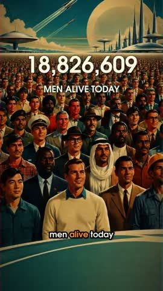](https://github.com/inematds/filme-em-codigo/releases/download/fonte-v1/style_retro_julian.mp4)  
[▶ Watch the video: style_retro_julian.mp4](https://github.com/inematds/filme-em-codigo/releases/download/fonte-v1/style_retro_julian.mp4)

*Retro-futurism (1950s to 60s atomic age)*

### Retro-futurism

**Same style, your idea**

```text
Make a 10 to 20 second vertical animated short about [YOUR IDEA HERE]. Tone: a short history or science story with one twist. First write a 5 or 6 line script (40 to 55 words, under 20 seconds spoken), fact-check every claim on the web and list the sources. Write numbers as words for the voice and digits in the captions. Beat structure: a hook line with a big number over a wide establishing image; a hero line; an evidence line with a statistic shown as a grid of tokens where one lights up; a map or diagram line on a styled panel over a blurred, darkened keyframe; a reversal line where a claim gets struck through; and a payoff question. Plan about seven keyframes, one per beat. Style for every keyframe: 1960s atomic age retro-futurist sci-fi poster illustration, gouache and airbrush, rounded chrome shapes, teal, cream and orange palette, halftone print grain, optimistic space-age design. Write each keyframe prompt as the subject, then that style sentence, then "Vertical 9:16 portrait composition with the main subject in the middle of the frame and a calmer lower quarter. No text, no letters, no logos, no watermark." and generate them at 9:16. Animate each keyframe in one WebGL shader: make a depth map with a monocular depth model, offset the lookup by depth for a parallax camera, sway the near foreground, drift the far sky sideways at a medium pace, and use no line boil (a line boil is a small noise warp that steps 8 times a second). Camera: a slow pan-and-zoom (zoom 1.02 to 1.12 with a sideways pan that alternates direction every segment). Transitions: a 0.45 s iris wipe opening from the centre. Labels on their words: an uppercase geometric sans in cream #fff3dc with a 6 px deep teal #0e3b43 stroke, accent orange #ff8a1f. Panels and overlays: the same palette, plus scanlines, red and cyan chromatic edge fringes, grain and a vignette. Captions: a geometric rounded sans (Avant Garde style) at 92 px, white with an 8 px black outline, two or three words per page near the bottom, spoken word in #FF8A1F. Music: a dark synth arpeggio around 116 bpm that drops out for the reversal. Sound effects: ticks under the counter, risers and shimmers on the key numbers, a record scratch on the reversal and a low synth stab on the twist. Build it in Remotion (React) with three.js, 1080x1920 at 30 fps, keying every cut, event and sound to word timestamps from the voice. Synthesise all music and effects in code, with the music about 20 dB under the voice and the effects just below it.
```

**Copy this exact film · Exact prompt**

```text
Recreate this 26 second vertical short about Genghis Khan's descendants in one consistent illustrated look, exactly as described. Narration, word for word (about 26 seconds): "About twenty million men alive today may descend from one man: Genghis Khan. In 2003, geneticists found that one in twelve men across a huge stretch of Asia carried almost the same Y chromosome. It seemed to spread with the Mongol Empire, the largest land empire in history. Case closed? Not quite. DNA from Mongol graves of his time showed a different line. So the world's most famous family tree might belong to someone else." Look: 1960s atomic age retro-futurist sci-fi poster illustration, gouache and airbrush, rounded chrome shapes, teal, cream and orange palette, halftone print grain, optimistic space-age design. First generate seven keyframe images at 9:16 (1080x1920) with these exact prompts, in beat order: 1. crowd: "a vast crowd of hundreds of ordinary men of many different backgrounds standing shoulder to shoulder across a wide plain, the crowd stretching all the way to the horizon, seen from slightly above. 1960s atomic age retro-futurist sci-fi poster illustration, gouache and airbrush, rounded chrome shapes, teal, cream and orange palette, halftone print grain, optimistic space-age design. Vertical 9:16, subject centred, simple lower quarter, no text or logos." 2. khan: "Genghis Khan, the 13th century Mongol ruler, with a fur-trimmed pointed helmet, long thin moustache and a deel robe, sitting proudly on a sturdy steppe horse on a grassy hill, heroic low angle, centred. 1960s atomic age retro-futurist sci-fi poster illustration, gouache and airbrush, rounded chrome shapes, teal, cream and orange palette, halftone print grain, optimistic space-age design. Vertical 9:16, subject centred, simple lower quarter, no text or logos." 3. lab: "two geneticists in white lab coats in a modern genetics laboratory, studying a large glowing DNA double helix model, racks of test tubes, a microscope and sample trays. 1960s atomic age retro-futurist sci-fi poster illustration, gouache and airbrush, rounded chrome shapes, teal, cream and orange palette, halftone print grain, optimistic space-age design. Vertical 9:16, subject centred, simple lower quarter, no text or logos." 4. army: "a long column of Mongol horsemen with banners riding out across the endless Eurasian steppe, clouds of dust, distant mountains, epic sense of scale. 1960s atomic age retro-futurist sci-fi poster illustration, gouache and airbrush, rounded chrome shapes, teal, cream and orange palette, halftone print grain, optimistic space-age design. Vertical 9:16, subject centred, simple lower quarter, no text or logos." 5. case: "a detective's wooden desk under a lamp with a thick closed case file folder, a magnifying glass, a cup of tea and an old map of Asia, moody and mysterious. 1960s atomic age retro-futurist sci-fi poster illustration, gouache and airbrush, rounded chrome shapes, teal, cream and orange palette, halftone print grain, optimistic space-age design. Vertical 9:16, subject centred, simple lower quarter, no text or logos." 6. grave: "archaeologists excavating an ancient Mongol burial mound at dusk, a skeleton partly uncovered in the dig, brushes and trowels, a faint glowing DNA strand rising out of the grave. 1960s atomic age retro-futurist sci-fi poster illustration, gouache and airbrush, rounded chrome shapes, teal, cream and orange palette, halftone print grain, optimistic space-age design. Vertical 9:16, subject centred, simple lower quarter, no text or logos." 7. tree: "a gigantic ancient family tree whose branches spread across the whole sky, hundreds of tiny portrait medallions hanging from the branches, and at the root a mysterious hooded silhouette. 1960s atomic age retro-futurist sci-fi poster illustration, gouache and airbrush, rounded chrome shapes, teal, cream and orange palette, halftone print grain, optimistic space-age design. Vertical 9:16, subject centred, simple lower quarter, no text or logos." Animate each keyframe in one WebGL shader: make a depth map with a monocular depth model, offset the lookup by depth for a parallax camera, sway the near foreground, drift the far sky sideways at a medium pace, and use no line boil (a line boil is a small noise warp that steps 8 times a second). Camera on each keyframe: a slow pan-and-zoom (zoom 1.02 to 1.12 with a sideways pan that alternates direction every segment). Transition between segments: a 0.45 s iris wipe opening from the centre. On-screen labels: an uppercase geometric sans in cream #fff3dc with a 6 px deep teal #0e3b43 stroke, accent orange #ff8a1f. Map panel skin: deep teal sea #0e3b43, cream land #f5e6c8, teal 3 px lines, an orange region rgba(255,138,31,0.85), a red empire rgba(232,72,48,0.6), orange dots. Texture overlays: scanlines, red and cyan chromatic edge fringes, grain and a vignette. Timeline: 0 to 2.3 s, crowd: a counter climbs to 20,000,000 from "About" to "today", with "men alive today" on "men". 2.3 to 5.05 s, khan: "Genghis Khan" on "Genghis". 5.05 to 7.6 s, lab: "2003" and "geneticists" on their words. 7.6 to 8.45 s, the crowd zoomed to 1.35x: "1 in 12" over a 6 by 2 grid of rounded pill tokens popping in, the eighth glowing in the accent colour on "twelve". 8.45 to 12.6 s, the army blurred and darkened behind a rounded map panel of Asia: the sampled region wipes in east to west on "huge" and dots pop on "carried", with "a huge stretch of Asia" and "the same Y chromosome" on "Y". 12.6 to 14.45 s, clear army: "Mongol Empire". 14.45 to 16.55 s, map again: the empire floods out from a pulsing Mongolia marker, with "largest land empire" and "24 million km²". 16.55 to 18.6 s, case: "CASE CLOSED?", struck through by an accent bar on "Not" as "Not quite." appears in the accent. 18.6 to 22.15 s, grave: "Mongol graves", "1130 to 1250" on "time" and "a different line" in the accent. 22.15 s to the end, tree: "most famous family tree", replaced on "someone" by "someone else?" in the accent. Labels fade and rise in over 0.2 s. Captions: burn in word-by-word captions in a geometric rounded sans (Avant Garde style) at 92 px, white with an 8 px black outline and a 3 px shadow, two or three words per page, centred about 330 px above the bottom, with the spoken word in #FF8A1F. Music: a dark A minor synth arpeggio of detuned saw waves through a low-pass filter at 116 bpm with a deep bass note every bar, ducking out for "Not quite". Sound effects: a fast run of ticks while the counter climbs, a noise riser into "twelve" with a bright shimmer, a riser on "spread", a record scratch on "Not", a low synth stab on "different" and a long shimmer on "someone". Technical setup: Remotion (React) with three.js, 1080x1920 at 30 fps, about 26 seconds. Make the voice with any text to speech engine, get word timestamps, and key every cut, event and sound to the start of its word. Burn the captions in. Synthesise all music and effects in code, with no samples. Mix the music about 20 dB under the voice and ducked under speech, with the effects just below the voice.
```

[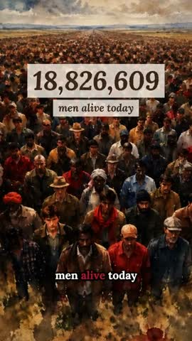](https://github.com/inematds/filme-em-codigo/releases/download/fonte-v1/style_watercolor_julian.mp4)  
[▶ Watch the video: style_watercolor_julian.mp4](https://github.com/inematds/filme-em-codigo/releases/download/fonte-v1/style_watercolor_julian.mp4)

*Watercolour (Painted watercolour)*

### Watercolour

**Same style, your idea**

```text
Make a 10 to 20 second vertical animated short about [YOUR IDEA HERE]. Tone: a short history or science story with one twist. First write a 5 or 6 line script (40 to 55 words, under 20 seconds spoken), fact-check every claim on the web and list the sources. Write numbers as words for the voice and digits in the captions. Beat structure: a hook line with a big number over a wide establishing image; a hero line; an evidence line with a statistic shown as a grid of tokens where one lights up; a map or diagram line on a styled panel over a blurred, darkened keyframe; a reversal line where a claim gets struck through; and a payoff question. Plan about seven keyframes, one per beat. Style for every keyframe: loose expressive watercolour painting, wet-on-wet washes, visible cold-press paper texture, soft bleeding edges and pigment blooms, muted earthy palette with splashes of crimson. Write each keyframe prompt as the subject, then that style sentence, then "Vertical 9:16 portrait composition with the main subject in the middle of the frame and a calmer lower quarter. No text, no letters, no logos, no watermark." and generate them at 9:16. Animate each keyframe in one WebGL shader: make a depth map with a monocular depth model, offset the lookup by depth for a parallax camera, sway the near foreground, drift the far sky sideways fully, and add a light line boil (a line boil is a small noise warp that steps 8 times a second). Camera: a slow dreamy drift (zoom easing from 1.06 to 1.14 with a gentle sideways sine sway and a slow rise). Transitions: a 0.8 s watercolour bleed (a soft radial mask that blooms open with a blur). Labels on their words: Lora Bold Italic in dark umber #3a2418 on a soft paper box rgba(250,244,232,0.78), accent crimson #a3172b. Panels and overlays: the same palette, plus a warm paper texture with a deep inner bleed shadow and grain. Captions: Lora Bold at 92 px, white with an 8 px black outline, two or three words per page near the bottom, spoken word in #A3172B. Music: breathy flute phrases on a pentatonic scale over slow low zither plucks. Sound effects: deep drum hits on the hook, the reversal and the reveal, and a shimmer on the key statistic. Build it in Remotion (React) with three.js, 1080x1920 at 30 fps, keying every cut, event and sound to word timestamps from the voice. Synthesise all music and effects in code, with the music about 20 dB under the voice and the effects just below it.
```

**Copy this exact film · Exact prompt**

```text
Recreate this 26 second vertical short about Genghis Khan's descendants in one consistent illustrated look, exactly as described. Narration, word for word (about 26 seconds): "About twenty million men alive today may descend from one man: Genghis Khan. In 2003, geneticists found that one in twelve men across a huge stretch of Asia carried almost the same Y chromosome. It seemed to spread with the Mongol Empire, the largest land empire in history. Case closed? Not quite. DNA from Mongol graves of his time showed a different line. So the world's most famous family tree might belong to someone else." Look: loose expressive watercolour painting, wet-on-wet washes, visible cold-press paper texture, soft bleeding edges and pigment blooms, muted earthy palette with splashes of crimson. First generate seven keyframe images at 9:16 (1080x1920) with these exact prompts, in beat order: 1. crowd: "a vast crowd of hundreds of ordinary men of many different backgrounds standing shoulder to shoulder across a wide plain, the crowd stretching all the way to the horizon, seen from slightly above. loose expressive watercolour painting, wet-on-wet washes, visible cold-press paper texture, soft bleeding edges and pigment blooms, muted earthy palette with splashes of crimson. Vertical 9:16, subject centred, simple lower quarter, no text or logos." 2. khan: "Genghis Khan, the 13th century Mongol ruler, with a fur-trimmed pointed helmet, long thin moustache and a deel robe, sitting proudly on a sturdy steppe horse on a grassy hill, heroic low angle, centred. loose expressive watercolour painting, wet-on-wet washes, visible cold-press paper texture, soft bleeding edges and pigment blooms, muted earthy palette with splashes of crimson. Vertical 9:16, subject centred, simple lower quarter, no text or logos." 3. lab: "two geneticists in white lab coats in a modern genetics laboratory, studying a large glowing DNA double helix model, racks of test tubes, a microscope and sample trays. loose expressive watercolour painting, wet-on-wet washes, visible cold-press paper texture, soft bleeding edges and pigment blooms, muted earthy palette with splashes of crimson. Vertical 9:16, subject centred, simple lower quarter, no text or logos." 4. army: "a long column of Mongol horsemen with banners riding out across the endless Eurasian steppe, clouds of dust, distant mountains, epic sense of scale. loose expressive watercolour painting, wet-on-wet washes, visible cold-press paper texture, soft bleeding edges and pigment blooms, muted earthy palette with splashes of crimson. Vertical 9:16, subject centred, simple lower quarter, no text or logos." 5. case: "a detective's wooden desk under a lamp with a thick closed case file folder, a magnifying glass, a cup of tea and an old map of Asia, moody and mysterious. loose expressive watercolour painting, wet-on-wet washes, visible cold-press paper texture, soft bleeding edges and pigment blooms, muted earthy palette with splashes of crimson. Vertical 9:16, subject centred, simple lower quarter, no text or logos." 6. grave: "archaeologists excavating an ancient Mongol burial mound at dusk, a skeleton partly uncovered in the dig, brushes and trowels, a faint glowing DNA strand rising out of the grave. loose expressive watercolour painting, wet-on-wet washes, visible cold-press paper texture, soft bleeding edges and pigment blooms, muted earthy palette with splashes of crimson. Vertical 9:16, subject centred, simple lower quarter, no text or logos." 7. tree: "a gigantic ancient family tree whose branches spread across the whole sky, hundreds of tiny portrait medallions hanging from the branches, and at the root a mysterious hooded silhouette. loose expressive watercolour painting, wet-on-wet washes, visible cold-press paper texture, soft bleeding edges and pigment blooms, muted earthy palette with splashes of crimson. Vertical 9:16, subject centred, simple lower quarter, no text or logos." Animate each keyframe in one WebGL shader: make a depth map with a monocular depth model, offset the lookup by depth for a parallax camera, sway the near foreground, drift the far sky sideways fully, and add a light line boil (a line boil is a small noise warp that steps 8 times a second). Camera on each keyframe: a slow dreamy drift (zoom easing from 1.06 to 1.14 with a gentle sideways sine sway and a slow rise). Transition between segments: a 0.8 s watercolour bleed (a soft radial mask that blooms open with a blur). On-screen labels: Lora Bold Italic in dark umber #3a2418 on a soft paper box rgba(250,244,232,0.78), accent crimson #a3172b. Map panel skin: warm paper #f6efe2, translucent umber land, brown 2.5 px lines #5b4632, a crimson region rgba(163,23,43,0.45), an indigo empire rgba(80,70,140,0.35), crimson dots, paper texture. Texture overlays: a warm paper texture with a deep inner bleed shadow and grain. Timeline: 0 to 2.3 s, crowd: a counter climbs to 20,000,000 from "About" to "today", with "men alive today" on "men". 2.3 to 5.05 s, khan: "Genghis Khan" on "Genghis". 5.05 to 7.6 s, lab: "2003" and "geneticists" on their words. 7.6 to 8.45 s, the crowd zoomed to 1.35x: "1 in 12" over a 6 by 2 grid of rounded pill tokens popping in, the eighth glowing in the accent colour on "twelve". 8.45 to 12.6 s, the army blurred and darkened behind a rounded map panel of Asia: the sampled region wipes in east to west on "huge" and dots pop on "carried", with "a huge stretch of Asia" and "the same Y chromosome" on "Y". 12.6 to 14.45 s, clear army: "Mongol Empire". 14.45 to 16.55 s, map again: the empire floods out from a pulsing Mongolia marker, with "largest land empire" and "24 million km²". 16.55 to 18.6 s, case: "CASE CLOSED?", struck through by an accent bar on "Not" as "Not quite." appears in the accent. 18.6 to 22.15 s, grave: "Mongol graves", "1130 to 1250" on "time" and "a different line" in the accent. 22.15 s to the end, tree: "most famous family tree", replaced on "someone" by "someone else?" in the accent. Labels fade and rise in over 0.2 s. Captions: burn in word-by-word captions in Lora Bold at 92 px, white with an 8 px black outline and a 3 px shadow, two or three words per page, centred about 330 px above the bottom, with the spoken word in #A3172B. Music: soft breathy bamboo-flute phrases on an A minor pentatonic scale over slow low zither plucks every 1.2 seconds. Sound effects: deep taiko hits at the start and on "Khan", at 12.6 s, "closed", "Not", "different" and "someone", a shimmer on "twelve" and a quiet hoof gallop under the army. Technical setup: Remotion (React) with three.js, 1080x1920 at 30 fps, about 26 seconds. Make the voice with any text to speech engine, get word timestamps, and key every cut, event and sound to the start of its word. Burn the captions in. Synthesise all music and effects in code, with no samples. Mix the music about 20 dB under the voice and ducked under speech, with the effects just below the voice.
```

[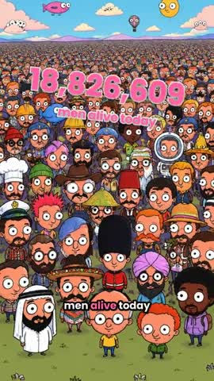](https://github.com/inematds/filme-em-codigo/releases/download/fonte-v1/style_quirky_julian.mp4)  
[▶ Watch the video: style_quirky_julian.mp4](https://github.com/inematds/filme-em-codigo/releases/download/fonte-v1/style_quirky_julian.mp4)

*Quirky absurd (Absurdist cartoon)*

### Quirky absurd

**Same style, your idea**

```text
Make a 10 to 20 second vertical animated short about [YOUR IDEA HERE]. Tone: a short history or science story with one twist. First write a 5 or 6 line script (40 to 55 words, under 20 seconds spoken), fact-check every claim on the web and list the sources. Write numbers as words for the voice and digits in the captions. Beat structure: a hook line with a big number over a wide establishing image; a hero line; an evidence line with a statistic shown as a grid of tokens where one lights up; a map or diagram line on a styled panel over a blurred, darkened keyframe; a reversal line where a claim gets struck through; and a payoff question. Plan about seven keyframes, one per beat. Style for every keyframe: absurd quirky cartoon, wobbly hand-drawn lines, googly eyes on everything including objects, pastel candy colours, surreal visual jokes, characters with tiny bodies and huge heads. Write each keyframe prompt as the subject, then that style sentence, then "Vertical 9:16 portrait composition with the main subject in the middle of the frame and a calmer lower quarter. No text, no letters, no logos, no watermark." and generate them at 9:16. Animate each keyframe in one WebGL shader: make a depth map with a monocular depth model, offset the lookup by depth for a parallax camera, sway the near foreground, drift the far sky sideways at a medium pace, and add a strong line boil (a line boil is a small noise warp that steps 8 times a second). Camera: a springy bounce (a damped zoom wobble at each cut and a slow rocking rotation of about 1.2 degrees). Transitions: a 0.35 s circle wipe from the centre. Labels on their words: Poppins ExtraBold in pink #ff5fa2 with a 12 px white stroke, rotated 4 degrees and gently wobbling, accent violet #7b5cff. Panels and overlays: the same palette, plus a gentle wobble on every label. Captions: Poppins Bold at 92 px, white with an 8 px black outline, two or three words per page near the bottom, spoken word in #FF5FA2. Music: a bouncy pentatonic plucked-string melody with soft drums around 120 bpm that drops out for the reversal. Sound effects: a gallop or travel sound under the action, a shimmer on the key number, a record scratch on the reversal and a deep drum on the reveal. Build it in Remotion (React) with three.js, 1080x1920 at 30 fps, keying every cut, event and sound to word timestamps from the voice. Synthesise all music and effects in code, with the music about 20 dB under the voice and the effects just below it.
```

**Copy this exact film · Exact prompt**

```text
Recreate this 26 second vertical short about Genghis Khan's descendants in one consistent illustrated look, exactly as described. Narration, word for word (about 26 seconds): "About twenty million men alive today may descend from one man: Genghis Khan. In 2003, geneticists found that one in twelve men across a huge stretch of Asia carried almost the same Y chromosome. It seemed to spread with the Mongol Empire, the largest land empire in history. Case closed? Not quite. DNA from Mongol graves of his time showed a different line. So the world's most famous family tree might belong to someone else." Look: absurd quirky cartoon, wobbly hand-drawn lines, googly eyes on everything including objects, pastel candy colours, surreal visual jokes, characters with tiny bodies and huge heads. First generate seven keyframe images at 9:16 (1080x1920) with these exact prompts, in beat order: 1. crowd: "a vast crowd of hundreds of ordinary men of many different backgrounds standing shoulder to shoulder across a wide plain, the crowd stretching all the way to the horizon, seen from slightly above. absurd quirky cartoon, wobbly hand-drawn lines, googly eyes on everything including objects, pastel candy colours, surreal visual jokes, characters with tiny bodies and huge heads. Vertical 9:16, subject centred, simple lower quarter, no text or logos." 2. khan: "Genghis Khan, the 13th century Mongol ruler, with a fur-trimmed pointed helmet, long thin moustache and a deel robe, sitting proudly on a sturdy steppe horse on a grassy hill, heroic low angle, centred. absurd quirky cartoon, wobbly hand-drawn lines, googly eyes on everything including objects, pastel candy colours, surreal visual jokes, characters with tiny bodies and huge heads. Vertical 9:16, subject centred, simple lower quarter, no text or logos." 3. lab: "two geneticists in white lab coats in a modern genetics laboratory, studying a large glowing DNA double helix model, racks of test tubes, a microscope and sample trays. absurd quirky cartoon, wobbly hand-drawn lines, googly eyes on everything including objects, pastel candy colours, surreal visual jokes, characters with tiny bodies and huge heads. Vertical 9:16, subject centred, simple lower quarter, no text or logos." 4. army: "a long column of Mongol horsemen with banners riding out across the endless Eurasian steppe, clouds of dust, distant mountains, epic sense of scale. absurd quirky cartoon, wobbly hand-drawn lines, googly eyes on everything including objects, pastel candy colours, surreal visual jokes, characters with tiny bodies and huge heads. Vertical 9:16, subject centred, simple lower quarter, no text or logos." 5. case: "a detective's wooden desk under a lamp with a thick closed case file folder, a magnifying glass, a cup of tea and an old map of Asia, moody and mysterious. absurd quirky cartoon, wobbly hand-drawn lines, googly eyes on everything including objects, pastel candy colours, surreal visual jokes, characters with tiny bodies and huge heads. Vertical 9:16, subject centred, simple lower quarter, no text or logos." 6. grave: "archaeologists excavating an ancient Mongol burial mound at dusk, a skeleton partly uncovered in the dig, brushes and trowels, a faint glowing DNA strand rising out of the grave. absurd quirky cartoon, wobbly hand-drawn lines, googly eyes on everything including objects, pastel candy colours, surreal visual jokes, characters with tiny bodies and huge heads. Vertical 9:16, subject centred, simple lower quarter, no text or logos." 7. tree: "a gigantic ancient family tree whose branches spread across the whole sky, hundreds of tiny portrait medallions hanging from the branches, and at the root a mysterious hooded silhouette. absurd quirky cartoon, wobbly hand-drawn lines, googly eyes on everything including objects, pastel candy colours, surreal visual jokes, characters with tiny bodies and huge heads. Vertical 9:16, subject centred, simple lower quarter, no text or logos." Animate each keyframe in one WebGL shader: make a depth map with a monocular depth model, offset the lookup by depth for a parallax camera, sway the near foreground, drift the far sky sideways at a medium pace, and add a strong line boil (a line boil is a small noise warp that steps 8 times a second). Camera on each keyframe: a springy bounce (a damped zoom wobble at each cut and a slow rocking rotation of about 1.2 degrees). Transition between segments: a 0.35 s circle wipe from the centre. On-screen labels: Poppins ExtraBold in pink #ff5fa2 with a 12 px white stroke, rotated 4 degrees and gently wobbling, accent violet #7b5cff. Map panel skin: pale pink sea #ffe9f3, mint land #bff0d4, purple 5 px lines #4a3b8f, a pink region rgba(255,95,162,0.8), a violet empire rgba(123,92,255,0.55), purple dots. Texture overlays: a gentle wobble on every label. Timeline: 0 to 2.3 s, crowd: a counter climbs to 20,000,000 from "About" to "today", with "men alive today" on "men". 2.3 to 5.05 s, khan: "Genghis Khan" on "Genghis". 5.05 to 7.6 s, lab: "2003" and "geneticists" on their words. 7.6 to 8.45 s, the crowd zoomed to 1.35x: "1 in 12" over a 6 by 2 grid of rounded pill tokens popping in, the eighth glowing in the accent colour on "twelve". 8.45 to 12.6 s, the army blurred and darkened behind a rounded map panel of Asia: the sampled region wipes in east to west on "huge" and dots pop on "carried", with "a huge stretch of Asia" and "the same Y chromosome" on "Y". 12.6 to 14.45 s, clear army: "Mongol Empire". 14.45 to 16.55 s, map again: the empire floods out from a pulsing Mongolia marker, with "largest land empire" and "24 million km²". 16.55 to 18.6 s, case: "CASE CLOSED?", struck through by an accent bar on "Not" as "Not quite." appears in the accent. 18.6 to 22.15 s, grave: "Mongol graves", "1130 to 1250" on "time" and "a different line" in the accent. 22.15 s to the end, tree: "most famous family tree", replaced on "someone" by "someone else?" in the accent. Labels fade and rise in over 0.2 s. Captions: burn in word-by-word captions in Poppins Bold at 92 px, white with an 8 px black outline and a 3 px shadow, two or three words per page, centred about 330 px above the bottom, with the spoken word in #FF5FA2. Music: an A minor pentatonic melody on a plucked zither with a low zither bass and soft taiko-style drums at 120 bpm, dropping almost to silence for "Not quite". Sound effects: a soft hoof gallop at the start and a long gallop under the army, a sparkling shimmer on "twelve" and "chromosome", a record scratch on "Not" and a deep drum hit on "someone". Technical setup: Remotion (React) with three.js, 1080x1920 at 30 fps, about 26 seconds. Make the voice with any text to speech engine, get word timestamps, and key every cut, event and sound to the start of its word. Burn the captions in. Synthesise all music and effects in code, with no samples. Mix the music about 20 dB under the voice and ducked under speech, with the effects just below the voice.
```

[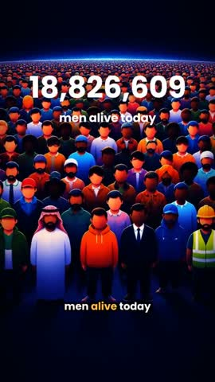](https://github.com/inematds/filme-em-codigo/releases/download/fonte-v1/style_flat_julian.mp4)  
[▶ Watch the video: style_flat_julian.mp4](https://github.com/inematds/filme-em-codigo/releases/download/fonte-v1/style_flat_julian.mp4)

*Flat vector science (Kurzgesagt-like)*

### Flat vector science

**Same style, your idea**

```text
Make a 10 to 20 second vertical animated short about [YOUR IDEA HERE]. Tone: a short history or science story with one twist. First write a 5 or 6 line script (40 to 55 words, under 20 seconds spoken), fact-check every claim on the web and list the sources. Write numbers as words for the voice and digits in the captions. Beat structure: a hook line with a big number over a wide establishing image; a hero line; an evidence line with a statistic shown as a grid of tokens where one lights up; a map or diagram line on a styled panel over a blurred, darkened keyframe; a reversal line where a claim gets struck through; and a payoff question. Plan about seven keyframes, one per beat. Style for every keyframe: flat vector illustration, bold geometric shapes, vibrant saturated gradients on a deep navy background, cute rounded characters with no mouths, clean science explainer style, soft glows and long shadows. Write each keyframe prompt as the subject, then that style sentence, then "Vertical 9:16 portrait composition with the main subject in the middle of the frame and a calmer lower quarter. No text, no letters, no logos, no watermark." and generate them at 9:16. Animate each keyframe in one WebGL shader: make a depth map with a monocular depth model, offset the lookup by depth for a parallax camera, sway the near foreground, drift the far sky sideways at a medium pace, and use no line boil (a line boil is a small noise warp that steps 8 times a second). Camera: a slow pan-and-zoom (zoom 1.02 to 1.12 with a sideways pan that alternates direction every segment). Transitions: a 0.4 s circle wipe from the centre. Labels on their words: Poppins Bold in white with a soft dark shadow, accent amber #ffb547. Panels and overlays: the same palette, plus a soft vignette. Captions: Poppins Bold at 92 px, white with an 8 px black outline, two or three words per page near the bottom, spoken word in #FFB547. Music: a dark synth arpeggio around 116 bpm that drops out for the reversal. Sound effects: ticks under the counter, risers and shimmers on the key numbers, a record scratch on the reversal and a low synth stab on the twist. Build it in Remotion (React) with three.js, 1080x1920 at 30 fps, keying every cut, event and sound to word timestamps from the voice. Synthesise all music and effects in code, with the music about 20 dB under the voice and the effects just below it.
```

**Copy this exact film · Exact prompt**

```text
Recreate this 26 second vertical short about Genghis Khan's descendants in one consistent illustrated look, exactly as described. Narration, word for word (about 26 seconds): "About twenty million men alive today may descend from one man: Genghis Khan. In 2003, geneticists found that one in twelve men across a huge stretch of Asia carried almost the same Y chromosome. It seemed to spread with the Mongol Empire, the largest land empire in history. Case closed? Not quite. DNA from Mongol graves of his time showed a different line. So the world's most famous family tree might belong to someone else." Look: flat vector illustration, bold geometric shapes, vibrant saturated gradients on a deep navy background, cute rounded characters with no mouths, clean science explainer style, soft glows and long shadows. First generate seven keyframe images at 9:16 (1080x1920) with these exact prompts, in beat order: 1. crowd: "a vast crowd of hundreds of ordinary men of many different backgrounds standing shoulder to shoulder across a wide plain, the crowd stretching all the way to the horizon, seen from slightly above. flat vector illustration, bold geometric shapes, vibrant saturated gradients on a deep navy background, cute rounded characters with no mouths, clean science explainer style, soft glows and long shadows. Vertical 9:16, subject centred, simple lower quarter, no text or logos." 2. khan: "Genghis Khan, the 13th century Mongol ruler, with a fur-trimmed pointed helmet, long thin moustache and a deel robe, sitting proudly on a sturdy steppe horse on a grassy hill, heroic low angle, centred. flat vector illustration, bold geometric shapes, vibrant saturated gradients on a deep navy background, cute rounded characters with no mouths, clean science explainer style, soft glows and long shadows. Vertical 9:16, subject centred, simple lower quarter, no text or logos." 3. lab: "two geneticists in white lab coats in a modern genetics laboratory, studying a large glowing DNA double helix model, racks of test tubes, a microscope and sample trays. flat vector illustration, bold geometric shapes, vibrant saturated gradients on a deep navy background, cute rounded characters with no mouths, clean science explainer style, soft glows and long shadows. Vertical 9:16, subject centred, simple lower quarter, no text or logos." 4. army: "a long column of Mongol horsemen with banners riding out across the endless Eurasian steppe, clouds of dust, distant mountains, epic sense of scale. flat vector illustration, bold geometric shapes, vibrant saturated gradients on a deep navy background, cute rounded characters with no mouths, clean science explainer style, soft glows and long shadows. Vertical 9:16, subject centred, simple lower quarter, no text or logos." 5. case: "a detective's wooden desk under a lamp with a thick closed case file folder, a magnifying glass, a cup of tea and an old map of Asia, moody and mysterious. flat vector illustration, bold geometric shapes, vibrant saturated gradients on a deep navy background, cute rounded characters with no mouths, clean science explainer style, soft glows and long shadows. Vertical 9:16, subject centred, simple lower quarter, no text or logos." 6. grave: "archaeologists excavating an ancient Mongol burial mound at dusk, a skeleton partly uncovered in the dig, brushes and trowels, a faint glowing DNA strand rising out of the grave. flat vector illustration, bold geometric shapes, vibrant saturated gradients on a deep navy background, cute rounded characters with no mouths, clean science explainer style, soft glows and long shadows. Vertical 9:16, subject centred, simple lower quarter, no text or logos." 7. tree: "a gigantic ancient family tree whose branches spread across the whole sky, hundreds of tiny portrait medallions hanging from the branches, and at the root a mysterious hooded silhouette. flat vector illustration, bold geometric shapes, vibrant saturated gradients on a deep navy background, cute rounded characters with no mouths, clean science explainer style, soft glows and long shadows. Vertical 9:16, subject centred, simple lower quarter, no text or logos." Animate each keyframe in one WebGL shader: make a depth map with a monocular depth model, offset the lookup by depth for a parallax camera, sway the near foreground, drift the far sky sideways at a medium pace, and use no line boil (a line boil is a small noise warp that steps 8 times a second). Camera on each keyframe: a slow pan-and-zoom (zoom 1.02 to 1.12 with a sideways pan that alternates direction every segment). Transition between segments: a 0.4 s circle wipe from the centre. On-screen labels: Poppins Bold in white with a soft dark shadow, accent amber #ffb547. Map panel skin: deep navy #13183f, indigo land #2c3a8c, periwinkle 2 px lines #7f8cff, an amber region rgba(255,181,71,0.9), a pink empire rgba(255,86,120,0.65), amber dots. Texture overlays: a soft vignette. Timeline: 0 to 2.3 s, crowd: a counter climbs to 20,000,000 from "About" to "today", with "men alive today" on "men". 2.3 to 5.05 s, khan: "Genghis Khan" on "Genghis". 5.05 to 7.6 s, lab: "2003" and "geneticists" on their words. 7.6 to 8.45 s, the crowd zoomed to 1.35x: "1 in 12" over a 6 by 2 grid of rounded pill tokens popping in, the eighth glowing in the accent colour on "twelve". 8.45 to 12.6 s, the army blurred and darkened behind a rounded map panel of Asia: the sampled region wipes in east to west on "huge" and dots pop on "carried", with "a huge stretch of Asia" and "the same Y chromosome" on "Y". 12.6 to 14.45 s, clear army: "Mongol Empire". 14.45 to 16.55 s, map again: the empire floods out from a pulsing Mongolia marker, with "largest land empire" and "24 million km²". 16.55 to 18.6 s, case: "CASE CLOSED?", struck through by an accent bar on "Not" as "Not quite." appears in the accent. 18.6 to 22.15 s, grave: "Mongol graves", "1130 to 1250" on "time" and "a different line" in the accent. 22.15 s to the end, tree: "most famous family tree", replaced on "someone" by "someone else?" in the accent. Labels fade and rise in over 0.2 s. Captions: burn in word-by-word captions in Poppins Bold at 92 px, white with an 8 px black outline and a 3 px shadow, two or three words per page, centred about 330 px above the bottom, with the spoken word in #FFB547. Music: a dark A minor synth arpeggio of detuned saw waves through a low-pass filter at 116 bpm with a deep bass note every bar, ducking out for "Not quite". Sound effects: a fast run of ticks while the counter climbs, a noise riser into "twelve" with a bright shimmer, a riser on "spread", a record scratch on "Not", a low synth stab on "different" and a long shimmer on "someone". Technical setup: Remotion (React) with three.js, 1080x1920 at 30 fps, about 26 seconds. Make the voice with any text to speech engine, get word timestamps, and key every cut, event and sound to the start of its word. Burn the captions in. Synthesise all music and effects in code, with no samples. Mix the music about 20 dB under the voice and ducked under speech, with the effects just below the voice.
```
