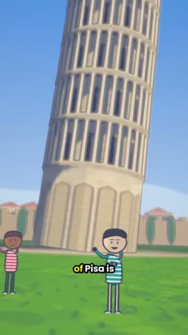
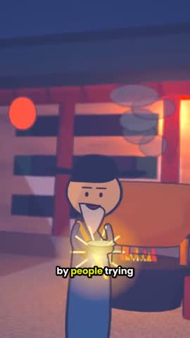
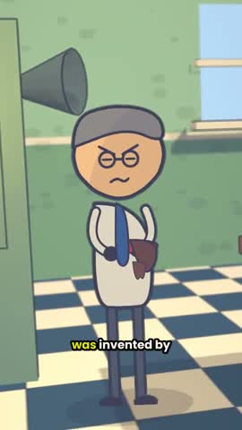
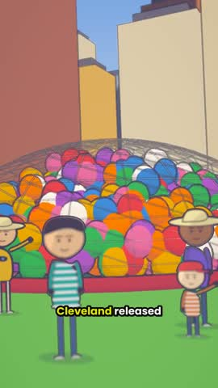
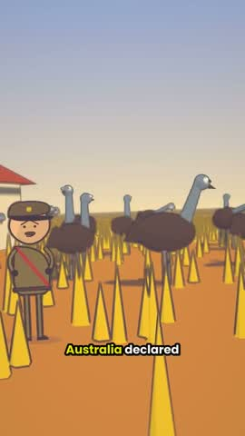

<!-- Anexo da fonte (filme-em-codigo). Texto original em inglês, completo; só foi tirado o ruído da página (botões "Copy", menu de navegação). Tradução: ../biblioteca-pt/06-historias-3d.md. Crédito e licença: ../LEIA.md. -->

[← index](../biblioteca-original.md) · [português](../biblioteca-pt/06-historias-3d.md) · [credit and licence](../LEIA.md)

## Cartoon 3D stories

[](https://github.com/inematds/filme-em-codigo/releases/download/fonte-v1/pisa_gideon.mp4)  
[▶ Watch the video: pisa_gideon.mp4](https://github.com/inematds/filme-em-codigo/releases/download/fonte-v1/pisa_gideon.mp4)

*Cartoon 3D*

### The Tower That Was Saved by Doing Nothing

**Same style, your idea**

```text
Make a 10 to 20 second vertical animated short about [YOUR IDEA HERE]. Use a playful history-mystery tone: a surprising claim, then the story told in small comic scenes. First write a 5 or 6 line script (40 to 55 words, under 20 seconds spoken), fact-check every claim on the web and list the sources. Write numbers as words for the voice and digits in the captions. Beat structure: a hook line that states the surprising claim over a comic establishing shot; a date-and-place line with a wide crane glide over the setting; three escalating beats where something goes wrong, each with its own cutaway or prop gag; and a payoff line that lands the irony, ending on a golden wide shot that pulls up and back. Style: flat 2D hand-drawn characters on camera-facing billboards (plum ink outline #241726, flat fills, big white eyes, blinking) inside a 3D toon-shaded world of simple primitives, with a post pass of near-black 5 px ink lines from depth edges, background blur on close shots, cool shadows, warm highlights and a soft vignette. Sky from #4f8fdc to a pale horizon, switching to golden, dusk or night blue when the mood changes. Camera: one shot per beat, each a smootherstep glide with a slow push-in, hard cuts, gentle rolls, a white flash after the hook and a short camera kick on every big hit. Captions: Poppins Bold 92 px, white with an 8 px black outline, two or three words per page near the bottom, the spoken word in yellow #E3E302. Music: an original, light folk dance tune that suits the setting's culture (for example plucked strings in 6/8 with an oom-pa-pa bass), ending on a final chord on the last word. Sound effects: one clear cartoon sound on each key word (creaks, thunks, squelches, boings, whooshes, a boom for the big moment, a chime or plink for the punchline). Build it in Remotion (React) with three.js, 1080x1920 at 30 fps, keying every cut, event and sound to word timestamps from the voice. Synthesise all music and effects in code, with the music about 20 dB under the voice and the effects just below it.
```

**Copy this exact film · Exact prompt**

```text
Recreate this 72 second vertical cartoon short, "The Tower That Was Saved by Doing Nothing", exactly as described. Narration, word for word: "The Leaning Tower of Pisa is only still standing because its builders stopped working for a hundred years. It's 1173, and Pisa is building the most beautiful bell tower in Italy. Five years in, around the fourth floor, the brand new tower is already leaning. The ground underneath is soft, wet clay, and one side of the tower is sinking into it. Then, for reasons nobody wrote down, work stops. For almost a hundred years. Luckily, nobody finished the tower. Unluckily, nobody fixed it either. You see, wet clay is full of water, and under all that weight, the water slowly squeezes out and the clay gets firmer. Ever stood still on a wet beach? Your feet sink at first, then the sand packs down and holds you. Engineers later worked out that if the builders had just kept going, the tower would have fallen over. When they finally came back, they made each new floor a little taller on the low side, so now the tower is curved like a banana. In 1934, Mussolini decided the lean was embarrassing and had the base pumped full of cement. It leaned more. In the end, engineers saved it by drilling soil out from under the high side, and letting it sink back the other way. So the most famous mistake in Italy was rescued twice: once by doing nothing, and once by digging a hole." Look: flat 2D hand-drawn characters on camera-facing billboards (plum ink outline #241726, flat fills, big white eyes, blinking, oval contact shadows) inside a 3D toon-shaded world of simple primitives with a hard two-tone shading ramp. A post pass adds near-black ink lines about 5 px thick from depth edges, background lens blur on close shots, a cool blue lift in the shadows, warm highlights, 8 percent extra saturation and a soft vignette. World: a piazza with the white marble tower at real proportions (blind-arcade base, six loggias ringed by cream columns, a belfry), the cathedral and baptistery, a crenellated wall, warm plaster houses and cypresses, plus a soil cutaway diorama and a beach. Light: day sky #4f8fdc to #c4daf0, golden #ffb46a to #8a6f8a, dusk #4a5fa8 to #e8a07a, and night blue #0f1d4a to #3a4f8f for the explanation. Beats, one shot each: (1) Low angle: tourists do the pushing-the-tower pose, then a white flash. (2) "1173": a crane glide down to a proud bishop in red before a one-storey stub as masons work. (3) "Five years in": storeys thunk up to the fourth floor; on "leaning" it tips about 4 degrees with a crack, the masons gasp and the camera kicks. (4) "The ground": a strata cutaway where the mini tower sinks on one side on "sinking". (5) "work stops": masons walk off under a question mark; on "almost" the sky flickers day and night as the scaffold vanishes and weeds grow. (6) "Luckily": the overgrown stub and a sleeping guard with Zzz. (7) "Unluckily": a deadpan push up the stub as a bird lands. (8) Night blue cutaway: water drops rise out of the clay, which firms on "firmer". (9) Golden beach: a kid sinks on "sink" and gives a sparkly thumbs up on "holds". (10) An engineer with a clipboard as a ghost of the full tower topples behind him on "fallen" into a dust cloud. (11) Builders return and the top floors rise with a counter-tilt; one holds up a banana on "banana". (12) Dusk, 1934: a smug official in a dark peaked cap by a red cement mixer, stern on "embarrassing"; on "more" the tower lurches and he panics. (13) Engineers in orange vests drill the high side, a spoil heap grows, and the tower eases back on "sink back". (14) Golden wide: posing tourists, a builder napping in a hammock, the engineer by the hole, craning up and back. Camera: each shot is a smootherstep glide with a slow creeping push-in, hard cuts between shots, 2 to 4 degree rolls, and a 7-frame decaying camera kick on big hits. Captions: Poppins Bold 92 px, white with an 8 px black outline and a 3 px shadow, about 330 px above the bottom, two or three words per page, the spoken word in yellow #E3E302. Music: an A minor tarantella in 6/8 at about 112 with mandolin tremolo plucks, an oom-pa-pa bass and tambourine, ending on a chord at "hole". Sound effects: thunks for storeys, a creak on "leaning", squelches on "sinking" and "sink", clanks on "stops", fast ticks on "almost", a wing flutter, a chime on "holds", a creak, whoosh and boom for the fall, a boing on "banana", a mixer chug and thunk on "more", a drill whine, a snore on "nothing" and a plink on "hole". Technical setup: Remotion (React) with three.js, 1080x1920 at 30 fps, about 72 seconds. Make the voice with any text to speech engine, get word timestamps, and key every cut, event and sound to the start of its word. Burn the captions in. Synthesise all music and effects in code, with no samples. Mix the music about 20 dB under the voice and ducked under speech, with the effects just below the voice.
```

[](https://github.com/inematds/filme-em-codigo/releases/download/fonte-v1/gunpowder_gideon.mp4)  
[▶ Watch the video: gunpowder_gideon.mp4](https://github.com/inematds/filme-em-codigo/releases/download/fonte-v1/gunpowder_gideon.mp4)

*Cartoon 3D*

### The Recipe You Should Never Make

**Same style, your idea**

```text
Make a 10 to 20 second vertical animated short about [YOUR IDEA HERE]. Tone: an accidental invention told as a comic fable. First write a 5 or 6 line script (40 to 55 words, under 20 seconds spoken), fact-check every claim on the web and list the sources. Write numbers as words for the voice and digits in the captions. Beat structure: a hook line stating the ironic claim over a close shot of the hero with a glowing prop; a time-and-place line on a wide night shot; a list line where each ingredient or step lands on its word with its own coloured puff; an escalation line that builds to a cartoon explosion with a white flash; a consequences line with sooty characters and a burning building; and a deadpan payoff at dawn. Style: flat 2D hand-drawn characters on camera-facing billboards (plum ink outline #241726, flat fills, big white eyes, blinking) inside a 3D toon-shaded world of simple primitives, with a post pass of near-black 5 px ink lines from depth edges, background blur on close shots, cool shadows, warm highlights and a soft vignette. Sky from #4f8fdc to a pale horizon, switching to golden, dusk or night blue when the mood changes. For night use a deep blue sky (#0c1638 to #34407a) with red lanterns and fire light that warms as tension rises. Camera: one shot per beat, each a smootherstep glide with a slow push-in, hard cuts, gentle rolls, a white flash after the hook and a short camera kick on every big hit. Captions: Poppins Bold 92 px, white with an 8 px black outline, two or three words per page near the bottom, the spoken word in yellow #E3E302. Music: a pentatonic plucked-string tune with a woodblock pulse, a tremolo build, silence on the blast and a sparse wry ending. Sound effects: an ambient bed, a roar into the climax, a boom with a gong tail and one small foley sound on the last line. Build it in Remotion (React) with three.js, 1080x1920 at 30 fps, keying every cut, event and sound to word timestamps from the voice. Synthesise all music and effects in code, with the music about 20 dB under the voice and the effects just below it.
```

**Copy this exact film · Exact prompt**

```text
Recreate this 18 second vertical cartoon short, "The Recipe You Should Never Make", exactly as described. Narration, word for word: "Gunpowder was invented by people trying to live forever. Ninth-century China. Alchemists are cooking up an elixir of eternal life. Saltpetre, sulphur, a little honey. Turn up the heat. Burned hands, burned faces, and the house burned down. So one of the first books to mention it listed it as a recipe you should never make." Look: flat 2D hand-drawn characters on camera-facing billboards (plum ink outline #241726, flat fills, big white eyes, blinking, oval contact shadows) inside a 3D toon-shaded world of simple primitives with a hard two-tone shading ramp. A post pass adds near-black ink lines about 5 px thick from depth edges, background lens blur on close shots, a cool blue lift in the shadows, warm highlights, 8 percent extra saturation and a soft vignette. The world: a Tang-era alchemist's courtyard at night with curved grey tiled roofs (#3d4a52), red timber halls (#9a3b2c), red lanterns casting warm light (#ff7a50), a pale moon #fff4d0, distant mountains and pines, packed earth (#b89a72) and flagstones, a bronze cauldron on three legs over a brazier, and three ingredient jars on a low bench: white saltpetre, yellow sulphur and amber honey. Night sky from #0c1638 to #34407a with cool blue moonlight; the last beat is dawn, #6f86c8 to #f2b48a. Characters are three robed alchemists (one elder with a dark official's hat and white beard, two with topknots) whose faces turn sooty after the blast; the fire light makes them glow warmer as the heat rises. Beats: (1) "Gunpowder was invented": close on the proud elder holding a glowing bowl with a little spark. A white flash. (2) "Ninth-century China": a high wide glide over the courtyard, the elder with hands on hips and a cook fanning the fire. (3) "Alchemists are cooking up": the elder points, the cook fans happily and a helper holds a bowl. (4) "Saltpetre, sulphur, a little honey": each jar tips over the cauldron exactly on its word and a coloured puff (white, yellow, amber) rises. (5) "Turn up the heat": the cook fans smugly as the fire grows; about 0.6 seconds after "heat" the cauldron explodes in a cartoon boom with a white flash and a double camera kick, and both alchemists throw up their arms in shock. (6) "Burned hands, burned faces": close on the two of them, sooty, smoke curling off their heads. (7) "and the house burned down": a wide of the hall with flames running along the roof and a huge smoke column, with a camera kick on "house". (8) Dawn, "So one of the first books": the elder at a scribe's desk among charred timbers holding a scroll, thinking, then stern on "never". Camera: each shot is a smootherstep glide with a slow creeping push-in, hard cuts between shots, 2 to 4 degree rolls, and a 7-frame decaying camera kick on big hits. Captions: Poppins Bold 92 px, white with an 8 px black outline and a 3 px shadow, about 330 px above the bottom, two or three words per page, the spoken word in yellow #E3E302. Music: a G major pentatonic tune on a plucked zither with a gentle string-bend wobble, a low zither bass and a woodblock pulse at 96 bpm, a fast tremolo build on "heat", stopping dead on the boom, then a sparse slightly sour phrase for the punchline with a low two-note ending on "make". Sound effects: a quiet campfire crackle bed, the fire roaring up on "heat", a big boom with a gong tail and a whoosh, the roof crackling up on "house", and a brush scratching on paper on "listed". Technical setup: Remotion (React) with three.js, 1080x1920 at 30 fps, about 18 seconds. Make the voice with any text to speech engine, get word timestamps, and key every cut, event and sound to the start of its word. Burn the captions in. Synthesise all music and effects in code, with no samples. Mix the music about 20 dB under the voice and ducked under speech, with the effects just below the voice.
```

[](https://github.com/inematds/filme-em-codigo/releases/download/fonte-v1/microwave_gideon.mp4)  
[▶ Watch the video: microwave_gideon.mp4](https://github.com/inematds/filme-em-codigo/releases/download/fonte-v1/microwave_gideon.mp4)

*Cartoon 3D*

### Two Dollars for the Microwave

**Same style, your idea**

```text
Make a 10 to 20 second vertical animated short about [YOUR IDEA HERE]. Tone: an inventor's lucky accident told in quick slapstick scenes. First write a 5 or 6 line script (40 to 55 words, under 20 seconds spoken), fact-check every claim on the web and list the sources. Write numbers as words for the voice and digits in the captions. Beat structure: a hook line naming the strange cause of the invention over a close shot of the hero with the key prop; a setup line with a wide shot of the workplace; then three escalating experiment beats, each with a visual gag landing on its word (the second one ends in a messy splat on a colleague with a white flash and camera kick); and a payoff line with the hero holding up an absurdly small reward. Style: flat 2D hand-drawn characters on camera-facing billboards (plum ink outline #241726, flat fills, big white eyes, blinking) inside a 3D toon-shaded world of simple primitives, with a post pass of near-black 5 px ink lines from depth edges, background blur on close shots, cool shadows, warm highlights and a soft vignette. Sky from #4f8fdc to a pale horizon, switching to golden, dusk or night blue when the mood changes. Place it in a bright period workplace with a pale sky-blue background, a checkered floor, painted walls and one glowing, humming machine that pulses with drawn wave rings. Camera: one shot per beat, each a smootherstep glide with a slow push-in, hard cuts, gentle rolls, a white flash after the hook and a short camera kick on every big hit. Captions: Poppins Bold 92 px, white with an 8 px black outline, two or three words per page near the bottom, the spoken word in yellow #E3E302. Music: period-appropriate light swing with a walking bass and brushed snare that dips for the big gag. Sound effects: a low hum bed, then one cartoon sound per experiment (squelch, a patter of pops, a whoosh and splat) and a ding for the payoff. Build it in Remotion (React) with three.js, 1080x1920 at 30 fps, keying every cut, event and sound to word timestamps from the voice. Synthesise all music and effects in code, with the music about 20 dB under the voice and the effects just below it.
```

**Copy this exact film · Exact prompt**

```text
Recreate this 15 second vertical cartoon short, "Two Dollars for the Microwave", exactly as described. Narration, word for word: "The microwave oven was invented by a melted candy bar. In the 1940s, an engineer called Percy Spencer is standing next to a radar machine, and the candy in his pocket melts. So he tries popcorn. It pops. Then he tries an egg. It explodes in his colleague's face. His company paid him two dollars for the idea." Look: flat 2D hand-drawn characters on camera-facing billboards (plum ink outline #241726, flat fills, big white eyes, blinking, oval contact shadows) inside a 3D toon-shaded world of simple primitives with a hard two-tone shading ramp. A post pass adds near-black ink lines about 5 px thick from depth edges, background lens blur on close shots, a cool blue lift in the shadows, warm highlights, 8 percent extra saturation and a soft vignette. Characters are tinted a warm #fff6ea. The world: a bright 1940s radar lab under a sky-blue background #bfe0ff, with a checkered floor (#2f4a5a and #e8e0cc), sage green walls (#9fc2a8 over #7da48a) with a cream rail, bright windows, a tall grey-green steel radar cabinet #6f8a80 with three cream dials with red needles, red, yellow and green buttons and a green oscilloscope trace, a brass magnetron and a horn aimed at a wooden workbench #8a5a34 with a popcorn pan, a steel kettle and an egg, jars on shelves, a filing cabinet and a green enamel ceiling lamp. The radar hums with a pulsing warm glow and drawn wavy radar rings. Characters: Spencer is grey-haired with glasses, a white shirt and a blue tie; his colleague has a moustache, a white shirt and a red tie and carries a clipboard. Beats: (1) "The microwave oven": a close shot of Spencer holding a candy bar that drips chocolate, worried, then shocked. A white flash. (2) "In the 1940s": a wide glide across the lab as Spencer walks up to the radar cabinet with the colleague and his clipboard beside him; radar rings start pulsing on "radar". (3) "and the candy in his pocket melts": medium on Spencer beside the horn with radar rings; the candy drips and on "melts" he jumps with his arms up in shock and the camera rolls. (4) "So he tries popcorn": at the bench Spencer points, thinking, then on "pops" popcorn bursts out of the pan and he cheers, with a camera kick. (5) "Then he tries an egg": the colleague leans in over the egg; on "explodes" it bursts in a yellow splat across his face with a white flash and a kick, the colleague shocked and yolky, Spencer smug with hands on hips. (6) "His company paid him": Spencer holds up a two dollar bill, neutral, then stern on "dollars", while the yolky colleague looks worried. Camera: each shot is a smootherstep glide with a slow creeping push-in, hard cuts between shots, 2 to 4 degree rolls, and a 7-frame decaying camera kick on big hits. Captions: Poppins Bold 92 px, white with an 8 px black outline and a 3 px shadow, about 330 px above the bottom, two or three words per page, the spoken word in yellow #E3E302. Music: 1940s swing at 140 bpm with a walking bass, off-beat chord plucks and a brushed snare, dipping on the explosion, ending on a high and low two-note button on "idea". Sound effects: a low electrical hum bed, a sticky squelch on "melts", a rapid patter of popcorn pops on "pops", a whoosh and a wet splat on "explodes", and a bright cash-register ding on "dollars". Technical setup: Remotion (React) with three.js, 1080x1920 at 30 fps, about 15 seconds. Make the voice with any text to speech engine, get word timestamps, and key every cut, event and sound to the start of its word. Burn the captions in. Synthesise all music and effects in code, with no samples. Mix the music about 20 dB under the voice and ducked under speech, with the effects just below the voice.
```

[](https://github.com/inematds/filme-em-codigo/releases/download/fonte-v1/new_balloon_julian.mp4)  
[▶ Watch the video: new_balloon_julian.mp4](https://github.com/inematds/filme-em-codigo/releases/download/fonte-v1/new_balloon_julian.mp4)

*Cartoon 3D*

### The Balloon Release That Went Wrong

**Same style, your idea**

```text
Make a 10 to 20 second vertical animated short about [YOUR IDEA HERE]. Tone: a feel-good event that goes hilariously wrong. First write a 5 or 6 line script (40 to 55 words, under 20 seconds spoken), fact-check every claim on the web and list the sources. Write numbers as words for the voice and digits in the captions. Beat structure: a hook line with the date, place and the big plan, shown as a crowd around the setup that releases on the key word; a triumph line on a wide high shot; a turn line where the weather or luck flips with a flash, a camera kick and a darker grade; three quick consequence shots, one per clause, each landing on its word; and a payoff line in clear light with the ironic outcome. Style: flat 2D hand-drawn characters on camera-facing billboards (plum ink outline #241726, flat fills, big white eyes, blinking) inside a 3D toon-shaded world of simple primitives, with a post pass of near-black 5 px ink lines from depth edges, background blur on close shots, cool shadows, warm highlights and a soft vignette. Sky from #4f8fdc to a pale horizon, switching to golden, dusk or night blue when the mood changes. Use instanced meshes for big crowds of objects (set frustumCulled to false on anything that moves) and animate them as one flock. Camera: one shot per beat, each a smootherstep glide with a slow push-in, hard cuts, gentle rolls, a white flash after the hook and a short camera kick on every big hit. Captions: Poppins Bold 92 px, white with an 8 px black outline, two or three words per page near the bottom, the spoken word in yellow #E3E302. Music: a bright plucked major-key melody around 120 bpm that turns minor during the bad turn. Sound effects: a whoosh flurry for the release, a chime for the triumph, thunder and rain for the turn, one foley sound per consequence (horns, engines) and a boing with a thump for the payoff. Build it in Remotion (React) with three.js, 1080x1920 at 30 fps, keying every cut, event and sound to word timestamps from the voice. Synthesise all music and effects in code, with the music about 20 dB under the voice and the effects just below it.
```

**Copy this exact film · Exact prompt**

```text
Recreate this 19 second vertical cartoon short about Balloonfest '86 exactly as described. Narration, word for word: "In 1986, Cleveland released one and a half million balloons for charity. It set a world record. Then a storm pushed every single one back down. Balloons covered the lake, tangled the traffic, and shut an airport runway. The most beautiful fundraiser ever ended in two lawsuits." Look: flat 2D hand-drawn characters on camera-facing billboards (plum ink outline #241726, flat fills, big white eyes, blinking, oval contact shadows) inside a 3D toon-shaded world of simple primitives with a hard two-tone shading ramp. A post pass adds near-black ink lines about 5 px thick from depth edges, background lens blur on close shots, a cool blue lift in the shadows, warm highlights, 8 percent extra saturation and a soft vignette. The world: a paved city plaza (#d8d2c4) with a green park, a blue lake (#3f8fd0) to one side, chunky toon city blocks (#e8c07a, #c9805a, #9fb4c8, #e8e0cc, #b0705a) with grey roofs, a stepped cream tower with a spire, a road with seven chunky cars (red, blue, yellow, green), and a lakefront runway with a small white plane with a red tail. In the plaza a white wireframe net dome with a red ring holds 1,400 instanced balloons in eight colours (#e8423a, #f2b632, #3f8fe0, #4cbf6a, #b05ad0, #f07ab0, #ffffff, #ff8a2a) that bob gently. Sky #4f8fdc to #d8e6f2. Beats: (1) 0 s: a low shot of a ring of 14 cheerful tourists and a kid around the dome, some pointing; on "released" the net fades, every balloon floats up and outward in a rising cloud, the crowd waves with arms up, and the camera tilts up to follow. (2) "It set a world record": a wide high shot of the huge balloon cloud over the city with a soft glow pulsing in it on "record". (3) "Then a storm": a white flash and a camera kick on "storm"; the sky darkens to slate (#3a4152 to #7d8696), the sun dims, rain streaks fall around the camera, saturation drops, and the balloons sink back down out of the cloud. (4) "Balloons covered the lake": the lake carpeted with floating balloons. (5) "tangled the traffic": the road full of balloons between the cars, one driver with arms up in shock and another worried. (6) "and shut an airport runway": the runway littered with balloons, a stern pilot in a blue uniform beside the plane under a question mark. (7) "The most beautiful fundraiser": the storm clears to sunshine, a close two-shot of two lawyers in dark suits holding scrolls, stern and smug on "lawsuits", with a worried kid beside them. Camera: each shot is a smootherstep glide with a slow creeping push-in, hard cuts between shots, 2 to 4 degree rolls, and a 7-frame decaying camera kick on big hits. Captions: Poppins Bold 92 px, white with an 8 px black outline and a 3 px shadow, about 330 px above the bottom, two or three words per page, the spoken word in yellow #E3E302. Music: a bright C major plucked melody with a plucked bass and a soft kick at 120 bpm that slips into a darker minor colour during the storm and fades out at the end. Sound effects: three whooshes and a flurry of rubbery balloon squeaks on "released", a two-note chime on "record", a thunder roll and crack on "storm" and a rain hiss until "ended", two car horns on "traffic", a plane engine drone on "runway", and a boing with a heavy thump on "lawsuits". Technical setup: Remotion (React) with three.js, 1080x1920 at 30 fps, about 19 seconds. Make the voice with any text to speech engine, get word timestamps, and key every cut, event and sound to the start of its word. Burn the captions in. Synthesise all music and effects in code, with no samples. Mix the music about 20 dB under the voice and ducked under speech, with the effects just below the voice.
```

[](https://github.com/inematds/filme-em-codigo/releases/download/fonte-v1/new_emu_julian.mp4)  
[▶ Watch the video: new_emu_julian.mp4](https://github.com/inematds/filme-em-codigo/releases/download/fonte-v1/new_emu_julian.mp4)

*Cartoon 3D*

### The War Australia Lost to Emus

**Same style, your idea**

```text
Make a 10 to 20 second vertical animated short about [YOUR IDEA HERE]. Tone: a real historical absurdity told with a straight face. First write a 5 or 6 line script (40 to 55 words, under 20 seconds spoken), fact-check every claim on the web and list the sources. Write numbers as words for the voice and digits in the captions. Beat structure: a hook line with the date and the absurd declaration over a close shot of a stern official; a problem line on a wide high shot of the opponents; an escalation line where the heavy response arrives; an action line full of noise and chaos; a reversal line where nothing changes; and a short deadpan payoff with a close hero shot of the unlikely winner. Style: flat 2D hand-drawn characters on camera-facing billboards (plum ink outline #241726, flat fills, big white eyes, blinking) inside a 3D toon-shaded world of simple primitives, with a post pass of near-black 5 px ink lines from depth edges, background blur on close shots, cool shadows, warm highlights and a soft vignette. Sky from #4f8fdc to a pale horizon, switching to golden, dusk or night blue when the mood changes. Build animals and vehicles as chunky 3D toon models from primitives with simple looping animations (pecking, running, wheels), and push the grade warm for a sunny outdoor setting. Camera: one shot per beat, each a smootherstep glide with a slow push-in, hard cuts, gentle rolls, a white flash after the hook and a short camera kick on every big hit. Captions: Poppins Bold 92 px, white with an 8 px black outline, two or three words per page near the bottom, the spoken word in yellow #E3E302. Music: a jaunty plucked major-key melody around 112 bpm with a march rattle under the action. Sound effects: a horn and thump on the declaration, an engine for the arrival, a rattle for the action, scurrying for the chaos, and a sad horn with a boing for the payoff. Build it in Remotion (React) with three.js, 1080x1920 at 30 fps, keying every cut, event and sound to word timestamps from the voice. Synthesise all music and effects in code, with the music about 20 dB under the voice and the effects just below it.
```

**Copy this exact film · Exact prompt**

```text
Recreate this 20 second vertical cartoon short about the Great Emu War exactly as described. Narration, word for word: "In 1932, Australia declared war on emus. Twenty thousand of them were eating the farmers' wheat. So the army sent soldiers with two machine guns. They fired nearly ten thousand bullets. The emus scattered, came back, and kept eating. The army went home. The emus won." Look: flat 2D hand-drawn characters on camera-facing billboards (plum ink outline #241726, flat fills, big white eyes, blinking, oval contact shadows) inside a 3D toon-shaded world of simple primitives with a hard two-tone shading ramp. A post pass adds near-black ink lines about 5 px thick from depth edges, background lens blur on close shots, a cool blue lift in the shadows, warm highlights, 8 percent extra saturation and a soft vignette. The grade is warm (highlights pushed towards amber, saturation up 12 percent) and characters are tinted #fff4e4. The world: a sunny wheat farm in Western Australia with golden ground #e2b862, a strip of red dirt #c98a52, about 2,600 little golden wheat-stalk cones #f2cf62, a cream farmhouse with a red roof, a tall grey windmill with spinning blades, a long wooden fence, and a sky from #3f86d8 to a warm horizon #f0dcb4. The emus are chunky 3D toon birds (dark brown feather body #4a3a2e, blue-grey neck and head #7f93a8, grey legs, big white eyes with black pupils, a dark beak) that peck in a loop, plus 400 distant emu blobs on the horizon. There is an olive army truck #6b7a3e with a black machine gun on the back and a crate. Characters: a stout officer in khaki with a moustache and peaked cap, a bearded farmer in a blue shirt and sun hat, and two soldiers in khaki slouch hats. Beats: (1) "In 1932": a close shot of the officer, smug with hands on hips, pointing sternly on "war". (2) "Twenty thousand": a wide high shot of 36 emus pecking in the wheat with hundreds more on the horizon and the worried farmer, who throws up his arms on "wheat". (3) "So the army": the truck drives in from the left and parks just before "guns", with the soldiers in the back and the officer pointing. (4) "They fired": from behind the truck, the gun swings and rattles with muzzle flashes, dust puffs kick up in the field, little camera kicks with each burst, spent brass cartridges pile up beside the truck, and the emus zigzag in panic. (5) "The emus scattered": on "scattered" they run off in every direction, on "back" they run back, and on "kept" they settle and peck again; the soldiers look shocked. (6) "The army went home": a close hero shot of one big emu standing proudly on the crate while the truck drives away behind it on "home", then a soft glow pulses behind the emu on "won" and the camera rolls slightly. Camera: each shot is a smootherstep glide with a slow creeping push-in, hard cuts between shots, 2 to 4 degree rolls, and a 7-frame decaying camera kick on big hits. Captions: Poppins Bold 92 px, white with an 8 px black outline and a 3 px shadow, about 330 px above the bottom, two or three words per page, the spoken word in yellow #E3E302. Music: a jaunty G major plucked melody with a plucked bass at 112 bpm, with a snare-like march rattle added from "army" to "scattered". Sound effects: a horn blast and a thump on "war", quick pecking clicks on "eating", a truck engine on "army", a machine gun rattle from "fired" to "scattered", scurrying feet on "scattered", the engine leaving on "home", and a sad two-note horn with a boing on "won". Technical setup: Remotion (React) with three.js, 1080x1920 at 30 fps, about 20 seconds. Make the voice with any text to speech engine, get word timestamps, and key every cut, event and sound to the start of its word. Burn the captions in. Synthesise all music and effects in code, with no samples. Mix the music about 20 dB under the voice and ducked under speech, with the effects just below the voice.
```

---

Made by AI Samson. Films and prompts free to use as a starting point for your own work.
