<!-- Anexo da fonte (filme-em-codigo). Tradução para o português feita pelo tradutor central (inema-traduz). Original em inglês: ../biblioteca-original/02-filmes-16x9.md. Crédito e licença: ../LEIA.md. -->

[← índice](../biblioteca-pt.md) · [original em inglês](../biblioteca-original/02-filmes-16x9.md) · [crédito e licença](../LEIA.md)

> Tradução da biblioteca de prompts de **AI Samson**. Cada prompt vem traduzido e, logo abaixo, no original em inglês: o prompt em inglês costuma funcionar melhor no modelo.

## Filmes em 16:9 feitos com código

Cada cartão tem um prompt para criar algo no mesmo estilo com sua ideia e o prompt exato daquele filme.

[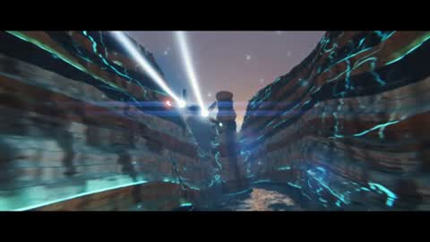](https://github.com/inematds/filme-em-codigo/releases/download/fonte-v1/wide_canyon.mp4)  
[▶ Ver o vídeo: wide_canyon.mp4](https://github.com/inematds/filme-em-codigo/releases/download/fonte-v1/wide_canyon.mp4)

*Ficção científica com raymarching*

### Corrida pelo cânion

Uma nave voa por um cânion brilhante, faz uma curva inclinada ao passar por um arco de pedra e sai sob um planeta com anéis ao nascer do sol.

**Mesmo estilo, sua ideia**

> Crie um filme animado em 16:9, com duração de 5 a 10 segundos, sobre [SUA IDEIA AQUI]. Estilo: um voo de ficção científica com raymarching, feito inteiramente em código. Desenhe o mundo todo com um único fragment shader de campo de distância com sinal (terreno, arcos de pedra, uma nave com motor brilhante e um planeta com anéis), renderizado com raymarching na metade da resolução. Depois, passe a imagem por um pipeline de filme: passe de brilho, rastros anamórficos, bloom, raios de luz em espaço de tela, profundidade de campo com desfoque radial de movimento, aberração cromática, granulação e letterbox de 2,39:1. Crie um movimento de câmera contínuo, com inclinação nas curvas e uma revelação no final. Sombras em tom azul-petróleo e luz laranja. Cada quadro deve ser uma função pura do número do quadro. Sem texto. Trilha sonora sintetizada e som do motor.

<details><summary>Prompt original (inglês)</summary>

```text
Make a 5 to 10 second 16:9 animated film about [YOUR IDEA HERE]. Style: a raymarched science fiction flight, built entirely in code. Draw the whole world with one signed-distance-field fragment shader (terrain, rock arches, a ship with a glowing engine, a ringed planet), raymarched at half resolution, then pass it through a film pipeline: bright pass, anamorphic streaks, bloom, screen-space god rays, depth of field with radial motion blur, chromatic aberration, grain and a 2.39:1 letterbox. Design one continuous camera move with banking and a reveal at the end. Teal shadows, orange light. Every frame is a pure function of the frame number. No text. Synthesised score and engine sound.
```

</details>

**Copiar este filme exato · Prompt exato**

> Crie um filme de ficção científica com raymarching, feito em código, em 16:9 e com duração de 8 segundos. Uma pequena nave com motor brilhante voa em alta velocidade por um cânion profundo, iluminado por veios luminosos, faz uma curva fechada ao passar por um arco natural de pedra e, em seguida, surge sobre um deserto aberto sob um enorme planeta com anéis ao nascer do sol. Um único shader de campo de distância com sinal desenha tudo. Depois, aplique rastros anamórficos, bloom, raios de luz, profundidade de campo, desfoque radial de movimento, aberração cromática, granulação e letterbox de 2,39:1. Tons azul-petróleo e laranja. Sem texto. Trilha sonora com pulsos sintetizados, rugido do motor e uma crescendo na revelação.

<details><summary>Prompt original (inglês)</summary>

```text
Make an 8 second 16:9 raymarched sci-fi film in code. A small ship with a glowing engine flies fast down a deep canyon lit by glowing seams, banks hard through a natural rock arch, then bursts out over open desert under a huge ringed planet at sunrise. One signed-distance-field shader draws everything, followed by anamorphic streaks, bloom, god rays, depth of field, radial motion blur, chromatic aberration, grain and a 2.39:1 letterbox. Teal and orange grade. No text. Synth pulse score with an engine roar and a swell on the reveal.
```

</details>

[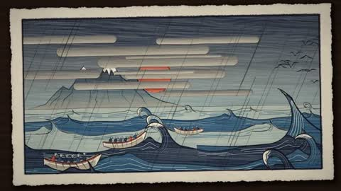](https://github.com/inematds/filme-em-codigo/releases/download/fonte-v1/wide_woodblock.mp4)  
[▶ Ver o vídeo: wide_woodblock.mp4](https://github.com/inematds/filme-em-codigo/releases/download/fonte-v1/wide_woodblock.mp4)

*Gravura animada em xilogravura*

### Tempestade no mar

Três barcos de pesca enfrentam uma tempestade enquanto uma onda gigante se ergue, se curva e desaba, e o céu se abre para revelar um sol vermelho.

**Mesmo estilo, sua ideia**

> Crie um filme animado 16:9 de 5 a 10 segundos sobre [SUA IDEIA AQUI]. Estilo: uma gravura japonesa animada em madeira, feita inteiramente em código e sem fingir ser 3D. Desenhe a arte como formas 2D planas em três matrizes de impressão separadas (uma camada de cor clara, uma de cor escura e uma de contorno preto), com uma paleta de azul da Prússia, índigo, azul acinzentado claro, creme e um vermelho. Depois, imprima as matrizes com um shader: pequeno desalinhamento entre elas, veios de madeira nas cores planas, fibras de papel, tinta irregular e uma folha com bordas desfiadas e uma margem. Estilize água, nuvens e vento como formas sinuosas e marcantes, com pontas de espuma. Anime em dois ou três quadros, como uma gravura ganhando vida. Um acontecimento claro e uma imagem final marcante. Sem texto. Música esparsa com percussão de madeira.

<details><summary>Prompt original (inglês)</summary>

```text
Make a 5 to 10 second 16:9 animated film about [YOUR IDEA HERE]. Style: an animated Japanese woodblock print, built entirely in code and never pretending to be 3D. Draw the artwork as flat 2D shapes on three separate printing plates (a light colour block, a deep colour block and a black key-line block), in a palette of Prussian blue, indigo, pale blue-grey, cream and one red. Then print the plates with a shader: slight misregistration between plates, wood grain inside the flat colours, paper fibre, uneven ink and a deckled sheet with a border. Stylise water, cloud and wind as bold curling shapes with fingers of foam. Animate on twos or threes like a print coming to life. One clear event and a final image that lands. No text. Sparse music with wooden percussion.
```

</details>

**Copiar este filme exato · Prompt exato**

> Crie uma gravura animada em madeira, em código, com 9 segundos e formato 16:9. Três pequenos barcos de pesca enfrentam um mar tempestuoso, desenhado em azul da Prússia e índigo, com espuma clara. Uma onda gigante se ergue atrás deles, se curva por cima com pontas de espuma em forma de garras e desaba. Os barcos atravessam a onda, e o céu se abre para revelar um sol vermelho. Desenhe três matrizes planas de impressão (camada clara, camada escura, camada de contorno preto) em telas e imprima-as em um shader com desalinhamento, veios de madeira, fibras de papel e uma folha com bordas desfiadas. Anime em dois quadros. Sem texto. Taiko, flauta e som do mar.

<details><summary>Prompt original (inglês)</summary>

```text
Make a 9 second 16:9 animated woodblock print in code. Three small fishing boats ride a storm sea drawn in Prussian blue and indigo with pale foam. A giant wave rises behind them, curls over with clawed fingers of foam and collapses, the boats ride through, and the sky clears to a red sun. Draw three flat printing plates (light block, deep block, black key block) on canvases and print them in a shader with misregistration, wood grain, paper fibre and a deckled sheet. Animate on twos. No text. Taiko, flute and sea sound.
```

</details>

[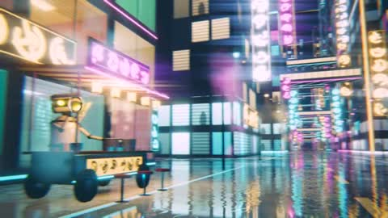](https://github.com/inematds/filme-em-codigo/releases/download/fonte-v1/wide_neon.mp4)  
[▶ Ver o vídeo: wide_neon.mp4](https://github.com/inematds/filme-em-codigo/releases/download/fonte-v1/wide_neon.mp4)

*Megacidade de neon encharcada pela chuva*

### Chuva de neon

A câmera sobe de um carrinho de rua pela fachada de uma torre, passa pelo topo do telhado e revela a cidade inteira.

**Mesmo estilo, sua ideia**

> Crie um filme animado em 16:9, com duração de 5 a 10 segundos, sobre [SUA IDEIA AQUI]. Estilo: uma megacidade de neon encharcada pela chuva à noite, construída em código com three.js. Torres instanciadas com cômodos iluminados mapeados no interior, placas brilhantes com glifos inventados (sem palavras reais), ruas molhadas com uma etapa de reflexos planares, chuva e vapor. Filme com um pipeline HDR: bloom com filtro duplo, rastros anamórficos, desfoque de movimento, leve aberração cromática, gotas de chuva na lente, granulação e gradação em tons de azul-petróleo e magenta. Um movimento de câmera planejado, de um detalhe íntimo ao nível da rua até uma vista ampla que revela a cidade inteira. Sem texto. Pads de sintetizador, chuva e uma onda grave de baixo na revelação.

<details><summary>Prompt original (inglês)</summary>

```text
Make a 5 to 10 second 16:9 animated film about [YOUR IDEA HERE]. Style: a rain-soaked neon megacity at night, built in code with three.js. Instanced towers with interior-mapped lit rooms, glowing signs with invented glyphs (no real words), wet streets with a planar reflection pass, falling rain and steam. Film it with an HDR pipeline: dual-filter bloom, anamorphic streaks, motion blur, slight chromatic aberration, raindrops on the lens, grain and a teal and magenta grade. One designed camera move from an intimate street-level detail to a wide reveal of the whole city. No text. Synth pads, rain and a low bass swell on the reveal.
```

</details>

**Copiar este filme exato · Prompt exato**

> Crie um filme de cidade neon em 16:9, com duração de 8 segundos, feito em código. Comece ao nível da rua, mostrando um carrinho de noodles soltando vapor sob um toldo, sob chuva forte, com reflexos na rua molhada. A câmera sobe rapidamente pela fachada de uma torre, passando por dezenas de cômodos iluminados, ultrapassa o topo do telhado e revela a megacidade até o horizonte, com tráfego voador e placas brilhantes. Reflexos planares, bloom HDR, rastros anamórficos, desfoque de movimento, gotas de chuva na lente, granulação e gradação em tons de azul-petróleo e magenta. As placas devem usar apenas glifos inventados. Trilha de pads de sintetizador, chuva e uma onda grave de baixo na revelação.

<details><summary>Prompt original (inglês)</summary>

```text
Make an 8 second 16:9 neon city film in code. Open at street level on a steaming noodle cart under an awning in heavy rain, reflections in the wet road. The camera rises fast up a tower face past dozens of lit rooms, crests the roofline and reveals the megacity to the horizon with flying traffic and glowing signs. Planar reflections, HDR bloom, anamorphic streaks, motion blur, lens raindrops, grain, teal and magenta grade. Signs use invented glyphs only. Synth pad score, rain, and a bass swell on the reveal.
```

</details>

[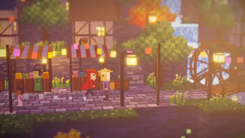](https://github.com/inematds/filme-em-codigo/releases/download/fonte-v1/wide_pixel.mp4)  
[▶ Ver o vídeo: wide_pixel.mp4](https://github.com/inematds/filme-em-codigo/releases/download/fonte-v1/wide_pixel.mp4)

*Diorama em pixel art HD-2D*

### Vila das Lanternas

Um herói de capa vermelha corre por uma vila nas montanhas iluminada por lanternas ao entardecer e observa os fogos de artifício sobre o vale.

**Mesmo estilo, sua ideia**

> Faça um filme animado de 5 a 10 segundos, em 16:9, sobre [SUA IDEIA AQUI]. Estilo: um diorama em pixel art HD-2D, feito com código. Desenhe cada sprite e bloco com código, usando uma única paleta fixa de 32 cores, pixels grandes e dithering aplicado à mão, e anime os personagens em ciclos curtos de sprites. Deixe os sprites planos em pé num cenário em miniatura 3D e ilumine e filme como uma maquete: luzes pontuais quentes com sombras, feixes volumétricos de luz do entardecer, água reflexiva alinhada aos pixels, lente tilt-shift com grande profundidade de campo e bloom HDR. Um movimento lento de câmera seguindo o herói, terminando numa vista ampla. Sem texto. Melodia chiptune com reverberação moderna suave e pequenos efeitos sonoros.

<details><summary>Prompt original (inglês)</summary>

```text
Make a 5 to 10 second 16:9 animated film about [YOUR IDEA HERE]. Style: an HD-2D pixel-art diorama, built in code. Draw every sprite and tile in code from one fixed 32-colour palette, with chunky pixels and hand-placed dithering, and animate the characters as short sprite cycles. Stand the flat sprites up in a 3D miniature set and light and film it like a model: warm point lights with shadows, volumetric dusk light shafts, pixel-snapped reflective water, a tilt-shift lens with strong depth of field, and HDR bloom. One slow dolly move following the hero, ending on a wide view. No text. Chiptune melody with soft modern reverb and small sound effects.
```

</details>

**Copiar este filme exato · Prompt exato**

> Faça um filme em pixel art HD-2D de 10 segundos, em 16:9, com código. Um herói de capa vermelha corre pelo terraço de uma vila nas montanhas iluminada por lanternas ao entardecer, atravessa a vila e para na beirada para observar os fogos de artifício explodirem sobre o vale e se refletirem na água. Todos os sprites e blocos são desenhados com código usando uma paleta de 32 cores e colocados num diorama 3D, com luzes pontuais das lanternas e sombras, feixes volumétricos do entardecer, reflexos da água alinhados aos pixels, profundidade de campo tilt-shift e bloom. Trilha chiptune com estouros dos fogos.

<details><summary>Prompt original (inglês)</summary>

```text
Make a 10 second 16:9 HD-2D pixel-art film in code. A hero in a red cloak runs along the terrace of a lantern-lit mountain village at dusk, through the village, and stops at the edge to watch fireworks burst over the valley and reflect in the water. All sprites and tiles drawn in code from a 32-colour palette, placed in a 3D diorama with lantern point lights and shadows, volumetric dusk shafts, pixel-snapped water reflections, tilt-shift depth of field and bloom. Chiptune score with firework pops.
```

</details>

[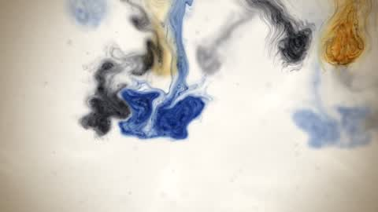](https://github.com/inematds/filme-em-codigo/releases/download/fonte-v1/wide_ink.mp4)  
[▶ Ver o vídeo: wide_ink.mp4](https://github.com/inematds/filme-em-codigo/releases/download/fonte-v1/wide_ink.mp4)

*Tinta na água e enxame de partículas*

### Garça de tinta

Nuvens de tinta florescem na água, então dezenas de milhares de partículas se espalham e formam uma garça levantando voo, antes de explodir de volta em tinta.

**Mesmo estilo, sua ideia**

> Crie um filme animado de 5 a 10 segundos, em 16:9, sobre [SUA IDEIA AQUI]. Faça tudo em código, como uma fotografia macro de tinta na água: um fundo de papel claro e luminoso, iluminado por trás, com nuvens de tinta preta e azul-escura, além de exatamente uma nuvem dourada de destaque. Cada uma se enrola em redemoinhos, com filamentos finos e fibrosos movidos por um campo de fluxo de curl noise, para se dobrar e esticar como tinta de verdade. Dezenas de milhares de partículas finas, levadas pelo mesmo fluxo, se desprendem da tinta e se agrupam num bando que atravessa o quadro e se transforma no tema, formando uma silhueta nítida e original. Ela se mantém por um instante, com um movimento sutil, antes de se desfazer em nuvens de tinta à deriva. Use profundidade de campo muito rasa, com bokeh suave nas partículas próximas, câmera com movimento lento que se afasta de um plano inicial fechado e ajusta o foco da tinta para o tema e de volta, desfoque de movimento nas partículas rápidas, refração sutil e brilho de cáusticas como se tudo fosse visto através da água, mistura de cores como pigmentos, vinheta quente de papel e granulação fina. Sem texto nem narração; um som ambiente contínuo e suave, notas dedilhadas esparsas e sons delicados de água, sincronizados com as gotas, o bando, a revelação e a dissolução.

<details><summary>Prompt original (inglês)</summary>

```text
Make a 5 to 10 second 16:9 animated film about [YOUR IDEA HERE]. Build it entirely in code as macro photography of ink in water: a luminous pale paper background lit from behind, with plumes of black and deep-blue ink plus exactly one accent plume of gold, each curling into vortex caps with fine fibrous filaments driven by a curl-noise flow field so they fold and stretch like real ink. Tens of thousands of fine particles carried by the same flow condense out of the ink into a murmuration that sweeps across the frame and resolves into the subject as a clear, original silhouette, which holds for a beat with one living motion before bursting back into drifting ink blooms. Use very shallow depth of field with soft bokeh on near particles, a slow drifting camera that pulls back from a close opening and racks focus from the ink to the subject and back, motion blur on fast particles, subtle refraction and caustic shimmer as if seen through water, pigment-style colour mixing, a warm paper vignette and fine grain. No text or narration; a quiet drone with sparse plucked notes and soft water sounds timed to the drops, the flock, the reveal and the dissolve.
```

</details>

**Copiar este filme exato · Prompt exato**

> Crie um filme de 9.6 segundos, em 16:9 e a 30 fps, inteiramente em código, sem narração nem texto, com aparência de fotografia macro de tinta na água. Sobre papel branco-quente e luminoso, iluminado por trás, nuvens de tinta preta e azul-índigo escura descem do alto do quadro e se enrolam em dois redemoinhos com formato de cogumelo, formando filamentos finos e fibrosos que se dobram e esticam como tinta de verdade, junto a uma nuvem dourada cintilante. Comece bem perto de uma nuvem preta e outra azul, enquanto a lente ajusta o foco; depois, afaste a câmera e mova-a para a direita para revelar o dourado. Pequenos pontos escuros surgem dentro da tinta; então, dezenas de milhares deles se espalham num bando com desfoque de movimento, atravessam a parte baixa do quadro, fazem uma curva para cima pelo lado direito e se agrupam no centro, formando uma garça original levantando voo: pescoço esticado para cima e para a frente, pernas longas para trás, coroa dourada e asas emplumadas batendo lentamente. Ajuste o foco da tinta para a ave, deixando a tinta como um fundo de cores suaves. Mantenha a imagem por um instante e meio; então, a garça explode em novas nuvens de tinta preta, azul e dourada, e suas partículas se dispersam enquanto o foco volta para a tinta. Use profundidade de campo muito rasa, com discos de bokeh suaves, refração delicada da água e brilho de cáusticas, vinheta quente de papel e granulação fina. Som: som ambiente contínuo e grave, notas esparsas dedilhadas como as de um koto, gotas subaquáticas, um whoosh suave para o bando, um sino quando a ave se forma, batidas de asas e uma sonoridade dissolvente.

<details><summary>Prompt original (inglês)</summary>

```text
Make a 9.6 second 16:9 film, 30 fps, entirely in code, no narration or text, shot like macro photography of ink in water. On luminous warm off-white paper lit from behind, plumes of black and deep indigo-blue ink descend from the top of frame and curl into twin-vortex mushroom caps with fine fibrous filaments that fold and stretch like real ink, with one plume of gold that glitters. Open very close on a black and a blue plume as the lens finds focus, then pull back and drift right to reveal the gold. Tiny dark specks appear inside the ink, then tens of thousands of them stream out as a motion-blurred murmuration that sweeps low across the frame, curves up the right side and condenses mid-frame into an original crane taking off: neck stretched up and forward, long legs trailing, gold crown, feathered wings beating slowly. Rack focus from the ink to the bird so the ink becomes soft colour behind it. Hold for a beat and a half, then the crane bursts into fresh black, blue and gold ink blooms and its particles drift away as focus returns to the ink. Very shallow depth of field with soft bokeh discs, gentle water refraction and caustic shimmer, warm paper vignette, fine grain. Sound: low drone, sparse koto-like plucks, underwater drops, a soft whoosh for the flock, a bell when the bird forms, wingbeats, a dissolving wash.
```

</details>

[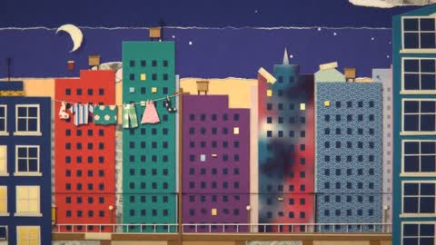](https://github.com/inematds/filme-em-codigo/releases/download/fonte-v1/wide_collage.mp4)  
[▶ Ver o vídeo: wide_collage.mp4](https://github.com/inematds/filme-em-codigo/releases/download/fonte-v1/wide_collage.mp4)

*Colagem de papel recortado*

### Manhã de papel

Uma cidade de papel desperta ao amanhecer, um bonde atravessa a ponte e um gato de papel salta entre os telhados, espalhando pássaros de jornal.

**Mesmo estilo, sua ideia**

> Faça um filme animado de 5 a 10 segundos em 16:9 sobre [SUA IDEIA AQUI]. Construa-o inteiramente em código como uma colagem de papel recortado em stop motion. Cada elemento deve ser um pedaço de papel de um pequeno sistema de peças de papel: tipos de papel gerados proceduralmente (papel colorido, papel kraft, jornal com letras abstratas ilegíveis, papel quadriculado, papel marmorizado, papel de seda, meio-tom de revista rasgada, papel de origami estampado), um estilo de recorte (cortado com tesoura e bordas levemente facetadas ou rasgado à mão com borda branca fibrosa), uma leve curvatura e uma sombra de contato suave que cresce e fica mais difusa à medida que a peça se ergue da folha. Sobreponha as peças em uma base texturizada, algumas presas com fita crepe ou um alfinete visível, e construa os personagens como marionetes articuladas de recortes de papel com bailarinas. Anime em dois quadros: as peças deslizam, giram nas articulações e são substituídas por outras formas, com uma pequena vibração entre os quadros e sombras que piscam como se a cena fosse fotografada novamente em uma câmera de animação vertical. Posicione o primeiro plano, o plano médio e o fundo em camadas multiplano, com uma panorâmica planejada e um zoom em direção ao personagem principal. Termine mostrando toda a colagem plana sobre a base, com fita nos cantos. Faça um movimento final de câmera com queda de luz nas bordas, leve suavidade de lente e granulação. Sem texto nem narração; use uma pequena melodia de caixa de música e efeitos sonoros de papel nos acontecimentos visíveis. Apenas designs originais.

<details><summary>Prompt original (inglês)</summary>

```text
Make a 5 to 10 second 16:9 animated film about [YOUR IDEA HERE]. Build it entirely in code as stop-motion cut-paper collage. Every element is a piece of paper from a small paper-piece system: procedurally generated stocks (coloured sugar paper, kraft, newsprint with abstract unreadable type, graph paper, marbled paper, tissue, torn magazine halftone, patterned origami paper), a cut style (scissor-cut with slightly faceted edges, or hand-torn with a white fibrous deckle), slight curl, and a soft contact shadow that grows and softens as the piece lifts off the sheet. Layer the pieces on a textured backing board, some held with masking tape or a visible pin, and build characters as jointed cut-out puppets with paper fasteners. Animate on twos: pieces slide, hinge and get swapped for replacement shapes, with small frame-to-frame jitter and shadows that flicker as if re-photographed under a rostrum camera. Stage foreground, midground and background on multiplane layers with a designed pan and a push-in on the main character. Finish on the whole collage seen flat on the backing board with tape at the corners. Add a final camera pass with lamp falloff, slight lens softness and grain. No text, no narration; a small music-box tune plus paper foley on the visible events. Original designs only.
```

</details>

**Copiar este filme exato · Prompt exato**

> Faça um filme de colagem de papel recortado em stop motion, com 10 segundos e formato 16:9, construído inteiramente em código, sobre uma cidade despertando. Cada elemento deve ser um pedaço de papel de um sistema procedural de peças de papel: papel colorido, kraft, jornal com letras abstratas ilegíveis, papel quadriculado, papel marmorizado, papel de seda, meio-tom de revista e papel de origami estampado; cada peça é cortada com tesoura e tem bordas facetadas ou é rasgada à mão, com uma borda branca fibrosa, leve curvatura e sombra de contato suave que cresce quando ela se ergue. Sobreponha as peças em uma base cinza texturizada, com tiras de fita crepe, alfinetes de mapa e bailarinas de latão. Comece à noite, com blocos de torres coloridos sob faixas rasgadas de céu azul-índigo e uma lua crescente presa com um alfinete. Troque as faixas do céu, uma a uma, por cores do amanhecer; retire a lua, erga um sol laranja rasgado com fatias de raios giratórias por trás das torres e vire os pequenos quadrados das janelas de azul-marinho para amarelo. Um bonde amarelo de papel cruza uma ponte arqueada de kraft sobre um rio marmorizado que desliza; roupas de origami tremulam em um varal. Aproxime-se de um gato feito de papel rasgado cor de carvão, com listras laranja marmorizadas, dormindo no parapeito de uma janela: ele acorda, se espreguiça, arqueia as costas, se agacha e salta para o telhado seguinte, espalhando um bando de pássaros de jornal. Afaste-se para mostrar toda a colagem plana sobre a base, com fita nos cantos, e pressione a última tira. Anime em dois quadros, com formas substituídas, vibração e sombras tremeluzentes, paralaxe multiplano, queda de luz de uma câmera de animação vertical e granulação. Melodia de caixa de música e efeitos sonoros de papel, sem texto.

<details><summary>Prompt original (inglês)</summary>

```text
Make a 10 second 16:9 stop-motion cut-paper collage film, built entirely in code, of a city waking up. Every element is a piece of paper from a procedural paper-piece system: coloured sugar paper, kraft, newsprint with abstract unreadable type, graph paper, marbled paper, tissue, magazine halftone and patterned origami paper, either scissor-cut with faceted edges or hand-torn with a white fibrous deckle, each with slight curl and a soft contact shadow that grows with lift. Layer them on a grey textured backing board with masking tape strips, map pins and brass fasteners. Open at night on colourful tower blocks under torn indigo sky bands with a pinned crescent moon. Re-paper the sky band by band into dawn colours, lift the moon away, raise a torn orange sun with rotating ray wedges behind the towers, and flip tiny window squares from navy to yellow. A yellow paper tram crosses a kraft arched bridge over a sliding marbled river; washing of origami paper flutters on a line. Push in on a charcoal torn-paper cat with marbled orange stripes asleep on a windowsill: it wakes, stretches, arches, crouches and leaps the gap to the next rooftop, scattering a flock of newsprint birds. Pull back to the whole collage flat on the board with tape at the corners, the last strip pressed on. Animate on twos with replacement shapes, jitter and flickering shadows, multiplane parallax, rostrum-camera lamp falloff and grain. Music-box tune and paper foley, no text.
```

</details>

[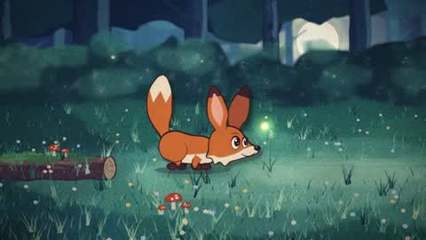](https://github.com/inematds/filme-em-codigo/releases/download/fonte-v1/wide_cel.mp4)  
[▶ Ver o vídeo: wide_cel.mp4](https://github.com/inematds/filme-em-codigo/releases/download/fonte-v1/wide_cel.mp4)

*Animação clássica desenhada à mão em acetato*

### Clareira dos vagalumes

Um filhote de raposa persegue um vagalume, dá um salto, rola e espirra. O espirro faz centenas de vagalumes saírem da grama.

**Mesmo estilo, sua ideia**

> Faça um filme animado de 5 a 10 segundos, em 16:9, sobre [SUA IDEIA AQUI]. Crie tudo em código, como uma animação clássica de cels desenhados à mão, na tradição dos longas-metragens americanos das décadas de 1940 e 1950, com personagens e mundo originais. Pinte os cenários proceduralmente em quatro ou cinco camadas planas de aquarela e guache, com bordas úmidas, granulação de pigmento, manchas suaves, folhagem feita com pincel seco e um pouco de esboço a lápis, usando uma paleta acolhedora de livro ilustrado. Mova as camadas como uma câmera multiplano, deixando as mais distantes mais suaves e criando um movimento de aproximação, panorâmica ou afastamento. Desenhe os personagens em cada quadro como cels pintados e contornados a tinta, feitos com splines 2D deformáveis: preenchimentos opacos e planos, com bordas de tinta levemente irregulares, linhas em algumas áreas da própria cor e uma sombra suave de cel no cenário. Anime a partir de uma folha de poses-chave, usando um desenho por quadro nas ações rápidas e um desenho a cada dois quadros no restante: antecipação, compressão e alongamento, ação sobreposta e continuidade do movimento, arcos, aceleração e desaceleração suaves e silhuetas marcantes. Acrescente cels de efeitos desenhados à mão, como ondulações, brilhos, nuvens de poeira e clarões suaves. Finalize tudo com um único shader que adicione textura de papel, cintilação e oscilação dos cels, poeira nos cels, granulação fina, oscilação da película, vinheta suave e cores quentes de impressão. Crie um pequeno arco narrativo com uma imagem de abertura, um acontecimento e uma imagem final marcante. Sem texto ou narração; crie uma trilha orquestral de livro ilustrado e efeitos sonoros sincronizados com a ação.

<details><summary>Prompt original (inglês)</summary>

```text
Make a 5 to 10 second 16:9 animated film about [YOUR IDEA HERE]. Build it entirely in code as classic hand-drawn cel animation in the tradition of 1940s and 1950s American feature animation, with original characters and world only. Paint the backgrounds procedurally as four or five flat watercolour and gouache layers (wet-edge washes, pigment granulation, soft bleeds, dry-brush foliage, a little pencil under-drawing) in a warm storybook palette, and move them as a multiplane camera with the far layers softer and a designed push, pan or pull-back. Draw the characters each frame as inked and painted cels from deformable 2D splines: flat opaque fills with a slightly uneven paint edge inside a tapering ink line, some self-colour lines, a soft cel shadow on the background. Animate with the classic principles from a keyed pose sheet, on ones for fast action and twos elsewhere: anticipation, squash and stretch, overlapping action and follow-through, arcs, slow in and out, strong silhouettes. Add hand-drawn effects cels (ripples, sparkles, dust puffs, soft glows) and photograph everything through one shader pass that adds paper tooth, cel flicker and weave, cel dust, fine grain, gate weave, gentle vignette and warm print colour. Give it a small arc with an opening image, an event and a final image that lands. No text or narration; synthesise an orchestral storybook score and sound effects timed to the action.
```

</details>

**Copiar este filme exato · Prompt exato**

> Faça um filme animado de 10 segundos, em 16:9, a 30 fps, criado inteiramente em código, no estilo da animação clássica de cels desenhados à mão dos longas-metragens americanos das décadas de 1940 e 1950, apenas com designs originais. Clareira na floresta sob o luar: cinco camadas de aquarela e guache pintadas proceduralmente (céu com lua cheia e estrelas, troncos distantes enevoados, árvores no plano médio, chão da clareira com grama, flores silvestres, lago, tronco coberto de musgo e cogumelos vermelhos, primeiro plano escuro com troncos, folhas e samambaias), movidas como uma câmera multiplano, com as camadas distantes mais suaves. Um filhote de raposa original, com orelhas grandes de pontas escuras, peito e ponta da cauda creme e patas com meias escuras, desenhado como cels pintados e contornados a tinta a partir de splines deformáveis, com um desenho por quadro nas ações rápidas e um a cada dois quadros no restante. De 0 a 2 s: ele persegue um vagalume pousado na ponta de uma semente. De 2 a 2,6 s: agacha-se e balança o quadril. De 2,6 a 3,1 s: salta com o corpo esticado, o vagalume dispara para longe e ele aterrissa comprimindo o corpo ao máximo, com nuvens de poeira. De 3,1 a 4 s: rola e se senta tonto, com estrelas girando ao redor. De 4,9 a 5,6 s: mexe o nariz, diz "ah, ah" e dá um espirro forte. De 5,6 a 7,5 s: uma onda circular atravessa a grama e centenas de vagalumes sobem em uma onda, iluminando as pinturas e refletindo no lago. A raposa olha para cima, maravilhada. O vagalume pousa em seu nariz, e a câmera se afasta até mostrar o cenário amplo. Finalize com granulação, oscilação da película, poeira e sombras nos cels, vinheta e cores quentes de impressão. Trilha orquestral de livro ilustrado e efeitos sonoros de desenho animado, sem texto.

<details><summary>Prompt original (inglês)</summary>

```text
Make a 10 second 16:9 animated film, 30 fps, built entirely in code, in the style of classic hand-drawn cel animation of 1940s and 1950s American features, with original designs only. Moonlit forest glade: five procedurally painted watercolour and gouache layers (sky with a full moon and stars, misty far trunks, middle trees, a glade floor with grass, wildflowers, a pond, a mossy log and red mushrooms, a dark foreground of trunks, leaves and ferns), moved as a multiplane camera with far layers softer. An original fox cub with oversized dark-tipped ears, cream bib and tail tip and dark socks, drawn as inked and painted cels from deformable splines, on ones for fast action and twos elsewhere. 0 to 2 s: it stalks a firefly resting on a seed head. 2 to 2.6 s: crouch and haunch wiggle. 2.6 to 3.1 s: stretched pounce, the firefly zips off, full squash on landing with dust puffs. 3.1 to 4 s: tumble, sits up dizzy with circling stars. 4.9 to 5.6 s: nose twitch, "ah, ah", big sneeze. 5.6 to 7.5 s: a ring crosses the grass and hundreds of fireflies rise in a wave, glowing on the paintings and reflecting in the pond. The cub looks up in wonder, the firefly lands on its nose, and the camera pulls back wide. Finish with grain, gate weave, cel dust and shadow, vignette, warm print colour. Storybook orchestral score and cartoon sound effects, no text.
```

</details>

[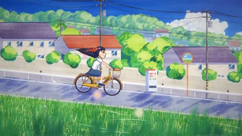](https://github.com/inematds/filme-em-codigo/releases/download/fonte-v1/wide_anime.mp4)  
[▶ Ver o vídeo: wide_anime.mp4](https://github.com/inematds/filme-em-codigo/releases/download/fonte-v1/wide_anime.mp4)

*Filme de anime 2D*

### Passagem de nível, verão

Uma garota desce de bicicleta ladeira abaixo, freia numa passagem de nível enquanto um trem passa em alta velocidade e, depois, olha para o céu de verão sobre o mar.

**Mesmo estilo, sua ideia**

> Crie um filme animado de 5 a 10 segundos, em 16:9, sobre [SUA IDEIA AQUI]. Estilo: anime teatral japonês 2D, com cores chapadas, feito do jeito tradicional e inteiramente em código, sem 3D. Os cenários são pinturas em cores de cartaz, separadas em camadas de profundidade para movimentos multiplanos: céu de verão saturado, grandes nuvens cumulus em dois ou três tons chapados, com bordas suaves feitas com pinceladas, cenários cotidianos detalhados em perspectiva plana correta, luz nítida com sombras azul-violeta saturadas e textura de pincel visível. As personagens têm designs originais desenhados como cels chapados: contorno fino, escuro e castanho, com pequenas variações; cores base chapadas; exatamente um tom de sombra com bordas definidas e um pequeno realce; cabelo e roupas em formas separadas. Anime com poses-chave marcantes, mantidas por 2 a 6 quadros, em ciclos de dois e três quadros, com movimento de continuidade no cabelo, nas roupas e nas fitas, uma piscada e uma mudança na boca, além de cels mantidos enquanto apenas o cabelo e as roupas se movem. Os efeitos (rajadas de vento, linhas de velocidade, poeira, pássaros, pétalas) são formas desenhadas em ciclos de três quadros. Finalize com um tratamento fotográfico de anime: panorâmica multiplana e aproximação lenta da câmera, brilho difuso nos realces, reflexo de lente e vazamento de luz quente, partículas desfocadas em primeiro plano, tremulação de calor, leve franja de cor e granulação fina de filme. Pelo menos quatro planos com cortes no estilo anime, incluindo um superclose dos olhos e um plano aberto final. Sem texto nem narração; música suave conduzida pelo piano e efeitos sonoros dos acontecimentos visíveis.

<details><summary>Prompt original (inglês)</summary>

```text
Make a 5 to 10 second 16:9 animated film about [YOUR IDEA HERE]. Style: flat 2D Japanese theatrical anime made the traditional way, built entirely in code with no 3D. Backgrounds are painted poster-colour art in separate depth layers for multiplane moves: saturated summer sky, big cumulus clouds in two or three flat tones with soft brushed edges, detailed everyday scenery in correct flat perspective, crisp light with saturated blue-violet shadows and visible brush texture. Characters are original designs drawn as flat cels: thin, slightly varied dark-brown outline, flat base colours, exactly one hard-edged shadow tone and a small highlight, hair and clothing as separate shapes. Animate with strong key poses held for 2 to 6 frames, on twos and threes, with follow-through on hair, clothes and ribbons, a blink and a mouth change, and held cels where only hair and clothes move. Effects (wind streaks, speed lines, dust, birds, petals) are drawn shapes on threes. Finish with an anime photography pass: multiplane pan and slow truck-in, highlight bloom and diffusion, lens flare and warm light leak, out-of-focus foreground particles, heat shimmer, slight colour fringing and fine film grain. At least four shots with anime-style cutting, including one extreme close-up of the eyes and one wide final shot. No text or narration; soft piano-led music and sound effects on the visible events.
```

</details>

**Copiar este filme exato · Prompt exato**

> Crie um filme de 10 segundos, em 16:9, com estilo de anime teatral japonês 2D e cores chapadas, todo feito em código, sem 3D. Cenários pintados em cores de cartaz, em várias camadas de profundidade: céu de verão azul-cobalto profundo, cumulonimbus imponentes em três tons chapados, com bordas suaves feitas com pinceladas, cidade litorânea numa encosta, com telhados de telha, sombras lavanda, postes com fios caídos, passagem de nível e mar cintilante. Uma garota original com cabelo longo azul-tinta, laço vermelho-alaranjado, blusa branca com gola marinheira verde-menta, saia plissada azul-marinho e uma bicicleta mostarda com cesta, desenhada como cel chapado, com linha fina, irregular e castanha-escura, um tom de sombra e um pequeno realce. Oito planos: plano de acompanhamento lateral dela descendo a ladeira sem pedalar, com o cabelo ao vento; ângulo baixo do sinal da passagem piscando enquanto a cancela listrada desce; ela freia, põe o pé no chão e o cabelo balança para a frente; vista por trás, um trem passa em alta velocidade e preenche o quadro, com linhas de velocidade, clarões nas janelas, pétalas voando e cabelo e fita lançados para o lado; superclose dos olhos apertados, que piscam e depois se abrem bem, com o mar refletido neles; o trem passa, revelando a cidade, o mar e uma nuvem gigante, com pássaros e um reflexo de sol; plano médio fechado dela olhando para cima e sorrindo; plano aberto final inclinando a câmera para cima sobre a cidade enquanto as cancelas se levantam. Personagens animadas em ciclos de dois quadros, com poses mantidas e movimento de continuidade; efeitos em ciclos de três quadros; câmera multiplana com aproximações lentas, brilho difuso, reflexo de lente, vazamento de luz, tremulação de calor, leve franja de cor e granulação fina. Sem texto. Música: piano suave e camadas sonoras, cigarras, sino da passagem, estrondo do trem e mar.

<details><summary>Prompt original (inglês)</summary>

```text
Make a 10 second 16:9 flat 2D Japanese theatrical-anime style film, all in code, no 3D. Painted poster-colour backgrounds in several depth layers: deep cobalt summer sky, towering cumulonimbus in three flat tones with soft brushed edges, a seaside hillside town of tiled roofs, lavender shadows, utility poles with sagging wires, a level crossing, glittering sea. An original girl with long ink-blue hair, vermilion ribbon bow, white blouse with mint sailor collar, navy pleated skirt and a mustard bicycle with a basket, drawn as flat cels with a thin varied dark-brown line, one hard shadow tone and a small highlight. Eight shots: side tracking shot of her coasting downhill, hair streaming; low angle of the crossing signal flashing as the striped barrier drops; she brakes, foot down, hair swinging forward; from behind her a train blasts past filling the frame with speed lines, window flashes, flying petals, hair and ribbon whipped sideways; extreme close-up of her eyes squinting, blinking, then opening wide with sea reflected; the train clears to reveal town, sea and giant cloud with birds and a sun flare; medium close-up as she looks up and smiles; wide final tilt-up over the town as the gates lift. Characters animated on twos with held poses and follow-through, effects on threes, multiplane camera with slow truck-ins, bloom, lens flare, light leak, heat shimmer, slight colour fringing, fine grain. No text. Music: gentle piano and pads, cicadas, crossing bell, train roar, sea.
```

</details>

[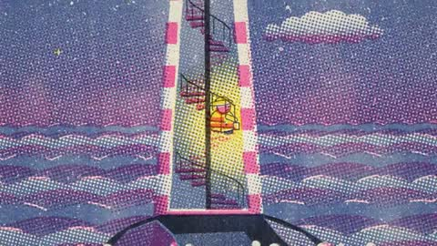](https://github.com/inematds/filme-em-codigo/releases/download/fonte-v1/wide_riso.mp4)  
[▶ Ver o vídeo: wide_riso.mp4](https://github.com/inematds/filme-em-codigo/releases/download/fonte-v1/wide_riso.mp4)

*Impressão em risografia*

### O Farol

Um faroleiro acende a lâmpada, e o feixe revela uma baleia em sobreimpressão.

**Mesmo estilo, sua ideia**

> Crie um filme animado de 5 a 10 segundos, em 16:9, sobre [SUA IDEIA AQUI]. Estilo: uma animação de impressão em risografia, criada inteiramente em código como arte 2D plana. Desenhe a imagem em quatro chapas de tinta em escala de cinza (rosa fluorescente, azul médio, amarelo e preto) em telas, com formas simples e marcantes, planejadas para que as tintas se sobreponham e formem novas cores. Depois, imprima-as em um shader: cada chapa com sua própria retícula de meio-tom (pontos, linhas ou granulação), sobreimpressão multiplicada, um pequeno desalinhamento diferente em cada impressão, faixas de rolo, áreas chapadas irregulares, pequenos furos e papel creme com textura. Mantenha cada impressão por dois ou três quadros para que a imagem trema como uma pilha de impressões folheadas. Um acontecimento e uma imagem final que use a sobreimpressão para revelar algo. Sem texto. Música lo-fi acolhedora e sons mecânicos suaves de impressão.

<details><summary>Prompt original (inglês)</summary>

```text
Make a 5 to 10 second 16:9 animated film about [YOUR IDEA HERE]. Style: a risograph print animation, built entirely in code as flat 2D artwork. Draw the picture as four greyscale ink plates (fluorescent pink, medium blue, yellow and black) on canvases, with bold simple shapes designed so the inks overlap into new colours. Then print them in a shader: each plate through its own halftone screen (dots, lines or grain), multiply overprint, a different small misregistration on every print, roller banding, patchy solids, pinholes and cream paper with tooth. Hold each print for two or three frames so the picture jitters like a stack of prints flipped through. One event, and a final image that uses overprint for a reveal. No text. Warm lo-fi music and soft mechanical print sounds.
```

</details>

**Copiar este filme exato · Prompt exato**

> Crie uma animação de impressão em risografia de 9 a 10 segundos, em 16:9, usando código. Mar noturno em azul, um farol sobre uma rocha e seu faroleiro. Ele acende a lâmpada, um feixe amarelo varre a água e, onde o feixe se sobrepõe ao mar azul, revela uma enorme baleia passando sob a superfície, em sobreimpressão rosa e azul. Quatro chapas de tinta (rosa fluorescente, azul, amarelo e preto), impressas em um shader com retículas de meio-tom, desalinhamento, faixas de rolo, pequenos furos e papel creme. Mantidas por dois e três quadros. Sem texto.

<details><summary>Prompt original (inglês)</summary>

```text
Make a 9 to 10 second 16:9 risograph print animation in code. Night sea in blue, a lighthouse on a rock and its keeper. He lights the lamp, a yellow beam sweeps across the water, and where the beam overprints the blue sea it reveals a huge whale passing under the surface in pink and blue overprint. Four ink plates (fluorescent pink, blue, yellow, black) printed in a shader with halftone screens, misregistration, roller banding, pinholes and cream paper. Held on twos and threes. No text.
```

</details>

[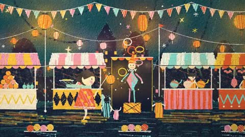](https://github.com/inematds/filme-em-codigo/releases/download/fonte-v1/wide_pastel.mp4)  
[▶ Ver o vídeo: wide_pastel.mp4](https://github.com/inematds/filme-em-codigo/releases/download/fonte-v1/wide_pastel.mp4)

*Pastel a óleo e guache*

### A lanterna que escapou

Uma menina caminha por um mercado noturno iluminado por lanternas, e uma delas sobe flutuando em direção às estrelas.

**Mesmo estilo, sua ideia**

> Crie um filme animado de 5 a 10 segundos em 16:9 sobre [SUA IDEIA AQUI]. Ele deve parecer uma digitalização de pastel oleoso e guache em papel escuro colorido (verde-petróleo profundo ou vermelho-tijolo), desenhado em estilo ingênuo, marcante e geométrico de livro ilustrado de meados do século. Use uma paleta limitada a cinco ou seis cores. Desenhe tudo como formas planas em 2D e depois crie um mecanismo de traços de verdade: cada forma deve ser preenchida com traços de pastel direcionais visíveis, que passem por cima da textura do papel e deixem partes do papel à mostra; as bordas devem ser ásperas e passar um pouco do contorno; as cores devem se misturar onde se sobrepõem; deve haver realces raspados em sgraffito e marcas suaves de dedos para criar brilho; áreas planas de guache fosco, com leves marcas de pincel, devem ficar ao lado do pastel ceroso. Use papel com textura pesada, iluminado por um lado, para que sua granulação fique visível em toda parte. Anime como uma animação feita em papel: redesenhe os traços a cada dois ou três quadros para que toda a imagem oscile suavemente; faça os personagens se moverem a cada dois quadros; e deixe rastros suaves de pigmento atrás dos objetos em movimento. Monte uma pequena cena com primeiro plano, plano médio e fundo, usando uma câmera multiplano com um movimento planejado, e crie um arco claro: uma imagem de abertura, algo acontece e uma imagem final marcante. Sem texto nem narração; use uma música simples tocada à mão, com efeitos sonoros para os acontecimentos visíveis.

<details><summary>Prompt original (inglês)</summary>

```text
Make a 5 to 10 second 16:9 animated film about [YOUR IDEA HERE]. It must look like a scan of oil pastel and gouache on dark coloured paper (deep teal or brick red), drawn in a naive, bold, geometric mid-century picture-book manner with a limited palette of five or six colours. Draw everything as flat 2D shapes, then build a real stroke engine: every shape is filled with visible directional pastel strokes that skip over the paper tooth and leave the paper showing through, edges are rough and slightly overshoot, colours layer where they overlap, there are scraped-back sgraffito highlights and soft finger smudges for glow, and flat matte gouache areas with faint brush drag sit beside the waxy pastel. Use heavy paper grain lit from one side so the tooth is visible everywhere. Animate it like paint-on-paper animation: strokes re-draw every two or three frames so the whole picture boils gently, characters move on twos, and moving things leave faint smears of pigment behind them. Stage a small scene with foreground, midground and background on a multiplane camera with one designed move, and give it a clear arc: an opening image, something that happens, and a final image that lands. No text, no narration; a simple hand-played music bed with sound effects on the visible events.
```

</details>

**Copiar este filme exato · Prompt exato**

> Crie um filme animado de 10 segundos em 16:9, 1920x1080 a 30 fps, sem texto, que pareça uma digitalização de pastel oleoso e guache em papel verde-petróleo escuro, em estilo ingênuo e geométrico de livro ilustrado de meados do século. Paleta: apenas creme, vermelhão, amarelo quente, rosa, índigo e azul-água. Crie um mecanismo de traços: cada forma deve ser preenchida com traços de pastel direcionais visíveis, que passem por cima da textura do papel, ultrapassem suas bordas ásperas e deixem partes do papel à mostra; áreas planas de guache fosco devem ficar ao lado deles; acrescente realces raspados em sgraffito e marcas de dedos, sobre papel com textura pesada iluminado pelo alto à esquerda. Redesenhe os traços a cada dois ou três quadros para que a imagem oscile, e deixe rastros suaves atrás dos objetos em movimento. Cena: um mercado noturno sob fileiras de lanternas de papel e bandeirolas. Uma menina com um casaco vermelho de bolinhas e um cachecol azul-água carrega uma lanterna presa a uma vara e passa por barracas listradas com panelas fumegantes, chaleiras e uma pirâmide de frutas. Um malabarista com roupa de losangos lança cinco argolas ao ar, sobre um caixote. No açougue, um cachorro branco salta, rouba uma corrente de linguiças e corre de volta passando por ela, enquanto o açougueiro ergue os braços. Uma lanterna se solta do cordão e sobe flutuando; ela para e observa. A câmera multiplano acompanha a menina de lado, depois se inclina para cima e se afasta. Imagem final: a lanterna, pequena entre estrelas grossas de pastel e uma lua crescente, acima do mercado iluminado. Música: uma valsa de piano de brinquedo, com murmúrios do mercado, passos, um som de corda vibrando e uma badalada final.

<details><summary>Prompt original (inglês)</summary>

```text
Make a 10 second 16:9 animated film, 1920x1080 at 30 fps, no text, that looks like a scan of oil pastel and gouache on dark teal paper in a naive, geometric mid-century picture-book manner. Palette: cream, vermilion, warm yellow, pink, indigo and aqua only. Build a stroke engine: every shape is filled with visible directional pastel strokes that skip over the paper tooth, overshoot their rough edges and let the paper show through; flat matte gouache areas sit beside them; add scraped sgraffito highlights and finger smudges, on heavy paper grain lit from the upper left. Re-draw the strokes every two or three frames so the picture boils, and let moving things leave faint smears. Scene: a night market under strings of paper lanterns and bunting. A girl in a red spotted coat with an aqua scarf carries a lantern on a stick past striped stalls with steaming pots, kettles and a fruit pyramid. A juggler in a diamond costume tosses five rings on a crate. At the butcher's stall a white dog leaps, steals a chain of sausages and runs back past her while the butcher throws up his arms. One lantern slips its string and floats up; she stops and watches. Multiplane camera tracks sideways with her, then tilts up and pulls back. Final image: the lantern small among thick pastel stars and a crescent moon above the glowing market. Music: a toy-piano waltz with market murmur, footsteps, a twang and a closing bell.
```

</details>

[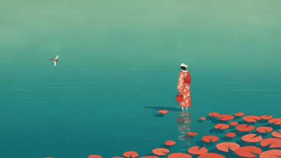](https://github.com/inematds/filme-em-codigo/releases/download/fonte-v1/wide_lily.mp4)  
[▶ Ver o vídeo: wide_lily.mp4](https://github.com/inematds/filme-em-codigo/releases/download/fonte-v1/wide_lily.mp4)

*Ilustração minimalista plana*

### Águas rasas

Uma mulher com um robe coral dá dois passos lentos pelas águas rasas que parecem não ter fim e ergue a cabeça quando uma pétala cai.

**Mesmo estilo, sua ideia**

> Faça um filme animado de 5 a 10 segundos, em 16:9, sobre [SUA IDEIA AQUI]. Estilo: ilustração contemporânea, plana e minimalista, com clima de gravura japonesa. Um enorme campo de cor sereno, que vai suavemente de um tom pálido e enevoado no alto a um tom profundo embaixo, sem linha do horizonte, deixando a maior parte do quadro vazia. Paleta rigorosa de quatro cores: os tons do campo, um acento saturado (coral-vermelhão), creme quente e quase preto. Formas planas com bordas nítidas, sem contornos, e apenas um ou dois tons planos de sombra. Descreva as superfícies com pouquíssimas marcas: linhas concêntricas finas e claras, faixas horizontais longas e suaves, uma sombra projetada escura e difusa, um reflexo quebrado e ondulante, formas de sombra deslocadas sob objetos flutuantes. Coloque uma figura pequena fora do centro e um conjunto de formas na cor de destaque em um canto do primeiro plano. Cubra tudo com uma granulação fina e uniforme de impressão e uma leve textura de papel, para parecer uma ilustração impressa. Anime como uma ilustração em movimento, em dois quadros, com muita contenção: uma ou duas ações lentas e deliberadas, um pequeno balanço secundário que se acalma, uma criatura minúscula atravessando o espaço vazio e um único zoom de aproximação bem lento, com leve paralaxe entre primeiro plano, figura e distância. Termine com um gesto final tranquilo e um último pequeno acontecimento. Som: muito esparso, ar, efeitos sonoros suaves para as ações visíveis e uma ou duas notas distantes, como as de um koto.

<details><summary>Prompt original (inglês)</summary>

```text
Make a 5 to 10 second 16:9 animated film about [YOUR IDEA HERE]. Style: contemporary flat minimalist illustration with a Japanese print feeling. One huge calm colour field that grades smoothly from a pale hazy tone at the top to a deep tone at the bottom, with no horizon line, so most of the frame is empty. A strict palette of four: the field colour range, one saturated accent (coral-vermilion), a warm cream, and near-black. Flat shapes with crisp edges, no outlines, one or two flat shading tones only. Describe surfaces with very few marks: thin pale concentric lines, faint long horizontal bands, a soft dark cast shadow, a broken wobbling reflection, offset shadow shapes under floating objects. One small subject placed off centre, with a cluster of accent-coloured shapes in one foreground corner. Cover everything with fine even print grain and slight paper texture so it reads as a printed illustration. Animate like a moving illustration, on twos, with great restraint: one or two slow deliberate actions, small secondary sway and settle, one tiny creature crossing the empty space, and a single very slow push-in with slight parallax between foreground, subject and distance. End on a quiet final gesture and one last small event. Sound: very sparse, air, soft foley on the visible actions, one or two distant koto-like plucks.
```

</details>

**Copiar este filme exato · Prompt exato**

> Faça um filme animado de 9 segundos, em 16:9, a 30 fps, no estilo de ilustração contemporânea, plana e minimalista, com clima de gravura japonesa. Um enorme campo sereno em tons de teal vai de uma névoa verde-sálvia suave no alto até águas verde-azuladas profundas embaixo, sem horizonte; a maior parte do quadro fica vazia. A paleta se limita a teal, coral-vermelhão, creme quente e quase preto. Formas planas e nítidas, sem contornos, um ou dois tons planos de sombra, granulação fina e uniforme de impressão e textura de papel por toda a imagem. À direita do centro, uma mulher pequena, vista de costas, está de pé na água rasa, com a cabeça baixa: robe coral com padrão de flores creme, faixa vermelha com nó quadrado, lenço creme sobre o cabelo escuro e uma bolsa vermelha pequena. Vitórias-régias corais com um recorte e nervuras radiais finas se agrupam no canto inferior direito, cada uma com uma sombra teal escura deslocada logo abaixo. Anime em dois quadros, com muita contenção: uma libélula vermelha dá saltos rápidos da esquerda para a direita; ela dá dois passos lentos para a esquerda e para, enquanto a barra da roupa e a manga balançam; anéis finos, claros e quebrados se expandem na água a cada passo e desaparecem; o reflexo dela, quebrado e ondulante, treme; uma pequena folha é empurrada para o lado; a sombra de uma carpa desliza sob as folhas; faixas longas e suaves de ondas se movem; a névoa deriva. Zoom de aproximação bem lento, com leve paralaxe. Imagem final: uma pétala creme cai, ela ergue a cabeça para a distância vazia, a pétala toca a água e uma última ondulação se espalha. Som: ar, passos suaves na água e algumas notas de koto.

<details><summary>Prompt original (inglês)</summary>

```text
Make a 9 second 16:9 animated film, 30 fps, in a contemporary flat minimalist illustration style with a Japanese print feeling. A huge calm field of teal grades from soft sage-green haze at the top to deep blue-green water at the bottom with no horizon; most of the frame is empty. Palette is strictly teal, one coral-vermilion, warm cream and near-black. Flat crisp shapes, no outlines, one or two flat shading tones, fine even print grain and paper texture over everything. Right of centre, a small woman seen from behind stands in the shallows, head bowed: coral robe with cream blossom pattern, red sash with a boxy knot, cream headscarf over dark hair, small red bag. Coral lily pads with a notch and thin radial veins cluster in the lower right, each with a dark teal shadow offset beneath. Animate on twos with great restraint: a red dragonfly darts left to right in hops; she takes two slow steps left and stops, hem and sleeve swaying; thin pale broken ripple rings expand and fade from each step; her wobbly broken reflection shivers; one small pad is nudged aside; a koi's shadow glides under the pads; faint long wave bands slide; haze drifts. Very slow push-in with slight parallax. Final image: a cream petal falls, she lifts her head to the empty distance, the petal lands and a last ripple spreads. Sound: air, soft water steps, a few koto plucks.
```

</details>

[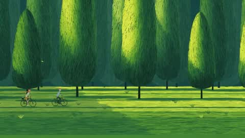](https://github.com/inematds/filme-em-codigo/releases/download/fonte-v1/wide_trees.mp4)  
[▶ Ver o vídeo: wide_trees.mp4](https://github.com/inematds/filme-em-codigo/releases/download/fonte-v1/wide_trees.mp4)

*Ilustração em guache hachurado*

### A Avenida

Dois ciclistas atravessam uma avenida ladeada por árvores imponentes, desenhadas com hachuras, enquanto o vento ondula os traços e a luz do sol os ilumina.

**Mesmo estilo, sua ideia**

> Faça um filme animado de 5 a 10 segundos em 16:9 sobre [SUA IDEIA AQUI]. Estilo: uma ilustração contemporânea em guache e lápis de cor, feita quase inteiramente de hachuras finas, com aspecto sinceramente plano, como uma imagem artesanal digitalizada que ganha movimento. Use um contraste extremo de escala: formas enormes e simples ocupam quase todo o quadro, organizadas em planos de profundidade, enquanto figuras minúsculas se movem numa faixa estreita na parte inferior. Mantenha tudo em uma única família de cores, do tom claro e luminoso, passando pelo tom médio, até a sombra profunda, quase preta; as únicas outras cores aparecem em pequenos detalhes nas figuras. Cada forma grande é uma silhueta plana e nítida, sem contorno, e seu volume é desenhado apenas com milhares de traços curtos e ligeiramente curvos, que acompanham a forma como pelos escovados: traços claros no lado iluminado, escuros no lado sombreado e mais densos e escuros na base. A profundidade vem dos tons: formas próximas, saturadas e contrastadas; as distantes, mais planas e azuladas; sombras profundas nos vãos. O chão é formado por faixas horizontais planas de luz e sombra, com sombras longas projetadas sobre ele. Tinta fosca, granulação fina de papel, sem gradientes além dos criados pela densidade dos traços. Anime como uma ilustração em movimento: as hachuras são redesenhadas a cada três quadros, criando um leve tremeluzir; um vento lento faz ondas nos traços; faixas de sol e sombras de nuvens atravessam a cena; as figuras se movem a cada dois quadros; e a câmera faz uma panorâmica lenta em múltiplos planos, com paralaxe evidente, seguida de uma leve inclinação para revelar toda a escala. Termine com as figuras pequenas na borda do quadro, enquanto a luz chega até elas. Sem texto nem narração; ambiência natural suave, alguns efeitos sonoros para eventos visíveis e uma frase delicada tocada em instrumento de cordas dedilhadas ou piano.

<details><summary>Prompt original (inglês)</summary>

```text
Make a 5 to 10 second 16:9 animated film about [YOUR IDEA HERE]. Style: a contemporary gouache and coloured-pencil illustration built almost entirely from fine hatching, honestly flat, like a scanned hand-made picture that moves. Use extreme scale contrast: huge simple forms fill nearly the whole frame, ranked in depth, and tiny figures act in a thin strip at the bottom. Keep everything in one colour family, from a luminous light tone through a mid tone to deep, near-black shadow, with the only other colours as tiny accents on the figures. Every large form is a crisp flat silhouette with no outline, and its volume is drawn only by thousands of short, slightly curved strokes that follow the form like brushed fur: light strokes on the lit side, dark on the shadow side, densest and darkest at the base. Depth comes from tone: near forms saturated and contrasted, far ones flatter and bluer, deep shadow in the gaps. The ground is flat horizontal bands of light and shade with long shadows lying across it. Matte paint, fine paper grain, no gradients except those made by stroke density. Animate it as a moving illustration: hatching redraws on threes so it shimmers, a slow wind sends waves through the strokes, bands of sun and cloud shadow drift across the scene, the figures act on twos, and the camera makes a slow multiplane pan with clear parallax, then a gentle tilt to reveal the full scale. End on the figures small at the edge of frame as light reaches them. No text, no narration; soft natural ambience, a few sound effects on visible events, and a gentle plucked or piano phrase.
```

</details>

**Copiar este filme exato · Prompt exato**

> Faça um filme animado de 9 segundos em 16:9, no estilo de uma ilustração contemporânea em guache e lápis de cor, feita quase inteiramente de hachuras finas. Árvores enormes, altas e podadas em formato de bala ocupam quase todo o quadro, distribuídas em quatro planos de profundidade; dois ciclistas minúsculos atravessam uma faixa estreita de gramado listrado, bem na parte inferior. Tudo pertence a uma família de verdes: do amarelo-lima luminoso sob a luz, passando pelo verde-folha, até o verde-azulado profundo e quase preto nas sombras, com vãos em teal profundo; as únicas outras cores são um boné vermelho, uma saia laranja, uma camisa azul-clara, um chapéu de palha creme e bicicletas pretas. Cada árvore é uma silhueta plana e nítida, cujo volume é desenhado com milhares de traços curtos e ligeiramente curvos que acompanham a forma de cima para baixo: em tom de lima no lado esquerdo iluminado, escuros no lado direito e mais escuros na base da copa, acima de um tronco fino e escuro. As árvores mais próximas são saturadas; as mais distantes, mais planas e azuladas. Tinta fosca, granulação fina de papel, sem contornos. Uma brisa ondula as hachuras e balança as copas a partir do alto; as hachuras são redesenhadas a cada três quadros. A sombra de uma nuvem atravessa o gramado e sobe pelas árvores. A câmera acompanha lentamente os ciclistas de lado, com paralaxe evidente; o ciclista de trás, com o cachecol esvoaçando, alcança o outro; uma campainha toca, pássaros levantam voo de uma copa e folhas caem; a câmera se inclina para cima, acompanhando as árvores imponentes. Imagem final: os ciclistas pequenos na extremidade direita, enquanto a luz do sol chega até eles. Som: vento nas folhas, estalos da catraca livre, uma campainha de bicicleta, canto de pássaros e uma frase suave de piano.

<details><summary>Prompt original (inglês)</summary>

```text
Make a 9 second 16:9 animated film in the style of a contemporary gouache and coloured-pencil illustration built almost entirely from fine hatching. Enormous, tall, bullet-shaped clipped trees fill nearly the whole frame in four ranks of depth; two tiny cyclists cross a thin strip of banded lawn at the very bottom. Everything is one family of greens, luminous yellow-lime in the light through leaf green to deep blue-green and near-black in shadow, with deep teal gaps; the only other colours are a red cap, an orange skirt, a pale blue shirt, a cream boater and black bicycles. Each tree is a flat crisp silhouette whose volume is drawn with thousands of short, slightly curved strokes following the form downward, lime on the lit left, dark on the right, darkest at the base of the crown above a thin dark trunk. Nearer trees are saturated, farther ones flatter and bluer. Matte paint, fine paper grain, no outlines. A breeze ripples the hatching in waves and sways the crowns from the top; the hatching redraws on threes. A cloud shadow drifts across the lawn and up the trees. The camera tracks slowly sideways with the cyclists with clear parallax; the rear rider, scarf trailing, catches up; a bell rings, birds lift from a crown, leaves drift down; the camera tilts up the towering trees. Final image: the cyclists small at the far right edge as sunlight reaches them. Sound: wind in leaves, freewheel ticks, a bicycle bell, birdsong, a gentle piano phrase.
```

</details>

[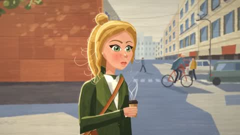](https://github.com/inematds/filme-em-codigo/releases/download/fonte-v1/wide_street.mp4)  
[▶ Ver o vídeo: wide_street.mp4](https://github.com/inematds/filme-em-codigo/releases/download/fonte-v1/wide_street.mp4)

*Arte conceitual para animação pictórica*

### Manhã, Olhando para Cima

Uma mulher com um café caminha ao longo de uma parede iluminada pelo sol, ouve uma campainha de bicicleta, olha para cima e começa a sorrir.

**Mesmo estilo, sua ideia**

> Crie um filme de animação de 5 a 10 segundos, em 16:9, sobre [SUA IDEIA AQUI]. Estilo: arte de desenvolvimento visual para animação de longa-metragem pintada, como se fosse de um livro de arte de um filme. Construa tudo com formas planas de guache recortado, bordas talhadas e sem contornos; cada forma recebe uma cor base, uma forma de sombra plana e uma forma de luz plana, com algumas pinceladas finas e secas visíveis e textura de papel por toda a imagem. Enquadre um personagem estilizado original, da cintura para cima, em plano médio, com olhos grandes e expressivos, cílios superiores marcantes, um brilho refletido bem definido, nariz simplificado, formato de lábios simples e marcante e um rubor quente nas bochechas. O cabelo é formado por grandes massas simples, com alguns fios finos e brilhantes captando a luz. Use luz solar forte e baixa vinda de um lado: um contorno luminoso intenso no cabelo e no ombro, luz quente refletida nas sombras e sombras projetadas em azul-acinzentado frio. Pinte o fundo com blocos mais soltos, suaves e de baixo contraste, com detalhes simplificados e algumas figuras pequenas em movimento, reduzidas a formas de pincelada. Mantenha a paleta terrosa e ensolarada, com uma cor fria para as sombras. Anime um único momento claro do personagem em ritmo de um ou dois quadros, com antecipação, ultrapassagem, pose sustentada, piscada e mudança de expressão, além de movimentos sobrepostos no cabelo e nas roupas. Aproximação lenta da câmera com leve paralaxe. Som: ambiente suave, efeitos para os acontecimentos visíveis e um acorde musical caloroso no momento emocional.

<details><summary>Prompt original (inglês)</summary>

```text
Make a 5 to 10 second 16:9 animated film about [YOUR IDEA HERE]. Style: painted feature-animation visual-development art, as if from a film's art book. Build everything from flat cut-gouache shapes with hard chiselled edges and no outlines; every form gets a base colour, one flat shadow shape and one flat light shape, with a few thin dry-brush streaks left visible and paper grain over the whole image. Stage one original stylised character in a waist-up medium shot with large expressive eyes, bold upper lashes, a clear catchlight, a simplified nose, a strong simple lip shape and a warm cheek blush. Hair is big simple masses with a handful of fine bright wisps catching the light. Use strong low sunlight from one side: a hot rim along hair and shoulder, warm bounce in the shadows, cool blue-grey cast shadows. Paint the background as looser, softer, lower-contrast blocks with simplified details and a couple of small moving figures reduced to brush shapes. Keep the palette earthy and sunlit with one cool shadow colour. Animate a single clear character moment on ones and twos with anticipation, overshoot, a held pose, a blink and a change of expression, plus overlapping action on hair and clothes. Slow camera push-in with slight parallax. Sound: gentle ambience, effects on the visible events and one warm musical chord at the emotional beat.
```

</details>

**Copiar este filme exato · Prompt exato**

> Crie um filme de animação de 5 segundos, em 16:9 e 30 fps, no estilo de arte de desenvolvimento visual para animação de longa-metragem pintada: formas planas de guache recortado, bordas talhadas e sem contornos; cada forma tem uma cor base, uma forma de sombra plana e uma forma de luz plana, com pinceladas secas visíveis e textura de papel. Plano médio da cintura para cima de uma jovem estilizada original: cabelo dourado preso num coque alto e solto, com franja penteada para o lado e alguns fios arrepiados finos iluminados pelo contorno, olhos verdes grandes com cílios superiores marcantes e brilho refletido, sardas, rubor quente nas bochechas, lábios corais, casaco verde-oliva com lapelas largas, camisa creme, alça transversal bege e bolsa, copo de café de papel soltando vapor. O sol baixo, vindo de trás à esquerda, cria um contorno luminoso intenso no cabelo e no ombro. Fundo em blocos soltos e suaves: parede terracota com luz manchada e móvel à esquerda, prédios creme-claro com janelas azul-ardósia à direita, sombras azul-ardósia na rua e carros estacionados. Ela entra caminhando; um ciclista toca a campainha; um pombo levanta voo de um poste; os olhos dela se movem rapidamente para cima, a cabeça acompanha com uma breve inspiração, os olhos se arregalam e os lábios se entreabrem; ela sustenta a pose, pisca e começa a sorrir enquanto uma brisa levanta seu cabelo. Uma pessoa passa ao fundo. Aproximação lenta com paralaxe, terminando no rosto dela voltado para cima. Anime em ritmo de um ou dois quadros, com movimentos sobrepostos no cabelo, na gola e na alça. Som: manhã tranquila na cidade, passos que param, campainha de bicicleta, asas e um acorde caloroso que cresce.

<details><summary>Prompt original (inglês)</summary>

```text
Make a 5 second 16:9 animated film at 30 fps in the style of painted feature-animation visual-development art: flat cut-gouache shapes with hard chiselled edges and no outlines, each form a base colour plus one flat shadow and one flat light shape, visible dry-brush streaks and paper grain. Waist-up medium shot of an original stylised young woman: golden hair in a loose top knot with a side-swept fringe and fine rim-lit flyaway wisps, large green eyes with bold upper lashes and a catchlight, freckles, warm cheek blush, coral lips, olive coat with wide lapels, cream shirt, tan crossbody strap and bag, paper coffee cup with steam. Low sun from behind left gives a hot rim on hair and shoulder. Background in loose, softer blocks: terracotta wall with shifting dappled light on the left, pale cream buildings with slate-blue windows on the right, slate-blue street shadows, parked cars. She walks in, a cyclist rings a bell, a pigeon takes off from a lamp, her eyes dart up, her head follows with a small intake of breath, eyes wide, lips parted; she holds, blinks, and begins to smile as a breeze lifts her hair. A passer-by crosses behind. Slow push-in with parallax, ending on her upturned face. Animate on ones and twos with overlapping hair, collar and strap. Sound: soft city morning, footsteps that stop, bicycle bell, wings, one warm chord blooming.
```

</details>

[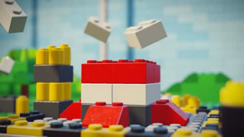](https://github.com/inematds/filme-em-codigo/releases/download/fonte-v1/wide_bricks.mp4)  
[▶ Ver o vídeo: wide_bricks.mp4](https://github.com/inematds/filme-em-codigo/releases/download/fonte-v1/wide_bricks.mp4)

*Animação em stop-motion com blocos de brinquedo*

### Decolagem na base de lançamento

Peças soltas de brinquedo pulam para o lugar e montam um foguete e uma torre de lançamento; uma pequena figura empurra a alavanca, e o foguete decola entre fogo e fumaça feitos de peças.

**Mesmo estilo, sua ideia**

> Crie um filme animado 16:9 de 5 a 10 segundos sobre [SUA IDEIA AQUI]. Estilo: um filme em stop-motion com peças de brinquedo, criado inteiramente em código (Remotion + three.js), sem texto na tela. Crie um sistema genérico de peças, sem marca: um pequeno catálogo de peças (blocos 1x1, 1x2, 2x2 e 2x4, placas com um terço da altura, rampas, peças redondas 1x1 e algumas peças translúcidas), com pinos, bordas levemente chanfradas e pequenos espaços entre elas, tudo em uma grade fixa de pinos e desenhado com InstancedMesh; sem logotipos, cenários conhecidos ou figuras que não sejam de criação original (cabeça em formato de cubo arredondado com dois olhos pontilhados, corpo de bloco afunilado e mãos em formato de pino). Material: ABS brilhante, com reflexos de softbox no verniz, leve brilho subsuperficial, riscos finos, marcas de dedos, poeira, linhas de junção do molde e pequenas diferenças de tonalidade entre as peças. Filme como um stop-motion real de mesa: uma base com pinos sobre uma mesa de madeira, diante de um cenário feito de peças; luz principal quente e prática, com sombras suaves e leve cintilação entre as exposições; lente macro com pouca profundidade de campo e bokeh suave; animação a 12 exposições por segundo, com pequenos deslocamentos irregulares, peças que se comprimem e se acomodam ao pousar, sem desfoque de movimento. Todos os efeitos (fumaça, fogo, água, explosões) são feitos de peças e pinos redondos que aparecem e desaparecem, nunca de partículas. Crie um movimento de câmera planejado, começando no nível dos pinos em macro e terminando em um plano aberto, e som sintetizado: um clique de plástico para cada peça, trilha de marimba e caixinha de música, além de pequenos efeitos divertidos.

<details><summary>Prompt original (inglês)</summary>

```text
Make a 5 to 10 second 16:9 animated film about [YOUR IDEA HERE]. Style: a toy-brick stop-motion film built entirely in code (Remotion + three.js), with no text on screen. Build a generic, unbranded brick system: a small catalogue of parts (1x1, 1x2, 2x2, 2x4 bricks, plates one third as high, slopes, round 1x1s, a few translucent pieces) with studs, slightly bevelled edges and tiny gaps, everything on a fixed stud grid and drawn with InstancedMesh; no logos, no real sets, and any figures are an original design (rounded-cube head with two dot eyes, tapered block body, peg hands). Material: glossy ABS with clear-coat reflections of a softbox, faint subsurface glow, hairline scratches, fingerprints, dust specks, mould seam lines and slight shade differences between bricks. Shoot it like real tabletop stop motion: a studded baseplate on a wooden table in front of a brick-built backdrop, a warm practical key light with soft shadows and slight flicker between exposures, a macro lens with shallow depth of field and creamy bokeh, animation at 12 exposures a second with small position jitter, squash-and-settle when pieces land, and no motion blur. All effects (smoke, fire, water, explosions) are made of bricks and round studs that pop on and off, never particles. Give it a designed camera move from stud-level macro to a wide final image, and synthesised sound: a plastic click for every brick, a marimba and music-box score, and small, playful effects.
```

</details>

**Copiar este filme exato · Prompt exato**

> Crie um filme de stop-motion de 10 segundos, em 16:9, com peças de brinquedo e feito em código (Remotion + three.js), sem texto. Crie um sistema genérico de peças: blocos 1x1, 1x2, 2x2 e 2x4, placas com um terço da altura, rampas, peças redondas 1x1 e peças translúcidas, com pinos, bordas chanfradas e pequenos espaços entre elas, tudo em uma grade de pinos, usando InstancedMesh; sem logotipos. ABS brilhante, com reflexos de softbox no verniz, riscos, marcas de dedos, poeira, linhas de junção do molde e variações de tonalidade. Anime a 12 exposições por segundo, com pequenos deslocamentos irregulares, cintilação da luz e sem desfoque de movimento; use uma lente macro com pouca profundidade de campo. Cena: uma base verde com pinos sobre uma mesa de madeira e uma plataforma de lançamento com faixas de segurança. Comece no nível dos pinos; peças soltas pulam de uma pilha espalhada e se encaixam com um pequeno impacto, formando um foguete vermelho e branco e uma torre de lançamento amarela enquanto a câmera sobe. Duas figuras originais (cabeça em formato de cubo arredondado, dois olhos pontilhados, corpo de bloco afunilado e mãos em formato de pino) observam; uma delas corre aos pulos até uma mesa de controle feita de peças e empurra uma alavanca; um semáforo translúcido passa pelas cores vermelho, amarelo e verde. O foguete decola com chamas feitas de peças translúcidas brilhantes e uma coluna crescente de fumaça branca e cinza feita de peças que rolam pela base e derrubam uma árvore de peças; a outra figura ergue os braços. Incline a câmera e recue até o foguete ficar pequeno diante de uma parede de céu azul feita de peças, com um sol quadriculado e nuvens de peças em suportes, enquanto a fumaça se dissipa. Som: cliques de plástico para cada peça, crescendo de marimba e caixinha de música, um pequeno estrondo divertido e um apito deslizante.

<details><summary>Prompt original (inglês)</summary>

```text
Make a 10 second 16:9 toy-brick stop-motion film in code (Remotion + three.js), no text. Build a generic brick system: 1x1, 1x2, 2x2, 2x4 bricks, plates one third as high, slopes, round 1x1s and translucent pieces, with studs, bevelled edges and tiny gaps, all on a stud grid as InstancedMesh; no logos. Glossy ABS with clear-coat softbox reflections, scratches, fingerprints, dust, mould seams and shade variation. Animate at 12 exposures a second with position jitter, light flicker and no motion blur; macro lens with shallow depth of field. Scene: a green baseplate on a wooden table with a hazard-striped launch pad. Open at stud level; loose bricks hop from a scattered pile and click into place with a squash, building a red-and-white rocket and a yellow gantry as the camera cranes up. Two original figures (rounded-cube head, two dot eyes, tapered block body, peg hands) watch; one hop-runs to a brick control desk and pushes a lever; a translucent light pole steps red, yellow, green. The rocket lifts off on glowing translucent fire bricks and a growing column of white and grey smoke bricks that tumble across the baseplate and knock over a brick tree; the other figure throws its arms up. Tilt and pull back to the rocket small against a blue brick sky wall with a pixel sun and brick clouds on sticks, smoke settling. Sound: plastic clicks per brick, marimba and music-box build-up, a small playful rumble with a slide whistle.
```

</details>

[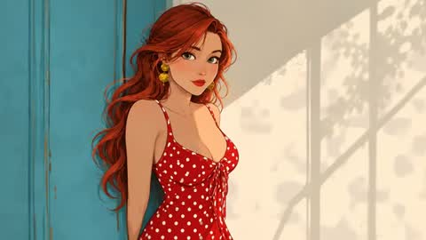](https://github.com/inematds/filme-em-codigo/releases/download/fonte-v1/wide_redhair.mp4)  
[▶ Ver o vídeo: wide_redhair.mp4](https://github.com/inematds/filme-em-codigo/releases/download/fonte-v1/wide_redhair.mp4)

*Retrato ilustrado de personagem*

### Luz da tarde, cabelo ruivo

Os mesmos seis segundos com a personagem ruiva: ela pisca enquanto o cabelo e os brincos balançam ao sol do fim da tarde. Depois, um close enquanto ela ergue as sobrancelhas, pisca e sorri.

**Mesmo estilo, sua ideia**

> Faça um filme animado 16:9 de 5 a 10 segundos sobre [SUA IDEIA AQUI]. Dê vida a uma ilustração estática fornecida, como um boneco de imagem, sem redesenhá-la: um único shader em tela cheia processa a imagem com filtragem bicúbica por meio de pequenos campos de deslocamento com máscaras suaves, para que tudo o que não estiver se movendo permaneça exatamente como foi desenhado. Separe os fios soltos do cabelo do fundo como uma camada com chave de cor sobre uma área pintada para removê-los e balance-os com uma brisa que se desloca, sem movimento na raiz e com mais movimento nas pontas. Faça as joias balançarem como pequenos pêndulos em torno de seus ganchos, sobre áreas pintadas para removê-las. Para piscar, deslize a linha dos cílios desenhada para baixo sobre uma pálpebra pintada, entre curvas da pálpebra traçadas a partir da imagem. Para desviar o olhar, deslize a íris e a pupila ao longo dessas curvas. As sobrancelhas e o sorriso são pequenas deformações locais. Acrescente manchas suaves e móveis de luz filtrada pelas folhas e um lento deslocamento da luz quente do sol, apenas no fundo, nunca na pele. Dois planos: um plano aberto da imagem inteira com um zoom muito lento, seguido de um corte seco para um close ampliado durante o desvio do olhar, a piscada e o sorriso. Granulação muito leve; som ambiente discreto de ar quente, brisa e folhas, com duas notas de piano no sorriso.

<details><summary>Prompt original (inglês)</summary>

```text
Make a 5 to 10 second 16:9 animated film about [YOUR IDEA HERE]. Bring one supplied still illustration to life as an image puppet, without redrawing it: a single full-screen shader samples the picture with bicubic filtering through small, softly masked displacement fields, so everything that is not moving stays exactly as drawn. Lift loose hair off the background as a colour-keyed layer over a painted-out plate and sway it with a travelling breeze, none at the roots and most at the tips. Swing jewellery as small pendulums about their hooks over painted-out patches. Blink by sliding the drawn lash line down a painted lid between lid curves traced from the image. Glance by sliding iris and pupil along those curves. Brows and smile are tiny local warps. Add soft moving leaf dapple and a slow warm sun drift on the background only, never on skin. Two shots: a wide of the whole picture with a very slow push, then a hard cut to an enlarged close-up for the glance, blink and smile. Very light grain; quiet bed of warm air, breeze, leaves and two piano notes on the smile.
```

</details>

**Copiar este filme exato · Prompt exato**

> Anime a ilustração fornecida public/wide/redhair.png (mulher ruiva com vestido de verão vermelho de bolinhas e brincos dourados de disco ao lado de uma porta verde-azulada, parede creme iluminada pelo sol com janela e sombra de folhas) como um filme de 6 segundos, 1920x1080, 24 fps, sem redesenhá-la. Um único shader em tela cheia processa a imagem com filtragem Catmull-Rom por meio de pequenos campos de deslocamento com máscaras. Plano 1, quadros 0-65: imagem inteira, zoom de 3%; cabelos soltos separados do fundo como uma camada com chave de cor sobre uma área pintada para removê-los, balançando com uma brisa senoidal que se desloca (cerca de 4 px nas pontas, nenhum movimento no couro cabeludo); brincos balançando como pêndulos em torno dos ganchos, sobre áreas pintadas para removê-los; respiração de 1.25 px no peito; laços e barra do vestido mal se movem; olhos fechados pela piscada no quadro 22, ao longo de 7 quadros, deslizando a faixa desenhada dos cílios para baixo sobre uma pálpebra pintada, entre curvas da pálpebra traçadas; manchas suaves de luz filtrada e deslocamento da luz quente do sol apenas na parede e na porta. Corte seco no quadro 66 para um close de 3.56x centralizado perto de (730, 276) nos pixels da imagem original, com zoom de 4.6%: os olhos começam 3 px à direita na tela e voltam para a câmera até o quadro 81; fecham na piscada no quadro 94; as sobrancelhas se erguem 2.7 px do quadro 110 ao 121; os cantos da boca sobem 3 px e as bochechas, 1 px do quadro 112 ao 130; mantenha a expressão. Granulação leve. Áudio: ar quente, brisa, folhas ao longe, nota sustentada grave em F, notas de piano A4 e C5 aos 4.75 e 5.15 s.

<details><summary>Prompt original (inglês)</summary>

```text
Animate the supplied illustration public/wide/redhair.png (red-haired woman in a red polka-dot sundress with gold disc earrings by a teal door, sunlit cream wall with window and leaf shadow) as a 6 second, 1920x1080, 24 fps film without redrawing it. One full-screen shader samples the image with Catmull-Rom filtering through small masked displacement fields. Shot 1, frames 0-65: full picture, 3% push-in; loose hair lifted off the background as a colour-keyed layer over a painted-out plate and swayed by a travelling sine breeze (about 4 px at tips, none at the scalp); earrings as pendulums about their hooks over painted-out patches; 1.25 px breath in the chest; ties and hem barely move; blink closed on frame 22 over 7 frames, made by sliding the drawn lash band down a painted lid between traced lid curves; soft noise dapple and warm sun drift on wall and door only. Hard cut at frame 66 to a 3.56x close-up centred near (730, 276) in source pixels with a 4.6% push: eyes start 3 px to screen right and return to camera by frame 81, blink closed on 94, brows lift 2.7 px from 110 to 121, mouth corners rise 3 px and cheeks 1 px from 112 to 130, held. Light grain. Audio: warm air, breeze, faint leaves, low F pad, piano A4 and C5 at 4.75 and 5.15 s.
```

</details>

[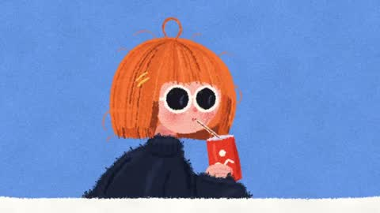](https://github.com/inematds/filme-em-codigo/releases/download/fonte-v1/wide_sip.mp4)  
[▶ Ver o vídeo: wide_sip.mp4](https://github.com/inematds/filme-em-codigo/releases/download/fonte-v1/wide_sip.mp4)

*Ilustração de personagem em pastel com textura de giz*

### Fizz

Uma garota de cabelo chanel laranja toma um gole de refrigerante, deixa os óculos escorregarem pelo nariz e sorri.

**Mesmo estilo, sua ideia**

> Faça um filme animado de 5 a 10 segundos em 16:9 sobre [SUA IDEIA AQUI]. Renderize como uma ilustração de guache com textura de giz e pastel seco, sem contornos: cada forma é preenchida com uma cor fosca e uniforme, com bordas suaves, irregulares e pontilhadas, cobertas por grãos finos de pigmento salpicados e algumas pintinhas mais claras e escuras. Descreva as formas apenas com alguns traços de pincel seco, mais claros e mais escuros, cujas cerdas falham e deixam espaços. Materiais felpudos (roupas de tricô, pontas do cabelo) têm fibras curtas saindo da silhueta; as bochechas têm blush pontilhado e sardas. Paleta: fundo azul-centáurea uniforme com uma faixa fina em branco-gelo na parte inferior, além de laranja vivo, vermelho-tomate, azul-marinho escuro, pele rosa quente, branco-creme e um pequeno toque amarelo. Componha um personagem simples e cativante, com formas grandes e detalhes minúsculos, fora do centro em um quadro amplo, com bastante espaço vazio em cor uniforme. Anime como uma animação de papel desenhada à mão: poses a cada dois quadros, momentos de pausa, uma pequena ação charmosa com antecipação e sobreposição (cabelo, roupa ou acessórios acompanhando o movimento), e textura e bordas dos traços tremulando suavemente a cada três quadros, como se fossem redesenhadas. Um único plano fixo, com no máximo uma aproximação muito lenta. Sem texto, logos ou palavras. Áudio: uma base lo-fi tranquila e ensolarada e sons leves e suaves para cada ação visível.

<details><summary>Prompt original (inglês)</summary>

```text
Make a 5 to 10 second 16:9 animated film about [YOUR IDEA HERE]. Render it as a chalky gouache and dry pastel illustration with no outlines: every shape is a flat matte fill with a soft, broken, stippled edge, covered in fine speckled pigment grain with occasional lighter and darker flecks. Describe form only with a few darker and lighter dry-brush strokes whose bristles skip and break. Fuzzy materials (knitwear, hair ends) get short fibres sticking out of the silhouette; cheeks get stippled blush and freckles. Palette: one flat cornflower-blue ground with a thin off-white strip at the bottom, plus saturated orange, tomato red, dark navy, warm pink skin, cream white and a single small yellow accent. Compose one simple, appealing character with big shapes and tiny features, off-centre in a wide frame with generous empty flat colour. Animate it like hand-drawn paper animation: poses on twos, held moments, one small charming piece of acting with anticipation and overlap (hair, cloth or accessories following through), and texture and stroke edges that boil gently every three frames as if redrawn. One held shot with at most a very slow push-in. No text, logos or words. Audio: a quiet, sunny lo-fi bed and small, soft sounds on each visible action.
```

</details>

**Copiar este filme exato · Prompt exato**

> Uma vinheta animada de personagem, em 16:9 e com 5 segundos, desenhada à mão em guache com textura de giz e pastel seco, com bastante pigmento salpicado e sem contornos. Fundo azul-centáurea uniforme, uma faixa fina em branco-gelo ao longo da parte inferior e bastante espaço azul vazio à direita. À esquerda do centro, em plano de busto, uma garota de frente em três quartos para a direita: cabelo chanel laranja, grande e arredondado, com franja reta, pintado como uma forma laranja uniforme, com mechas de pincel seco, claras e escuras, partindo do alto da cabeça, uma borda inferior irregular marrom, fios finos soltos, um fio de cabelo arrepiado em formato de laço e uma presilha amarela pequena. Óculos redondos com armação branca e lentes quase pretas, bochechas rosadas pontilhadas, sardas e um sorriso vermelho minúsculo. Suéter azul-marinho escuro de gola alta, grande e com bordas felpudas feitas de pincel seco. Ela segura uma lata vermelha lisa, com um símbolo branco de ponto e onda e um canudo branco. Ação: ela toma um gole, a bochecha afunda um pouco e o líquido sobe pelo canudo; dá dois golinhos; solta o canudo e abaixa a lata; faz um aceno rápido com a cabeça, fazendo os óculos escorregarem pelo nariz e revelando dois olhinhos em forma de ponto acima das lentes; pisca; depois inclina a cabeça, fecha os olhos com alegria e abre um sorriso maior. O fio de cabelo em laço e os fios soltos balançam com sobreposição. Animação a cada dois quadros, com as bordas dos traços e os grãos tremulando a cada três quadros. Aproximação muito lenta. Áudio: acordes suaves de piano elétrico, baixo macio, efervescência da lata, sucção no canudo, um pequeno “ahh”, um clique de plástico quando os óculos se acomodam e um sininho no sorriso final.

<details><summary>Prompt original (inglês)</summary>

```text
A 5 second 16:9 hand-animated character vignette in soft chalky gouache and dry pastel with heavy speckled pigment grain and no outlines. Flat cornflower-blue background, a thin off-white strip along the bottom, lots of empty blue to the right. Left of centre, bust view, a girl facing three-quarters right: a big round orange bob with a blunt fringe, painted as a flat orange shape with darker and lighter dry-brush strands fanning from the crown, a ragged brown hem, thin flyaway strands, a wiry hair loop standing up on top and a small yellow clip. Round white-framed sunglasses with near-black lenses, rosy stippled cheeks, freckles, tiny red smile. Oversized dark navy roll-neck sweater with a fuzzy dry-brush edge. She holds a plain red can with a white dot-and-wave mark and a white straw. Action: she sips, cheek pulling in, drink rising up the straw, two small gulps; releases the straw and lowers the can; nods quickly so the sunglasses slip down her nose and two small dot eyes peek over the rims; blinks; then tilts her head with happy closed eyes and a bigger smile. Hair loop and flyaways bob with overlap. Animated on twos, with stroke edges and grain boiling every three frames. Very slow push-in. Audio: lazy electric-piano chords, soft bass, can fizz, straw slurp, a small "ahh", a plastic click as the glasses land, a tiny bell on the last smile.
```

</details>

[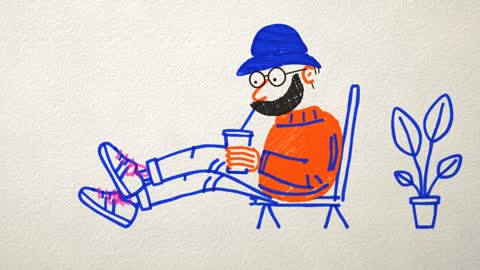](https://github.com/inematds/filme-em-codigo/releases/download/fonte-v1/wide_marker.mp4)  
[▶ Ver o vídeo: wide_marker.mp4](https://github.com/inematds/filme-em-codigo/releases/download/fonte-v1/wide_marker.mp4)

*Linha marcador e giz de cera neon*

### Último gole

Um homem barbudo de chapéu bucket relaxa numa cadeira, toma um gole da bebida, balança o pé e olha de lado.

**Mesmo estilo, sua ideia**

> Crie um filme animado de 5 a 10 segundos em 16:9 sobre [SUA IDEIA AQUI]. Deve parecer um desenho à mão fotografado em papel prensado a frio, quente e branco-amarelado, com textura visível e luz de janela suave e irregular. Use exatamente este conjunto: marcador azul-cobalto de ponta redonda e grossa para todos os traços (traço firme, levemente trêmulo, pontas arredondadas, mais escuro onde os traços se sobrepõem, áreas sólidas preenchidas com passadas visíveis do marcador); giz de cera laranja fluorescente para um ou dois preenchimentos grandes, rabiscado em uma única direção diagonal, com fragmentos do papel aparecendo e sem contorno azul ao redor do preenchimento; pequenos detalhes em marcador rosa-choque; alguns detalhes finos com caneta preta. Deixe a maior parte do personagem e todo o fundo como papel sem desenho. Proporções simplificadas, encantadoras e um pouco ingênuas; um personagem sentado ou relaxando e um ou dois objetos simples. Dê ao personagem uma pequena atuação com bom ritmo, acompanhada de um movimento secundário de tombar ou se acomodar. Anime em intervalos de três quadros, como numa animação de papel de verdade: cada desenho é refeito, então os traços tremem, os rabiscos de giz de cera mudam e a textura do papel varia a cada desenho. Câmera fixa, sem texto. Áudio: uma base sonora tranquila e preguiçosa, mais sons discretos a cada ação visível.

<details><summary>Prompt original (inglês)</summary>

```text
Make a 5 to 10 second 16:9 animated film about [YOUR IDEA HERE]. It must look like a hand drawing photographed on warm off-white cold-pressed paper with visible tooth and soft, uneven window light. Use exactly this kit: a thick cobalt-blue round-tip marker for all line work (confident, slightly wobbly, round ends, darker where strokes overlap, solid areas coloured in with visible marker laps); fluorescent orange wax crayon for one or two large fills, scribbled in a single diagonal direction with paper flecks showing through and no blue outline around the fill; small hot-pink marker accents; a few thin black pen details. Leave most of the subject and all of the background as bare paper. Simplified, charming, slightly naive proportions; one seated or lounging character and one or two simple props. Give the character a small, well-timed piece of acting with a secondary flop or settle. Animate on threes like real paper animation: every drawing is redrawn, so lines boil, the crayon scribble shifts, and the paper tooth changes with each drawing. Locked-off camera, no text. Audio: a quiet, lazy bed plus small sounds on each visible action.
```

</details>

**Copiar este filme exato · Prompt exato**

> Crie um filme animado de 5 segundos em 16:9 que pareça um desenho à mão fotografado em papel prensado a frio, quente e branco-amarelado, com textura visível e luz de janela suave, que diminui em direção aos cantos. Use apenas traços de marcador azul-cobalto de ponta redonda e grossa (levemente trêmulos, mais escuros onde se sobrepõem), giz de cera laranja fluorescente rabiscado em uma única direção diagonal, com fragmentos do papel aparecendo, pequenos detalhes em marcador rosa-choque e alguns detalhes finos com caneta preta. Personagem: um homem barbudo com chapéu bucket azul sólido e óculos redondos pretos com olhos em forma de ponto, nariz e orelha de giz de cera laranja, barba rabiscada com caneta preta e um suéter laranja de gola alta e grande, sem contorno, apenas com linhas azuis nas dobras. Ele relaxa numa cadeira baixa desenhada com linhas azuis, com as pernas em calças largas com punhos esticadas para a esquerda, tênis grandes com cadarços e laços rosa, um vaso com planta desenhado com linhas azuis à direita e bastante papel sem desenho. Ação: ele pisca, leva um copo com tampa e canudo em direção ao rosto e se inclina para tomar dois goles, abaixa o copo, inclina a cabeça para trás e engole; depois, o pé levantado balança duas vezes e o laço rosa cai e balança. Ele pisca e olha de lado. Anime em intervalos de três quadros, com os traços tremendo e os rabiscos de giz de cera e a textura do papel mudando a cada desenho. Sem texto. Áudio: uma base tranquila e preguiçosa de piano elétrico e baixo, com um gole pelo canudo, um engolir, duas batidas leves do pé e um estalinho ao olhar de lado.

<details><summary>Prompt original (inglês)</summary>

```text
Make a 5 second 16:9 animated film that looks like a hand drawing photographed on warm off-white cold-pressed paper with visible tooth and soft window light falling off towards the corners. Use only a thick cobalt-blue round-tip marker line (slightly wobbly, darker where strokes overlap), fluorescent orange wax crayon scribbled in one diagonal direction with paper flecks showing through, small hot-pink marker accents and a few thin black pen details. Subject: a bearded man in a solid-blue bucket hat and round black glasses with dot eyes, an orange crayon nose and ear, a scribbled black pen beard and an oversized orange roll-neck sweater with no outline, only blue fold lines. He lounges in a low blue-line chair, legs in baggy cuffed trousers stretched to the left, big sneakers with pink laces and bows, a blue-line potted plant on the right, and lots of bare paper. Action: he blinks, brings a lidded cup with a straw towards his face and leans in for two sips, lowers it, tips his head back and swallows, then his raised foot bobs twice with the pink bow flopping, and he blinks and glances sideways. Animate on threes with line boil, the crayon scribble and paper texture changing with every drawing. No text. Audio: a quiet, lazy electric-piano and bass bed with a straw slurp, a gulp, two soft foot taps and a tiny tick on the glance.
```

</details>

[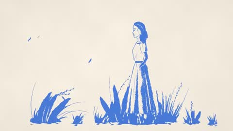](https://github.com/inematds/filme-em-codigo/releases/download/fonte-v1/wide_bluecrayon.mp4)  
[▶ Ver o vídeo: wide_bluecrayon.mp4](https://github.com/inematds/filme-em-codigo/releases/download/fonte-v1/wide_bluecrayon.mp4)

*Impressão em giz de cera de uma só cor*

### Ao vento

Uma mulher está de pé na grama alta enquanto uma rajada atravessa a cena, levanta seus cabelos e sua saia, e ela fecha os olhos para sentir o vento.

**Mesmo estilo, sua ideia**

> Faça um filme animado de 5 a 10 segundos, em 16:9, sobre [SUA IDEIA AQUI]. Estilo: desenho litográfico com giz de cera de uma só cor em papel creme quente, fotografado quadro a quadro. Use um único giz de cera azul-centáurea e nada mais: sem segunda cor, tons de cinza, contornos pretos ou gradientes. Construa cada imagem usando apenas dois tipos de marca: formas de sombra azul sólidas, com bordas secas, granuladas e irregulares, e direção visível das pinceladas onde o giz falha ao passar pela textura do papel; e algumas linhas de contorno finas e delicadas, com variação de espessura, para bordas iluminadas, rostos e dobras de tecido. Tudo o que estiver iluminado deve ser papel sem marcas, inclusive as finas frestas de papel dentro das massas escuras. Proporções elegantes, próximas do realismo, como em ilustrações de moda ou editoriais. Composição ampla, com a maior parte da folha vazia. Câmera fixa, sem cortes. Anime a cada três quadros, redesenhando a textura do giz, as pinceladas e os contornos em cada novo desenho para que tremulem suavemente, como uma animação feita à mão no papel. Uma ação pequena, bem sincronizada, mais movimentos secundários naturais (cabelos, tecido, plantas). Sem texto. Som: ambiente natural tranquilo e pequenos sons suaves das ações visíveis.

<details><summary>Prompt original (inglês)</summary>

```text
Make a 5 to 10 second 16:9 animated film about [YOUR IDEA HERE]. Style: a one-colour lithographic crayon drawing on warm cream paper, photographed frame by frame. Use a single cornflower-blue wax crayon and nothing else: no second colour, no grey tones, no black outlines, no gradients. Build every image from only two kinds of mark: solid blue shadow shapes with dry, grainy, broken edges and visible stroke direction where the crayon skips over the paper tooth, and a few thin, sensitive thick-and-thin contour lines for lit edges, faces and cloth folds. Everything in light is left as bare paper, including thin paper slivers inside the dark masses. Elegant, realistic-leaning proportions like fashion or editorial illustration. Compose wide, with most of the sheet empty. Held camera, no cuts. Animate on threes, with the crayon grain, strokes and contours re-drawn on every new drawing so they gently shimmer like hand-drawn animation on paper. One small, well-timed piece of acting plus natural secondary motion (hair, cloth, plants). No text. Sound: a quiet natural bed and small soft sounds on the visible actions.
```

</details>

**Copiar este filme exato · Prompt exato**

> Faça um filme animado de 5 segundos, em 16:9, desenhado à mão, a 30 fps e animado a cada três quadros, com aparência de desenho litográfico a giz de cera de uma só cor, fotografado quadro a quadro. Material: um único giz de cera azul-centáurea em papel creme quente, sem outras cores, cinza ou contornos pretos. A imagem é construída com apenas dois elementos: formas de sombra azul sólidas, com bordas secas, granuladas e irregulares, e direção visível das pinceladas onde o giz falha ao passar pela textura do papel; e algumas linhas de contorno finas e delicadas, com variação de espessura. Todas as áreas iluminadas são papel sem marcas. Composição ampla, com a maior parte da folha vazia. À direita do centro, uma mulher esguia de perfil, voltada para a esquerda, está de pé na grama alta: cabelo escuro na altura dos ombros, como uma única massa azul sólida; blusa larga de mangas curtas, desenhada apenas com linhas; faixa escura; saia longa e rodada com longas formas triangulares de sombra azul nas dobras; uma das mãos no bolso. Ao redor dos pés, leques de folhas largas e pontudas e grama espigada em azul sólido, com finos caules de espiguetas; outro tufo de grama bem à esquerda e pequenos tufos entre eles. Ação: ela fica parada e pisca; uma rajada chega da esquerda, a grama se curva em uma onda que atravessa a cena, pequenas folhas voam pelo papel vazio; a saia gruda nas pernas e esvoaça para trás, os cabelos e a faixa esvoaçam para trás; ela ergue o rosto para o vento, inspira e fecha os olhos; tudo se aquieta. Câmera fixa. A textura do giz e os contornos são redesenhados a cada três quadros, para que tremulem. Som: vento suave passando da esquerda para a direita, farfalhar da grama, tecido batendo, quatro notas suaves de piano.

<details><summary>Prompt original (inglês)</summary>

```text
Make a 5 second 16:9 hand-drawn animated film, 30 fps, animated on threes, that looks like a one-colour lithographic crayon drawing photographed frame by frame. Medium: a single cornflower-blue wax crayon on warm cream paper, no other colour, no grey, no outlines in black. The picture is built from two things only: solid blue shadow shapes with dry, grainy, broken edges and visible stroke direction where the crayon skips over paper tooth, and a few thin, sensitive thick-and-thin contour lines; all lit areas are bare paper. Wide composition with most of the sheet empty. Right of centre, a slender woman in profile facing left stands in tall grass: shoulder-length dark hair as one solid blue mass, loose short-sleeved blouse drawn only in line, dark sash, long full skirt with long blue fold-shadow wedges, one hand in her pocket. Around her feet, fans of broad pointed leaves and spiky grass in solid blue with thin seed-head stems; a second stand of grass far left, small tufts between. Action: she stands still and blinks; a gust arrives from the left, the grass bends in a wave that travels across the frame, small leaves blow across the empty paper; her skirt presses to her legs and billows behind, hair and sash stream back; she lifts her face into the wind, breathes in and closes her eyes; everything settles. Held camera. Crayon texture and contours re-drawn every third frame so they shimmer. Sound: soft wind passing left to right, grass hiss, cloth flaps, four soft piano notes.
```

</details>

[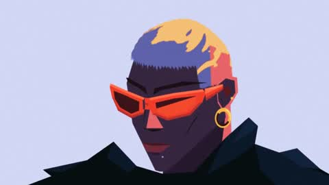](https://github.com/inematds/filme-em-codigo/releases/download/fonte-v1/wide_shades.mp4)  
[▶ Ver o vídeo: wide_shades.mp4](https://github.com/inematds/filme-em-codigo/releases/download/fonte-v1/wide_shades.mp4)

*Retrato de anime com sombras chapadas*

### Tons

Uma personagem de óculos escuros vermelhos levanta e vira a cabeça enquanto uma luz intensa passa, redesenhando as formas planas das sombras.

**Mesmo estilo, sua ideia**

> Crie um filme animado de 5 a 10 segundos, em 16:9, sobre [SUA IDEIA AQUI]. Estilo: ilustração de moda em anime com cores chapadas e marcantes, feita apenas de formas planas com bordas bem definidas e antisserrilhadas, sem contornos nem gradientes. Fundo vazio em lavanda pálido, grandes massas de sombra em ameixa escura e quase preto, um ou dois acentos saturados (vermelho, dourado), sombras violetas e luz amarela quente no cabelo, com um limite irregular que lembra chamas, feito de pontas e gotas; coral para a pele iluminada, em algumas facetas angulares precisas, e uma faixa reta de luz na borda. Desenho angular, confiante e simplificado, com poucas formas. Luz direcional intensa que se move durante a cena, recortando as formas de sombra de modo coerente por toda a figura (derive-as de uma forma 3D simples oculta e renderize em cores chapadas). Pequenos movimentos da personagem, bem sincronizados, com antecipação e acomodação; movimento secundário nas joias e nas roupas; um brilho que percorre as superfícies lustrosas. Personagem animada em dois quadros, movimento lento de câmera em todos os quadros, leve granulação de filme e uma suavidade muito sutil em toda a imagem. Base sonora discreta e melancólica, com pequenos sons nas ações visíveis.

<details><summary>Prompt original (inglês)</summary>

```text
Make a 5 to 10 second 16:9 animated film about [YOUR IDEA HERE]. Style: bold flat-colour anime fashion illustration made only of hard-edged flat shapes with crisp anti-aliased edges, no outlines and no gradients. Empty pale lavender background, deep plum and near-black shadow masses, one or two saturated accents (red, gold), violet shadow and warm yellow light on hair with a ragged flame-like terminator of pointed tongues and droplets, coral for lit skin as a few precise angular facets and a straight rim strip. Angular, confident, simplified drawing with few shapes. Hard directional light that moves during the shot so the shadow shapes re-cut consistently across the forms (derive them from a hidden simple 3D form, render flat). Small, well-timed character acting with anticipation and settle, secondary motion on jewellery and cloth, a travelling glint on glossy surfaces. Character animated on twos, slow camera push on ones, faint film grain and very slight softness over everything. Quiet moody pad with small sounds on the visible actions.
```

</details>

**Copiar este filme exato · Prompt exato**

> Crie um filme animado de 5 segundos, em 16:9, a 30 fps, no estilo de ilustração de moda em anime com cores chapadas e marcantes: apenas formas planas com bordas bem definidas e antisserrilhadas, sem contornos nem gradientes, sobre um fundo vazio em lavanda pálido (#d0d5f3). Close aberto de uma personagem original: cabelo texturizado cortado pelo enquadramento, óculos vermelhos angulares e envolventes, com lentes marrom-avermelhadas escuras cortadas por um reflexo vermelho vivo, sobrancelhas grossas em formato de cunha preta, lábios cor de vinho, argola dourada e gola alta quase preta, com alguns planos azul-marinho escuros. A pele está na sombra em tom ameixa escura; a pele iluminada é coral; a sombra do cabelo é violeta (#5c60a9); o cabelo iluminado é amarelo quente (#f3bd72), com um limite irregular que lembra chamas, feito de pontas e gotas, e uma franja laranja fina. Comece com a cabeça baixa, em vista de três quartos, iluminada por trás: uma faixa amarela no cabelo, uma faixa reta de luz coral na borda de trás da cabeça e do pescoço, e um triângulo coral no nariz. Após uma breve inclinação de antecipação, a cabeça se ergue e vira em direção à câmera (de cerca de 1.0 a 2.6 s), enquanto a luz passa por cima e chega à frente: a faixa de luz na borda se estreita e desaparece, o amarelo redesenha as áreas iluminadas do cabelo, e um plano angular coral surge no lado mais distante do rosto. Um brilho pálido de duas faixas atravessa os óculos entre 2.6 e 3.2 s; a argola balança e para; a gola se move acompanhando o gesto; e, em 3.9 s, uma sobrancelha se ergue junto com um meio sorriso. Personagem animada em dois quadros, movimento lento de câmera em todos os quadros, leve granulação de filme e suavidade muito sutil. Base sonora discreta e fria, farfalhar de tecido, tilintar do ouro e um toque cristalino no brilho.

<details><summary>Prompt original (inglês)</summary>

```text
Make a 5 second 16:9 animated film, 30 fps, in a bold flat-colour anime fashion-illustration style: only hard-edged flat shapes with crisp anti-aliased edges, no outlines, no gradients, on an empty pale lavender background (#d0d5f3). Wide close-up of an original character: cropped textured hair, sharp angular red wraparound sunglasses with dark maroon lenses split by a bright red reflection, heavy black wedge eyebrows, wine-coloured lips, a gold hoop earring, a high near-black coat collar with a few dark navy planes. Skin is deep plum shadow; lit skin is coral; hair shadow is violet (#5c60a9); lit hair is warm yellow (#f3bd72) with a ragged flame-like terminator of pointed tongues and droplets and a thin orange fringe. Start head-down in three-quarter view, lit from behind: yellow cap on the hair, a straight coral rim strip down the back of the head and neck, one coral triangle on the nose. After a tiny anticipation dip the head lifts and turns toward camera (about 1.0 to 2.6 s) while the light sweeps overhead to the front: the rim strip narrows away, the yellow re-cuts across the hair, an angular coral plane opens down the far side of the face. A two-bar pale glint crosses the sunglasses at 2.6 to 3.2 s, the hoop swings and settles, the collar shifts with follow-through, and at 3.9 s one eyebrow lifts with a half smile. Character on twos, slow camera push on ones, faint film grain, very slight softness. Quiet cool pad, cloth rustle, gold tinkles, a glassy ping on the glint.
```

</details>

[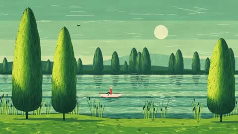](https://github.com/inematds/filme-em-codigo/releases/download/fonte-v1/wide_trees2.mp4)  
[▶ Ver o vídeo: wide_trees2.mp4](https://github.com/inematds/filme-em-codigo/releases/download/fonte-v1/wide_trees2.mp4)

*Guache e pinceladas hachuradas, mecanismo reutilizado*

### Rio lento

Segundo filme feito com o motor de The Avenue: uma pessoa rema um pequeno barco por um rio entre álamos altos cobertos por hachuras.

**Mesmo estilo, sua ideia**

> Crie um filme animado de 5 a 10 segundos, em 16:9, sobre [SUA IDEIA AQUI]. Estilo: uma ilustração contemporânea em guache e lápis de cor, feita quase inteiramente com hachuras finas, com aparência realmente plana, como uma imagem artesanal digitalizada que ganha movimento. Use um contraste extremo de escala: formas simples e enormes preenchem quase todo o quadro, dispostas em profundidade, enquanto figuras minúsculas atuam numa faixa estreita na parte inferior. Mantenha tudo na mesma família de cores, de um tom claro e luminoso a um tom médio e uma sombra profunda, quase preta, usando outras cores apenas em pequenos detalhes nas figuras. Cada forma grande é uma silhueta plana e nítida, sem contorno, e seu volume é desenhado apenas com milhares de traços curtos e levemente curvos, que acompanham a forma como pelos escovados: traços claros no lado iluminado, escuros no lado sombreado, mais densos e escuros na base. A profundidade vem dos tons: formas próximas, saturadas e contrastadas; formas distantes, mais uniformes e azuladas; sombras profundas nos espaços entre elas. O chão é formado por faixas horizontais planas de luz e sombra, com sombras longas projetadas sobre ele. Tinta fosca, textura fina de papel, sem gradientes além dos criados pela densidade dos traços. Anime como uma ilustração em movimento: as hachuras são redesenhadas a cada três quadros, criando um leve tremeluzir; um vento lento percorre os traços em ondas; faixas de sol e sombras de nuvens deslizam pela cena; as figuras se movem a cada dois quadros; e a câmera faz uma panorâmica lenta em múltiplos planos, com paralaxe nítida, seguida de uma inclinação suave para revelar toda a escala. Termine com as figuras pequenas na borda do quadro, enquanto a luz chega até elas. Sem texto nem narração; som ambiente natural e suave, alguns efeitos sonoros para eventos visíveis e uma frase delicada tocada em cordas dedilhadas ou piano.

<details><summary>Prompt original (inglês)</summary>

```text
Make a 5 to 10 second 16:9 animated film about [YOUR IDEA HERE]. Style: a contemporary gouache and coloured-pencil illustration built almost entirely from fine hatching, honestly flat, like a scanned hand-made picture that moves. Use extreme scale contrast: huge simple forms fill nearly the whole frame, ranked in depth, and tiny figures act in a thin strip at the bottom. Keep everything in one colour family, from a luminous light tone through a mid tone to deep, near-black shadow, with the only other colours as tiny accents on the figures. Every large form is a crisp flat silhouette with no outline, and its volume is drawn only by thousands of short, slightly curved strokes that follow the form like brushed fur: light strokes on the lit side, dark on the shadow side, densest and darkest at the base. Depth comes from tone: near forms saturated and contrasted, far ones flatter and bluer, deep shadow in the gaps. The ground is flat horizontal bands of light and shade with long shadows lying across it. Matte paint, fine paper grain, no gradients except those made by stroke density. Animate it as a moving illustration: hatching redraws on threes so it shimmers, a slow wind sends waves through the strokes, bands of sun and cloud shadow drift across the scene, the figures act on twos, and the camera makes a slow multiplane pan with clear parallax, then a gentle tilt to reveal the full scale. End on the figures small at the edge of frame as light reaches them. No text, no narration; soft natural ambience, a few sound effects on visible events, and a gentle plucked or piano phrase.
```

</details>

**Copiar este filme exato · Prompt exato**

> Uma animação plana de 5 segundos, 30 fps e 16:9, em guache e lápis de cor, mostrando a margem de um rio, com a câmera fixa, um deslocamento quase imperceptível para a direita e uma aproximação suave. À esquerda: dois álamos altos em forma de chama; à direita, um terceiro. Cada um é uma silhueta plana verde-escura, coberta por hachuras curtas de lápis que acompanham a forma, iluminada de amarelo-esverdeado pela esquerda, com sombras verde-escuras. Em primeiro plano: uma margem verde-grama viva, com taboas balançando. No meio: um rio formado por faixas horizontais planas em tons de verde-azulado e verde-claro, com ondulações brancas soltas de lápis, redesenhadas a cada três quadros. Um pequeno barco a remo cor de creme, com uma faixa vermelha e uma pessoa remando, de camisa vermelha e chapéu de palha, desliza devagar da esquerda para a direita. Na margem oposta: uma fileira de pequenos álamos verde-azulados, com reflexos interrompidos, colinas claras, céu verde em faixas, um sol cor de creme e dois pássaros escuros cruzando o céu. Textura de papel prensado a frio, paleta limitada de verde, verde-azulado, creme e vermelho.

<details><summary>Prompt original (inglês)</summary>

```text
A 5 second, 30 fps, 16:9 flat gouache and coloured-pencil animation of a riverbank, locked off with a barely perceptible drift right and push in. Left: two tall flame-shaped poplars, right: a third, each a flat dark green silhouette covered in short directional pencil hatching, lit yellow-green from the left, deep green in shadow. Foreground: a bright lawn-green bank with cattail reeds swaying. Middle: a river of flat horizontal teal and pale green bands with loose white pencil ripples that re-draw every third frame. A small cream rowing boat with a red stripe, one rower in a red shirt and straw boater, glides slowly left to right. Far bank: a row of small teal poplars with broken reflections, pale hills, banded green sky, a cream sun, two dark birds crossing. Cold-pressed paper grain, limited green, teal, cream and red palette.
```

</details>

[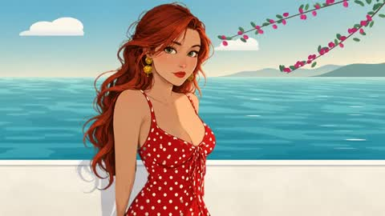](https://github.com/inematds/filme-em-codigo/releases/download/fonte-v1/wide_redhair2.mp4)  
[▶ Ver o vídeo: wide_redhair2.mp4](https://github.com/inematds/filme-em-codigo/releases/download/fonte-v1/wide_redhair2.mp4)

*Retrato de personagem ilustrado, motor reutilizado*

### Luz da tarde, à beira-mar

A personagem ruiva, com a mesma atuação, em um calçadão ensolarado à beira-mar.

**Mesmo estilo, sua ideia**

> Faça um filme animado de 5 a 10 segundos, em 16:9, sobre [SUA IDEIA AQUI]. Dê vida a uma ilustração estática fornecida como um boneco de imagem, sem redesenhá-la: um único shader em tela cheia amostra a imagem com filtragem bicúbica por meio de pequenos campos de deslocamento com máscara suave, para que tudo o que não estiver se movendo permaneça exatamente como foi desenhado. Separe os fios soltos do cabelo do fundo como uma camada com chave de cor sobre uma placa com a área pintada por cima e balance-os com uma brisa que passa, sem movimento na raiz e com mais movimento nas pontas. Balance as joias como pequenos pêndulos presos pelos ganchos, sobre áreas pintadas por cima. Faça a personagem piscar deslizando a linha dos cílios desenhada para baixo sobre uma pálpebra pintada, entre curvas da pálpebra traçadas a partir da imagem. Faça-a desviar o olhar deslizando a íris e a pupila ao longo dessas curvas. As sobrancelhas e o sorriso são pequenas deformações locais. Acrescente manchas suaves de luz e sombra de folhas em movimento e um lento deslocamento da luz quente do sol, apenas no fundo, nunca sobre a pele. Duas tomadas: um plano aberto da imagem inteira, com um movimento de câmera para a frente bem lento; depois, um corte seco para um close ampliado durante o olhar de lado, a piscada e o sorriso. Granulação bem leve; uma base sonora suave de ar quente, brisa, folhas e duas notas de piano no sorriso.

<details><summary>Prompt original (inglês)</summary>

```text
Make a 5 to 10 second 16:9 animated film about [YOUR IDEA HERE]. Bring one supplied still illustration to life as an image puppet, without redrawing it: a single full-screen shader samples the picture with bicubic filtering through small, softly masked displacement fields, so everything that is not moving stays exactly as drawn. Lift loose hair off the background as a colour-keyed layer over a painted-out plate and sway it with a travelling breeze, none at the roots and most at the tips. Swing jewellery as small pendulums about their hooks over painted-out patches. Blink by sliding the drawn lash line down a painted lid between lid curves traced from the image. Glance by sliding iris and pupil along those curves. Brows and smile are tiny local warps. Add soft moving leaf dapple and a slow warm sun drift on the background only, never on skin. Two shots: a wide of the whole picture with a very slow push, then a hard cut to an enlarged close-up for the glance, blink and smile. Very light grain; quiet bed of warm air, breeze, leaves and two piano notes on the smile.
```

</details>

**Copiar este filme exato · Prompt exato**

> Estilo de ilustração plana, formas limpas, luz suave e quente do sol da tarde à direita, leve textura de papel. Uma jovem de cabelos ruivos longos e ondulados, com brincos dourados de moeda pendente e um vestido de verão vermelho com bolinhas brancas, está de pé, com os braços atrás das costas, diante de um muro baixo e caiado à beira-mar. Atrás dela: mar azul-turquesa calmo com alguns reflexos, um promontório distante e enevoado à direita, céu azul-claro que fica creme perto do horizonte, duas nuvens pequenas e suaves, um ramo de buganvília com brácteas magenta balançando no canto superior direito. Plano aberto: os cabelos balançam com a brisa, os brincos oscilam, ela pisca e olha para o lado. Corte seco para um close do rosto: ela volta a olhar para a câmera, pisca, depois ergue as sobrancelhas e sorri suavemente. Som das ondas, gaivotas ao longe, duas notas suaves de piano.

<details><summary>Prompt original (inglês)</summary>

```text
Flat illustrated style, clean shapes, soft warm afternoon sun from the right, slight paper grain. A young woman with long wavy red hair, gold coin drop earrings and a red sundress with white polka dots stands, arms behind her back, in front of a low whitewashed sea wall on a seaside promenade. Behind her: calm turquoise sea with a few glints, a hazy far headland on the right, pale blue sky warming to cream at the horizon, two small soft clouds, a bougainvillea branch with magenta bracts swaying in from the top right. Wide shot: her hair sways in the breeze, earrings swing, she blinks and glances aside. Hard cut to a close-up of her face: she looks back to camera, blinks, then raises her brows and smiles gently. Sea wash, distant gulls, two soft piano notes.
```

</details>

[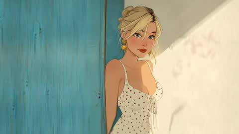](https://github.com/inematds/filme-em-codigo/releases/download/fonte-v1/wide_sundress.mp4)  
[▶ Ver o vídeo: wide_sundress.mp4](https://github.com/inematds/filme-em-codigo/releases/download/fonte-v1/wide_sundress.mp4)

*Retrato de personagem ilustrado*

### Luz da tarde

Uma ilustração estática ganha vida com código. No plano aberto, ela pisca enquanto o cabelo e os brincos dourados balançam sob o sol do fim da tarde. Então, um corte para um close, quando ela olha para a câmera, ergue as sobrancelhas, pisca e sorri. Seis segundos, feitos com Fable 5.2.
