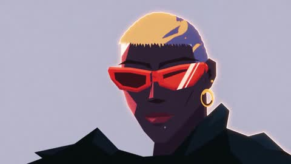
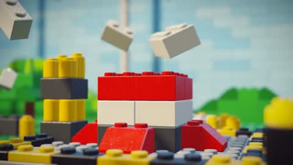
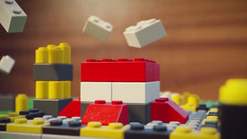
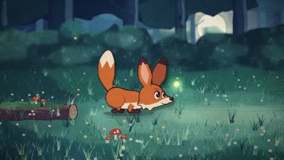
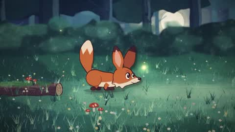
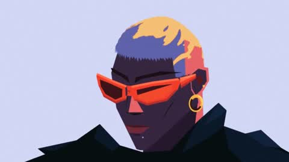
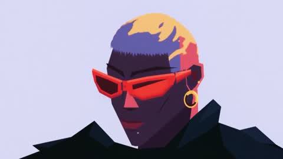

<!-- Anexo da fonte (filme-em-codigo). Tradução para o português feita pelo tradutor central (inema-traduz). Original em inglês: ../biblioteca-original/03-seedance.md. Crédito e licença: ../LEIA.md. -->

[← índice](../biblioteca-pt.md) · [original em inglês](../biblioteca-original/03-seedance.md) · [crédito e licença](../LEIA.md)

> Tradução da biblioteca de prompts de **AI Samson**. Cada prompt vem traduzido e, logo abaixo, no original em inglês: o prompt em inglês costuma funcionar melhor no modelo.

## Deixe mais rico com Seedance 2.5

Use um filme de código pronto como vídeo de referência e peça a um modelo de vídeo com IA para adicionar detalhes, mantendo o plano. No Claude, conecte o Higgsfield (o conector permite que o Claude acione os modelos de vídeo pelo chat), inicie uma nova conversa, anexe seu MP4, cole um dos prompts abaixo e preencha os colchetes. Defina o modelo e a resolução e ajuste a duração para corresponder à do seu filme. Comece pelo prompt curto: foi o que produziu a mudança mais nítida.

*Prompt aprimorado*

### Mesmo plano, mais detalhes e animação

**Prompt**

> Configurações: [MODELO, por exemplo Seedance 2.5], [RESOLUÇÃO, por exemplo 1080p ou 4K], [DURAÇÃO: igual à do vídeo de referência, em segundos].
>
> Use o vídeo de referência anexado como o modelo fixo deste plano e renderize-o novamente como uma versão muito mais rica, detalhada e com animação mais fluida do mesmo filme.
>
> MANTENHA EXATAMENTE:
> - Composição e enquadramento: cada elemento permanece no mesmo lugar do quadro.
> - Câmera: a mesma posição, o mesmo movimento e a mesma velocidade.
> - Ação e tempo: os mesmos eventos na mesma ordem e nos mesmos momentos, com os mesmos cortes.
> - Estilo: o mesmo meio, paleta de cores, design dos personagens e aparência geral. Este é [ESTILO, por exemplo: um filme em stop-motion com blocos de brinquedo / uma animação cel desenhada à mão / uma ilustração em guache]. Não mude para outro estilo nem torne a imagem fotorrealista.
>
> MELHORE MUITO:
> - Detalhes: adicione muito mais detalhes finos em toda parte. Texturas e materiais mais ricos em cada objeto, detalhes intrincados no fundo, mais camadas de profundidade, pequenos objetos de cena e variações naturais onde a referência for lisa ou simples.
> - Animação: deixe todos os movimentos muito mais suaves e fluidos, com todos os quadros intermediários e sem travamentos nem poses paradas. Acrescente peso natural, antecipação, sobreposição e continuidade do movimento, para que personagens e objetos se movam de forma realista, fisicamente convincente e dinâmica.
> - Movimento secundário: cabelo, tecido, folhas, água, poeira e pequenos objetos reagem à ação principal e ao ar.
> - Efeitos: adicione muito mais atmosfera e efeitos. [EFEITOS, por exemplo: feixes de luz volumétricos, poeira e pólen flutuando, brasas brilhantes, fumaça com turbulência realista, faíscas, reflexos, bloom suave, profundidade de campo].
> - Iluminação: luz mais rica e dimensional, com sombras suaves, luz rebatida e realces que respondam ao movimento.
>
> O QUE ACONTECE, em ordem: [DESCREVA A AÇÃO DO VÍDEO DE REFERÊNCIA EM DUAS OU TRÊS FRASES].
>
> O resultado deve parecer a versão final de alto orçamento da referência: o mesmo plano, muito mais detalhado e muito mais vivo. Sem texto, logotipos, novos personagens ou novos ângulos de câmera.

<details><summary>Prompt original (inglês)</summary>

```text
Settings: [MODEL, for example Seedance 2.5], [RESOLUTION, for example 1080p or 4K], [LENGTH: the same as the reference video, in seconds].

Use the attached reference video as the locked blueprint for this shot, and re-render it as a far richer, more detailed and more fluidly animated version of the same film.

KEEP EXACTLY THE SAME:
- Composition and framing: every element stays where it is in the frame.
- Camera: the same camera position, the same move and the same speed.
- Action and timing: the same events in the same order at the same moments, and the same cuts.
- Style: the same medium, colour palette, character designs and overall look. This is [STYLE, for example: a toy-brick stop-motion film / a hand-drawn cel animation / a gouache illustration]. Do not change it to another style and do not make it photorealistic.

ENHANCE STRONGLY:
- Detail: add much more fine detail everywhere. Richer surface texture and material on every object, intricate background detail, more depth layers, small props and natural variation where the reference is flat or plain.
- Animation: make all motion much smoother and more fluid, with full in-between frames and no stutter or held poses. Add natural weight, anticipation, overlap and follow-through, so characters and objects move in a realistic, physically believable and dynamic way.
- Secondary motion: hair, cloth, leaves, water, dust and small objects react to the main action and to the air.
- Effects: add much more atmosphere and many more effects. [EFFECTS, for example: volumetric light rays, drifting dust and pollen, glowing embers, smoke with real turbulence, sparks, reflections, soft bloom, depth of field].
- Lighting: richer, more dimensional light with soft shadows, bounce light and highlights that respond to the movement.

WHAT HAPPENS, in order: [DESCRIBE THE ACTION OF THE REFERENCE VIDEO IN TWO OR THREE SENTENCES].

The result should look like the high-budget finished version of the reference: the same shot, far more detailed, far more alive. No text, no logos, no new characters, no new camera angles.
```

</details>

[](https://github.com/inematds/filme-em-codigo/releases/download/fonte-v1/seedance_shades_grain.mp4)  
[▶ Ver o vídeo: seedance_shades_grain.mp4](https://github.com/inematds/filme-em-codigo/releases/download/fonte-v1/seedance_shades_grain.mp4)

*Prompt curto usado no vídeo*

### Tons, mais suave e com mais granulação

O retrato em anime do vídeo, renderizado novamente por Seedance 2.5 a partir do filme em código. Um prompt curto pedindo um visual claramente diferente resultou em movimentos mais suaves, granulação de filme, luz de contorno e sombras com aparência de pintura, enquanto o personagem, a pose, o tempo e o enquadramento permaneceram iguais. 1080p, 5 segundos.

**Prompt**

> Usando o conector do Higgsfield, renderize novamente o vídeo anexado com [MODELO, por exemplo Seedance 2.5] em [RESOLUÇÃO, por exemplo 1080p ou 4K], com [DURAÇÃO: a mesma do meu vídeo, por exemplo 5] segundos, usando meu vídeo como referência.
>
> Renderize novamente esta cena com movimentos claramente mais suaves e fluidos e um visual cinematográfico: granulação orgânica de filme visível, sombras suaves com aparência de pintura e luz de contorno no rosto, profundidade e textura sutis em vez de preenchimentos vetoriais chapados. Mantenha o mesmo personagem, pose, tempo e enquadramento.

<details><summary>Prompt original (inglês)</summary>

```text
Using the Higgsfield connector, re-render the attached video with [MODEL, for example Seedance 2.5] at [RESOLUTION, for example 1080p or 4K], [LENGTH: the same as my video, for example 5] seconds, using my video as the reference.

Re-render this shot with clearly smoother, more fluid motion and a cinematic filmic look: visible organic film grain, soft painterly shading and rim light on the face, subtle depth and texture instead of flat vector fills. Keep the same character, pose, timing and framing.
```

</details>

[](https://github.com/inematds/filme-em-codigo/releases/download/fonte-v1/wide_bricks.mp4)  
[▶ Ver o vídeo: wide_bricks.mp4](https://github.com/inematds/filme-em-codigo/releases/download/fonte-v1/wide_bricks.mp4)

*Código*

[](https://github.com/inematds/filme-em-codigo/releases/download/fonte-v1/sd_bricks.mp4)  
[▶ Ver o vídeo: sd_bricks.mp4](https://github.com/inematds/filme-em-codigo/releases/download/fonte-v1/sd_bricks.mp4)

*Seedance 2.5*

### Decolagem na placa de base

Seedance 2.5 manteve todos os planos, o ritmo e o movimento de câmera. Fez o plástico, a luz e a fumaça parecerem mais com uma filmagem real em uma mesa, e trocou nossa parede de céu feita de blocos por uma parede de madeira. A mudança é modesta, nada dramática. Custo: 160 créditos por 10 segundos em 1080p, uma tomada.

**Prompt usado**

> Use o vídeo de referência como modelo exato: mantenha os mesmos planos, o ritmo, os movimentos de câmera, a composição e cada ação. Renderize-o novamente como um filme stop-motion de mesa real, de alto orçamento, filmado com uma lente macro: blocos de brinquedo de plástico moldado por injeção e brilhante, com riscos finos, poeira e marcas de dedos; uma placa de base verde com pinos sobre uma mesa de madeira; luz principal suave e quente de estúdio, com sombras reais de contato; profundidade de campo rasa e bokeh suave. Blocos soltos pulam e se encaixam para montar o foguete vermelho e branco e a torre de lançamento listrada de amarelo; a pequena figura quadrada empurra a alavanca; a lâmpada de sinalização fica verde; e o foguete decola com peças translúcidas de plástico brilhantes que formam a chama, junto de uma coluna ondulante de fumaça branca e cinza feita de blocos, faíscas e partículas de poeira flutuando. Muitos detalhes, iluminação cinematográfica, respiração sutil da lente, cadência de stop-motion de 12 frames por segundo. Sem logotipos, sem texto.

<details><summary>Prompt original (inglês)</summary>

```text
Use the reference video as the exact blueprint: keep the same shots, timing, camera moves, composition and every action. Re-render it as a real, high-budget tabletop stop-motion film shot on a macro lens: glossy injection-moulded plastic toy bricks with fine scratches, dust and fingerprints, a real studded green baseplate on a wooden table, soft warm studio key light with real contact shadows, shallow depth of field with creamy bokeh. Loose bricks hop and click into place to build the red-and-white rocket and yellow striped gantry, the little blocky figure pushes the lever, the signal lamp turns green, and the rocket lifts off on glowing translucent plastic flame pieces with a billowing column of white and grey brick smoke, sparks and drifting dust motes. Rich detail, cinematic lighting, subtle lens breathing, 12 frames per second stop-motion cadence. No logos, no text.
```

</details>

[](https://github.com/inematds/filme-em-codigo/releases/download/fonte-v1/wide_cel.mp4)  
[▶ Ver o vídeo: wide_cel.mp4](https://github.com/inematds/filme-em-codigo/releases/download/fonte-v1/wide_cel.mp4)

*Código*

[](https://github.com/inematds/filme-em-codigo/releases/download/fonte-v1/sd_cel.mp4)  
[▶ Ver o vídeo: sd_cel.mp4](https://github.com/inematds/filme-em-codigo/releases/download/fonte-v1/sd_cel.mp4)

*Seedance 2.5*

### Clareira dos Vagalumes

Seedance 2.5 manteve toda a atuação do filhote de raposa e o afastamento da câmera. Os fundos ficaram um pouco mais suaves e ricos, e o brilho dos vagalumes está mais intenso, mas a imagem continua muito próxima do filme feito com código. Custo: 160 créditos por 10 segundos em 1080p, uma tomada.

**Prompt usado**

> Use o vídeo de referência como modelo exato: mantenha a mesma tomada, o mesmo tempo, o movimento da câmera, a composição e cada ação do filhote de raposa. Recrie como uma animação clássica de longa-metragem, feita à mão e com riqueza de detalhes: fundos de floresta ricamente pintados em aquarela e guache, com árvores em camadas profundas, névoa, raios de luar atravessando a copa, grama coberta de orvalho, flores silvestres, um lago refletivo e troncos cobertos de musgo; o filhote de raposa como personagem original, desenhado com tinta e pintado com beleza, olhos expressivos, detalhes de pelo macio, squash and stretch e continuidade do movimento nas orelhas e na cauda. Ele espreita um vagalume, se contorce, salta e cai de barriga no chão, levantando pequenas nuvens de poeira; rola, senta tonto e espirra. O espirro ergue centenas de vagalumes brilhantes em uma onda que ilumina toda a clareira e se reflete no lago; um vagalume pousa no focinho dele enquanto a câmera se afasta. Brilho volumétrico, pólen flutuando, granulação suave de filme, profundidade multiplanar. Sem texto.

<details><summary>Prompt original (inglês)</summary>

```text
Use the reference video as the exact blueprint: keep the same shot, timing, camera move, composition and every action of the fox cub. Re-render it as lavish classic hand-drawn feature animation: richly painted watercolour and gouache forest backgrounds with deep layered trees, mist, moonbeams through the canopy, dewy grass, wildflowers, a reflective pond and mossy logs; the fox cub as a beautifully inked and painted original character with expressive eyes, soft fur detail, squash and stretch and follow-through on ears and tail. He stalks a firefly, wiggles, pounces and lands flat with dust puffs, tumbles, sits up dizzy, sneezes, and the sneeze lifts hundreds of glowing fireflies in a wave that lights the whole glade and reflects in the pond; a firefly lands on his nose as the camera pulls back. Volumetric glow, floating pollen, gentle film grain, multiplane depth. No text.
```

</details>

[](https://github.com/inematds/filme-em-codigo/releases/download/fonte-v1/wide_shades.mp4)  
[▶ Ver o vídeo: wide_shades.mp4](https://github.com/inematds/filme-em-codigo/releases/download/fonte-v1/wide_shades.mp4)

*Código*

[](https://github.com/inematds/filme-em-codigo/releases/download/fonte-v1/sd_shades.mp4)  
[▶ Ver o vídeo: sd_shades.mp4](https://github.com/inematds/filme-em-codigo/releases/download/fonte-v1/sd_shades.mp4)

*Seedance 2.5*

### Tons, com o prompt longo de aprimoramento

Esta execução usou o prompt de aprimoramento acima, com listas separadas do que manter e aprimorar. Seedance 2.5 ainda retornou uma cópia quase exata do filme de código: as mesmas formas chapadas, sem detalhes ou efeitos extras visíveis nos quadros verificados. Com uma referência de vídeo, o modelo segue muito mais a referência do que as palavras. O prompt curto no primeiro card desta seção trouxe uma mudança mais clara. Custo: 80 créditos por 5 segundos em 1080p, uma tomada.

**Prompt usado**

> O prompt de aprimoramento acima, com o estilo definido como ilustração de moda em anime, com cores chapadas e marcantes, e os efeitos definidos como um brilho nos óculos de sol, luz de contorno, bloom, partículas de poeira e granulação de filme.

<details><summary>Prompt original (inglês)</summary>

```text
The enhance prompt above, with the style set to a bold flat-colour anime fashion illustration and the effects set to a glint on the sunglasses, rim light, bloom, dust motes and film grain.
```

</details>
