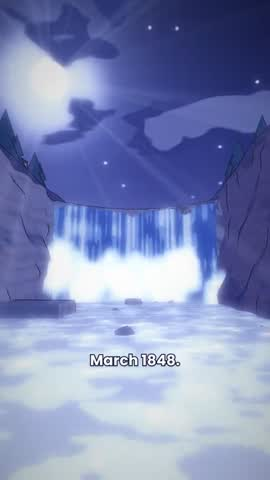
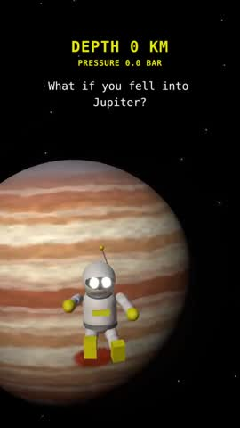
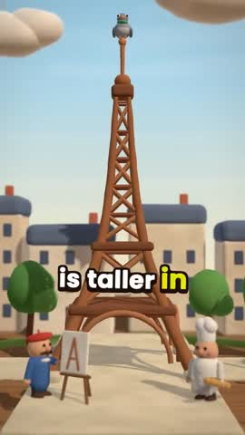
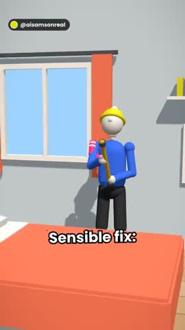
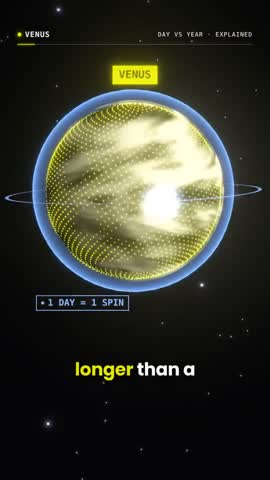
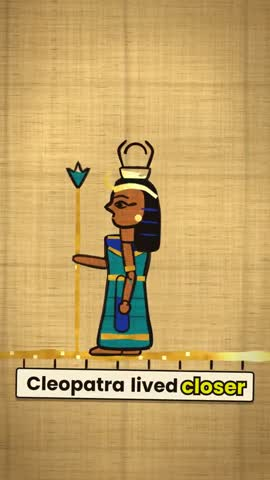
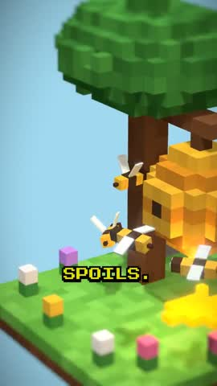
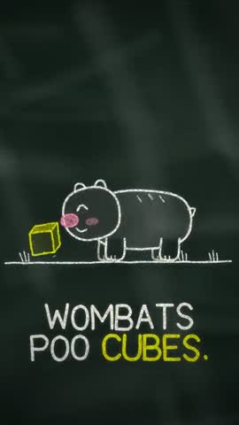
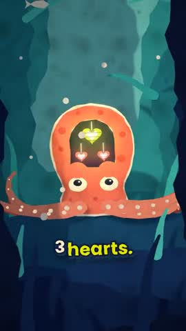
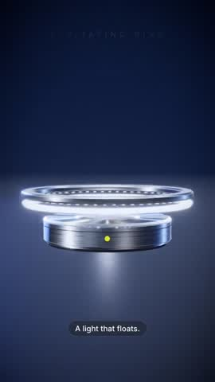

<!-- Anexo da fonte (filme-em-codigo). Tradução para o português feita pelo tradutor central (inema-traduz). Original em inglês: ../biblioteca-original/04-shorts.md. Crédito e licença: ../LEIA.md. -->

[← índice](../biblioteca-pt.md) · [original em inglês](../biblioteca-original/04-shorts.md) · [crédito e licença](../LEIA.md)

> Tradução da biblioteca de prompts de **AI Samson**. Cada prompt vem traduzido e, logo abaixo, no original em inglês: o prompt em inglês costuma funcionar melhor no modelo.

## Vídeos curtos verticais

[](https://github.com/inematds/filme-em-codigo/releases/download/fonte-v1/x4_niagara_kokoro.mp4)  
[▶ Ver o vídeo: x4_niagara_kokoro.mp4](https://github.com/inematds/filme-em-codigo/releases/download/fonte-v1/x4_niagara_kokoro.mp4)

*Filme de anime desenhado com código*

### A noite em que as Cataratas do Niágara pararam

**Mesmo estilo, sua ideia**

> Faça um curta de animação vertical de 10 a 20 segundos sobre [SUA IDEIA AQUI]. Crie tudo em código com three.js, sem modelos de imagem ou vídeo, e faça o 3D parecer um anime 2D desenhado à mão: cel shading com exatamente dois tons bem definidos por superfície, bordas das sombras levemente irregulares, sombras azul-violeta frias e contornos em tinta azul-marinho (casca invertida nos personagens e objetos, passe de contorno de profundidade no cenário). Pinte céus e fundos com shaders, usando gradientes e ruído: gradiente em faixas, nuvens em dois tons e camadas de montanhas enevoadas. Adicione névoa de profundidade, feixes de luz na tela vindos do sol ou da lua, bloom suave nas fontes de luz, vinheta sutil e granulação fina. Anime os personagens a cada dois quadros e a água, a névoa ou a fumaça a cada três, com movimentos suaves de câmera em todos os quadros. Use personagens originais com proporções chibi e uma cor quente de destaque em contraste com a cena fria; dê a um deles uma pequena luz quente que projete um brilho com bordas bem definidas. Use pelo menos cinco planos com transições elaboradas (panorâmica rápida com rastro, transição em forma de algo da história, corte casado com um objeto brilhante, corte com clarão), atuação real em todos os planos (antecipação, compressão, ultrapassagem do movimento, continuidade do cabelo e do cachecol) e um plano geral final que conclua a última fala. Narração com voz calma de contador de histórias, de 40 a 55 palavras. Legendas: uma linha branca simples, com contorno escuro fino, no terço inferior. Som: base suave e melodia de caixinha de música, com efeitos sonoros nas palavras-chave.

<details><summary>Prompt original (inglês)</summary>

```text
Make a 10 to 20 second vertical animated short about [YOUR IDEA HERE]. Build it entirely in code with three.js, no image or video model, and make the 3D read as hand-drawn 2D anime: cel shading with exactly two hard tones per surface, a slightly wobbly brushed shadow edge, cool blue-violet shadows, and navy ink outlines (inverted hull on characters and props, a depth edge pass on scenery). Paint skies and backgrounds in shaders with gradients and noise: banded gradient, two-tone clouds, layered hazy ridges. Add depth haze, screen-space light shafts from the sun or moon, soft bloom on light sources, a gentle vignette and fine grain. Animate characters on twos and water, mist or smoke on threes, with cameras moving smoothly on ones. Use original chibi-proportioned characters with one warm accent colour against a cool scene, and give one of them a small warm light that casts a hard-edged glow. Use at least five shots with designed transitions (whip pan with smear, a shape wipe made from something in the story, a match cut on a glowing object, a flash cut), real acting in every shot (anticipation, squash, overshoot, hair and scarf follow-through), and a final wide shot that lands the last line. Narration by a calm storyteller voice, 40 to 55 words. Captions: one clean white line with a thin dark outline in the lower third. Sound: soft pad and music-box melody with sound effects on the key words.
```

</details>

**Copiar este filme exato · Prompt exato**

> Faça um curta de anime vertical de 21 segundos (1080x1920, 30 fps), feito inteiramente em código com three.js: cel shading com dois tons bem definidos e sombras violeta frias, contornos em tinta azul-marinho, céus pintados com shaders, névoa, feixes de luz, bloom suave e granulação fina. Os personagens são animados a cada dois quadros; água e névoa, a cada três. Narração masculina britânica e calma, palavra por palavra: "Março de mil oitocentos e quarenta e oito. Numa noite, as Cataratas do Niágara ficaram em silêncio. O vento havia empurrado o gelo do lago Erie até a foz do rio. Pela manhã, as pessoas caminharam pelo leito seco do rio. Encontraram mosquetes e baionetas antigos na lama. Por mais de um dia, as cataratas só gotejaram. Então o gelo se rompeu, e o rugido voltou." Plano 1: as cataratas em forma de ferradura, iluminadas pela lua, num desfiladeiro de pinheiros; a água se afina em fios e para; panorâmica rápida para cima. Plano 2: mapa aéreo pintado; blocos de gelo brancos são empurrados pelo vento pelo lago e atingem a foz do rio; o rio abaixo seca; transição em forma de estilhaço de gelo. Plano 3: amanhecer; uma menina pequena de casaco vermelho e cachecol amarelo, com uma lanterna, desce de uma pedra e caminha pelo leito lamacento do rio atrás do cachorro caramelo; aproximação da lanterna. Plano 4: corte casado com a lanterna; o cachorro cava e puxa um mosquete da lama; ela recua assustada; uma baioneta brilha. Plano 5: ângulo baixo dos dois sobre uma pedra grande, sob o penhasco gotejante, enquanto o céu passa pelo amanhecer, dia, crepúsculo e noite. Plano 6: à noite, o bloqueio de gelo se rompe na direção da câmera, com um clarão branco; transição com água para a menina erguendo a lanterna enquanto as cataratas voltam a jorrar. Legenda branca com contorno escuro fino, no terço inferior. Base suave e caixinha de música; o rugido desaparece e volta.

<details><summary>Prompt original (inglês)</summary>

```text
Make a 21 second vertical (1080x1920, 30 fps) pure-code anime short in three.js: cel shading with two hard tones and cool violet shadows, navy ink outlines, painted shader skies, haze, light shafts, soft bloom, fine grain. Characters animate on twos, water and mist on threes. Calm British male narrator, word for word: "March, eighteen forty-eight. One night, Niagara Falls went silent. Wind had jammed Lake Erie's ice into the river's mouth. By morning, people walked out onto the bare riverbed. They found old muskets and bayonets in the mud. For over a day, the falls only dripped. Then the ice broke, and the roar came home." Shot 1: moonlit horseshoe falls in a pine gorge, the water thins to strands and stops, whip pan up. Shot 2: aerial painted map, white ice floes blown down the lake slam into the river mouth, the river below drains; ice-shard wipe. Shot 3: dawn, a small girl in a red coat and yellow scarf with a lantern hops off a rock and walks the muddy riverbed behind her tan dog, push in on the lantern. Shot 4: match cut from the lantern, the dog digs and tugs a musket out of the mud, she recoils, a bayonet glints. Shot 5: low angle of both on a boulder under the dripping cliff as the sky runs dawn, day, dusk, night. Shot 6: night, the ice jam bursts toward camera with a white flash; water wipe to the girl raising her lantern as the falls pour back. White subtitle line with thin dark outline, lower third. Soft pad and music box, roar that dies and returns.
```

</details>

[](https://github.com/inematds/filme-em-codigo/releases/download/fonte-v1/x4_jupiter_kokoro.mp4)  
[▶ Ver o vídeo: x4_jupiter_kokoro.mp4](https://github.com/inematds/filme-em-codigo/releases/download/fonte-v1/x4_jupiter_kokoro.mp4)

*Personagem 3D hipotético*

### E se você caísse em Júpiter?

**Mesmo estilo, sua ideia**

> Crie um curta animado vertical de 10 a 20 segundos sobre [SUA IDEIA AQUI]. Faça tudo em código com Remotion e three.js em 1080x1920 e 30 fps, sem usar modelo de imagem ou vídeo. Use pelo menos cinco cenas com transições planejadas, atuação real em cada cena e sincronize cada momento visual com a palavra que o nomeia. Adicione narração com TTS neural, legendas embutidas e música sintetizada cerca de 20 dB abaixo da voz, com efeitos sonoros nas palavras-chave. Use o formato sem rosto de “e se”: uma pergunta marcante, um personagem 3D simples e original que realmente atua e uma jornada que aumenta de intensidade por pelo menos cinco ambientes bem diferentes, criados com céus de shader, neblina e partículas. No topo, coloque um contador amarelo (#E3E302) em fonte monoespaçada, com uma leitura principal e outra menor, que avance a cada momento. Mostre uma legenda curta por momento, em estilo de máquina de escrever, com fonte monoespaçada branca sobre uma faixa preta. Termine com uma cena que ninguém prevê e que conclua com a última frase.

<details><summary>Prompt original (inglês)</summary>

```text
Make a 10 to 20 second vertical animated short about [YOUR IDEA HERE]. Build it entirely in code with Remotion and three.js at 1080x1920 and 30 fps, with no image or video model. Use at least five shots with designed transitions, real acting in every shot, and time each visual beat to the word that names it. Add neural TTS narration, burned-in captions, and synthesized music about 20 dB under the voice with sound effects on the key words. Use the faceless "what if" format: one big question, one simple original 3D character who really acts, and a journey that escalates through at least five very different environments made with shader skies, fog and particles. Put a ticking yellow (#E3E302) monospace counter at the top with one main reading and one smaller reading, and make it jump with every beat. Show one short typewriter caption per beat in white monospace on a black bar. End on a shot nobody predicts that lands the last line.
```

</details>

**Copiar este filme exato · Prompt exato**

> Crie um curta vertical de “e se” com 22 segundos. Faça tudo em código com Remotion e three.js em 1080x1920 e 30 fps, sem usar modelo de imagem ou vídeo. Use pelo menos cinco cenas com transições planejadas, atuação real em cada cena e sincronize cada momento visual com a palavra que o nomeia. Adicione narração com TTS neural, legendas embutidas e música sintetizada cerca de 20 dB abaixo da voz, com efeitos sonoros nas palavras-chave. Narração, palavra por palavra: “E se você caísse em Júpiter? Você atinge o céu a cento e setenta mil quilómetros por hora. Nuvens de amônia. Ventos acima de quinhentos quilómetros por hora. A cento e cinquenta quilómetros de profundidade: uma pressão vinte e três vezes maior que a da Terra e calor de forno. Não existe chão. O gás apenas fica mais denso e se torna líquido. Você nunca pousa. Você se torna Júpiter.” Acompanhe um pequeno astronauta robô original, com olhos brilhantes e uma antena. Cena 1: ele flutua e acena diante de Júpiter listrado. Cena 2: ele entra na atmosfera dentro de uma bola de fogo laranja, com rastros de velocidade. Cena 3: ele gira em meio a nuvens claras de amônia, com linhas de vento. Cena 4: o céu fica marrom e escuro, destroços passam voando, e ele é esmagado enquanto se esforça. Cena 5: uma névoa cinzenta sem chão à vista. Cena 6: ele se dissolve numa chuva de faíscas amarelas que flutuam para baixo e se juntam ao planeta. No topo, um contador amarelo (#E3E302) em fonte monoespaçada mostra DEPTH em km e, em tamanho menor, PRESSURE em bar; os valores avançam a cada momento e terminam em “off scale”. Legendas: uma linha em estilo de máquina de escrever, em fonte monoespaçada branca sobre uma faixa preta sob o contador.

<details><summary>Prompt original (inglês)</summary>

```text
Make a 22 second vertical "what if" short. Build it entirely in code with Remotion and three.js at 1080x1920 and 30 fps, with no image or video model. Use at least five shots with designed transitions, real acting in every shot, and time each visual beat to the word that names it. Add neural TTS narration, burned-in captions, and synthesized music about 20 dB under the voice with sound effects on the key words. Narration, word for word: "What if you fell into Jupiter? You hit the sky at a hundred and seventy thousand kilometres an hour. Ammonia clouds. Winds over five hundred kilometres an hour. A hundred and fifty kilometres down: twenty-three times Earth's pressure, and oven hot. There is no ground. The gas just thickens into liquid. You never land. You become Jupiter." Follow one small original robot astronaut with glowing eyes and an antenna. Shot 1: he floats and waves in front of banded Jupiter. Shot 2: he hits the atmosphere inside an orange entry fireball with speed streaks. Shot 3: he tumbles through pale ammonia cloud with wind lines. Shot 4: the sky turns brown and dark, debris streaks past, he is squeezed and strains. Shot 5: grey murk with no ground in sight. Shot 6: he dissolves into a shower of yellow sparks that drift down and join the planet. At the top, a yellow (#E3E302) monospace counter reads DEPTH in km and a smaller PRESSURE in bar, jumping on every beat and ending "off scale". Captions: one typewriter line in white monospace on a black bar under the counter.
```

</details>

[](https://github.com/inematds/filme-em-codigo/releases/download/fonte-v1/x4_eiffel_kokoro.mp4)  
[▶ Ver o vídeo: x4_eiffel_kokoro.mp4](https://github.com/inematds/filme-em-codigo/releases/download/fonte-v1/x4_eiffel_kokoro.mp4)

*Diorama em stop motion de massinha*

### A Torre Eiffel é mais alta no verão

**Mesmo estilo, sua ideia**

> Crie um curta animado vertical de 10 a 20 segundos sobre [SUA IDEIA AQUI]. Faça tudo com código usando Remotion e three.js, em 1080x1920 e 30 fps, sem modelos de imagem ou vídeo. Use pelo menos cinco cenas com transições planejadas, atuação de verdade em cada cena e sincronize cada momento visual com a palavra que o nomeia. Adicione narração com TTS neural, legendas integradas ao vídeo e música sintetizada cerca de 20 dB abaixo da voz, com efeitos sonoros nas palavras-chave. Faça uma maquete de claymation em stop-motion, sobre uma mesa. Modele tudo como argila macia e levemente irregular, deformando os vértices com ruído. Adicione ao sombreamento relevos que lembrem marcas de dedos e use materiais foscos, luz quente de cena, sombras suaves e pouca profundidade de campo. Anime a cada dois quadros, com um leve tremor entre poses, para dar às superfícies um aspecto de fervura. Dê ao objeto principal um rosto ou uma personalidade marcante, acrescente dois ou três pequenos personagens originais de argila que reajam e mostre qualquer número com um objeto físico de argila, como uma régua. Legendas: letras brancas, grossas e arredondadas, com contorno escuro, duas ou três palavras por vez; a palavra falada em amarelo (#E3E302).

<details><summary>Prompt original (inglês)</summary>

```text
Make a 10 to 20 second vertical animated short about [YOUR IDEA HERE]. Build it entirely in code with Remotion and three.js at 1080x1920 and 30 fps, with no image or video model. Use at least five shots with designed transitions, real acting in every shot, and time each visual beat to the word that names it. Add neural TTS narration, burned-in captions, and synthesized music about 20 dB under the voice with sound effects on the key words. Make it a stop-motion claymation diorama on a tabletop set. Model everything as soft, slightly lumpy clay by displacing vertices with noise, add a fingerprint-like bump in the shading, and use matte materials, warm practical lighting, soft shadows and shallow depth of field. Animate on twos with a little per-pose jitter so surfaces boil. Give the main object a face or a clear personality, add two or three small original clay characters who react, and show any number with a physical clay prop such as a ruler. Captions: chunky rounded white letters with a dark outline, two or three words at a time, the spoken word in yellow (#E3E302).
```

</details>

**Copiar este filme exato · Prompt exato**

> Crie um curta vertical de claymation em stop-motion com 19 segundos. Faça tudo com código usando Remotion e three.js, em 1080x1920 e 30 fps, sem modelos de imagem ou vídeo. Use pelo menos cinco cenas com transições planejadas, atuação de verdade em cada cena e sincronize cada momento visual com a palavra que o nomeia. Adicione narração com TTS neural, legendas integradas ao vídeo e música sintetizada cerca de 20 dB abaixo da voz, com efeitos sonoros nas palavras-chave. Narração, palavra por palavra: "A Torre Eiffel é mais alta no verão. O ferro se expande com o calor, então a torre inteira se estica. Do inverno mais rigoroso ao verão mais quente, as estimativas indicam até quinze centímetros. O lado ensolarado cresce mais, então o topo se inclina para longe do sol. Quando esfria, ela encolhe e volta ao normal. Só o pombo percebe." Tudo parece feito à mão com argila de modelar, numa maquete de Paris sobre uma mesa: formas arredondadas e irregulares, materiais foscos, luz quente, sombras suaves, pouca profundidade de campo e animação a cada dois quadros, com um leve tremor nas superfícies. Cena 1: uma Torre Eiffel de argila marrom numa praça, com um pintor diante de um cavalete, um padeiro e um pombo no topo. Cena 2: um sol de argila com rosto se aproxima e a torre se estica. Cena 3: uma régua de argila amarela ao lado do topo, com o pombo subindo de 0 a 15 cm. Cena 4: o topo se curva para longe do sol enquanto o sol parece surpreso. Cena 5: entardecer; a torre encolhe e o sol sorri. Cena 6: close noturno do pombo olhando ao redor. Legendas: letras brancas, grossas e arredondadas, com contorno escuro, duas ou três palavras por vez; a palavra falada em amarelo (#E3E302).

<details><summary>Prompt original (inglês)</summary>

```text
Make a 19 second vertical stop-motion claymation short. Build it entirely in code with Remotion and three.js at 1080x1920 and 30 fps, with no image or video model. Use at least five shots with designed transitions, real acting in every shot, and time each visual beat to the word that names it. Add neural TTS narration, burned-in captions, and synthesized music about 20 dB under the voice with sound effects on the key words. Narration, word for word: "The Eiffel Tower is taller in summer. Its iron swells in the heat, so the whole tower stretches. From deepest winter to hottest summer, estimates say up to fifteen centimetres. The sunny side grows more, so the top leans away from the sun. When it cools down, it shrinks right back. Only the pigeon notices." Everything looks hand-made from modelling clay on a tabletop Paris set: lumpy rounded shapes, matte materials, warm light, soft shadows, shallow depth of field, motion on twos with a little surface jitter. Shot 1: a brown clay Eiffel Tower in a square with a painter at an easel, a baker and a pigeon on the tip. Shot 2: a clay sun with a face leans in and the tower stretches. Shot 3: a yellow clay ruler beside the tip, with the pigeon rising from 0 to 15 cm. Shot 4: the top bends away from the sun while the sun looks surprised. Shot 5: evening, the tower shrinks back and the sun smiles. Shot 6: night close-up of the pigeon looking around. Captions: chunky rounded white letters with a dark outline, two or three words at a time, the spoken word in yellow (#E3E302).
```

</details>

[](https://github.com/inematds/filme-em-codigo/releases/download/fonte-v1/x4_sock_kokoro.mp4)  
[▶ Ver o vídeo: x4_sock_kokoro.mp4](https://github.com/inematds/filme-em-codigo/releases/download/fonte-v1/x4_sock_kokoro.mp4)

*Comédia de engenharia desnecessária*

### O Localizador de Meias de que Ninguém Precisava

**Mesmo estilo, sua ideia**

> Crie um curta animado vertical de 10 a 20 segundos sobre [SUA IDEIA AQUI]. Faça tudo em código com Remotion e three.js em 1080x1920 e 30 fps, sem modelo de imagem ou vídeo. Use pelo menos cinco cenas com transições planejadas, atuação de verdade em cada cena e sincronize cada momento visual com a palavra que o nomeia. Adicione narração com TTS neural, legendas fixas no vídeo e música sintetizada cerca de 20 dB abaixo da voz, com efeitos sonoros nas palavras-chave. Use o formato de comédia de “engenharia desnecessária”: um problema do dia a dia, depois quatro soluções que vão do razoável ao absurdo e, por fim, uma piada que torna tudo inútil. Cenário 3D low-poly, claro e limpo, com um manequim sem rosto que interpreta de verdade comicamente (olha duas vezes, se curva, faz pose de vitória). Monte cada engenhoca peça por peça, com tubos de metal amarelos e abraçadeiras cinzas, usando movimentos rápidos que passam um pouco do ponto antes de voltar. Mova a câmera rapidamente entre as piadas. Legendas brancas em negrito, com contorno preto grosso, duas ou três palavras por vez, e uma pequena etiqueta em formato de pílula no canto superior esquerdo.

<details><summary>Prompt original (inglês)</summary>

```text
Make a 10 to 20 second vertical animated short about [YOUR IDEA HERE]. Build it entirely in code with Remotion and three.js at 1080x1920 and 30 fps, with no image or video model. Use at least five shots with designed transitions, real acting in every shot, and time each visual beat to the word that names it. Add neural TTS narration, burned-in captions, and synthesized music about 20 dB under the voice with sound effects on the key words. Use the "unnecessary engineering" comedy format: an everyday problem, then four fixes that escalate from sensible to absurd, then a punchline that makes all of it pointless. Bright, clean low-poly 3D set with a faceless mannequin who does real comic acting (double takes, slumps, a victory pose). Build each contraption from yellow metal tubing and grey clamps, assembling piece by piece with snappy overshoot, and whip the camera between gags. White heavy captions with a thick black outline, two or three words at a time, and a small handle pill in the top-left.
```

</details>

**Copiar este filme exato · Prompt exato**

> Crie um curta de comédia vertical de 17 segundos no formato “engenharia desnecessária”. Faça tudo em código com Remotion e three.js em 1080x1920 e 30 fps, sem modelo de imagem ou vídeo. Use pelo menos cinco cenas com transições planejadas, atuação de verdade em cada cena e sincronize cada momento visual com a palavra que o nomeia. Adicione narração com TTS neural, legendas fixas no vídeo e música sintetizada cerca de 20 dB abaixo da voz, com efeitos sonoros nas palavras-chave. Narração, em tom impassível, palavra por palavra: "Você perdeu uma meia. Solução razoável: um ímã numa corda. Meias não são magnéticas. Então, um cão-robô farejador de meias. Ele só fica olhando para você. Inútil. Então, uma esteira que atravessa a casa toda. Ainda nada. Certo. Lance o satélite. Meia localizada. Ela estava no seu pé o tempo todo." Quarto 3D low-poly claro, com cama coral, paredes cinzas, janela e planta. Um manequim branco sem rosto, usando suéter azul, calça preta e gorro amarelo, está com uma meia rosa listrada. Cena 1: ele dá de ombros para a câmera. Cena 2: um ímã vermelho numa corda fica pendurado sobre o chão e não encontra nada. Cena 3: um cão-robô feito de tubos amarelos e abraçadeiras cinzas fareja e depois só fica olhando para ele. Cena 4: uma esteira de tubos amarelos atravessa o quarto, carregando um cacto e um botão vermelho grande. Cena 5: ele aperta o botão e olha para cima. Cena 6: um anel de mira rosa vindo do satélite pousa no próprio pé dele, e ele se curva. Legendas brancas em negrito, com contorno preto grosso, duas ou três palavras por vez, e uma pequena etiqueta @aisamsonreal em formato de pílula no canto superior esquerdo.

<details><summary>Prompt original (inglês)</summary>

```text
Make a 17 second vertical "unnecessary engineering" comedy short. Build it entirely in code with Remotion and three.js at 1080x1920 and 30 fps, with no image or video model. Use at least five shots with designed transitions, real acting in every shot, and time each visual beat to the word that names it. Add neural TTS narration, burned-in captions, and synthesized music about 20 dB under the voice with sound effects on the key words. Narration, deadpan, word for word: "You've lost one sock. Sensible fix: a magnet on a string. Socks aren't magnetic. So, a sock-sniffing robot dog. It just stares at you. Useless. So, a conveyor through the whole house. Still nothing. Fine. Launch the satellite. Sock located. It was on your foot the whole time." Bright low-poly 3D bedroom with a coral bed, grey walls, a window and a plant. A faceless white mannequin in a blue jumper, black trousers and a yellow beanie wears one pink striped sock. Shot 1: he shrugs at the camera. Shot 2: a red magnet on a string dangles over the floor and finds nothing. Shot 3: a robot dog built from yellow tubing and grey clamps sniffs, then just stares at him. Shot 4: a conveyor of yellow tubing runs through the room carrying a cactus and a big red button. Shot 5: he slams the button and looks up. Shot 6: a pink targeting ring from the satellite lands on his own foot, and he slumps. White heavy captions with a thick black outline, two or three words at a time, and a small @aisamsonreal pill in the top-left.
```

</details>

[](https://github.com/inematds/filme-em-codigo/releases/download/fonte-v1/x4_venus_kokoro.mp4)  
[▶ Ver o vídeo: x4_venus_kokoro.mp4](https://github.com/inematds/filme-em-codigo/releases/download/fonte-v1/x4_venus_kokoro.mp4)

*Explicação 3D com brilho*

### Em Vênus, um dia dura mais que um ano

**Mesmo estilo, sua ideia**

> Crie um curta animado vertical de 10 a 20 segundos sobre [SUA IDEIA AQUI]. Faça tudo em código com Remotion e three.js, em 1080x1920 e 30 fps, sem usar modelo de imagem ou vídeo. Use pelo menos cinco cenas, com transições planejadas, atuação real em cada cena e cada momento visual sincronizado com a palavra que o nomeia. Adicione narração com TTS neural, legendas incorporadas ao vídeo e música sintetizada cerca de 20 dB abaixo da voz, com efeitos sonoros nas palavras-chave. Crie um explicador 3D escuro e brilhante: espaço quase preto, traços amarelos brilhantes (#E3E302), luz de contorno azul, objetos desenhados com partículas pontilhadas e detalhes de shader, além de bloom suave. Transforme a comparação principal numa corrida que o espectador entenda de relance, com dois marcadores e dois contadores grandes e brilhantes, avançando lado a lado. Mostre um rótulo monoespaçado em maiúsculas para cada palavra que ele nomeia, mantenha uma barra fina no topo com uma linha de progresso e exiba legendas centralizadas em negrito, com a palavra falada em amarelo. Termine com uma vista do chão e, em seguida, faça uma pergunta direta ao espectador como título grande.

<details><summary>Prompt original (inglês)</summary>

```text
Make a 10 to 20 second vertical animated short about [YOUR IDEA HERE]. Build it entirely in code with Remotion and three.js at 1080x1920 and 30 fps, with no image or video model. Use at least five shots with designed transitions, real acting in every shot, and time each visual beat to the word that names it. Add neural TTS narration, burned-in captions, and synthesized music about 20 dB under the voice with sound effects on the key words. Make it a dark glowing 3D explainer: near-black space, glowing yellow (#E3E302) line work, blue rim light, objects drawn as dotted particles with shader detail, and soft bloom. Turn the key comparison into a race the viewer can read at a glance, with two markers and two big glowing counters running side by side. Pop a mono uppercase label chip on each word it names, keep a thin top bar with a progress line, and show centred bold captions with the spoken word in yellow. End on a view from the ground, then a direct question to the viewer as a big title.
```

</details>

**Copiar este filme exato · Prompt exato**

> Crie um explicador vertical de 20 segundos, escuro e brilhante. Faça tudo em código com Remotion e three.js, em 1080x1920 e 30 fps, sem usar modelo de imagem ou vídeo. Use pelo menos cinco cenas, com transições planejadas, atuação real em cada cena e cada momento visual sincronizado com a palavra que o nomeia. Adicione narração com TTS neural, legendas incorporadas ao vídeo e música sintetizada cerca de 20 dB abaixo da voz, com efeitos sonoros nas palavras-chave. Narração, palavra por palavra: "Em Vênus, um dia dura mais que um ano. Uma rotação leva duzentos e quarenta e três dias terrestres. Uma volta ao redor do Sol? Apenas duzentos e vinte e cinco. O ano vence. É o planeta mais quente: quente o bastante para derreter chumbo. E gira ao contrário, então o Sol nasce no oeste. Você esperaria por esse nascer do sol?" Espaço quase preto com estrelas, traços amarelos brilhantes (#E3E302), luz de contorno azul e uma barra fina no topo com uma linha de progresso. Cena 1: Vênus feito de partículas pontilhadas, com nuvens em redemoinho e um rótulo VENUS. Cena 2: um marcador avança devagar ao redor da rotação do planeta enquanto um contador azul chega a 243 dias terrestres. Cena 3: afaste a câmera até mostrar o Sol e uma órbita brilhante; um segundo marcador corre ao redor dela enquanto dois contadores, YEAR e DAY, avançam lado a lado, e o ano termina primeiro, em 225. Cena 4: um pequeno veículo explorador na superfície, ao lado de um bloco de chumbo que cede e derrete, com os rótulos HOTTEST PLANET e LEAD. Cena 5: o planeta gira ao contrário. Cena 6: da superfície, o Sol nasce sobre montanhas negras, com um rótulo WEST; em seguida, a pergunta aparece como título grande. Legendas centralizadas em negrito, com a palavra falada em amarelo.

<details><summary>Prompt original (inglês)</summary>

```text
Make a 20 second vertical dark glowing explainer. Build it entirely in code with Remotion and three.js at 1080x1920 and 30 fps, with no image or video model. Use at least five shots with designed transitions, real acting in every shot, and time each visual beat to the word that names it. Add neural TTS narration, burned-in captions, and synthesized music about 20 dB under the voice with sound effects on the key words. Narration, word for word: "On Venus, a day is longer than a year. One spin takes two hundred and forty three Earth days. One lap of the Sun? Just two hundred and twenty five. The year wins. It's the hottest planet: hot enough to melt lead. And it spins backwards, so the Sun rises in the west. Would you wait for that sunrise?" Near-black space with stars, glowing yellow (#E3E302) line work and blue rim light, a thin top bar with a progress line. Shot 1: a dotted-particle Venus with swirling cloud and a VENUS label chip. Shot 2: a marker crawls round the planet's spin while a blue counter runs to 243 Earth days. Shot 3: pull back to the Sun and a glowing orbit arc; a second marker races round it while two counters, YEAR and DAY, run side by side and the year finishes first at 225. Shot 4: a small rover on the surface beside a block of lead that slumps and melts, with HOTTEST PLANET and LEAD chips. Shot 5: the planet spins backwards. Shot 6: from the surface, the Sun rises over black mountains with a WEST chip, then the question appears as a big title. Centred bold captions with the spoken word in yellow.
```

</details>

[](https://github.com/inematds/filme-em-codigo/releases/download/fonte-v1/x4_cleopatra_kokoro.mp4)  
[▶ Ver o vídeo: x4_cleopatra_kokoro.mp4](https://github.com/inematds/filme-em-codigo/releases/download/fonte-v1/x4_cleopatra_kokoro.mp4)

*Pergaminho de papiro com tinta e dourado*

### Cleópatra viveu mais perto da chegada à Lua

**Mesmo estilo, sua ideia**

> Crie um curta animado vertical de 10 a 20 segundos sobre [SUA IDEIA AQUI]. Faça tudo em código com three.js por meio de @remotion/three, em 1080x1920 a 30 fps, no estilo de um pergaminho de papiro com tinta e ouro. O fundo é uma superfície de papiro procedural e quente (fibras cruzadas, emendas das tiras, manchas e granulação em um shader), que um rolo desenrola no primeiro segundo e ao longo da qual a câmera avança. Desenhe tudo como geometria: linhas pretas de pincel como fitas afuniladas, com leve oscilação, que se desenham ao longo do próprio traçado com bordas de pincel seco; e preenchimentos planos em ocre, teal, lápis-lazúli e creme, que aparecem por trás das linhas com passadas alternadas de pincel bem visíveis. Use folha de ouro para o elemento que representa a ideia (uma linha do tempo, um caminho, uma medida): tom irregular de folha, um brilho que percorre o traçado e uma estrela brilhante na ponta enquanto ele se desenha. Crie figuras originais de perfil, no estilo da pintura mural do antigo Egito, e faça-as agir: virar com deformação, apontar, antecipar o esforço, passar um pouco do ponto ao aterrissar e ter pequenos movimentos secundários. Use pelo menos cinco tomadas unidas por chicotadas de câmera ao longo do pergaminho e uma tomada ampla em que o pergaminho gire 90 graus, para que o diagrama inteiro preencha o quadro vertical, com numerais grandes em ouro, contornados por tinta escura, para quaisquer números. Termine com uma imagem simbólica e tranquila que dê sentido à última frase. Legendas: letras escuras e em negrito numa faixa creme com borda de tinta; a palavra falada fica destacada em #E3E302 com contorno escuro. Música: melodia dedilhada parecida com oud sobre um som contínuo e tambor de moldura suave, com efeitos de papel, pincel e sino nas palavras-chave. Verifique primeiro todos os fatos e mantenha todos os números em escala.

<details><summary>Prompt original (inglês)</summary>

```text
Make a 10 to 20 second vertical animated short about [YOUR IDEA HERE]. Build it entirely in code with three.js through @remotion/three, 1080x1920 at 30 fps, styled as an ink and gold papyrus scroll. The background is a warm procedural papyrus surface (crossed fibres, strip seams, flecks and grain in a shader) that a roller unrolls in the first second and that the camera then travels along. Draw everything as geometry: black brush lines as tapered, slightly wobbling ribbons that draw on along their length with a dry-brush edge, and flat ochre, teal, lapis and cream fills that paint in behind the lines with visible alternating brush wipes. Use gold leaf for the one thing that carries the idea (a timeline, a path, a measurement): patchy leaf tone, a travelling glint, and a bright star riding the tip as it draws. Design original profile figures in an ancient Egyptian wall-painting manner and make them act: turns with squash, pointing, anticipation before effort, overshoot on landings, small secondary motion. Use at least five shots joined by whip pans along the scroll, and one wide shot where the scroll rolls 90 degrees so the whole diagram fills the tall frame, with big gold numerals outlined in dark ink for any numbers. End on one quiet, symbolic image that lands the last line. Captions: bold dark lettering on a cream strip with an ink border, the spoken word highlighted in #E3E302 with a dark outline. Music: plucked oud-like line over a drone and soft frame drum, with paper, brush and chime effects on the key words. Verify every fact first and keep all numbers to scale.
```

</details>

**Copiar este filme exato · Prompt exato**

> Crie um curta animado vertical de 21 segundos (1080x1920, 30 fps), feito inteiramente em código com three.js por meio de @remotion/three, no estilo de um pergaminho de papiro com tinta e ouro. Um shader procedural de papiro (fibras cruzadas, emendas, granulação) é desenrolado por um rolo. Uma linha do tempo em folha de ouro, com marcas dos séculos, aparece com uma estrela brilhante na ponta. A arte usa fitas de linhas pretas de pincel que se desenham, com preenchimentos planos em ocre, teal e lápis-lazúli que aparecem com passadas de pincel visíveis. Tomada 1: uma rainha egípcia original, de perfil, vira para a direita e aponta enquanto surge uma lua crescente dourada; depois vira para a esquerda enquanto surge uma pequena pirâmide. Tomada 2: chicotada de câmera para a esquerda, mostrando três construtores puxando um bloco num trenó em direção a uma pirâmide, que é pintada camada por camada sob um sol dourado; carimbo "2560 BC". Tomada 3: movimento para a direita enquanto um colchete dourado se desenha e um numeral conta até 2,530 YEARS, chegando à rainha, com a legenda "30 BC". Tomada 4: movimento para a direita, contador até 1,998 YEARS; um pequeno módulo de pouso desce num céu noturno lápis-lazúli, amassa ao tocar o solo, com nuvens de poeira, legenda "1969". Tomada 5: o pergaminho gira 90 graus para mostrar toda a linha do tempo na vertical, com os dois colchetes e os numerais grandes em ouro 2,530 e 1,998. Tomada 6: aproximação da rainha protegendo os olhos do sol; chicotada de câmera para uma pegada com sulcos ao lado de uma sombra em forma de pirâmide. Legendas: letras escuras e em negrito numa faixa creme; palavra falada em #E3E302 com contorno escuro. Narradora com voz feminina e calorosa: "Cleópatra viveu mais perto da chegada à Lua do que da construção da Grande Pirâmide. Ela foi concluída por volta de 2560 a.C. Cleópatra morreu em 30 a.C., 2,530 anos depois. A chegada à Lua aconteceu em 1969, apenas 1,998 anos depois dela. Para ela, as pirâmides eram história antiga."

<details><summary>Prompt original (inglês)</summary>

```text
Make a 21 second vertical animated short (1080x1920, 30 fps) built entirely in code with three.js through @remotion/three, styled as an ink and gold papyrus scroll. A procedural papyrus shader (crossed fibres, seams, grain) is unrolled by a roller. A gold-leaf timeline with century ticks draws on with a glinting star at its tip. Art is black brush-line ribbons that draw on, with flat ochre, teal and lapis fills that paint in with visible brush wipes. Shot 1: an original Egyptian queen in profile with a staff turns right and points as a gold crescent appears, then turns left as a small pyramid appears. Shot 2: whip pan left to three builders hauling a block on a sledge toward a pyramid that paints up course by course under a gold sun, stamp "2560 BC". Shot 3: travel right as a gold bracket draws and a numeral counts to 2,530 YEARS, arriving at the queen, label "30 BC". Shot 4: travel right, counter to 1,998 YEARS, a small lander descends into a lapis night sky, squashes on touchdown with dust puffs, label "1969". Shot 5: the scroll rolls 90 degrees to show the whole timeline vertical with both brackets and big gold numerals 2,530 and 1,998. Shot 6: push in on the queen shading her eyes, whip to a ribbed footprint beside a pyramid-shaped shadow. Captions: bold dark lettering on a cream strip, spoken word in #E3E302 with a dark outline. Warm female narrator: "Cleopatra lived closer to the Moon landing than to the building of the Great Pyramid. It was finished around 2560 BC. Cleopatra died in 30 BC, 2,530 years later. The Moon landing came in 1969, only 1,998 years after her. To her, the pyramids were ancient history."
```

</details>

[](https://github.com/inematds/filme-em-codigo/releases/download/fonte-v1/x4_honey_kokoro.mp4)  
[▶ Ver o vídeo: x4_honey_kokoro.mp4](https://github.com/inematds/filme-em-codigo/releases/download/fonte-v1/x4_honey_kokoro.mp4)

*Diorama de voxels*

### O mel quase nunca estraga

**Mesmo estilo, sua ideia**

> Crie um curta animado vertical de 10 a 20 segundos sobre [SUA IDEIA AQUI]. Faça tudo em código com Remotion e three.js em 1080x1920 e 30 fps, sem usar modelo de imagem ou vídeo. Use pelo menos cinco cenas, com transições planejadas e atuação de verdade em cada cena. Sincronize cada momento visual com a palavra que o descreve. Adicione narração com TTS neural, legendas embutidas no vídeo e música sintetizada cerca de 20 dB abaixo da voz, com efeitos sonoros nas palavras-chave. Faça um diorama de voxel: cada objeto deve ser feito de cubos grandes (InstancedMesh) sobre bases quadradas flutuantes, vistos por uma câmera isométrica de três quartos que orbita e mergulha entre os cenários. Os objetos se montam e se desmontam cubo a cubo, com movimentos elásticos. Líquidos fluem como cubos luminosos que caem, e pequenos personagens de cubo com rostos simples reagem. Adicione bloom quente aos elementos luminosos, sombreamento suave nos cantos e desfoque tilt-shift na parte de cima e de baixo. Legendas: letras maiúsculas brancas no estilo pixelado, com contorno preto; a palavra falada fica amarela (#E3E302).

<details><summary>Prompt original (inglês)</summary>

```text
Make a 10 to 20 second vertical animated short about [YOUR IDEA HERE]. Build it entirely in code with Remotion and three.js at 1080x1920 and 30 fps, with no image or video model. Use at least five shots with designed transitions, real acting in every shot, and time each visual beat to the word that names it. Add neural TTS narration, burned-in captions, and synthesized music about 20 dB under the voice with sound effects on the key words. Make it a voxel diorama: every object is built from chunky cubes (InstancedMesh) on floating square bases, seen from a three-quarter isometric camera that orbits and dives between sets. Things assemble and come apart cube by cube with bouncy timing, liquids flow as falling glowing cubes, and small cube characters with simple faces react. Add warm bloom on anything that glows, soft shading in the corners and tilt-shift blur at the top and bottom. Captions: chunky pixel-style white capitals with a black outline, the spoken word in yellow (#E3E302).
```

</details>

**Copiar este filme exato · Prompt exato**

> Crie um curta vertical de 20 segundos em estilo diorama de voxel. Faça tudo em código com Remotion e three.js em 1080x1920 e 30 fps, sem usar modelo de imagem ou vídeo. Use pelo menos cinco cenas, com transições planejadas e atuação de verdade em cada cena. Sincronize cada momento visual com a palavra que o descreve. Adicione narração com TTS neural, legendas embutidas no vídeo e música sintetizada cerca de 20 dB abaixo da voz, com efeitos sonoros nas palavras-chave. Narração, palavra por palavra: "O mel quase nunca estraga. Diz a lenda que um pote encontrado em uma tumba egípcia ainda estava doce após três mil anos. Essa história é duvidosa. A química, não. O mel tem menos de um quinto de água e é ácido. As abelhas adicionam uma enzima que produz peróxido de hidrogênio, dificultando o crescimento dos germes. Se ficar bem fechado, dura por muito tempo." Cada elemento deve ser feito de cubos grandes sobre bases quadradas flutuantes, visto por uma câmera isométrica de três quartos que orbita e mergulha entre os cenários, com bloom quente e desfoque tilt-shift. Cena 1: um campo verde com uma árvore de voxel, uma colmeia dourada e abelhas listradas. Cena 2: dentro de uma tumba egípcia iluminada por tochas, um arqueólogo original em voxel, usando chapéu, levanta a tampa de um pote de barro. Cena 3: a câmera se afasta e mostra a tumba inteira como uma caixa em corte, brilhando no escuro. Cena 4: mergulho rápido pelo espaço azul-escuro, com cubos passando em alta velocidade. Cena 5: um pote de vidro se enche de cubos de mel luminosos que caem, enquanto alguns cubos de água azul-clara são espremidos para fora. Pequenos germes em forma de cubo, roxos e verdes, com rostos preocupados. Cena 6: uma abelha deixa cair um brilho branco no pote, e os germes recuam. Cena 7: uma tampa amarela cai sobre o pote. Legendas: letras maiúsculas brancas no estilo pixelado, com contorno preto; a palavra falada fica amarela (#E3E302).

<details><summary>Prompt original (inglês)</summary>

```text
Make a 20 second vertical voxel diorama short. Build it entirely in code with Remotion and three.js at 1080x1920 and 30 fps, with no image or video model. Use at least five shots with designed transitions, real acting in every shot, and time each visual beat to the word that names it. Add neural TTS narration, burned-in captions, and synthesized music about 20 dB under the voice with sound effects on the key words. Narration, word for word: "Honey almost never spoils. Legend says a jar from an Egyptian tomb was still sweet after three thousand years. That story is shaky. The chemistry is not. Honey is less than a fifth water, and it's acidic. Bees add an enzyme that makes hydrogen peroxide, so germs struggle to grow. Keep it sealed, and it keeps." Everything is chunky cubes on floating square bases, seen from a three-quarter isometric camera that orbits and dives between sets, with warm bloom and tilt-shift blur. Shot 1: a green meadow with a voxel tree, a golden beehive and striped bees. Shot 2: inside a torch-lit Egyptian tomb, an original voxel archaeologist in a hat lifts the lid off a clay pot. Shot 3: pull back to the whole tomb as a cutaway box glowing in the dark. Shot 4: fast dive through dark blue space with cubes streaking past. Shot 5: a glass jar fills with falling glowing honey cubes while a few pale blue water cubes are squeezed out, and small purple and green germ cubes with faces look worried. Shot 6: a bee drops a white sparkle into the jar and the germs back away. Shot 7: a yellow lid lands on the jar. Captions: chunky pixel-style white capitals with a black outline, the spoken word in yellow (#E3E302).
```

</details>

[](https://github.com/inematds/filme-em-codigo/releases/download/fonte-v1/x4_wombat_kokoro.mp4)  
[▶ Ver o vídeo: x4_wombat_kokoro.mp4](https://github.com/inematds/filme-em-codigo/releases/download/fonte-v1/x4_wombat_kokoro.mp4)

*Animação de linha no quadro-negro*

### Cocô de wombat em cubos

**Mesmo estilo, sua ideia**

> Faça um curta animado vertical de 10 a 20 segundos sobre [SUA IDEIA AQUI]. Estilo: animação de traços em quadro-negro, feita inteiramente em código (canvas 2D ou SVG dentro do Remotion, sem imagens de banco e sem fontes). Uma lousa verde-escura quase preta, com manchas de pó, arranhões leves e marcas antigas de apagador. Tudo é desenhado com traços de giz texturizados, que surgem com um pedaço de giz visível na ponta, com leve oscilação e linhas redesenhadas a cada três quadros, além de bordas irregulares e granuladas. Cores: giz branco e amarelo #E3E302 para o objeto principal, com um pouco de rosa e azul para as partes identificadas. Inclua um personagem de giz fofo e original, que demonstre expectativa, squash and stretch e uma reação orgulhosa, apoiado em duas pernas. Inclua pelo menos um diagrama identificado com rótulos curtos escritos à mão e setas pulsantes, além de uma demonstração física simples em que objetos caem com peso, quicam, amassam e levantam poeira. Use pelo menos cinco cenas em um único quadro contínuo: a câmera desliza pelo quadro acompanhando um objeto em movimento, e apagadores de feltro limpam o quadro e deixam manchas entre as seções. Termine com um número ou palavra grande, desenhado à mão, que feche a última fala com um pequeno floreio. Legendas: letras maiúsculas desenhadas à mão com giz, duas ou três palavras por vez; a palavra falada aparece em amarelo. Narração: de 40 a 55 palavras, calorosa e divertida, com cada fato verificado primeiro na internet. Som: música leve em pizzicato, riscos de giz ao desenhar, batidas e estalos suaves, sons de apagador deslizando e um toque de sino no último compasso.

<details><summary>Prompt original (inglês)</summary>

```text
Make a 10 to 20 second vertical animated short about [YOUR IDEA HERE]. Style: a chalkboard line animation built entirely in code (2D canvas or SVG inside Remotion, no stock images, no fonts). A dark green-black slate with dusty smudges, faint scratches and old eraser marks. Everything is drawn in textured chalk strokes that draw on with a visible stick of chalk at the tip, with slight wobble and line boil re-drawn every third frame, and a grainy, broken chalk edge. Colours: white chalk plus yellow #E3E302 for the hero object, with a little pink and blue for labelled parts. Include one original cute chalk character who acts with anticipation, squash and stretch and a proud reaction, posed on twos. Include at least one labelled diagram with short hand-lettered labels and pulsing arrows, and one simple physical demonstration where objects fall with weight, bounce, squash and puff dust. Use at least five shots on one continuous board: the camera slides along the board following a moving object, and felt-eraser wipes clear the board and leave smears between sections. End on a big hand-drawn number or word that lands the last line, with a small flourish. Captions: hand-lettered chalk capitals, two or three words at a time, the spoken word in yellow. Narration: 40 to 55 words, warm and amused, every fact verified on the web first. Sound: light pizzicato tune, chalk scratches on draw-ons, soft thuds and plops, eraser swishes, a chime on the final beat.
```

</details>

**Copiar este filme exato · Prompt exato**

> Faça uma animação vertical de 18,8 segundos (1080x1920, 30 fps) com traços em quadro-negro, feita inteiramente em código com canvas 2D no Remotion. Lousa verde-escura quase preta, com manchas de pó e marcas de apagador; tudo em traços de giz texturizados, que surgem com um pedaço de giz visível, com linhas redesenhadas a cada três quadros; giz branco, amarelo #E3E302, rosa e azul. Narração (voz feminina calorosa e divertida): "Wombats fazem cocô em cubos. É sério. O trecho final do intestino tem faixas rígidas e faixas elásticas. Elas se contraem em velocidades diferentes, e isso dá forma aos cantos. Os cubos ficam no lugar sobre as pedras e os troncos que os wombats marcam. Uma bolinha rolaria para longe. E um wombat pode fazer até cem por noite." Cena 1: um wombat fofo, desenhado com giz, entra gingando, se agacha, solta um cubo amarelo, vira-se para admirá-lo e solta um segundo, que cai para a direita enquanto a câmera desliza. Cena 2: wombat em corte, com o intestino enrolado em rosa e o trecho final circulado em amarelo; tubo ampliado com faixas azuis RÍGIDAS e faixas onduladas rosas ELÁSTICAS; uma massa vira um quadrado; nota "YANG + HU, 2018-2021"; um cubo cai e puxa a câmera para baixo. Cena 3: anel em corte transversal, arcos azuis RÁPIDO, arcos rosas DEVAGAR, setas pulsantes, massa vira quadrado com cantos marcados. Limpeza com apagador. Cena 4: cubos caem com força sobre uma pedra inclinada e um tronco e ficam no lugar; wombat espia; arcos amarelos de marcação. Cena 5: uma bola rosa é desenhada ao lado dos cubos e rola para longe. Limpeza com apagador. Cena 6: cubos se empilham formando uma pirâmide; wombat coloca com cuidado o último no topo; "100" grande em amarelo, lua e estrelas. Legendas: letras maiúsculas desenhadas à mão com giz, duas ou três palavras; palavra falada em amarelo. Música em pizzicato, riscos de giz, estalos.

<details><summary>Prompt original (inglês)</summary>

```text
Make an 18.8 second vertical (1080x1920, 30 fps) chalkboard line animation built entirely in code with 2D canvas in Remotion. Dark green-black slate with dusty smudges and eraser marks; everything in textured chalk strokes that draw on with a visible chalk stick, line boil on threes; white chalk plus yellow #E3E302, pink and blue. Narration (warm, amused female voice): "Wombats poo cubes. Really. The last stretch of the gut has stiff bands and stretchy bands. They squeeze at different speeds, and that shapes the corners. Cubes stay put on the rocks and logs wombats mark. A round one would roll right off. And one wombat can make up to a hundred a night." Shot 1: an original cute chalk wombat waddles in, squats, plops a yellow cube, turns to admire it, plops a second that tumbles right as the camera slides. Shot 2: cutaway wombat with pink coiled gut, last stretch circled yellow, zoomed tube with blue STIFF and pink wavy STRETCHY bands, a lump turning square, note "YANG + HU, 2018-2021"; a cube drops out and pulls the camera down. Shot 3: cross-section ring, blue arcs FAST, pink arcs SLOW, arrows pulsing, lump becomes a square with corner marks. Eraser wipe. Shot 4: cubes thud onto a slanted rock and a log and stay, wombat peeks, yellow marker arcs. Shot 5: a pink ball drawn beside them rolls off. Eraser wipe. Shot 6: cubes stack into a pyramid, wombat bucks the last on top, big yellow "100", moon and stars. Captions: hand-lettered chalk capitals, two or three words, spoken word yellow. Pizzicato music, chalk scratches, plops.
```

</details>

[](https://github.com/inematds/filme-em-codigo/releases/download/fonte-v1/x4_octopus_kokoro.mp4)  
[▶ Ver o vídeo: x4_octopus_kokoro.mp4](https://github.com/inematds/filme-em-codigo/releases/download/fonte-v1/x4_octopus_kokoro.mp4)

*Cenário de sombras em papel recortado*

### Um polvo tem três corações

**Mesmo estilo, sua ideia**

> Crie um curta animado vertical de 10 a 20 segundos sobre [SUA IDEIA AQUI]. Faça tudo em código, com Remotion e three.js, em 1080x1920 e 30 fps, sem usar modelos de imagem ou vídeo. Use pelo menos cinco cenas com transições planejadas, movimento real em cada cena e sincronize cada momento visual com a palavra que o nomeia. Adicione narração com TTS neural, legendas incorporadas ao vídeo e música sintetizada cerca de 20 dB abaixo da voz, com efeitos sonoros nas palavras-chave. Crie uma caixa de sombras com camadas de papel recortado: camadas planas de papel empilhadas em profundidade, com sombras suaves reais entre elas, textura de papel visível e bordas levemente irregulares, como se tivessem sido cortadas à mão. Use uma paleta limitada de quatro cores, mais amarelo (#E3E302) como único destaque. Crie um personagem original de papel com tiras articuladas que se curvam e se estendem, com movimento contínuo. Mostre o funcionamento interno do tema como lanternas de papel brilhantes atrás de uma janela recortada. Mova a câmera lentamente entre as camadas, criando paralaxe, e atravesse uma janela em uma camada para mudar de cena. Legendas: letras de papel recortado em creme, em negrito e com sombra projetada, duas ou três palavras por vez; a palavra falada aparece em amarelo.

<details><summary>Prompt original (inglês)</summary>

```text
Make a 10 to 20 second vertical animated short about [YOUR IDEA HERE]. Build it entirely in code with Remotion and three.js at 1080x1920 and 30 fps, with no image or video model. Use at least five shots with designed transitions, real motion in every shot, and time each visual beat to the word that names it. Add neural TTS narration, burned-in captions, and synthesized music about 20 dB under the voice with sound effects on the key words. Make it a layered paper-cut shadowbox: flat cut-paper layers stacked in depth with real soft shadows between them, visible paper grain and slightly uneven hand-cut edges. Use a limited palette of four colours plus yellow (#E3E302) as the one accent. Build one original paper puppet character from jointed strips that curl and uncurl with follow-through, and show the inner workings of the subject as glowing paper lanterns behind a cut-out window. Move the camera slowly through the layers with parallax, and push through a window in one layer to change scene. Captions: bold cream cut-paper letters with a drop shadow, two or three words at a time, the spoken word in yellow.
```

</details>

**Copiar este filme exato · Prompt exato**

> Crie um curta vertical de 18 segundos no estilo de caixa de sombras com papel recortado. Faça tudo em código, com Remotion e three.js, em 1080x1920 e 30 fps, sem usar modelos de imagem ou vídeo. Use pelo menos cinco cenas com transições planejadas, movimento real em cada cena e sincronize cada momento visual com a palavra que o nomeia. Adicione narração com TTS neural, legendas incorporadas ao vídeo e música sintetizada cerca de 20 dB abaixo da voz, com efeitos sonoros nas palavras-chave. Narração, palavra por palavra: "Um polvo tem três corações. Dois bombeiam sangue pelas brânquias. Um coração principal irriga o corpo. O sangue é azul porque transporta oxigênio com cobre, não com ferro. Mas, quando nada, o coração principal para. Nadar o cansa depressa. Por isso, o polvo prefere rastejar." Tudo deve ser feito de papel recortado plano, empilhado em profundidade, com sombras suaves entre as camadas, textura de papel visível e bordas levemente irregulares, como se tivessem sido cortadas à mão. Use as cores azul-marinho, verde-azulado, coral e creme, com amarelo (#E3E302) como único destaque. Cena 1: um polvo original de papel coral, com pontos brancos e olhos grandes, fica entre camadas de algas verde-azuladas; uma janela na cabeça revela três pequenos corações de papel pendurados como lanternas. Cena 2: aproxime a câmera através da janela até um arco coral, onde dois corações brilhantes ficam ao lado de brânquias verdes em forma de pente e um coração principal amarelo fica pendurado acima. Cena 3: uma gota de sangue em camadas de papel azul. Cena 4: discos de O2 creme flutuam ao redor da gota. Cena 5: o polvo nada para cima, com os braços para trás, e o coração amarelo se apaga. Cena 6: ele se curva, com os olhos cansados. Cena 7: ele se acomoda e rasteja pelo fundo do mar, enrolando os braços, e o coração amarelo volta a brilhar. Legendas: letras de papel recortado em creme, em negrito e com sombra projetada, duas ou três palavras por vez; a palavra falada aparece em amarelo.

<details><summary>Prompt original (inglês)</summary>

```text
Make an 18 second vertical paper-cut shadowbox short. Build it entirely in code with Remotion and three.js at 1080x1920 and 30 fps, with no image or video model. Use at least five shots with designed transitions, real motion in every shot, and time each visual beat to the word that names it. Add neural TTS narration, burned-in captions, and synthesized music about 20 dB under the voice with sound effects on the key words. Narration, word for word: "An octopus has three hearts. Two pump blood through the gills. One main heart feeds the body. Its blood is blue, because it carries oxygen with copper, not iron. But when it swims, the main heart stops. Swimming wears it out fast. So an octopus would rather crawl." Everything is flat cut paper stacked in depth with soft shadows between layers, visible paper grain and slightly uneven hand-cut edges, in navy, teal, coral and cream with yellow (#E3E302) as the one accent. Shot 1: an original coral paper octopus with white dots and big eyes sits among teal kelp layers; a window in its head shows three small paper hearts hanging like lanterns. Shot 2: push in through the window to a coral arch where two glowing hearts hang beside comb-like green gills and a yellow main heart hangs above. Shot 3: a layered blue paper drop of blood. Shot 4: cream O2 discs drift around the drop. Shot 5: the octopus swims up with arms trailing and the yellow heart goes dark. Shot 6: it droops with tired eyes. Shot 7: it settles and crawls along the seabed with arms curling, the yellow heart glowing again. Captions: bold cream cut-paper letters with a drop shadow, two or three words at a time, the spoken word in yellow.
```

</details>

[](https://github.com/inematds/filme-em-codigo/releases/download/fonte-v1/x4_halo_kokoro.mp4)  
[▶ Ver o vídeo: x4_halo_kokoro.mp4](https://github.com/inematds/filme-em-codigo/releases/download/fonte-v1/x4_halo_kokoro.mp4)

*Filme de produto de estúdio*

### Halo: um filme de produto

**Mesmo estilo, sua ideia**

> Crie um curta animado vertical de 10 a 20 segundos sobre [SUA IDEIA AQUI]. Trate-o como um filme de produto em um estúdio escuro, feito em código com 3D em tempo real: o objeto principal em alumínio usinado, vidro fosco e um elemento luminoso, flutuando em um vazio azul quase preto, com reflexos de ambiente de softbox e materiais com base física, incluindo metal escovado anisotrópico. Coloque uma luz real que projete sombras dentro do elemento luminoso, para que a luz se espalhe visivelmente e se mova pelas superfícies. Use câmeras com movimentos lentos de órbita e elevação, profundidade de campo rasa e mudança de foco, bloom suave e vinheta discreta. Estruture em seis ou sete planos unidos por transições planejadas (panorâmica rápida, mergulho com desfoque de zoom, corte com clarão de luz): uma revelação quando a luz acende, um close dos materiais, uma vista explodida em que cada peça se afasta em sequência com rótulos em linhas-guia finas e depois volta ao lugar, uma passagem macro por uma superfície escovada, o produto em uso com mãos simples de manequim originais, uma vista de cima e um plano final do produto com o nome em letras finas, brancas e espaçadas. Identifique cada recurso com um título branco, fino e espaçado no topo, coloque uma linha curta de legenda por momento em uma cápsula translúcida e use apenas um detalhe amarelo #E3E302 (um ponto de energia e o sublinhado do nome). Narração: uma frase calma e confiante por momento, de 30 a 45 palavras no total, terminando com o nome do produto, sobre uma base suave e vítrea, com efeitos sonoros discretos de passagem de ar e um toque final.

<details><summary>Prompt original (inglês)</summary>

```text
Make a 10 to 20 second vertical animated short about [YOUR IDEA HERE]. Treat it as a dark studio product film built in code with real time 3D: the hero object in machined aluminium, frosted glass and one glowing light element, floating in a soft blue-black void with softbox environment reflections and physically based materials, including anisotropic brushed metal. Put a real shadow-casting light inside the glowing element so light visibly spills and moves across surfaces. Use slow orbiting and craning cameras with shallow depth of field and rack focus, soft bloom and a fine vignette. Structure it as six or seven shots joined by designed transitions (whip pan, zoom-blur dive, light-flash cut): a reveal as the light switches on, a materials close-up, an exploded view where every part slides apart in sequence with thin leader-line labels and then reassembles, a macro pass along a brushed surface, the product in use with simple original mannequin hands, a top-down view, and a final hero shot with the product name as a thin, wide-tracked wordmark. Name each feature with a thin wide-tracked white title at the top, put one short caption line per beat in a translucent pill, and use a single yellow #E3E302 accent only (a power dot and the wordmark underline). Narration: one calm, confident line per beat, 30 to 45 words in total, ending on the product name, over a slow glassy pad with soft whooshes and a closing chime.
```

</details>

**Copiar este filme exato · Prompt exato**

> Crie um filme de produto cinematográfico vertical de 22 segundos (1080x1920), feito em código (Remotion + three.js), para uma luminária de mesa inventada chamada Halo: uma base baixa em formato de disco, de alumínio usinado, com lente central de vidro fosco e um pequeno ponto de energia amarelo #E3E302, além de um anel fino de alumínio com difusor fosco luminoso que flutua acima dela. Vazio de estúdio azul quase preto, reflexos de ambiente de softbox, metal escovado anisotrópico, um holofote real dentro do anel projetando um foco de luz e sombras em movimento, profundidade de campo com mudança de foco, bloom suave e vinheta discreta. Planos: (1) os LEDs acendem em sequência e o anel sobe enquanto a câmera se eleva; (2) órbita próxima pela borda da base, inclinação e mudança de foco até o anel; (3) panorâmica rápida até uma vista explodida, com oito peças se afastando em sequência e chamadas identificadas por linhas finas, depois voltando ao lugar de repente; (4) mergulho com desfoque de zoom até uma passagem macro rente à placa superior escovada; (5) o anel se ergue e desliza sobre duas mãos simples de manequim desenhando uma elipse no papel; (6) elevação da câmera até uma vista de cima através do anel, enquanto ele acompanha o lápis; (7) clarão de luz até o plano principal, com a palavra HALO em letras finas e espaçadas e um sublinhado amarelo. Títulos brancos, finos e espaçados identificam cada recurso; legendas em uma cápsula translúcida. Narração calma, masculina e britânica, em ritmo lento: "Uma luz que flutua. Alumínio usinado. Vidro fosco. Cada peça, feita para desaparecer. Escovada à mão, até ficar suave como um sussurro. Ela se ergue e acompanha suas mãos enquanto você trabalha. Luz, exatamente onde você precisa. Halo."

<details><summary>Prompt original (inglês)</summary>

```text
Make a 22 second vertical (1080x1920) cinematic product film in code (Remotion + three.js) for an invented desk lamp called Halo: a low machined aluminium puck base with a frosted glass centre lens and a small yellow #E3E302 power dot, and a thin aluminium ring with a glowing frosted diffuser that floats above it. Dark blue-black studio void, softbox environment reflections, anisotropic brushed metal, a real spotlight inside the ring casting a moving pool of light and shadows, depth of field with rack focus, soft bloom, fine vignette. Shots: (1) LEDs chase on and the ring rises as the camera cranes up; (2) close orbit of the base edge, tilt and rack focus up to the ring; (3) whip pan to an exploded view, eight parts sliding apart in sequence with thin labelled call-outs, then snapping back; (4) zoom-blur dive into a macro skim across the brushed top plate; (5) the ring lifts and glides over two simple mannequin hands sketching an ellipse on paper; (6) crane to top-down through the ring as it follows the pencil; (7) light flash to the hero shot with the thin wide wordmark HALO and a yellow underline. Thin wide-tracked white titles name each feature; captions in a translucent pill. Calm British male narration, slow: "A light that floats. Machined aluminium. Frosted glass. Every part, made to vanish. Brushed by hand, to a whisper. It lifts, and follows your hands as you work. Light, exactly where you need it. Halo."
```

</details>
