<!-- Anexo da fonte (filme-em-codigo). Tradução para o português feita pelo tradutor central (inema-traduz). Original em inglês: ../biblioteca-original/05-um-roteiro-14-estilos.md. Crédito e licença: ../LEIA.md. -->

[← índice](../biblioteca-pt.md) · [original em inglês](../biblioteca-original/05-um-roteiro-14-estilos.md) · [crédito e licença](../LEIA.md)

> Tradução da biblioteca de prompts de **AI Samson**. Cada prompt vem traduzido e, logo abaixo, no original em inglês: o prompt em inglês costuma funcionar melhor no modelo.

## Um roteiro, 14 estilos

O mesmo roteiro sobre Genghis Khan, reconstruído em um estilo diferente a cada vez.

[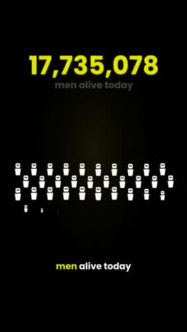](https://github.com/inematds/filme-em-codigo/releases/download/fonte-v1/genghis_brand_gideon.mp4)  
[▶ Ver o vídeo: genghis_brand_gideon.mp4](https://github.com/inematds/filme-em-codigo/releases/download/fonte-v1/genghis_brand_gideon.mp4)

*Estilo AI Samson*

### Estilo AI Samson

**Mesmo estilo, sua ideia**

> Crie um vídeo curto animado vertical de 10 a 20 segundos sobre [SUA IDEIA AQUI]. Tom: um explicador de tecnologia confiante que apresenta uma afirmação e depois aponta uma falha nela. Primeiro, escreva um roteiro de 5 ou 6 linhas (40 a 55 palavras, menos de 20 segundos falados), verifique todos os fatos na internet e liste as fontes. Escreva os números por extenso para a voz e em algarismos nas legendas. Estrutura das batidas: uma frase de abertura com um contador brilhante sobre uma grade de pessoas simples em blocos que se conectam a um herói brilhante; uma frase de evidência dentro de uma janela de aplicativo com cantos arredondados; uma frase com estatística em que uma de doze figuras se ilumina; uma frase sobre o mapa em que uma região aparece em uma transição e um império se espalha a partir de um ponto pulsante, seguida por barras horizontais que comparam tamanhos; uma frase de reviravolta em que um carimbo inclinado com “CASO ENCERRADO?” é riscado; e uma pergunta final em que o herói na raiz de uma árvore genealógica se transforma em uma figura contornada com um ponto de interrogação. Estilo: motion graphics em SVG plano sobre fundo preto puro #000000, com uma grade fina de pontos escuros e uma vinheta central suave, um único destaque amarelo #E3E302 com brilhos suaves, texto branco e linhas em cinza médio #5A5A5A, painéis escuros arredondados #141414 com três pontos de janela, tipografia Poppins Bold com algarismos tabulares e personagens simples em blocos (uma cabeça quadrada arredondada com uma fenda preta de visor sobre um corpo afunilado). Câmera: movimento e escala respirando muito lentamente no quadro todo, cenas com fades de cerca de 0.3 s, surgimento suave com recuo em cada elemento e uma trepidação de 8 frames na reviravolta. Mantenha todo o texto branco ou amarelo sobre preto para garantir o contraste. Legendas: Poppins Bold 92 px, brancas com contorno preto de 8 px, duas ou três palavras por tela perto da parte inferior; a palavra falada em amarelo #E3E302. Música: um arpejo de sintetizador sombrio por volta de 116 bpm que para na reviravolta. Efeitos sonoros: tique-taques sob o contador, subidas e brilhos nos números importantes, um efeito de disco riscado na reviravolta e uma nota grave de sintetizador na surpresa. Crie em Remotion (React) com three.js, 1080x1920 a 30 fps, sincronizando cada corte, evento e som com os tempos das palavras da voz. Sintetize toda a música e os efeitos em código, com a música cerca de 20 dB abaixo da voz e os efeitos logo abaixo dela.

<details><summary>Prompt original (inglês)</summary>

```text
Make a 10 to 20 second vertical animated short about [YOUR IDEA HERE]. Tone: a confident tech-explainer that builds a claim and then pokes a hole in it. First write a 5 or 6 line script (40 to 55 words, under 20 seconds spoken), fact-check every claim on the web and list the sources. Write numbers as words for the voice and digits in the captions. Beat structure: a hook line with a glowing counter over a grid of simple block people that link up to one glowing hero; an evidence line inside a rounded app window; a statistic line where one of twelve figures lights up; a map line where a region wipes in and an empire spreads from a pulsing dot, then horizontal bars compare sizes; a reversal line where a tilted "CASE CLOSED?" stamp gets struck through; and a payoff question where the hero at the root of a family tree turns into an outlined figure with a question mark. Style: flat SVG motion graphics on pure black #000000 with a fine dark dot grid and a soft central vignette, a single yellow accent #E3E302 with soft glows, white text and mid grey #5A5A5A lines, dark rounded panels #141414 with three window dots, Poppins Bold type with tabular figures, and simple block characters (a rounded square head with a black visor slot over a tapered body). Camera: a very slow drift and breathing scale on the whole frame, scene fades of about 0.3 s, back-eased pops on every element, and an 8-frame shake on the reversal. Keep all text white or yellow on black for contrast. Captions: Poppins Bold 92 px, white with an 8 px black outline, two or three words per page near the bottom, the spoken word in yellow #E3E302. Music: a dark synth arpeggio around 116 bpm that drops out for the reversal. Sound effects: ticks under the counter, risers and shimmers on key numbers, a record scratch on the reversal and a low synth stab on the twist. Build it in Remotion (React) with three.js, 1080x1920 at 30 fps, keying every cut, event and sound to word timestamps from the voice. Synthesise all music and effects in code, with the music about 20 dB under the voice and the effects just below it.
```

</details>

**Copiar este filme exato · Prompt exato**

> Recrie exatamente como descrito este vídeo curto vertical de motion graphics de 26 segundos sobre os descendentes de Genghis Khan. Narração, palavra por palavra (cerca de 26 segundos): “Cerca de vinte milhões de homens vivos hoje podem descender de um homem: Genghis Khan. Em 2003, geneticistas descobriram que um em cada doze homens em uma vasta região da Ásia tinha quase o mesmo cromossomo Y. Parecia ter se espalhado junto com o Império Mongol, o maior império terrestre da história. Caso encerrado? Ainda não. DNA de túmulos mongóis da época dele revelou uma linhagem diferente. Então, a árvore genealógica mais famosa do mundo talvez pertença a outra pessoa.” Aparência: tudo em SVG sobre fundo preto #000000, com uma grade fina de pontos (#1C1C1C a cada 40 px) e uma vinheta com um brilho amarelo-oliva discreto no centro. Amarelo #E3E302 é o único destaque, com brilhos suaves, além de texto branco, linhas cinza #5A5A5A e painéis escuros #141414 com bordas #2A2A2A. Tipografia Poppins Bold com algarismos tabulares. Os personagens são pessoas em blocos: uma cabeça quadrada arredondada com uma fenda preta de visor sobre um corpo afunilado. Os painéis são janelas de aplicativo arredondadas com três pontos no canto, o primeiro amarelo. Câmera: o quadro todo se move e respira muito lentamente; cada cena aparece em fade ao longo de cerca de 0.3 s e aumenta de escala suavemente; em “Ainda não”, o quadro treme por 8 frames. Cenas: (1) Um contador amarelo brilhante sobe até 20,000,000, de “Cerca de” até “hoje”, com “homens vivos hoje”, enquanto 60 pessoas brancas em blocos surgem abaixo; em “descender”, linhas cinza se desenham de cada pessoa até um ponto, e elas escurecem; em “um”, uma pessoa grande, amarela e brilhante surge ali; “Genghis Khan” aparece em amarelo. (2) 5.0 s: uma janela intitulada “Estudo do cromossomo Y”, com “2003” em tamanho grande e doze tubos de ensaio surgindo; o oitavo se enche de amarelo em “descobriram”. (3) 7.45 s: “1 em 12” sobre doze pessoas em blocos; a oitava se ilumina em “doze”. (4) 8.3 s: o contorno de um mapa escuro da Eurásia aparece; a região surge em amarelo do leste ao oeste em “vasta”; anéis surgem em “tinha”, com “Ásia”; em “espalhado”, um império amarelo brilhante cresce a partir de um ponto pulsante na Mongólia, com “Império Mongol”; em “maior”, o mapa desliza para cima, sobre barras horizontais: Mongol 24.0 (amarela), Russian 22.8, Qing 14.7 e Roman 5.0 milhões de km². (5) 16.35 s: uma janela “Arquivo do caso”; um carimbo amarelo “CASO ENCERRADO?” surge com impacto, inclinado; em “Ainda”, fica cinza, gira e um risco branco atravessa o carimbo, com “Ainda não” abaixo. (6) 18.45 s: quatro caixas isométricas de túmulos ganham bordas brancas em “túmulos”, com “Túmulos mongóis” e “1130 a 1250”; uma hélice de contas brancas sobe e se bifurca em “diferente”, em um ramo cinza “esperada” e um ramo amarelo brilhante “linhagem diferente”, cada um terminando em um glifo de cromossomo Y. (7) 22.05 s: uma árvore genealógica de pessoas em blocos sob uma raiz amarela brilhante e “Genghis Khan”; em “talvez”, um risco branco atravessa o nome; em “outra pessoa”, a raiz vira uma figura contornada com um ponto de interrogação amarelo e aparece “outra pessoa?”. Legendas: Poppins Bold 92 px, brancas com contorno preto de 8 px e sombra de 3 px, cerca de 330 px acima da parte inferior, duas ou três palavras por tela; a palavra falada em amarelo #E3E302. Música: um arpejo de sintetizador em Lá menor, com serras desafinadas por um filtro passa-baixa a 116 bpm e uma nota grave de baixo em cada compasso, que sai durante “Ainda não”. Efeitos sonoros: tique-taques rápidos enquanto o contador sobe, uma subida e brilho em “doze”, uma subida em “espalhado”, um efeito de disco riscado em “Ainda”, uma nota grave de sintetizador em “diferente” e um brilho prolongado em “outra pessoa”. Configuração técnica: Remotion (React) com three.js, 1080x1920 a 30 fps, cerca de 26 segundos. Gere a voz com qualquer mecanismo de conversão de texto em fala, obtenha os tempos das palavras e sincronize cada corte, evento e som com o início de sua palavra. Insira as legendas no vídeo. Sintetize toda a música e os efeitos em código, sem amostras. Mixe a música cerca de 20 dB abaixo da voz e reduza o volume durante a fala; deixe os efeitos logo abaixo da voz.

<details><summary>Prompt original (inglês)</summary>

```text
Recreate this 26 second vertical motion-graphics short about Genghis Khan's descendants exactly as described. Narration, word for word (about 26 seconds): "About twenty million men alive today may descend from one man: Genghis Khan. In 2003, geneticists found that one in twelve men across a huge stretch of Asia carried almost the same Y chromosome. It seemed to spread with the Mongol Empire, the largest land empire in history. Case closed? Not quite. DNA from Mongol graves of his time showed a different line. So the world's most famous family tree might belong to someone else." Look: all SVG on black #000000 with a fine dot grid (#1C1C1C every 40 px) and a vignette with a faint yellow-olive glow in the middle. Yellow #E3E302 is the only accent, with soft glows, plus white text, grey #5A5A5A lines and dark panels #141414 with #2A2A2A borders. Type is Poppins Bold with tabular figures. Characters are "block" people: a rounded square head with a black visor slot over a tapered body. Panels are rounded app windows with three corner dots, the first yellow. Camera: the whole frame drifts and breathes very slowly, each scene fades in over about 0.3 s and scales up gently, and on "Not" the frame shakes for 8 frames. Scenes: (1) A glowing yellow counter climbs to 20,000,000 from "About" to "today" with "men alive today" while 60 white block people pop in below; on "descend" grey lines draw from each to one point and they dim; on "one" a big glowing yellow person pops up there; "Genghis Khan" rises in yellow. (2) 5.0 s: a window titled "Y chromosome study" with "2003" huge and twelve test tubes popping in, the eighth filling yellow on "found". (3) 7.45 s: "1 in 12" over twelve block people, the eighth lighting yellow on "twelve". (4) 8.3 s: a dark map of Eurasia draws its outline; the region wipes in yellow east to west on "huge", rings pop on "carried" with "Asia"; on "spread" a glowing yellow empire grows from a pulsing dot in Mongolia with "Mongol Empire"; on "largest" the map slides up over horizontal bars: Mongol 24.0 (yellow), Russian 22.8, Qing 14.7 and Roman 5.0 million km². (5) 16.35 s: a "Case file" window; a yellow "CASE CLOSED?" stamp slams in tilted, and on "Not" it greys, turns and a white strike draws through it, with "Not quite" below. (6) 18.45 s: four isometric grave boxes that gain white edges on "graves", with "Mongol graves" and "1130 to 1250"; a white bead helix rises and forks on "different" into a grey "expected" branch and a glowing yellow "different line" branch, each ending in a Y chromosome glyph. (7) 22.05 s: a family tree of block people under a glowing yellow root and "Genghis Khan"; on "might" a white strike crosses the name, and on "someone" the root becomes an outlined figure with a yellow question mark and "someone else?" appears. Captions: Poppins Bold 92 px, white with an 8 px black outline and a 3 px shadow, about 330 px above the bottom, two or three words per page, the spoken word in yellow #E3E302. Music: a dark A minor synth arpeggio of detuned saws through a low-pass filter at 116 bpm with a deep bass note each bar, ducking out for "Not quite". Sound effects: fast ticks while the counter climbs, a riser and shimmer on "twelve", a riser on "spread", a record scratch on "Not", a low synth stab on "different" and a long shimmer on "someone". Technical setup: Remotion (React) with three.js, 1080x1920 at 30 fps, about 26 seconds. Make the voice with any text to speech engine, get word timestamps, and key every cut, event and sound to the start of its word. Burn the captions in. Synthesise all music and effects in code, with no samples. Mix the music about 20 dB under the voice and ducked under speech, with the effects just below the voice.
```

</details>

[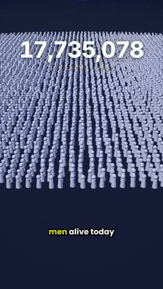](https://github.com/inematds/filme-em-codigo/releases/download/fonte-v1/genghis_data_gideon.mp4)  
[▶ Ver o vídeo: genghis_data_gideon.mp4](https://github.com/inematds/filme-em-codigo/releases/download/fonte-v1/genghis_data_gideon.mp4)

*Dados 3D*

### Dados em 3D

**Mesmo estilo, sua ideia**

> Crie um curta animado vertical de 10 a 20 segundos sobre [SUA IDEIA AQUI]. Tom: uma explicação jornalística com dados que constrói um argumento com números e depois o derruba. Primeiro, escreva um roteiro de 5 ou 6 linhas (40 a 55 palavras, com menos de 20 segundos de fala), verifique cada afirmação na web e liste as fontes. Escreva os números por extenso para a voz e em algarismos nas legendas. Estrutura das cenas: uma frase de abertura com um contador enorme subindo sobre um campo de milhares de figuras 3D minúsculas que se conectam a um personagem principal iluminado; uma frase com evidências em um laboratório e uma dupla hélice luminosa girando; uma frase com uma estatística e um pequeno grupo em que uma figura se ilumina; uma frase com um mapa, usando um mapa de colunas 3D da região que se ergue e se espalha em cores; uma frase comparativa com barras 3D e valores flutuantes; uma frase de reversão em que as colunas da teoria desabam e um risco vermelho cruza a afirmação; e uma pergunta final em um grafo de nós luminosos, onde o rótulo do personagem principal vira uma pergunta. Estilo: three.js em azul-marinho quase preto #060a16, com uma grade azul tênue no chão, geometria instanciada, detalhes luminosos em dourado #ffc23d, ciano #4cc9f0 e vermelho #ff5470, sem linhas de contorno ou desfoque. Sobreponha texto em HTML com Inter (números em peso 800, com algarismos tabulares; legendas em 600), que apareça palavra por palavra com fade e destaque. Câmera: movimentos suaves entre pontos-chave dentro de cada cena e cortes secos entre cenas, com um clarão branco na reversão. Legendas: Poppins Bold 92 px, brancas com contorno preto de 8 px, duas ou três palavras por tela perto da parte inferior; a palavra falada em amarelo #E3E302. Música: um arpejo de sintetizador sombrio, por volta de 116 bpm, que para na reversão. Efeitos sonoros: tiques durante a contagem, crescendos e brilhos nos números principais, som de disco arranhando na reversão e uma nota grave de sintetizador na reviravolta. Desenvolva em Remotion (React) com three.js, 1080x1920 a 30 fps, marcando cada corte, evento e som com os timestamps das palavras da voz. Sintetize toda a música e os efeitos em código, com a música cerca de 20 dB abaixo da voz e os efeitos logo abaixo dela.

<details><summary>Prompt original (inglês)</summary>

```text
Make a 10 to 20 second vertical animated short about [YOUR IDEA HERE]. Tone: a data-journalism explainer that builds a case with numbers and then overturns it. First write a 5 or 6 line script (40 to 55 words, under 20 seconds spoken), fact-check every claim on the web and list the sources. Write numbers as words for the voice and digits in the captions. Beat structure: a hook line with a huge counter climbing over a field of thousands of tiny 3D figures that link up to one glowing hero; an evidence line in a lab with a rotating glowing double helix; a statistic line with a small group where one figure lights up; a map line using a 3D column map of the region that rises and floods with colour; a comparison line with 3D bars and floating values; a reversal line where the theory columns collapse and a red strike crosses the claim; and a payoff question on a glowing node graph where the hero's label swaps to a question. Style: three.js on near-black navy #060a16 with a faint blue floor grid, instanced geometry, emissive accents in gold #ffc23d, cyan #4cc9f0 and red #ff5470, no ink lines or blur. Overlay HTML type in Inter (numbers at weight 800 with tabular figures, subtitles at 600) that fades and pops in on each word. Camera: smooth keyed glides within a beat and hard cuts between beats, with a white flash on the reversal. Captions: Poppins Bold 92 px, white with an 8 px black outline, two or three words per page near the bottom, the spoken word in yellow #E3E302. Music: a dark synth arpeggio around 116 bpm that drops out for the reversal. Sound effects: ticks under the counter, risers and shimmers on the key numbers, a record scratch on the reversal and a low synth stab on the twist. Build it in Remotion (React) with three.js, 1080x1920 at 30 fps, keying every cut, event and sound to word timestamps from the voice. Synthesise all music and effects in code, with the music about 20 dB under the voice and the effects just below it.
```

</details>

**Copiar este filme exato · Prompt exato**

> Recrie exatamente como descrito este vídeo curto vertical de visualização de dados em 3D, com 26 segundos, sobre os descendentes de Genghis Khan. Narração, palavra por palavra (cerca de 26 segundos): "Cerca de vinte milhões de homens vivos hoje talvez descendam de um homem: Genghis Khan. Em 2003, geneticistas descobriram que um em cada doze homens em uma vasta região da Ásia carregava quase o mesmo cromossomo Y. Parecia ter se espalhado com o Império Mongol, o maior império terrestre da história. Caso encerrado? Não exatamente. O DNA de túmulos mongóis da época dele mostrou uma linhagem diferente. Então, a árvore genealógica mais famosa do mundo talvez pertença a outra pessoa." Aparência: three.js em azul-marinho quase preto #060a16, com chão escuro #0a1124 e uma grade azul tênue #13204a, luz hemisférica fria e uma luz principal branca, sem linhas de contorno ou desfoque, saturação 10% maior. Cores de destaque: dourado #ffc23d, ciano #4cc9f0 e vermelho #ff5470 como luzes emissivas. Uma camada de texto em HTML usa Inter, números em peso 800 com algarismos tabulares e legendas em 600, com uma sombra escura suave. Câmera: movimentos suaves marcados por pontos-chave e cortes secos em 5.15, 7.6, 8.5, 15.0, 16.6, 18.6 e 22.2 s. Cenas: (1) Um campo de 9,900 homens brancos minúsculos, instanciados, visto de baixo; depois, a câmera sobe e recua enquanto "20,000,000" cresce de "Cerca de" até "hoje", com "homens vivos hoje" em dourado; em "descendam", 700 raios sobem até um homem dourado em uma coluna de luz e a multidão escurece para ardósia #55648f; "Genghis Khan" aparece em dourado. (2) Um laboratório com uma dupla hélice de contas luminosas girando e um plano de varredura; "2003" enorme e "geneticistas analisam o cromossomo Y" em ciano. (3) Doze homens sobre uma plataforma com "1 em 12"; um deles fica dourado em "doze". (4) Vista de cima de um mapa de colunas 3D da Eurásia, com uma caixa por célula terrestre de 2.5 graus: a região amostrada se ergue em dourado, de leste a oeste, em "vasta", com "uma vasta região da Ásia" e "quase o mesmo cromossomo Y"; em "espalhado", o império se expande da Mongólia em colunas vermelhas elevadas, com "Império Mongol". (5) Quatro barras 3D crescem para Mongol 24.0 (vermelho brilhante), Russo 22.8, Qing 14.7 e Romano 5.0, sob o título "maiores impérios terrestres, milhões de km²", com os valores flutuando acima. (6) De volta à vista do mapa, com "CASO ENCERRADO?" inclinado; em "Não", um clarão branco, as colunas douradas desabam e ficam cinzas, e um risco vermelho cruza a frase, com "Não exatamente." em vermelho. (7) Um marcador de túmulo enquanto o mapa escurece; uma hélice ciano sobe e se bifurca em "diferente", com "túmulos mongóis", "época dele: 1130 a 1250" e "esperado vs. uma linhagem diferente". (8) Uma árvore genealógica luminosa de nós e linhas sob uma raiz dourada "Genghis Khan", que fica cinza em "talvez" e se torna ciano "outra pessoa?" em "pessoa". Legendas: Poppins Bold 92 px, brancas, com contorno preto de 8 px e sombra de 3 px, cerca de 330 px acima da parte inferior, duas ou três palavras por tela; a palavra falada em amarelo #E3E302. Música: um arpejo sombrio em lá menor, com ondas dente de serra desafinadas por um filtro passa-baixa a 116 bpm e uma nota grave de baixo a cada compasso, que diminui durante "Não exatamente". Efeitos sonoros: tiques rápidos enquanto o contador sobe, um crescendo e brilho em "doze", um crescendo em "espalhado", som de disco arranhando em "Não", uma nota grave de sintetizador em "diferente" e um brilho longo em "pessoa". Configuração técnica: Remotion (React) com three.js, 1080x1920, a 30 fps, cerca de 26 segundos. Gere a voz com qualquer mecanismo de conversão de texto em fala, obtenha os timestamps das palavras e marque cada corte, evento e som no início da palavra correspondente. Grave as legendas no vídeo. Sintetize toda a música e os efeitos em código, sem amostras. Mixe a música cerca de 20 dB abaixo da voz e reduza seu volume durante a fala; deixe os efeitos logo abaixo da voz.

<details><summary>Prompt original (inglês)</summary>

```text
Recreate this 26 second vertical 3D data-visualisation short about Genghis Khan's descendants exactly as described. Narration, word for word (about 26 seconds): "About twenty million men alive today may descend from one man: Genghis Khan. In 2003, geneticists found that one in twelve men across a huge stretch of Asia carried almost the same Y chromosome. It seemed to spread with the Mongol Empire, the largest land empire in history. Case closed? Not quite. DNA from Mongol graves of his time showed a different line. So the world's most famous family tree might belong to someone else." Look: three.js on near-black navy #060a16 with a dark floor #0a1124 and a faint blue grid #13204a, a cool hemisphere light and a white key, no ink lines or blur, saturation up 10 percent. Accents: gold #ffc23d, cyan #4cc9f0 and red #ff5470 as glowing emissives. An HTML type layer uses Inter, numbers at weight 800 with tabular figures and subtitles at 600, with a soft dark shadow. Camera: keyed glides with hard cuts at 5.15, 7.6, 8.5, 15.0, 16.6, 18.6 and 22.2 s. Beats: (1) A field of 9,900 tiny white instanced men seen low, then a crane up and back as "20,000,000" climbs from "About" to "today" with "men alive today" in gold; on "descend" 700 rays draw up to one gold man on a light column and the crowd dims to slate #55648f; "Genghis Khan" pops in gold. (2) A lab with a rotating double helix of glowing beads and a scan plane, "2003" huge and "geneticists scan the Y chromosome" in cyan. (3) Twelve men on a platform with "1 in 12"; one turns gold on "twelve". (4) Top-down on a 3D column map of Eurasia, one box per 2.5 degree land cell: the sampled region rises in gold east to west on "huge" with "a huge stretch of Asia" and "almost the same Y chromosome"; on "spread" the empire floods out from Mongolia in red raised columns with "Mongol Empire". (5) Four 3D bars grow to Mongol 24.0 (glowing red), Russian 22.8, Qing 14.7 and Roman 5.0 under "largest land empires, million km²", with values floating above. (6) Back over the map with "CASE CLOSED?" tilted; on "Not" a white flash, the gold columns collapse to grey and a red strike crosses it, with "Not quite." in red. (7) A grave pin as the map darkens; a cyan helix rises and forks on "different", with "Mongol graves", "his time: 1130 to 1250" and "expected vs a different line". (8) A glowing node-and-line family tree under a gold "Genghis Khan" root, which greys on "might" and becomes cyan "someone else?" on "someone". Captions: Poppins Bold 92 px, white with an 8 px black outline and a 3 px shadow, about 330 px above the bottom, two or three words per page, the spoken word in yellow #E3E302. Music: a dark A minor synth arpeggio of detuned saws through a low-pass filter at 116 bpm with a deep bass note each bar, ducking out for "Not quite". Sound effects: fast ticks while the counter climbs, a riser and shimmer on "twelve", a riser on "spread", a record scratch on "Not", a low synth stab on "different" and a long shimmer on "someone". Technical setup: Remotion (React) with three.js, 1080x1920 at 30 fps, about 26 seconds. Make the voice with any text to speech engine, get word timestamps, and key every cut, event and sound to the start of its word. Burn the captions in. Synthesise all music and effects in code, with no samples. Mix the music about 20 dB under the voice and ducked under speech, with the effects just below the voice.
```

</details>

[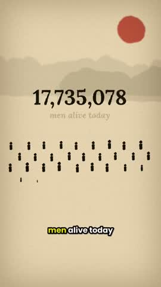](https://github.com/inematds/filme-em-codigo/releases/download/fonte-v1/genghis_ink_gideon.mp4)  
[▶ Ver o vídeo: genghis_ink_gideon.mp4](https://github.com/inematds/filme-em-codigo/releases/download/fonte-v1/genghis_ink_gideon.mp4)

*Pergaminho com tinta*

### Rolo de tinta

**Mesmo estilo, sua ideia**

> Crie um curta-metragem animado vertical de 10 a 20 segundos sobre [SUA IDEIA AQUI]. Tom: uma história histórica tranquila e acadêmica, com uma reviravolta. Primeiro, escreva um roteiro de 5 ou 6 linhas (40 a 55 palavras, menos de 20 segundos de fala), verifique os fatos de cada afirmação na internet e liste as fontes. Escreva os números por extenso para a narração e em algarismos nas legendas. Estrutura das cenas: uma frase de abertura com um número grande aumentando sobre uma multidão de pequenas figuras desenhadas a pincel que se conectam a um herói; uma frase sobre as evidências, com uma data grande e um instrumento desenhado a pincel; uma frase com uma estatística, com figuras surgindo e uma delas ficando vermelha; uma cena com mapa, cujo contorno se desenha e sobre o qual se espalha uma mancha vermelha, com faixas de pergaminho penduradas como um gráfico de barras; uma frase de reviravolta, em que um traço de tinta corta um cartão de “caso encerrado”; e uma pergunta final, em que um selo vermelho com um ponto de interrogação é carimbado sobre o selo do herói. Estilo: um pergaminho ilustrado à mão em sumi-e, sobre papel de arroz quente #efe4cc, com textura granulada e vinheta marrom, tinta #161310 e #3b342c, vermelho de selo #b3261e, fonte serifada Lora Bold com legendas em itálico. Desenhe tudo em SVG usando um filtro de deslocamento por turbulência para dar aparência de pinceladas, anime as pinceladas se formando e dê aos selos uma textura pontilhada de carimbo. Disponha a história em um único pergaminho comprido, dividido em painéis de 1080 px, e mova a câmera para os lados de um painel a outro a cada cena, enquanto montanhas esmaecidas se movem mais devagar ao fundo, criando paralaxe; adicione uma pequena tremida na reviravolta. Legendas: Poppins Bold 92 px, brancas com contorno preto de 8 px, duas ou três palavras por página, perto da parte inferior; destaque em amarelo #E3E302 a palavra que está sendo falada. Música: frases de flauta suave em escala pentatônica sobre notas lentas e graves de cítara. Efeitos sonoros: batidas graves de taiko na abertura, na reviravolta e na revelação, e um leve brilho sonoro na estatística principal. Crie tudo em Remotion (React) com three.js, em 1080x1920 a 30 fps, marcando cada corte, evento e som com os tempos das palavras na narração. Sintetize toda a música e os efeitos em código, com a música cerca de 20 dB abaixo da voz e os efeitos um pouco abaixo dela.

<details><summary>Prompt original (inglês)</summary>

```text
Make a 10 to 20 second vertical animated short about [YOUR IDEA HERE]. Tone: a calm, scholarly history story with one twist. First write a 5 or 6 line script (40 to 55 words, under 20 seconds spoken), fact-check every claim on the web and list the sources. Write numbers as words for the voice and digits in the captions. Beat structure: a hook line with a big number counting up over a crowd of tiny brush figures that link to one hero; an evidence line with a large date and a brush-drawn instrument; a statistic line with figures popping in and one turning red; a map line where an outline draws itself and a red wash spreads, with hanging scroll banners as a bar chart; a reversal line where one ink slash cuts across a "case closed" card; and a payoff question where a red seal with a question mark stamps over the hero's seal. Style: a sumi-e handscroll on warm rice paper #efe4cc with grain and a brown vignette, ink #161310 and #3b342c, seal red #b3261e, Lora Bold serif type with italic subtitles. Draw everything as SVG through a turbulence displacement filter so it looks brushed, animate strokes drawing on, and give seals a speckled stamp texture. Lay the story out as one long scroll of 1080 px panels and glide the camera sideways from panel to panel on each beat with washed mountains drifting slower behind for parallax and a small shake on the reversal. Captions: Poppins Bold 92 px, white with an 8 px black outline, two or three words per page near the bottom, the spoken word in yellow #E3E302. Music: breathy flute phrases on a pentatonic scale over slow low zither plucks. Sound effects: deep taiko hits on the hook, the reversal and the reveal, and a soft shimmer on the key statistic. Build it in Remotion (React) with three.js, 1080x1920 at 30 fps, keying every cut, event and sound to word timestamps from the voice. Synthesise all music and effects in code, with the music about 20 dB under the voice and the effects just below it.
```

</details>

**Copiar este filme exato · Prompt exato**

> Recrie este curta vertical de 26 segundos sobre os descendentes de Genghis Khan como um pergaminho ilustrado em tinta sumi-e, exatamente como descrito. Narração, palavra por palavra (cerca de 26 segundos): “Cerca de vinte milhões de homens vivos hoje talvez descendam de um só homem: Genghis Khan. Em 2003, geneticistas descobriram que um em cada doze homens, numa vasta região da Ásia, tinha praticamente o mesmo cromossomo Y. Parecia ter se espalhado com o Império Mongol, o maior império territorial da história. Caso encerrado? Ainda não. O DNA de túmulos mongóis da época dele revelou uma linhagem diferente. Então, a árvore genealógica mais famosa do mundo talvez pertença a outra pessoa.” Aparência: tinta de pincel sobre papel de arroz #efe4cc com textura de papel multiplicada e vinheta interna marrom; tinta #161310 e #3b342c, aguadas marrons translúcidas e vermelho de selo #b3261e. Desenhe tudo em SVG usando um filtro de deslocamento por turbulência para que as bordas pareçam pinceladas; faça os traços se formarem com stroke-dash e dê aos selos vermelhos uma textura pontilhada de carimbo. Use Lora Bold em tinta, com legendas em itálico; os selos usam uma fonte serifada CJK pesada. Montanhas esmaecidas se movem a um quarto da velocidade da câmera, e um sol vermelho fica no canto superior direito até 16 s. Câmera: um único pergaminho comprido com sete painéis de 1080 px; a câmera desliza para o lado até o painel seguinte em 0, 5.0, 7.45, 8.3, 16.4, 18.45 e 22.05 s, com suavização de 0.7 s e leve balanço, além de uma tremida de 8 quadros em “Ainda”. Painéis: (1) Um contador aumenta até 20,000,000, de “Cerca de” até “hoje”, com “homens vivos hoje”; 54 figuras desenhadas a pincel aparecem abaixo; em “descendam”, fios de tinta saem de cada figura e se encontram em um ponto, então desaparecem; em “um só”, surge ali uma figura grande de chapéu; em “Genghis”, um selo vermelho 成吉思汗 é carimbado acima, e “Genghis Khan” aparece em “Khan”. (2) “2003” em algarismos enormes; um microscópio desenhado a pincel, traço por traço, em “geneticistas”; e três tubos de ensaio, com o do meio vermelho. (3) “1 em 12”, com doze figuras surgindo; a oitava fica vermelha em “doze”. (4) O contorno da Eurásia se desenha; em “vasta”, uma mancha escura se espalha de leste a oeste; em “tinha”, pontos vermelhos aparecem com “Ásia”; em “espalhado”, uma mancha vermelha do império cresce a partir da Mongólia, enquanto seis cavaleiros desenhados a pincel partem; “Império Mongol” em vermelho; em “maior”, o mapa desliza para cima e quatro faixas de pergaminho penduradas se desenrolam conforme a área: Mongol 24.0 (vermelho), Russo 22.8, Qing 14.7 e Romano 5.0 million km². (5) Um cartão entre duas hastes de pergaminho diz “Caso encerrado?”; um selo vermelho 結案 é carimbado em “encerrado”; em “Ainda”, um grosso traço de tinta corta o cartão, com respingos, e aparece “Ainda não.” (6) Uma colina tumular se forma com aguadas; ossos aparecem em “túmulos”, junto de “túmulos mongóis” e “da época dele, 1130 a 1250”; uma hélice sobe do túmulo e se bifurca em “diferente”: um ramo apagado, “esperado”, e um ramo vermelho, “uma linhagem diferente”. (7) Uma árvore genealógica de figuras desenhadas a pincel se ramifica para baixo a partir de “família”, sob o selo e “a árvore genealógica mais famosa”; o selo desaparece em “talvez”; em “pessoa”, um selo vermelho com ponto de interrogação é carimbado e aparece “outra pessoa?” em itálico vermelho. Legendas: Poppins Bold 92 px, brancas com contorno preto de 8 px e sombra de 3 px, a cerca de 330 px da parte inferior, duas ou três palavras por página; destaque em amarelo #E3E302 a palavra que está sendo falada. Música: frases de flauta de bambu suave em pentatônica de Lá menor sobre notas lentas e graves de cítara. Efeitos sonoros: batidas graves de taiko no início e em “Khan”, “encerrado”, “Ainda”, “diferente” e “pessoa”; um brilho sonoro em “doze” e um galope suave sob os cavaleiros. Configuração técnica: Remotion (React) com three.js, 1080x1920 a 30 fps, cerca de 26 segundos. Crie a voz com qualquer mecanismo de conversão de texto em fala, obtenha os tempos das palavras e sincronize cada corte, evento e som com o início da palavra correspondente. Grave as legendas no vídeo. Sintetize toda a música e os efeitos em código, sem amostras. Misture a música cerca de 20 dB abaixo da voz e reduza seu volume sob a fala; deixe os efeitos um pouco abaixo da voz.

<details><summary>Prompt original (inglês)</summary>

```text
Recreate this 26 second vertical short about Genghis Khan's descendants as a sumi-e ink handscroll, exactly as described. Narration, word for word (about 26 seconds): "About twenty million men alive today may descend from one man: Genghis Khan. In 2003, geneticists found that one in twelve men across a huge stretch of Asia carried almost the same Y chromosome. It seemed to spread with the Mongol Empire, the largest land empire in history. Case closed? Not quite. DNA from Mongol graves of his time showed a different line. So the world's most famous family tree might belong to someone else." Look: brush ink on rice paper #efe4cc with multiplied paper grain and a brown inner vignette; ink #161310 and #3b342c, translucent brown washes and seal red #b3261e. Draw everything in SVG through a turbulence displacement filter so edges look brushed, draw strokes on with stroke-dash, and give red seals a speckled stamp texture. Type is Lora Bold in ink with italic subtitles; seals use a heavy CJK serif. Washed mountains drift at a quarter of the camera speed, and a red sun sits top right until 16 s. Camera: one long scroll of seven 1080 px panels; the camera glides sideways to the next panel at 0, 5.0, 7.45, 8.3, 16.4, 18.45 and 22.05 s with a 0.7 s ease and a slight sway, plus an 8-frame shake on "Not". Panels: (1) A counter climbs to 20,000,000 from "About" to "today" with "men alive today"; 54 brush figures pop in below; on "descend" ink threads draw from each to one point and they fade; on "one" a big hatted figure pops there; on "Genghis" a red seal 成吉思汗 stamps above, and "Genghis Khan" appears on "Khan". (2) "2003" in huge numerals, a brush microscope drawn stroke by stroke on "geneticists", and three test tubes, the middle one red. (3) "1 in 12" with twelve figures popping in, the eighth turning red on "twelve". (4) Eurasia outlines itself, a dark wash region wipes in east to west on "huge" and red dots pop on "carried" with "Asia"; on "spread" a red wash empire grows from Mongolia as six brush riders ride out, with "Mongol Empire" in red; on "largest" the map slides up and four hanging scroll banners unroll by area: Mongol 24.0 (red), Russian 22.8, Qing 14.7 and Roman 5.0 million km². (5) A card between scroll rods reads "Case closed?", a red 結案 seal stamps on "closed", and on "Not" one thick ink slash cuts across with splatter and "Not quite." appears. (6) A grave mound washes in, bones appear on "graves" with "Mongol graves" and "of his time, 1130 to 1250", a helix rises from it and forks on "different" into a faint "expected" branch and a red "a different line" branch. (7) A family tree of brush figures branches down from "family" under the seal and "the most famous family tree"; the seal fades on "might", and on "someone" a red seal with a question mark stamps in with "someone else?" in red italics. Captions: Poppins Bold 92 px, white with an 8 px black outline and a 3 px shadow, about 330 px above the bottom, two or three words per page, the spoken word in yellow #E3E302. Music: breathy bamboo-flute phrases on A minor pentatonic over slow low zither plucks. Sound effects: deep taiko hits at the start and on "Khan", "closed", "Not", "different" and "someone", a shimmer on "twelve" and a soft gallop under the riders. Technical setup: Remotion (React) with three.js, 1080x1920 at 30 fps, about 26 seconds. Make the voice with any text to speech engine, get word timestamps, and key every cut, event and sound to the start of its word. Burn the captions in. Synthesise all music and effects in code, with no samples. Mix the music about 20 dB under the voice and ducked under speech, with the effects just below the voice.
```

</details>

[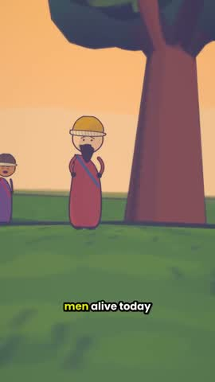](https://github.com/inematds/filme-em-codigo/releases/download/fonte-v1/genghis_toon_gideon.mp4)  
[▶ Ver o vídeo: genghis_toon_gideon.mp4](https://github.com/inematds/filme-em-codigo/releases/download/fonte-v1/genghis_toon_gideon.mp4)

*3D de desenho animado*

### Desenho animado 3D

**Mesmo estilo, sua ideia**

> Crie um curta animado vertical de 10 a 20 segundos sobre [SUA IDEIA AQUI]. Tom: uma reviravolta que mistura ciência e história e derruba uma afirmação famosa. Primeiro, escreva um roteiro de 5 ou 6 linhas (40 a 55 palavras, menos de 20 segundos de fala), confira todos os fatos na web e liste as fontes. Escreva os números por extenso para a narração e use algarismos nas legendas. Estrutura das cenas: uma frase de impacto com um número enorme, mostrado com uma multidão surgindo atrás de um herói; uma frase sobre evidências, com cientistas e uma fila de pessoas, uma das quais fica dourada; uma frase sobre a expansão, em um plano aberto de grua sobre a paisagem, com cavaleiros ou viajantes atravessando-a; uma reviravolta no estilo “Caso encerrado? Ainda não.”, com clarão, efeito de disco riscado e ponto de interrogação; uma frase sobre novas evidências em um sítio de escavação; e uma pergunta de encerramento em que o herói desaparece e um grande ponto de interrogação toma seu lugar. Estilo: personagens 2D desenhados à mão em placas voltadas para a câmera (contorno de tinta ameixa #241726, preenchimentos chapados, olhos grandes e brancos, piscando), dentro de um mundo 3D com sombreamento toon feito de formas geométricas simples, com uma etapa final que adiciona linhas de tinta quase pretas de 5 px nas bordas de profundidade, desfoque do fundo em planos fechados, sombras frias, realces quentes e uma vinheta suave. Céu de #4f8fdc até um horizonte pálido, mudando para tons dourados, de crepúsculo ou azul-noturno quando o clima mudar. Use uma paisagem 3D ondulada com objetos de época que combinem com o tema e luz dourada na primeira e na última cenas. Câmera: um plano por cena, cada um com um movimento suave de interpolação smootherstep e uma aproximação lenta, cortes secos, giros sutis, um clarão branco depois da abertura e um breve impacto de câmera em cada grande momento. Legendas: Poppins Bold 92 px, brancas, com contorno preto de 8 px, duas ou três palavras por tela perto da parte de baixo; a palavra falada fica amarela #E3E302. Música: melodia pentatônica de cordas dedilhadas com tambores taiko suaves, que para na reviravolta. Efeitos sonoros: sons de galope ou viagem, um brilho nas evidências, efeito de disco riscado na reviravolta e uma batida grave de tambor na revelação final. Crie no Remotion (React) com three.js, em 1080x1920 a 30 fps, sincronizando cada corte, evento e som com as marcações de tempo das palavras na voz. Sintetize toda a música e os efeitos em código, com a música cerca de 20 dB abaixo da voz e os efeitos um pouco mais baixos.

<details><summary>Prompt original (inglês)</summary>

```text
Make a 10 to 20 second vertical animated short about [YOUR IDEA HERE]. Tone: a science-meets-history twist where a famous claim gets overturned. First write a 5 or 6 line script (40 to 55 words, under 20 seconds spoken), fact-check every claim on the web and list the sources. Write numbers as words for the voice and digits in the captions. Beat structure: a hook line with a huge number, shown as a crowd popping in behind one hero figure; an evidence line with scientists and a line of people where one turns gold; a spread line on a wide crane shot over the landscape with riders or travellers crossing it; a "Case closed? Not quite." style reversal with a flash, record scratch and a question mark; a new-evidence line at a dig site; and a payoff question where the hero vanishes and a big question mark takes his place. Style: flat 2D hand-drawn characters on camera-facing billboards (plum ink outline #241726, flat fills, big white eyes, blinking) inside a 3D toon-shaded world of simple primitives, with a post pass of near-black 5 px ink lines from depth edges, background blur on close shots, cool shadows, warm highlights and a soft vignette. Sky from #4f8fdc to a pale horizon, switching to golden, dusk or night blue when the mood changes. Use a rolling 3D landscape with period props that fit the topic, and golden light for the first and last beats. Camera: one shot per beat, each a smootherstep glide with a slow push-in, hard cuts, gentle rolls, a white flash after the hook and a short camera kick on every big hit. Captions: Poppins Bold 92 px, white with an 8 px black outline, two or three words per page near the bottom, the spoken word in yellow #E3E302. Music: a pentatonic plucked-string melody with soft taiko drums that drops out for the reversal. Sound effects: galloping or travel sounds, a shimmer on the evidence, a record scratch on the reversal and a deep drum on the final reveal. Build it in Remotion (React) with three.js, 1080x1920 at 30 fps, keying every cut, event and sound to word timestamps from the voice. Synthesise all music and effects in code, with the music about 20 dB under the voice and the effects just below it.
```

</details>

**Copiar este filme exato · Prompt exato**

> Recrie exatamente como descrito este curta vertical em desenho animado, de 26 segundos, sobre os descendentes de Genghis Khan. Narração, palavra por palavra (cerca de 26 segundos): "Cerca de vinte milhões de homens vivos hoje podem descender de um homem: Genghis Khan. Em 2003, geneticistas descobriram que um em cada doze homens numa enorme área da Ásia tinha quase o mesmo cromossomo Y. Parecia ter se espalhado com o Império Mongol, o maior império terrestre da história. Caso encerrado? Ainda não. O DNA de túmulos mongóis da época dele revelou uma linhagem diferente. Então, a árvore genealógica mais famosa do mundo talvez pertença a outra pessoa." Visual: personagens 2D desenhados à mão em placas voltadas para a câmera (contorno de tinta ameixa #241726, preenchimentos chapados, olhos grandes e brancos, piscando, sombras de contato ovais), dentro de um mundo 3D com sombreamento toon feito de formas geométricas simples e uma rampa de sombreamento rígida de dois tons. Uma etapa final adiciona linhas de tinta quase pretas, com cerca de 5 px de espessura, nas bordas de profundidade, desfoque de lente no fundo em planos fechados, um tom azulado nas sombras, realces quentes, 8 por cento a mais de saturação e uma vinheta suave. O mundo: colinas onduladas e verdes da estepe (textura de grama #c9e0a0) sob um céu que vai de #4f8fdc a #d8e6f2, montanhas pintadas em azul-claro ao longe, gers de feltro brancas espalhadas (#f2ead8, com faixas vermelhas #c0352a e azuis #2f5a9a e portas vermelhas), uma colina isolada, uma vala de escavação com terra escura e uma árvore genealógica gigante de desenho animado numa colina distante (casca marrom #7a5236, copas arredondadas #4f9a46 e #6fb85a). As primeiras e últimas cenas têm luz dourada (céu de #ffb46a a #f2c69a). O Khan usa um manto vermelho, chapéu de pele dourado, faixa azul, barba e bigode pretos; os nômades usam mantos azuis, roxos, oliva e ferrugem, com chapéus de pele; os cientistas usam jalecos brancos. Cenas: (1) de 0 a 4,95 s: ângulo baixo e próximo do Khan em pé, orgulhoso, sobre sua colina, mãos na cintura; de “Cerca de” até “Khan”, uma multidão de 34 nômades surge atrás dele, fileira por fileira, acenando; clarão branco em 4,85 s. (2) de 4,95 a 12,45 s, “Em 2003”: dois cientistas, um com prancheta, diante de uma fila de doze nômades; em “doze”, um homem fica dourado e o cientista se espanta; em “cromossomo”, uma hélice de DNA surge acima deles. (3) de 12,45 a 16,5 s, “Parecia se espalhar”: plano aberto e alto de grua sobre a estepe e os gers enquanto nove cavaleiros galopam pelas colinas. (4) de 16,5 a 18,35 s, “Caso encerrado?”: plano próximo dos dois cientistas, convencidos, com o polegar para cima; em “Ainda não”, um deles ergue os braços, surge um ponto de interrogação, há um clarão branco e a câmera gira com um impacto. (5) de 18,35 a 21,95 s, “O DNA de túmulos mongóis”: um escavador de chapéu de sol aponta para ossos na vala, sob sombras mais frias; em “DNA”, surge uma hélice e, em “diferente”, o escavador pula assustado sob um ponto de interrogação, com um impacto. (6) de 21,95 s até o fim, em tons dourados: o Khan fica orgulhoso sob a árvore genealógica gigante, cercado por 26 nômades felizes; em “outra pessoa”, ele desaparece e um grande ponto de interrogação toma seu lugar, enquanto a multidão fica assustada. Câmera: cada plano tem um movimento suave de interpolação smootherstep com uma aproximação lenta e gradual, cortes secos entre planos, giros de 2 a 4 graus e um impacto de câmera que diminui ao longo de 7 quadros nos grandes momentos. Legendas: Poppins Bold 92 px, brancas, com contorno preto de 8 px e sombra de 3 px, cerca de 330 px acima da parte inferior, duas ou três palavras por tela; a palavra falada fica amarela #E3E302. Música: melodia pentatônica em lá menor numa cítara dedilhada, com baixo de cítara e tambores suaves no estilo taiko a 120 bpm, quase parando durante “Ainda não”. Efeitos sonoros: galope suave de cascos no início e um galope longo durante os cavaleiros, brilho cintilante em “doze” e “cromossomo”, efeito de disco riscado em “Ainda não” e batida grave de tambor em “outra pessoa”. Configuração técnica: Remotion (React) com three.js, 1080x1920 a 30 fps, cerca de 26 segundos. Gere a voz com qualquer mecanismo de conversão de texto em fala, obtenha as marcações de tempo das palavras e sincronize cada corte, evento e som com o início da palavra correspondente. Grave as legendas no vídeo. Sintetize toda a música e os efeitos em código, sem samples. Misture a música cerca de 20 dB abaixo da voz e reduza seu volume durante a fala; deixe os efeitos um pouco abaixo da voz.

<details><summary>Prompt original (inglês)</summary>

```text
Recreate this 26 second vertical cartoon short about Genghis Khan's descendants exactly as described. Narration, word for word (about 26 seconds): "About twenty million men alive today may descend from one man: Genghis Khan. In 2003, geneticists found that one in twelve men across a huge stretch of Asia carried almost the same Y chromosome. It seemed to spread with the Mongol Empire, the largest land empire in history. Case closed? Not quite. DNA from Mongol graves of his time showed a different line. So the world's most famous family tree might belong to someone else." Look: flat 2D hand-drawn characters on camera-facing billboards (plum ink outline #241726, flat fills, big white eyes, blinking, oval contact shadows) inside a 3D toon-shaded world of simple primitives with a hard two-tone shading ramp. A post pass adds near-black ink lines about 5 px thick from depth edges, background lens blur on close shots, a cool blue lift in the shadows, warm highlights, 8 percent extra saturation and a soft vignette. The world: rolling green steppe hills (#c9e0a0 grass texture) under a sky from #4f8fdc to #d8e6f2, pale blue painted mountains in the distance, scattered white felt gers (#f2ead8 with red #c0352a and blue #2f5a9a bands and red doors), a lone hill, an excavation pit with dark earth, and a giant cartoon family tree on a far hill (brown bark #7a5236, round foliage clouds #4f9a46 and #6fb85a). The first and last beats are golden light (sky #ffb46a to #f2c69a). The khan wears a red robe, a gold fur hat, a blue sash, a black beard and moustache; the nomads wear blue, purple, olive and rust robes with fur hats; the scientists wear white coats. Beats: (1) 0 to 4.95 s: low close angle on the khan standing proudly on his hill, hands on hips; from "About" to "Khan" a crowd of 34 nomads pops in behind him row by row, waving; a white flash at 4.85 s. (2) 4.95 to 12.45 s, "In 2003": two scientists, one with a clipboard, in front of a line of twelve nomads; on "twelve" one man turns gold and the scientist looks shocked; on "chromosome" a DNA helix pops up above them. (3) 12.45 to 16.5 s, "It seemed to spread": a wide high crane over the steppe and gers as nine riders on horseback gallop across the hills. (4) 16.5 to 18.35 s, "Case closed?": a close two-shot of the scientists, smug with a thumbs up; on "Not" one throws up his arms, a question mark appears, a white flash, and the camera roll flips with a kick. (5) 18.35 to 21.95 s, "DNA from Mongol graves": a digger in a sun hat points at bones in the pit with cooler shadows; on "DNA" a helix appears and on "different" the digger jumps in shock under a question mark, with a kick. (6) 21.95 s to the end, golden: the khan stands proudly under the giant family tree ringed by 26 happy nomads; on "someone" he vanishes and a big question mark takes his place while the crowd turns shocked. Camera: each shot is a smootherstep glide with a slow creeping push-in, hard cuts between shots, 2 to 4 degree rolls, and a 7-frame decaying camera kick on big hits. Captions: Poppins Bold 92 px, white with an 8 px black outline and a 3 px shadow, about 330 px above the bottom, two or three words per page, the spoken word in yellow #E3E302. Music: an A minor pentatonic melody on a plucked zither with a low zither bass and soft taiko-style drums at 120 bpm, dropping almost to silence for "Not quite". Sound effects: a soft hoof gallop at the start and a long gallop under the riders, a sparkling shimmer on "twelve" and "chromosome", a record scratch on "Not", and a deep drum hit on "someone". Technical setup: Remotion (React) with three.js, 1080x1920 at 30 fps, about 26 seconds. Make the voice with any text to speech engine, get word timestamps, and key every cut, event and sound to the start of its word. Burn the captions in. Synthesise all music and effects in code, with no samples. Mix the music about 20 dB under the voice and ducked under speech, with the effects just below the voice.
```

</details>

[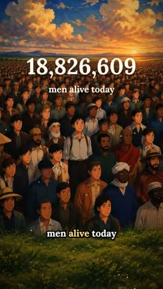](https://github.com/inematds/filme-em-codigo/releases/download/fonte-v1/style_ghibli_julian.mp4)  
[▶ Ver o vídeo: style_ghibli_julian.mp4](https://github.com/inematds/filme-em-codigo/releases/download/fonte-v1/style_ghibli_julian.mp4)

*Filme de anime pintado (no estilo do Studio Ghibli)*

### Filme de anime pintado

**Mesmo estilo, sua ideia**

> Crie um curta animado vertical de 10 a 20 segundos sobre [SUA IDEIA AQUI]. Tom: uma breve história ou narrativa científica com uma reviravolta. Primeiro, escreva um roteiro de 5 ou 6 linhas (40 a 55 palavras, menos de 20 segundos de fala), verifique todos os fatos na web e liste as fontes. Escreva os números por extenso para a voz e em algarismos nas legendas. Estrutura das batidas: uma frase de abertura com um número grande sobre uma imagem panorâmica de apresentação; uma frase sobre o personagem principal; uma frase de evidência com uma estatística exibida como uma grade de símbolos, com um deles acendendo; uma frase com mapa ou diagrama em um painel estilizado sobre um quadro-chave desfocado e escurecido; uma frase de reviravolta em que uma afirmação é riscada; e uma pergunta final. Planeje cerca de sete quadros-chave, um por batida. Estilo de cada quadro-chave: visual de longa-metragem de animação japonesa pintado à mão, fundos exuberantes pintados com guache e aquarela, nuvens cúmulos macias e fofas, luz dourada acolhedora e nostálgica, personagens de design simples e delicado, com rostos pequenos e expressivos, personagens com sombreamento cel sobre cenários ricamente pintados. Escreva cada prompt de quadro-chave nesta ordem: o tema, depois a frase de estilo e, em seguida, "Composição vertical 9:16, com o tema principal no meio do quadro e o quarto inferior mais tranquilo. Sem texto, letras, logotipos ou marca-d'água." e gere as imagens em 9:16. Anime cada quadro-chave em um shader WebGL: crie um mapa de profundidade com um modelo de profundidade monocular, desloque a amostragem de acordo com a profundidade para simular uma câmera com paralaxe, balance o primeiro plano próximo, faça o céu distante se deslocar bastante para os lados e não use line boil (line boil é uma pequena distorção ruidosa que muda 8 vezes por segundo). Câmera: um movimento lento e onírico (zoom com easing de 1.06 a 1.14, leve balanço lateral em seno e uma subida lenta). Transições: dissolução cruzada de 0.6 s. Textos na tela: serifada Lora Bold em branco quente #fffaf0 com sombra escura suave e destaque #ffd27a. Painéis e sobreposições: a mesma paleta, mais pontos de luz quente flutuantes, vinheta suave e granulação fina de filme. Legendas: Lora Bold em 92 px, brancas, com contorno preto de 8 px; duas ou três palavras por tela, perto da parte inferior; a palavra falada em #FFD27A. Música: frases suaves de flauta com sopro, em escala pentatônica, sobre notas graves e lentas de cítara. Efeitos sonoros: batidas graves de tambor na abertura, na reviravolta e na revelação, e um brilho sonoro na estatística principal. Crie em Remotion (React) com three.js, em 1080x1920 a 30 fps, sincronizando cada corte, evento e som com as marcações de tempo das palavras da voz. Sintetize toda a música e os efeitos em código, com a música cerca de 20 dB abaixo da voz e os efeitos um pouco abaixo dela.

<details><summary>Prompt original (inglês)</summary>

```text
Make a 10 to 20 second vertical animated short about [YOUR IDEA HERE]. Tone: a short history or science story with one twist. First write a 5 or 6 line script (40 to 55 words, under 20 seconds spoken), fact-check every claim on the web and list the sources. Write numbers as words for the voice and digits in the captions. Beat structure: a hook line with a big number over a wide establishing image; a hero line; an evidence line with a statistic shown as a grid of tokens where one lights up; a map or diagram line on a styled panel over a blurred, darkened keyframe; a reversal line where a claim gets struck through; and a payoff question. Plan about seven keyframes, one per beat. Style for every keyframe: hand-painted Japanese animated feature film look, lush gouache and watercolour background painting, soft fluffy cumulus clouds, warm nostalgic golden light, gentle simple character designs with small expressive faces, cel-shaded characters over richly painted scenery. Write each keyframe prompt as the subject, then that style sentence, then "Vertical 9:16 portrait composition with the main subject in the middle of the frame and a calmer lower quarter. No text, no letters, no logos, no watermark." and generate them at 9:16. Animate each keyframe in one WebGL shader: make a depth map with a monocular depth model, offset the lookup by depth for a parallax camera, sway the near foreground, drift the far sky sideways strongly, and use no line boil (a line boil is a small noise warp that steps 8 times a second). Camera: a slow dreamy drift (zoom easing from 1.06 to 1.14 with a gentle sideways sine sway and a slow rise). Transitions: a 0.6 s cross dissolve. Labels on their words: Lora Bold serif in warm white #fffaf0 with a soft dark shadow, accent #ffd27a. Panels and overlays: the same palette, plus floating warm light motes, a soft vignette and fine film grain. Captions: Lora Bold at 92 px, white with an 8 px black outline, two or three words per page near the bottom, spoken word in #FFD27A. Music: breathy flute phrases on a pentatonic scale over slow low zither plucks. Sound effects: deep drum hits on the hook, the reversal and the reveal, and a shimmer on the key statistic. Build it in Remotion (React) with three.js, 1080x1920 at 30 fps, keying every cut, event and sound to word timestamps from the voice. Synthesise all music and effects in code, with the music about 20 dB under the voice and the effects just below it.
```

</details>

**Copiar este filme exato · Prompt exato**

> Recrie este curta vertical de 26 segundos sobre os descendentes de Genghis Khan em um único estilo ilustrado consistente, exatamente como descrito. Narração, palavra por palavra (cerca de 26 segundos): "Cerca de vinte milhões de homens vivos hoje podem descender de um homem: Genghis Khan. Em 2003, geneticistas descobriram que um em cada doze homens de uma vasta região da Ásia tinha quase o mesmo cromossomo Y. Parecia ter se espalhado junto com o Império Mongol, o maior império territorial da história. Caso encerrado? Ainda não. O DNA de túmulos mongóis da época dele revelou uma linhagem diferente. Então, a árvore genealógica mais famosa do mundo talvez pertença a outra pessoa." Visual: longa-metragem de animação japonesa pintado à mão, fundos exuberantes pintados com guache e aquarela, nuvens cúmulos macias e fofas, luz dourada acolhedora e nostálgica, personagens de design simples e delicado, com rostos pequenos e expressivos, personagens com sombreamento cel sobre cenários ricamente pintados. Primeiro, gere sete imagens de quadros-chave em 9:16 (1080x1920) com estes prompts exatos, na ordem das batidas: 1. multidão: "uma vasta multidão de centenas de homens comuns de origens diversas, ombro a ombro, por toda uma planície ampla, estendendo-se até o horizonte, vista de um ponto ligeiramente elevado. Estilo: longa-metragem de animação japonesa pintado à mão, fundos exuberantes pintados com guache e aquarela, nuvens cúmulos macias e fofas, luz dourada acolhedora e nostálgica, personagens de design simples e delicado, com rostos pequenos e expressivos, personagens com sombreamento cel sobre cenários ricamente pintados. Composição vertical 9:16, com o tema principal no meio do quadro e o quarto inferior mais tranquilo. Sem texto, letras, logotipos ou marca-d'água." 2. khan: "Genghis Khan, governante mongol do século 13, usando um capacete pontudo com acabamento de pele, bigode longo e fino e uma túnica deel, sentado com orgulho em um cavalo robusto das estepes sobre uma colina coberta de grama, visto de um ângulo heroico baixo, centralizado. Estilo: longa-metragem de animação japonesa pintado à mão, fundos exuberantes pintados com guache e aquarela, nuvens cúmulos macias e fofas, luz dourada acolhedora e nostálgica, personagens de design simples e delicado, com rostos pequenos e expressivos, personagens com sombreamento cel sobre cenários ricamente pintados. Composição vertical 9:16, com o tema principal no meio do quadro e o quarto inferior mais tranquilo. Sem texto, letras, logotipos ou marca-d'água." 3. laboratório: "dois geneticistas de jaleco branco em um laboratório moderno de genética, estudando um grande modelo brilhante de dupla hélice de DNA, estantes com tubos de ensaio, um microscópio e bandejas de amostras. Estilo: longa-metragem de animação japonesa pintado à mão, fundos exuberantes pintados com guache e aquarela, nuvens cúmulos macias e fofas, luz dourada acolhedora e nostálgica, personagens de design simples e delicado, com rostos pequenos e expressivos, personagens com sombreamento cel sobre cenários ricamente pintados. Composição vertical 9:16, com o tema principal no meio do quadro e o quarto inferior mais tranquilo. Sem texto, letras, logotipos ou marca-d'água." 4. exército: "uma longa coluna de cavaleiros mongóis com estandartes atravessando as intermináveis estepes da Eurásia, nuvens de poeira, montanhas distantes e uma escala épica. Estilo: longa-metragem de animação japonesa pintado à mão, fundos exuberantes pintados com guache e aquarela, nuvens cúmulos macias e fofas, luz dourada acolhedora e nostálgica, personagens de design simples e delicado, com rostos pequenos e expressivos, personagens com sombreamento cel sobre cenários ricamente pintados. Composição vertical 9:16, com o tema principal no meio do quadro e o quarto inferior mais tranquilo. Sem texto, letras, logotipos ou marca-d'água." 5. caso: "mesa de madeira de detetive sob uma luminária, com uma pasta grossa e fechada de arquivo de caso, uma lupa, uma xícara de chá e um mapa antigo da Ásia; atmosfera sombria e misteriosa. Estilo: longa-metragem de animação japonesa pintado à mão, fundos exuberantes pintados com guache e aquarela, nuvens cúmulos macias e fofas, luz dourada acolhedora e nostálgica, personagens de design simples e delicado, com rostos pequenos e expressivos, personagens com sombreamento cel sobre cenários ricamente pintados. Composição vertical 9:16, com o tema principal no meio do quadro e o quarto inferior mais tranquilo. Sem texto, letras, logotipos ou marca-d'água." 6. túmulo: "arqueólogos escavando um antigo túmulo mongol ao anoitecer; um esqueleto parcialmente descoberto na escavação, pincéis e espátulas, e uma tênue fita de DNA brilhante saindo do túmulo. Estilo: longa-metragem de animação japonesa pintado à mão, fundos exuberantes pintados com guache e aquarela, nuvens cúmulos macias e fofas, luz dourada acolhedora e nostálgica, personagens de design simples e delicado, com rostos pequenos e expressivos, personagens com sombreamento cel sobre cenários ricamente pintados. Composição vertical 9:16, com o tema principal no meio do quadro e o quarto inferior mais tranquilo. Sem texto, letras, logotipos ou marca-d'água." 7. árvore: "uma gigantesca árvore genealógica antiga, com galhos que se espalham por todo o céu, centenas de pequenos medalhões com retratos pendurados nos galhos e, na raiz, uma silhueta misteriosa encapuzada. Estilo: longa-metragem de animação japonesa pintado à mão, fundos exuberantes pintados com guache e aquarela, nuvens cúmulos macias e fofas, luz dourada acolhedora e nostálgica, personagens de design simples e delicado, com rostos pequenos e expressivos, personagens com sombreamento cel sobre cenários ricamente pintados. Composição vertical 9:16, com o tema principal no meio do quadro e o quarto inferior mais tranquilo. Sem texto, letras, logotipos ou marca-d'água." Anime cada quadro-chave em um shader WebGL: crie um mapa de profundidade com um modelo de profundidade monocular, desloque a amostragem de acordo com a profundidade para simular uma câmera com paralaxe, balance o primeiro plano próximo, faça o céu distante se deslocar bastante para os lados e não use line boil (line boil é uma pequena distorção ruidosa que muda 8 vezes por segundo). Câmera em cada quadro-chave: um movimento lento e onírico (zoom com easing de 1.06 a 1.14, leve balanço lateral em seno e uma subida lenta). Transição entre segmentos: dissolução cruzada de 0.6 s. Textos na tela: serifada Lora Bold em branco quente #fffaf0 com sombra escura suave e destaque #ffd27a. Estilo do painel do mapa: mar claro #cfe3ea, terras em pergaminho #e9e2c6, linhas oliva #5b6b4a, uma região âmbar rgba(232,160,60,0.55), um império vermelho rgba(200,80,60,0.45), pontos laranja #e08a2c e textura de papel. Sobreposições de textura: pontos de luz quente flutuantes, vinheta suave e granulação fina de filme. Linha do tempo: de 0 a 2.3 s, multidão: um contador sobe até 20,000,000 de "Cerca de" até "hoje", com "homens vivos hoje" aparecendo em "homens". De 2.3 a 5.05 s, khan: "Genghis Khan" aparece em "Genghis". De 5.05 a 7.6 s, laboratório: "2003" e "geneticistas" aparecem em suas palavras. De 7.6 a 8.45 s, a multidão com zoom de 1.35x: "1 em 12" sobre uma grade de 6 por 2 fichas arredondadas que surgem em sequência; a oitava brilha na cor de destaque em "doze". De 8.45 a 12.6 s, o exército desfocado e escurecido atrás de um painel arredondado com o mapa da Ásia: a região amostrada é revelada do leste para o oeste em "vasta" e os pontos surgem em "tinha", com "uma vasta região da Ásia" e "o mesmo cromossomo Y" em "Y". De 12.6 a 14.45 s, exército nítido: "Império Mongol". De 14.45 a 16.55 s, mapa novamente: o império se expande a partir de um marcador pulsante na Mongólia, com "maior império territorial" e "24 milhões de km²". De 16.55 a 18.6 s, caso: "CASO ENCERRADO?", riscado por uma barra de destaque em "Ainda", enquanto "Ainda não." aparece na cor de destaque. De 18.6 a 22.15 s, túmulo: "Túmulos mongóis", "1130 a 1250" em "época" e "uma linhagem diferente" em destaque. De 22.15 s até o fim, árvore: "árvore genealógica mais famosa", substituída por "outra pessoa?" em destaque na palavra "pessoa". Os textos aparecem subindo e desaparecendo gradualmente ao longo de 0.2 s. Legendas: insira legendas palavra por palavra em Lora Bold de 92 px, brancas, com contorno preto de 8 px e sombra de 3 px, duas ou três palavras por tela, centralizadas a cerca de 330 px da parte inferior, com a palavra falada em #FFD27A. Música: frases suaves de flauta de bambu com sopro na escala pentatônica de lá menor, sobre notas graves e lentas de cítara a cada 1.2 segundos. Efeitos sonoros: batidas graves de taiko no início, em "Khan", aos 12.6 s, em "encerrado", "Ainda", "diferente" e "pessoa"; um brilho sonoro em "doze" e um galope discreto sob o exército. Configuração técnica: Remotion (React) com three.js, 1080x1920 a 30 fps, cerca de 26 segundos. Gere a voz com qualquer mecanismo de síntese de fala, obtenha as marcações de tempo das palavras e sincronize cada corte, evento e som com o início da palavra correspondente. Insira as legendas no vídeo. Sintetize toda a música e os efeitos em código, sem amostras. Mixe a música cerca de 20 dB abaixo da voz e reduza seu volume durante as falas; os efeitos devem ficar um pouco abaixo da voz.

<details><summary>Prompt original (inglês)</summary>

```text
Recreate this 26 second vertical short about Genghis Khan's descendants in one consistent illustrated look, exactly as described. Narration, word for word (about 26 seconds): "About twenty million men alive today may descend from one man: Genghis Khan. In 2003, geneticists found that one in twelve men across a huge stretch of Asia carried almost the same Y chromosome. It seemed to spread with the Mongol Empire, the largest land empire in history. Case closed? Not quite. DNA from Mongol graves of his time showed a different line. So the world's most famous family tree might belong to someone else." Look: hand-painted Japanese animated feature film look, lush gouache and watercolour background painting, soft fluffy cumulus clouds, warm nostalgic golden light, gentle simple character designs with small expressive faces, cel-shaded characters over richly painted scenery. First generate seven keyframe images at 9:16 (1080x1920) with these exact prompts, in beat order: 1. crowd: "a vast crowd of hundreds of ordinary men of many different backgrounds standing shoulder to shoulder across a wide plain, the crowd stretching all the way to the horizon, seen from slightly above. Style: hand-painted Japanese animated feature film look, lush gouache and watercolour background painting, soft fluffy cumulus clouds, warm nostalgic golden light, gentle simple character designs with small expressive faces, cel-shaded characters over richly painted scenery. Vertical 9:16 portrait composition with the main subject in the middle of the frame and a calmer lower quarter. No text, no letters, no logos, no watermark." 2. khan: "Genghis Khan, the 13th century Mongol ruler, with a fur-trimmed pointed helmet, long thin moustache and a deel robe, sitting proudly on a sturdy steppe horse on a grassy hill, heroic low angle, centred. Style: hand-painted Japanese animated feature film look, lush gouache and watercolour background painting, soft fluffy cumulus clouds, warm nostalgic golden light, gentle simple character designs with small expressive faces, cel-shaded characters over richly painted scenery. Vertical 9:16 portrait composition with the main subject in the middle of the frame and a calmer lower quarter. No text, no letters, no logos, no watermark." 3. lab: "two geneticists in white lab coats in a modern genetics laboratory, studying a large glowing DNA double helix model, racks of test tubes, a microscope and sample trays. Style: hand-painted Japanese animated feature film look, lush gouache and watercolour background painting, soft fluffy cumulus clouds, warm nostalgic golden light, gentle simple character designs with small expressive faces, cel-shaded characters over richly painted scenery. Vertical 9:16 portrait composition with the main subject in the middle of the frame and a calmer lower quarter. No text, no letters, no logos, no watermark." 4. army: "a long column of Mongol horsemen with banners riding out across the endless Eurasian steppe, clouds of dust, distant mountains, epic sense of scale. Style: hand-painted Japanese animated feature film look, lush gouache and watercolour background painting, soft fluffy cumulus clouds, warm nostalgic golden light, gentle simple character designs with small expressive faces, cel-shaded characters over richly painted scenery. Vertical 9:16 portrait composition with the main subject in the middle of the frame and a calmer lower quarter. No text, no letters, no logos, no watermark." 5. case: "a detective's wooden desk under a lamp with a thick closed case file folder, a magnifying glass, a cup of tea and an old map of Asia, moody and mysterious. Style: hand-painted Japanese animated feature film look, lush gouache and watercolour background painting, soft fluffy cumulus clouds, warm nostalgic golden light, gentle simple character designs with small expressive faces, cel-shaded characters over richly painted scenery. Vertical 9:16 portrait composition with the main subject in the middle of the frame and a calmer lower quarter. No text, no letters, no logos, no watermark." 6. grave: "archaeologists excavating an ancient Mongol burial mound at dusk, a skeleton partly uncovered in the dig, brushes and trowels, a faint glowing DNA strand rising out of the grave. Style: hand-painted Japanese animated feature film look, lush gouache and watercolour background painting, soft fluffy cumulus clouds, warm nostalgic golden light, gentle simple character designs with small expressive faces, cel-shaded characters over richly painted scenery. Vertical 9:16 portrait composition with the main subject in the middle of the frame and a calmer lower quarter. No text, no letters, no logos, no watermark." 7. tree: "a gigantic ancient family tree whose branches spread across the whole sky, hundreds of tiny portrait medallions hanging from the branches, and at the root a mysterious hooded silhouette. Style: hand-painted Japanese animated feature film look, lush gouache and watercolour background painting, soft fluffy cumulus clouds, warm nostalgic golden light, gentle simple character designs with small expressive faces, cel-shaded characters over richly painted scenery. Vertical 9:16 portrait composition with the main subject in the middle of the frame and a calmer lower quarter. No text, no letters, no logos, no watermark." Animate each keyframe in one WebGL shader: make a depth map with a monocular depth model, offset the lookup by depth for a parallax camera, sway the near foreground, drift the far sky sideways strongly, and use no line boil (a line boil is a small noise warp that steps 8 times a second). Camera on each keyframe: a slow dreamy drift (zoom easing from 1.06 to 1.14 with a gentle sideways sine sway and a slow rise). Transition between segments: a 0.6 s cross dissolve. On-screen labels: Lora Bold serif in warm white #fffaf0 with a soft dark shadow, accent #ffd27a. Map panel skin: pale sea #cfe3ea, parchment land #e9e2c6, olive lines #5b6b4a, an amber region rgba(232,160,60,0.55), a red empire rgba(200,80,60,0.45), orange dots #e08a2c, paper texture. Texture overlays: floating warm light motes, a soft vignette and fine film grain. Timeline: 0 to 2.3 s, crowd: a counter climbs to 20,000,000 from "About" to "today", with "men alive today" on "men". 2.3 to 5.05 s, khan: "Genghis Khan" on "Genghis". 5.05 to 7.6 s, lab: "2003" and "geneticists" on their words. 7.6 to 8.45 s, the crowd zoomed to 1.35x: "1 in 12" over a 6 by 2 grid of rounded pill tokens popping in, the eighth glowing in the accent colour on "twelve". 8.45 to 12.6 s, the army blurred and darkened behind a rounded map panel of Asia: the sampled region wipes in east to west on "huge" and dots pop on "carried", with "a huge stretch of Asia" and "the same Y chromosome" on "Y". 12.6 to 14.45 s, clear army: "Mongol Empire". 14.45 to 16.55 s, map again: the empire floods out from a pulsing Mongolia marker, with "largest land empire" and "24 million km²". 16.55 to 18.6 s, case: "CASE CLOSED?", struck through by an accent bar on "Not" as "Not quite." appears in the accent. 18.6 to 22.15 s, grave: "Mongol graves", "1130 to 1250" on "time" and "a different line" in the accent. 22.15 s to the end, tree: "most famous family tree", replaced on "someone" by "someone else?" in the accent. Labels fade and rise in over 0.2 s. Captions: burn in word-by-word captions in Lora Bold at 92 px, white with an 8 px black outline and a 3 px shadow, two or three words per page, centred about 330 px above the bottom, with the spoken word in #FFD27A. Music: soft breathy bamboo-flute phrases on an A minor pentatonic scale over slow low zither plucks every 1.2 seconds. Sound effects: deep taiko hits at the start and on "Khan", at 12.6 s, "closed", "Not", "different" and "someone", a shimmer on "twelve" and a quiet hoof gallop under the army. Technical setup: Remotion (React) with three.js, 1080x1920 at 30 fps, about 26 seconds. Make the voice with any text to speech engine, get word timestamps, and key every cut, event and sound to the start of its word. Burn the captions in. Synthesise all music and effects in code, with no samples. Mix the music about 20 dB under the voice and ducked under speech, with the effects just below the voice.
```

</details>

[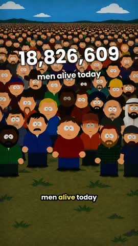](https://github.com/inematds/filme-em-codigo/releases/download/fonte-v1/style_paper_julian.mp4)  
[▶ Ver o vídeo: style_paper_julian.mp4](https://github.com/inematds/filme-em-codigo/releases/download/fonte-v1/style_paper_julian.mp4)

*Desenho de papel-cartão (no estilo de South Park)*

### Desenho animado de recortes de papel colorido

**Mesmo estilo, sua ideia**

> Crie um curta animado vertical de 10 a 20 segundos sobre [SUA IDEIA AQUI]. Tom: uma breve história ou narrativa científica com uma reviravolta. Primeiro, escreva um roteiro de 5 ou 6 linhas (40 a 55 palavras, menos de 20 segundos de fala), confira todos os fatos na web e liste as fontes. Escreva os números por extenso para a narração e em algarismos nas legendas. Estrutura das cenas: uma frase de abertura com um número grande sobre uma imagem panorâmica de estabelecimento; uma frase de apresentação do personagem principal; uma frase com evidências e uma estatística mostrada como uma grade de símbolos em que um deles se ilumina; uma frase com mapa ou diagrama em um painel estilizado sobre um quadro desfocado e escurecido; uma frase de reviravolta em que uma afirmação é riscada; e uma pergunta para fechar. Planeje cerca de sete quadros-chave, um por cena. Estilo para todos os quadros-chave: desenho animado tosco de recortes de papel de construção, formas simples e chapadas, personagens com cabeças grandes e redondas e olhos de pontinho, cores vivas e chapadas, visual deliberadamente tosco de animação em stop-motion com recortes, personagens originais. Escreva o prompt de cada quadro-chave começando pelo assunto, depois a frase de estilo e, em seguida, "Composição vertical em retrato 9:16, com o assunto principal no meio do quadro e o quarto inferior mais tranquilo. Sem texto, letras, logotipos ou marca-d'água." e gere as imagens em 9:16. Anime cada quadro-chave em um único shader WebGL: crie um mapa de profundidade com um modelo monocular de profundidade, desloque a busca de pixels pela profundidade para criar uma câmera com paralaxe, balance o primeiro plano próximo, mova suavemente o céu distante para o lado e adicione line boil com intensidade máxima (line boil é uma pequena distorção com ruído que avança em saltos 8 vezes por segundo). Câmera: tremor de stop-motion (um novo deslocamento aleatório mínimo, escala e rotação a cada 3 quadros, em grupos de três). Transições: cortes secos. Legendas em destaque sobre as palavras: Poppins ExtraBold em branco com contorno preto grosso de 10 px, inclinadas menos 3 graus, cor de destaque #ffde3b. Painéis e sobreposições: a mesma paleta, mais uma textura sutil de papel na diagonal com sombra interna suave. Legendas: Poppins Bold em 92 px, brancas com contorno preto de 8 px, duas ou três palavras por tela perto da parte inferior; a palavra falada em #FFDE3B. Música: melodia saltitante pentatônica de cordas dedilhadas, com percussão suave em torno de 120 bpm, que para na reviravolta. Efeitos sonoros: som de galope ou viagem durante a ação, um brilho no número-chave, som de disco riscando na reviravolta e uma batida grave na revelação. Produza em Remotion (React) com three.js, 1080x1920 a 30 fps, sincronizando cada corte, evento e som com as marcações de tempo das palavras na voz. Sintetize toda a música e os efeitos em código, com a música cerca de 20 dB abaixo da voz e os efeitos um pouco mais baixos que ela.

<details><summary>Prompt original (inglês)</summary>

```text
Make a 10 to 20 second vertical animated short about [YOUR IDEA HERE]. Tone: a short history or science story with one twist. First write a 5 or 6 line script (40 to 55 words, under 20 seconds spoken), fact-check every claim on the web and list the sources. Write numbers as words for the voice and digits in the captions. Beat structure: a hook line with a big number over a wide establishing image; a hero line; an evidence line with a statistic shown as a grid of tokens where one lights up; a map or diagram line on a styled panel over a blurred, darkened keyframe; a reversal line where a claim gets struck through; and a payoff question. Plan about seven keyframes, one per beat. Style for every keyframe: crude construction-paper cutout cartoon, flat simple shapes, characters with big round heads and simple dot eyes, bright flat colours, deliberately rough cutout stop-motion look, original characters. Write each keyframe prompt as the subject, then that style sentence, then "Vertical 9:16 portrait composition with the main subject in the middle of the frame and a calmer lower quarter. No text, no letters, no logos, no watermark." and generate them at 9:16. Animate each keyframe in one WebGL shader: make a depth map with a monocular depth model, offset the lookup by depth for a parallax camera, sway the near foreground, drift the far sky sideways gently, and add a full-strength line boil (a line boil is a small noise warp that steps 8 times a second). Camera: a stop-motion jitter (a new tiny random offset, scale and rotation every 3 frames, on threes). Transitions: hard cuts. Labels on their words: Poppins ExtraBold in white with a thick 10 px black stroke, rotated minus 3 degrees, accent #ffde3b. Panels and overlays: the same palette, plus a faint diagonal paper texture with a soft inner shadow. Captions: Poppins Bold at 92 px, white with an 8 px black outline, two or three words per page near the bottom, spoken word in #FFDE3B. Music: a bouncy pentatonic plucked-string melody with soft drums around 120 bpm that drops out for the reversal. Sound effects: a gallop or travel sound under the action, a shimmer on the key number, a record scratch on the reversal and a deep drum on the reveal. Build it in Remotion (React) with three.js, 1080x1920 at 30 fps, keying every cut, event and sound to word timestamps from the voice. Synthesise all music and effects in code, with the music about 20 dB under the voice and the effects just below it.
```

</details>

**Copiar este filme exato · Prompt exato**

> Recrie este curta vertical de 26 segundos sobre os descendentes de Genghis Khan em um estilo ilustrado consistente, exatamente como descrito. Narração, palavra por palavra (cerca de 26 segundos): "Cerca de vinte milhões de homens vivos hoje podem descender de um homem: Genghis Khan. Em 2003, geneticistas descobriram que um em cada doze homens em uma vasta região da Ásia tinha quase o mesmo cromossomo Y. Parecia ter se espalhado com o Império Mongol, o maior império terrestre da história. Caso encerrado? Ainda não. O DNA de túmulos mongóis da época dele revelou uma linhagem diferente. Então, a árvore genealógica mais famosa do mundo talvez pertença a outra pessoa." Visual: desenho animado tosco de recortes de papel de construção, formas simples e chapadas, personagens com cabeças grandes e redondas e olhos de pontinho, cores vivas e chapadas, visual deliberadamente tosco de animação em stop-motion com recortes, personagens originais. Primeiro, gere sete imagens de quadros-chave em 9:16 (1080x1920) com estes prompts exatos, na ordem das cenas: 1. multidão: "uma multidão imensa de centenas de homens comuns de várias origens, lado a lado numa ampla planície, estendendo-se até o horizonte, vista de um pouco acima. Estilo: desenho animado tosco de recortes de papel de construção, formas simples e chapadas, personagens com cabeças grandes e redondas, olhos de pontinho e mãos em forma de luva, cores vivas e chapadas, visual deliberadamente tosco e infantil de animação com recortes, como em uma sitcom animada satírica para adultos, personagens originais. Composição vertical em retrato 9:16, com o assunto principal no meio do quadro e o quarto inferior mais tranquilo. Sem texto, letras, logotipos ou marca-d'água." 2. Khan: "Genghis Khan, governante mongol do século 13, com um capacete pontudo enfeitado com pele, bigode longo e fino e uma túnica deel, sentado com orgulho em um cavalo robusto da estepe, no alto de uma colina gramada, em ângulo heroico de baixo, centralizado. Desenho animado tosco de recortes de papel de construção, formas simples e chapadas, personagens com cabeças grandes e redondas e olhos de pontinho, cores vivas e chapadas, visual deliberadamente tosco de animação em stop-motion com recortes, personagens originais. Vertical 9:16, assunto centralizado, quarto inferior simples, sem texto ou logotipos." 3. laboratório: "dois geneticistas de jaleco branco em um laboratório moderno de genética, estudando um grande modelo brilhante de dupla hélice de DNA, com estantes de tubos de ensaio, microscópio e bandejas de amostras. Estilo: desenho animado tosco de recortes de papel de construção, formas simples e chapadas, personagens com cabeças grandes e redondas, olhos de pontinho e mãos em forma de luva, cores vivas e chapadas, visual deliberadamente tosco e infantil de animação com recortes, como em uma sitcom animada satírica para adultos, personagens originais. Composição vertical em retrato 9:16, com o assunto principal no meio do quadro e o quarto inferior mais tranquilo. Sem texto, letras, logotipos ou marca-d'água." 4. exército: "uma longa coluna de cavaleiros mongóis com estandartes atravessando a interminável estepe eurasiática, nuvens de poeira, montanhas ao longe, sensação épica de escala. Desenho animado tosco de recortes de papel de construção, formas simples e chapadas, personagens com cabeças grandes e redondas e olhos de pontinho, cores vivas e chapadas, visual deliberadamente tosco de animação em stop-motion com recortes, personagens originais. Vertical 9:16, assunto centralizado, quarto inferior simples, sem texto ou logotipos." 5. caso: "mesa de madeira de detetive sob uma luminária, com uma pasta grossa de arquivo fechada, uma lupa, uma xícara de chá e um mapa antigo da Ásia, clima sombrio e misterioso. Estilo: desenho animado tosco de recortes de papel de construção, formas simples e chapadas, personagens com cabeças grandes e redondas, olhos de pontinho e mãos em forma de luva, cores vivas e chapadas, visual deliberadamente tosco e infantil de animação com recortes, como em uma sitcom animada satírica para adultos, personagens originais. Composição vertical em retrato 9:16, com o assunto principal no meio do quadro e o quarto inferior mais tranquilo. Sem texto, letras, logotipos ou marca-d'água." 6. túmulo: "arqueólogos escavando um túmulo antigo mongol ao anoitecer, com um esqueleto parcialmente descoberto na escavação, pincéis e espátulas, e uma tênue fita de DNA brilhante saindo do túmulo. Desenho animado tosco de recortes de papel de construção, formas simples e chapadas, personagens com cabeças grandes e redondas e olhos de pontinho, cores vivas e chapadas, visual deliberadamente tosco de animação em stop-motion com recortes, personagens originais. Vertical 9:16, assunto centralizado, quarto inferior simples, sem texto ou logotipos." 7. árvore: "uma árvore genealógica antiga e gigantesca, com galhos que se espalham por todo o céu, centenas de pequenos medalhões com retratos pendurados nos galhos e, na raiz, uma silhueta misteriosa com capuz. Desenho animado tosco de recortes de papel de construção, formas simples e chapadas, personagens com cabeças grandes e redondas e olhos de pontinho, cores vivas e chapadas, visual deliberadamente tosco de animação em stop-motion com recortes, personagens originais. Vertical 9:16, assunto centralizado, quarto inferior simples, sem texto ou logotipos." Anime cada quadro-chave em um único shader WebGL: crie um mapa de profundidade com um modelo monocular de profundidade, desloque a busca de pixels pela profundidade para criar uma câmera com paralaxe, balance o primeiro plano próximo, mova suavemente o céu distante para o lado e adicione line boil com intensidade máxima (line boil é uma pequena distorção com ruído que avança em saltos 8 vezes por segundo). Câmera em cada quadro-chave: tremor de stop-motion (um novo deslocamento aleatório mínimo, escala e rotação a cada 3 quadros, em grupos de três). Transição entre cenas: cortes secos. Legendas em destaque na tela: Poppins ExtraBold em branco com contorno preto grosso de 10 px, inclinadas menos 3 graus, cor de destaque #ffde3b. Estilo do painel do mapa: mar azul-celeste #5aa9e6, terra verde-grama #7cc36e, linhas pretas grossas de 6 px #1d1d1d, região amarela rgba(255,222,59,0.9), império vermelho rgba(230,60,50,0.85), pontos pretos, cantos retos. Sobreposições de textura: textura sutil de papel na diagonal com sombra interna suave. Linha do tempo: de 0 a 2.3 s, multidão: um contador sobe até 20,000,000 de "Cerca de" até "hoje", com "homens vivos hoje" na palavra "homens". De 2.3 a 5.05 s, Khan: "Genghis Khan" na palavra "Genghis". De 5.05 a 7.6 s, laboratório: "2003" e "geneticistas" nas respectivas palavras. De 7.6 a 8.45 s, a multidão ampliada em 1.35x: "1 em 12" sobre uma grade de 6 por 2 fichas arredondadas que aparecem uma a uma, com a oitava brilhando na cor de destaque na palavra "doze". De 8.45 a 12.6 s, o exército desfocado e escurecido atrás de um painel de mapa arredondado da Ásia: a região amostrada surge da leste para oeste na palavra "vasta", e os pontos aparecem na palavra "tinha", com "uma vasta região da Ásia" e "o mesmo cromossomo Y" na palavra "Y". De 12.6 a 14.45 s, exército nítido: "Império Mongol". De 14.45 a 16.55 s, mapa de novo: o império se expande a partir de um marcador pulsante na Mongólia, com "maior império terrestre" e "24 milhões de km²". De 16.55 a 18.6 s, caso: "CASO ENCERRADO?", riscado por uma barra de destaque na palavra "Ainda", enquanto "Ainda não." aparece em destaque. De 18.6 a 22.15 s, túmulo: "Túmulos mongóis", "1130 a 1250" na palavra "época" e "linhagem diferente" em destaque. De 22.15 s até o fim, árvore: "árvore genealógica mais famosa", substituída por "outra pessoa?" na palavra "pessoa". As legendas entram subindo e desaparecem em 0.2 s. Legendas: grave legendas palavra por palavra em Poppins Bold, 92 px, brancas com contorno preto de 8 px e sombra de 3 px, duas ou três palavras por tela, centralizadas cerca de 330 px acima da parte inferior, com a palavra falada em #FFDE3B. Música: melodia pentatônica em Lá menor numa cítara dedilhada, com baixo de cítara e tambores suaves ao estilo taiko em 120 bpm, quase parando em "Ainda não". Efeitos sonoros: galope suave no começo e um galope longo durante a cena do exército, brilho cintilante em "doze" e "cromossomo", som de disco riscando em "Ainda" e uma batida grave em "pessoa". Configuração técnica: Remotion (React) com three.js, 1080x1920 a 30 fps, cerca de 26 segundos. Faça a voz com qualquer mecanismo de conversão de texto em fala, obtenha as marcações de tempo das palavras e sincronize cada corte, evento e som com o início da palavra. Grave as legendas no vídeo. Sintetize toda a música e os efeitos em código, sem amostras. Mixe a música cerca de 20 dB abaixo da voz e reduza ainda mais durante a fala; deixe os efeitos um pouco mais baixos que a voz.

<details><summary>Prompt original (inglês)</summary>

```text
Recreate this 26 second vertical short about Genghis Khan's descendants in one consistent illustrated look, exactly as described. Narration, word for word (about 26 seconds): "About twenty million men alive today may descend from one man: Genghis Khan. In 2003, geneticists found that one in twelve men across a huge stretch of Asia carried almost the same Y chromosome. It seemed to spread with the Mongol Empire, the largest land empire in history. Case closed? Not quite. DNA from Mongol graves of his time showed a different line. So the world's most famous family tree might belong to someone else." Look: crude construction-paper cutout cartoon, flat simple shapes, characters with big round heads and simple dot eyes, bright flat colours, deliberately rough cutout stop-motion look, original characters. First generate seven keyframe images at 9:16 (1080x1920) with these exact prompts, in beat order: 1. crowd: "a vast crowd of hundreds of ordinary men of many different backgrounds standing shoulder to shoulder across a wide plain, the crowd stretching all the way to the horizon, seen from slightly above. Style: crude construction-paper cutout cartoon, flat simple shapes, characters with big round heads, dot eyes and mitten hands, bright flat colours, deliberately rough and childish cutout animation look like a satirical adult animated sitcom, original characters. Vertical 9:16 portrait composition with the main subject in the middle of the frame and a calmer lower quarter. No text, no letters, no logos, no watermark." 2. khan: "Genghis Khan, the 13th century Mongol ruler, with a fur-trimmed pointed helmet, long thin moustache and a deel robe, sitting proudly on a sturdy steppe horse on a grassy hill, heroic low angle, centred. crude construction-paper cutout cartoon, flat simple shapes, characters with big round heads and simple dot eyes, bright flat colours, deliberately rough cutout stop-motion look, original characters. Vertical 9:16, subject centred, simple lower quarter, no text or logos." 3. lab: "two geneticists in white lab coats in a modern genetics laboratory, studying a large glowing DNA double helix model, racks of test tubes, a microscope and sample trays. Style: crude construction-paper cutout cartoon, flat simple shapes, characters with big round heads, dot eyes and mitten hands, bright flat colours, deliberately rough and childish cutout animation look like a satirical adult animated sitcom, original characters. Vertical 9:16 portrait composition with the main subject in the middle of the frame and a calmer lower quarter. No text, no letters, no logos, no watermark." 4. army: "a long column of Mongol horsemen with banners riding out across the endless Eurasian steppe, clouds of dust, distant mountains, epic sense of scale. crude construction-paper cutout cartoon, flat simple shapes, characters with big round heads and simple dot eyes, bright flat colours, deliberately rough cutout stop-motion look, original characters. Vertical 9:16, subject centred, simple lower quarter, no text or logos." 5. case: "a detective's wooden desk under a lamp with a thick closed case file folder, a magnifying glass, a cup of tea and an old map of Asia, moody and mysterious. Style: crude construction-paper cutout cartoon, flat simple shapes, characters with big round heads, dot eyes and mitten hands, bright flat colours, deliberately rough and childish cutout animation look like a satirical adult animated sitcom, original characters. Vertical 9:16 portrait composition with the main subject in the middle of the frame and a calmer lower quarter. No text, no letters, no logos, no watermark." 6. grave: "archaeologists excavating an ancient Mongol burial mound at dusk, a skeleton partly uncovered in the dig, brushes and trowels, a faint glowing DNA strand rising out of the grave. crude construction-paper cutout cartoon, flat simple shapes, characters with big round heads and simple dot eyes, bright flat colours, deliberately rough cutout stop-motion look, original characters. Vertical 9:16, subject centred, simple lower quarter, no text or logos." 7. tree: "a gigantic ancient family tree whose branches spread across the whole sky, hundreds of tiny portrait medallions hanging from the branches, and at the root a mysterious hooded silhouette. crude construction-paper cutout cartoon, flat simple shapes, characters with big round heads and simple dot eyes, bright flat colours, deliberately rough cutout stop-motion look, original characters. Vertical 9:16, subject centred, simple lower quarter, no text or logos." Animate each keyframe in one WebGL shader: make a depth map with a monocular depth model, offset the lookup by depth for a parallax camera, sway the near foreground, drift the far sky sideways gently, and add a full-strength line boil (a line boil is a small noise warp that steps 8 times a second). Camera on each keyframe: a stop-motion jitter (a new tiny random offset, scale and rotation every 3 frames, on threes). Transition between segments: hard cuts. On-screen labels: Poppins ExtraBold in white with a thick 10 px black stroke, rotated minus 3 degrees, accent #ffde3b. Map panel skin: sky blue sea #5aa9e6, grass green land #7cc36e, thick black 6 px lines #1d1d1d, a yellow region rgba(255,222,59,0.9), a red empire rgba(230,60,50,0.85), black dots, square corners. Texture overlays: a faint diagonal paper texture with a soft inner shadow. Timeline: 0 to 2.3 s, crowd: a counter climbs to 20,000,000 from "About" to "today", with "men alive today" on "men". 2.3 to 5.05 s, khan: "Genghis Khan" on "Genghis". 5.05 to 7.6 s, lab: "2003" and "geneticists" on their words. 7.6 to 8.45 s, the crowd zoomed to 1.35x: "1 in 12" over a 6 by 2 grid of rounded pill tokens popping in, the eighth glowing in the accent colour on "twelve". 8.45 to 12.6 s, the army blurred and darkened behind a rounded map panel of Asia: the sampled region wipes in east to west on "huge" and dots pop on "carried", with "a huge stretch of Asia" and "the same Y chromosome" on "Y". 12.6 to 14.45 s, clear army: "Mongol Empire". 14.45 to 16.55 s, map again: the empire floods out from a pulsing Mongolia marker, with "largest land empire" and "24 million km²". 16.55 to 18.6 s, case: "CASE CLOSED?", struck through by an accent bar on "Not" as "Not quite." appears in the accent. 18.6 to 22.15 s, grave: "Mongol graves", "1130 to 1250" on "time" and "a different line" in the accent. 22.15 s to the end, tree: "most famous family tree", replaced on "someone" by "someone else?" in the accent. Labels fade and rise in over 0.2 s. Captions: burn in word-by-word captions in Poppins Bold at 92 px, white with an 8 px black outline and a 3 px shadow, two or three words per page, centred about 330 px above the bottom, with the spoken word in #FFDE3B. Music: an A minor pentatonic melody on a plucked zither with a low zither bass and soft taiko-style drums at 120 bpm, dropping almost to silence for "Not quite". Sound effects: a soft hoof gallop at the start and a long gallop under the army, a sparkling shimmer on "twelve" and "chromosome", a record scratch on "Not" and a deep drum hit on "someone". Technical setup: Remotion (React) with three.js, 1080x1920 at 30 fps, about 26 seconds. Make the voice with any text to speech engine, get word timestamps, and key every cut, event and sound to the start of its word. Burn the captions in. Synthesise all music and effects in code, with no samples. Mix the music about 20 dB under the voice and ducked under speech, with the effects just below the voice.
```

</details>

[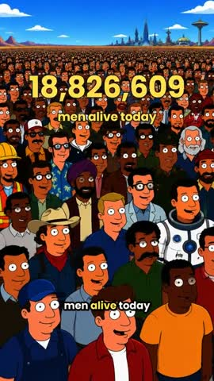](https://github.com/inematds/filme-em-codigo/releases/download/fonte-v1/style_sitcom_julian.mp4)  
[▶ Ver o vídeo: style_sitcom_julian.mp4](https://github.com/inematds/filme-em-codigo/releases/download/fonte-v1/style_sitcom_julian.mp4)

*Desenho animado de TV em horário nobre (no estilo de Simpsons / Futurama)*

### Desenho animado de TV em horário nobre

**Mesmo estilo, sua ideia**

> Crie um curta animado vertical de 10 a 20 segundos sobre [SUA IDEIA AQUI]. Tom: uma breve história ou narrativa científica com uma reviravolta. Primeiro, escreva um roteiro de 5 ou 6 linhas (40 a 55 palavras, menos de 20 segundos de fala), verifique cada afirmação na web e liste as fontes. Escreva os números por extenso na narração e com algarismos nas legendas. Estrutura das cenas: uma frase de abertura com um número grande sobre uma imagem ampla de ambientação; uma frase sobre o protagonista; uma frase com evidências e uma estatística mostrada como uma grade de símbolos, com um deles aceso; uma frase com mapa ou diagrama em um painel estilizado sobre um quadro-chave desfocado e escurecido; uma frase de reviravolta em que uma afirmação é riscada; e uma pergunta de desfecho. Planeje cerca de sete quadros-chave, um por cena. Estilo de todos os quadros-chave: visual clássico de desenho animado americano de TV em horário nobre, contornos pretos fortes e limpos, cores chapadas de animação, personagens originais com olhos grandes e redondos e tons de pele variados e naturais, paleta ensolarada e saturada, energia de sitcom retrô de ficção científica. Escreva cada prompt de quadro-chave começando pelo tema, depois a frase de estilo e, em seguida, "Composição vertical 9:16, com o tema principal no centro do quadro e o quarto inferior mais tranquilo. Sem texto, letras, logos ou marca-d'água." e gere as imagens em 9:16. Anime cada quadro-chave em um único shader WebGL: crie um mapa de profundidade com um modelo monocular de profundidade, desloque a amostragem conforme a profundidade para simular uma câmera com paralaxe, balance o primeiro plano próximo, mova o céu distante para o lado em ritmo médio e não use line boil (line boil é uma pequena deformação com ruído que muda 8 vezes por segundo). Câmera: um punch-in (um salto de zoom de 9 por cento a cada corte, que se estabiliza rápido, seguido por uma aproximação lenta e um balanço). Transições: um flash branco de 0.12 s. Textos sobre os temas: Poppins ExtraBold em amarelo #ffe14d, com contorno de 9 px em preto quase total #1b1b1b, cor de destaque #ff6b3d. Painéis e sobreposições: a mesma paleta, sem sobreposição de textura. Legendas: Poppins Bold a 92 px, brancas com contorno preto de 8 px, duas ou três palavras por página perto da parte inferior, palavra falada em #FFE14D. Música: melodia saltitante em escala pentatônica, tocada em cordas dedilhadas, com bateria suave a cerca de 120 bpm, que para na reviravolta. Efeitos sonoros: som de galope ou viagem durante a ação, brilho sonoro no número principal, arranhão de disco na reviravolta e uma batida grave de tambor na revelação. Crie em Remotion (React) com three.js, 1080x1920 a 30 fps, sincronizando cada corte, evento e som com os tempos das palavras da voz. Sintetize toda a música e os efeitos em código, com a música cerca de 20 dB abaixo da voz e os efeitos um pouco mais baixos que ela.

<details><summary>Prompt original (inglês)</summary>

```text
Make a 10 to 20 second vertical animated short about [YOUR IDEA HERE]. Tone: a short history or science story with one twist. First write a 5 or 6 line script (40 to 55 words, under 20 seconds spoken), fact-check every claim on the web and list the sources. Write numbers as words for the voice and digits in the captions. Beat structure: a hook line with a big number over a wide establishing image; a hero line; an evidence line with a statistic shown as a grid of tokens where one lights up; a map or diagram line on a styled panel over a blurred, darkened keyframe; a reversal line where a claim gets struck through; and a payoff question. Plan about seven keyframes, one per beat. Style for every keyframe: classic American prime-time TV cartoon look, bold clean black outlines, flat cel colours, original characters with big round eyes and natural varied skin tones, saturated sunny palette, retro sci-fi sitcom energy. Write each keyframe prompt as the subject, then that style sentence, then "Vertical 9:16 portrait composition with the main subject in the middle of the frame and a calmer lower quarter. No text, no letters, no logos, no watermark." and generate them at 9:16. Animate each keyframe in one WebGL shader: make a depth map with a monocular depth model, offset the lookup by depth for a parallax camera, sway the near foreground, drift the far sky sideways at a medium pace, and use no line boil (a line boil is a small noise warp that steps 8 times a second). Camera: a punch-in (a 9 percent zoom pop at each cut that settles fast, then a slow creep and sway). Transitions: a 0.12 s white flash. Labels on their words: Poppins ExtraBold in yellow #ffe14d with a 9 px near-black #1b1b1b stroke, accent #ff6b3d. Panels and overlays: the same palette, plus no texture overlay. Captions: Poppins Bold at 92 px, white with an 8 px black outline, two or three words per page near the bottom, spoken word in #FFE14D. Music: a bouncy pentatonic plucked-string melody with soft drums around 120 bpm that drops out for the reversal. Sound effects: a gallop or travel sound under the action, a shimmer on the key number, a record scratch on the reversal and a deep drum on the reveal. Build it in Remotion (React) with three.js, 1080x1920 at 30 fps, keying every cut, event and sound to word timestamps from the voice. Synthesise all music and effects in code, with the music about 20 dB under the voice and the effects just below it.
```

</details>

**Copiar este filme exato · Prompt exato**

> Recrie este curta vertical de 26 segundos sobre os descendentes de Genghis Khan em um estilo ilustrado consistente, exatamente como descrito. Narração, palavra por palavra (cerca de 26 segundos): "Cerca de vinte milhões de homens vivos hoje talvez descendam de um homem: Genghis Khan. Em 2003, geneticistas descobriram que um em cada doze homens em uma enorme região da Ásia tinha quase o mesmo cromossomo Y. Ele parecia ter se espalhado com o Império Mongol, o maior império terrestre da história. Caso encerrado? Não exatamente. O DNA de túmulos mongóis da época dele revelou uma linhagem diferente. Então, a árvore genealógica mais famosa do mundo talvez pertença a outra pessoa." Visual: estilo clássico de desenho animado americano de TV em horário nobre, contornos pretos fortes e limpos, cores chapadas de animação, personagens originais com olhos grandes e redondos e tons de pele variados e naturais, paleta ensolarada e saturada, energia de sitcom retrô de ficção científica. Primeiro, gere sete imagens de quadros-chave em 9:16 (1080x1920) com estes prompts exatos, na ordem das cenas: 1. multidão: "uma imensa multidão de centenas de homens comuns de muitas origens diferentes, lado a lado em uma vasta planície, estendendo-se até o horizonte, vista de um ângulo ligeiramente elevado. Estilo clássico de desenho animado americano de TV em horário nobre, contornos pretos fortes e limpos, cores chapadas de animação, personagens originais com olhos grandes e redondos e tons de pele variados e naturais, paleta ensolarada e saturada, energia de sitcom retrô de ficção científica. Vertical 9:16, tema centralizado, quarto inferior simples, sem texto ou logos." 2. khan: "Genghis Khan, governante mongol do século 13, com um capacete pontudo com acabamento de pele, bigode longo e fino e um manto deel, sentado com orgulho em um cavalo robusto das estepes, no alto de uma colina gramada, em contra-plongée heroico, centralizado. Estilo clássico de desenho animado americano de TV em horário nobre, contornos pretos fortes e limpos, cores chapadas de animação, personagens originais com olhos grandes e redondos e tons de pele variados e naturais, paleta ensolarada e saturada, energia de sitcom retrô de ficção científica. Vertical 9:16, tema centralizado, quarto inferior simples, sem texto ou logos." 3. laboratório: "dois geneticistas de jaleco branco em um laboratório moderno de genética, estudando um grande modelo brilhante de dupla hélice de DNA, com estantes de tubos de ensaio, um microscópio e bandejas de amostras. Estilo clássico de desenho animado americano de TV em horário nobre, contornos pretos fortes e limpos, cores chapadas de animação, personagens originais com olhos grandes e redondos e tons de pele variados e naturais, paleta ensolarada e saturada, energia de sitcom retrô de ficção científica. Vertical 9:16, tema centralizado, quarto inferior simples, sem texto ou logos." 4. exército: "uma longa coluna de cavaleiros mongóis com estandartes avançando pela interminável estepe euroasiática, nuvens de poeira e montanhas ao longe, com uma sensação épica de escala. Estilo clássico de desenho animado americano de TV em horário nobre, contornos pretos fortes e limpos, cores chapadas de animação, personagens originais com olhos grandes e redondos e tons de pele variados e naturais, paleta ensolarada e saturada, energia de sitcom retrô de ficção científica. Vertical 9:16, tema centralizado, quarto inferior simples, sem texto ou logos." 5. caso: "uma escrivaninha de detetive de madeira sob uma luminária, com uma pasta grossa de arquivo fechada, uma lupa, uma xícara de chá e um mapa antigo da Ásia, clima sombrio e misterioso. Estilo clássico de desenho animado americano de TV em horário nobre, contornos pretos fortes e limpos, cores chapadas de animação, personagens originais com olhos grandes e redondos e tons de pele variados e naturais, paleta ensolarada e saturada, energia de sitcom retrô de ficção científica. Vertical 9:16, tema centralizado, quarto inferior simples, sem texto ou logos." 6. túmulo: "arqueólogos escavando um antigo túmulo mongol ao anoitecer, com um esqueleto parcialmente descoberto na escavação, escovas e espátulas e uma tênue fita de DNA brilhante saindo do túmulo. Estilo clássico de desenho animado americano de TV em horário nobre, contornos pretos fortes e limpos, cores chapadas de animação, personagens originais com olhos grandes e redondos e tons de pele variados e naturais, paleta ensolarada e saturada, energia de sitcom retrô de ficção científica. Vertical 9:16, tema centralizado, quarto inferior simples, sem texto ou logos." 7. árvore: "uma gigantesca árvore genealógica ancestral, cujos galhos se espalham por todo o céu, com centenas de pequenos medalhões com retratos pendurados nos galhos e uma misteriosa silhueta encapuzada nas raízes. Estilo clássico de desenho animado americano de TV em horário nobre, contornos pretos fortes e limpos, cores chapadas de animação, personagens originais com olhos grandes e redondos e tons de pele variados e naturais, paleta ensolarada e saturada, energia de sitcom retrô de ficção científica. Vertical 9:16, tema centralizado, quarto inferior simples, sem texto ou logos." Anime cada quadro-chave em um único shader WebGL: crie um mapa de profundidade com um modelo monocular de profundidade, desloque a amostragem conforme a profundidade para simular uma câmera com paralaxe, balance o primeiro plano próximo, mova o céu distante para o lado em ritmo médio e não use line boil (line boil é uma pequena deformação com ruído que muda 8 vezes por segundo). Câmera em cada quadro-chave: um punch-in (um salto de zoom de 9 por cento a cada corte, que se estabiliza rápido, seguido por uma aproximação lenta e um balanço). Transição entre cenas: um flash branco de 0.12 s. Textos na tela: Poppins ExtraBold em amarelo #ffe14d, com contorno de 9 px em preto quase total #1b1b1b, cor de destaque #ff6b3d. Estilo do painel de mapa: mar azul-celeste #58b8f5, terra verde #9ad86a, linhas pretas de 5 px #1b1b1b, região amarela rgba(255,225,77,0.95), império laranja rgba(255,107,61,0.85), pontos pretos. Sobreposições de textura: sem sobreposição de textura. Linha do tempo: de 0 a 2.3 s, multidão: um contador sobe até 20,000,000 de "Cerca de" até "hoje", com "homens vivos hoje" sobre a palavra "homens". De 2.3 a 5.05 s, khan: "Genghis Khan" sobre "Genghis". De 5.05 a 7.6 s, laboratório: "2003" e "geneticistas" sobre suas respectivas palavras. De 7.6 a 8.45 s, multidão ampliada para 1.35x: "1 em 12" sobre uma grade 6 por 2 de fichas arredondadas que aparecem uma a uma, com a oitava brilhando na cor de destaque sobre "doze". De 8.45 a 12.6 s, o exército desfocado e escurecido ao fundo de um painel de mapa arredondado da Ásia: a região selecionada aparece da direita para a esquerda sobre "enorme" e os pontos surgem sobre "tinha", com "uma enorme região da Ásia" e "o mesmo cromossomo Y" sobre "Y". De 12.6 a 14.45 s, exército nítido: "Império Mongol". De 14.45 a 16.55 s, mapa novamente: o império se expande a partir de um marcador pulsante na Mongólia, com "maior império terrestre" e "24 milhões km²". De 16.55 a 18.6 s, caso: "CASO ENCERRADO?", riscado por uma barra de destaque sobre "Não", enquanto "Não exatamente." aparece em destaque. De 18.6 a 22.15 s, túmulo: "túmulos mongóis", "1130 a 1250" sobre "época" e "uma linhagem diferente" em destaque. De 22.15 s até o fim, árvore: "árvore genealógica mais famosa", substituída sobre "pessoa" por "outra pessoa?" em destaque. Os textos aparecem subindo e desaparecendo gradualmente em 0.2 s. Legendas: inserir legendas palavra por palavra em Poppins Bold a 92 px, brancas com contorno preto de 8 px e sombra de 3 px, duas ou três palavras por página, centralizadas cerca de 330 px acima da parte inferior, com a palavra falada em #FFE14D. Música: melodia pentatônica em Lá menor, tocada em saltério dedilhado, com baixo de saltério e tambores suaves no estilo taiko a 120 bpm, quase silenciando em "Não exatamente". Efeitos sonoros: galope suave no início e um galope longo durante o exército, brilho sonoro em "doze" e "cromossomo", arranhão de disco em "Não" e uma batida grave de tambor em "alguém". Configuração técnica: Remotion (React) com three.js, 1080x1920 a 30 fps, cerca de 26 segundos. Crie a voz com qualquer mecanismo de síntese de voz, obtenha os tempos das palavras e sincronize cada corte, evento e som com o início da palavra correspondente. Grave as legendas no vídeo. Sintetize toda a música e os efeitos em código, sem amostras. Mixe a música cerca de 20 dB abaixo da voz e reduza seu volume durante a fala, com os efeitos um pouco abaixo da voz.

<details><summary>Prompt original (inglês)</summary>

```text
Recreate this 26 second vertical short about Genghis Khan's descendants in one consistent illustrated look, exactly as described. Narration, word for word (about 26 seconds): "About twenty million men alive today may descend from one man: Genghis Khan. In 2003, geneticists found that one in twelve men across a huge stretch of Asia carried almost the same Y chromosome. It seemed to spread with the Mongol Empire, the largest land empire in history. Case closed? Not quite. DNA from Mongol graves of his time showed a different line. So the world's most famous family tree might belong to someone else." Look: classic American prime-time TV cartoon look, bold clean black outlines, flat cel colours, original characters with big round eyes and natural varied skin tones, saturated sunny palette, retro sci-fi sitcom energy. First generate seven keyframe images at 9:16 (1080x1920) with these exact prompts, in beat order: 1. crowd: "a vast crowd of hundreds of ordinary men of many different backgrounds standing shoulder to shoulder across a wide plain, the crowd stretching all the way to the horizon, seen from slightly above. classic American prime-time TV cartoon look, bold clean black outlines, flat cel colours, original characters with big round eyes and natural varied skin tones, saturated sunny palette, retro sci-fi sitcom energy. Vertical 9:16, subject centred, simple lower quarter, no text or logos." 2. khan: "Genghis Khan, the 13th century Mongol ruler, with a fur-trimmed pointed helmet, long thin moustache and a deel robe, sitting proudly on a sturdy steppe horse on a grassy hill, heroic low angle, centred. classic American prime-time TV cartoon look, bold clean black outlines, flat cel colours, original characters with big round eyes and natural varied skin tones, saturated sunny palette, retro sci-fi sitcom energy. Vertical 9:16, subject centred, simple lower quarter, no text or logos." 3. lab: "two geneticists in white lab coats in a modern genetics laboratory, studying a large glowing DNA double helix model, racks of test tubes, a microscope and sample trays. classic American prime-time TV cartoon look, bold clean black outlines, flat cel colours, original characters with big round eyes and natural varied skin tones, saturated sunny palette, retro sci-fi sitcom energy. Vertical 9:16, subject centred, simple lower quarter, no text or logos." 4. army: "a long column of Mongol horsemen with banners riding out across the endless Eurasian steppe, clouds of dust, distant mountains, epic sense of scale. classic American prime-time TV cartoon look, bold clean black outlines, flat cel colours, original characters with big round eyes and natural varied skin tones, saturated sunny palette, retro sci-fi sitcom energy. Vertical 9:16, subject centred, simple lower quarter, no text or logos." 5. case: "a detective's wooden desk under a lamp with a thick closed case file folder, a magnifying glass, a cup of tea and an old map of Asia, moody and mysterious. classic American prime-time TV cartoon look, bold clean black outlines, flat cel colours, original characters with big round eyes and natural varied skin tones, saturated sunny palette, retro sci-fi sitcom energy. Vertical 9:16, subject centred, simple lower quarter, no text or logos." 6. grave: "archaeologists excavating an ancient Mongol burial mound at dusk, a skeleton partly uncovered in the dig, brushes and trowels, a faint glowing DNA strand rising out of the grave. classic American prime-time TV cartoon look, bold clean black outlines, flat cel colours, original characters with big round eyes and natural varied skin tones, saturated sunny palette, retro sci-fi sitcom energy. Vertical 9:16, subject centred, simple lower quarter, no text or logos." 7. tree: "a gigantic ancient family tree whose branches spread across the whole sky, hundreds of tiny portrait medallions hanging from the branches, and at the root a mysterious hooded silhouette. classic American prime-time TV cartoon look, bold clean black outlines, flat cel colours, original characters with big round eyes and natural varied skin tones, saturated sunny palette, retro sci-fi sitcom energy. Vertical 9:16, subject centred, simple lower quarter, no text or logos." Animate each keyframe in one WebGL shader: make a depth map with a monocular depth model, offset the lookup by depth for a parallax camera, sway the near foreground, drift the far sky sideways at a medium pace, and use no line boil (a line boil is a small noise warp that steps 8 times a second). Camera on each keyframe: a punch-in (a 9 percent zoom pop at each cut that settles fast, then a slow creep and sway). Transition between segments: a 0.12 s white flash. On-screen labels: Poppins ExtraBold in yellow #ffe14d with a 9 px near-black #1b1b1b stroke, accent #ff6b3d. Map panel skin: sky blue sea #58b8f5, green land #9ad86a, black 5 px lines #1b1b1b, a yellow region rgba(255,225,77,0.95), an orange empire rgba(255,107,61,0.85), black dots. Texture overlays: no texture overlay. Timeline: 0 to 2.3 s, crowd: a counter climbs to 20,000,000 from "About" to "today", with "men alive today" on "men". 2.3 to 5.05 s, khan: "Genghis Khan" on "Genghis". 5.05 to 7.6 s, lab: "2003" and "geneticists" on their words. 7.6 to 8.45 s, the crowd zoomed to 1.35x: "1 in 12" over a 6 by 2 grid of rounded pill tokens popping in, the eighth glowing in the accent colour on "twelve". 8.45 to 12.6 s, the army blurred and darkened behind a rounded map panel of Asia: the sampled region wipes in east to west on "huge" and dots pop on "carried", with "a huge stretch of Asia" and "the same Y chromosome" on "Y". 12.6 to 14.45 s, clear army: "Mongol Empire". 14.45 to 16.55 s, map again: the empire floods out from a pulsing Mongolia marker, with "largest land empire" and "24 million km²". 16.55 to 18.6 s, case: "CASE CLOSED?", struck through by an accent bar on "Not" as "Not quite." appears in the accent. 18.6 to 22.15 s, grave: "Mongol graves", "1130 to 1250" on "time" and "a different line" in the accent. 22.15 s to the end, tree: "most famous family tree", replaced on "someone" by "someone else?" in the accent. Labels fade and rise in over 0.2 s. Captions: burn in word-by-word captions in Poppins Bold at 92 px, white with an 8 px black outline and a 3 px shadow, two or three words per page, centred about 330 px above the bottom, with the spoken word in #FFE14D. Music: an A minor pentatonic melody on a plucked zither with a low zither bass and soft taiko-style drums at 120 bpm, dropping almost to silence for "Not quite". Sound effects: a soft hoof gallop at the start and a long gallop under the army, a sparkling shimmer on "twelve" and "chromosome", a record scratch on "Not" and a deep drum hit on "someone". Technical setup: Remotion (React) with three.js, 1080x1920 at 30 fps, about 26 seconds. Make the voice with any text to speech engine, get word timestamps, and key every cut, event and sound to the start of its word. Burn the captions in. Synthesise all music and effects in code, with no samples. Mix the music about 20 dB under the voice and ducked under speech, with the effects just below the voice.
```

</details>

[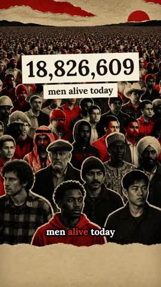](https://github.com/inematds/filme-em-codigo/releases/download/fonte-v1/style_vox_julian.mp4)  
[▶ Ver o vídeo: style_vox_julian.mp4](https://github.com/inematds/filme-em-codigo/releases/download/fonte-v1/style_vox_julian.mp4)

*Colagem de recortes de papel (estilo Vox)*

### Colagem de recortes de papel

**Mesmo estilo, sua ideia**

> Crie um curta animado vertical de 10 a 20 segundos sobre [SUA IDEIA AQUI]. Tom: uma breve história ou narrativa científica com uma reviravolta. Primeiro, escreva um roteiro de 5 ou 6 linhas (40 a 55 palavras, menos de 20 segundos de fala), verifique cada afirmação na web e liste as fontes. Escreva os números por extenso para a voz e em algarismos nas legendas. Estrutura das batidas: uma frase de abertura com um número grande sobre uma imagem ampla que apresente o cenário; uma frase sobre o protagonista; uma frase com evidências e uma estatística mostrada como uma grade de fichas, com uma delas acendendo; uma frase com mapa ou diagrama em um painel estilizado sobre um quadro-chave desfocado e escurecido; uma frase de reviravolta em que uma afirmação é riscada; e uma pergunta de desfecho. Planeje cerca de sete quadros-chave, um por batida. Estilo de todos os quadros-chave: explicação em colagem editorial com recortes de papel, formas de papel rasgado em camadas, recortes de fotos de arquivo em meio-tom, textura de risografia, paleta em creme, preto e vermelho vivo, bordas recortadas à mão com sombras suaves, estilo gráfico de documentário explicativo. Escreva cada prompt de quadro-chave começando pelo tema, depois a frase de estilo e, em seguida, "Composição vertical em retrato 9:16, com o tema principal no meio do quadro e o quarto inferior mais tranquilo. Sem texto, letras, logos ou marca-d'água." e gere as imagens em 9:16. Anime cada quadro-chave em um único shader WebGL: crie um mapa de profundidade com um modelo de profundidade monocular, desloque a amostragem de acordo com a profundidade para criar uma câmera com paralaxe, balance o primeiro plano próximo, desloque o céu distante muito levemente para o lado e aplique um line boil com metade da intensidade (line boil é uma pequena distorção com ruído que dá um passo 8 vezes por segundo). Câmera: panorâmica e zoom lentos (zoom de 1.02 a 1.12, com panorâmica lateral alternando de direção a cada segmento). Transições: entrada deslizante da direita, de 0.35 s, com inclinação de 4 graus e sombra projetada. Etiquetas junto às palavras: Lora Bold em preto #111111 sobre uma caixa de papel creme #f4ecd8 girada menos 1.5 graus, com vermelho de destaque #e1251b. Painéis e sobreposições: a mesma paleta, mais uma tela de pontos em meio-tom, textura de papel e granulação fina. Legendas: Lora Bold a 92 px, brancas com contorno preto de 8 px, duas ou três palavras por tela perto da parte inferior; palavra falada em #E1251B. Música: um arpejo de sintetizador sombrio por volta de 116 bpm, que para na reviravolta. Efeitos sonoros: tiques durante a contagem, crescendos e brilhos nos números-chave, arranhão de disco na reviravolta e uma nota grave de sintetizador na surpresa. Crie tudo em Remotion (React) com three.js, em 1080x1920 a 30 fps, alinhando cada corte, evento e som às marcações de tempo das palavras na voz. Gere toda a música e os efeitos em código, com a música cerca de 20 dB abaixo da voz e os efeitos um pouco mais baixos que ela.

<details><summary>Prompt original (inglês)</summary>

```text
Make a 10 to 20 second vertical animated short about [YOUR IDEA HERE]. Tone: a short history or science story with one twist. First write a 5 or 6 line script (40 to 55 words, under 20 seconds spoken), fact-check every claim on the web and list the sources. Write numbers as words for the voice and digits in the captions. Beat structure: a hook line with a big number over a wide establishing image; a hero line; an evidence line with a statistic shown as a grid of tokens where one lights up; a map or diagram line on a styled panel over a blurred, darkened keyframe; a reversal line where a claim gets struck through; and a payoff question. Plan about seven keyframes, one per beat. Style for every keyframe: editorial paper cutout collage explainer, layered torn paper shapes, halftone archival photo cutouts, risograph grain, cream, black and vivid red palette, hand-cut edges with soft drop shadows, documentary explainer graphic style. Write each keyframe prompt as the subject, then that style sentence, then "Vertical 9:16 portrait composition with the main subject in the middle of the frame and a calmer lower quarter. No text, no letters, no logos, no watermark." and generate them at 9:16. Animate each keyframe in one WebGL shader: make a depth map with a monocular depth model, offset the lookup by depth for a parallax camera, sway the near foreground, drift the far sky sideways very slightly, and add a half-strength line boil (a line boil is a small noise warp that steps 8 times a second). Camera: a slow pan-and-zoom (zoom 1.02 to 1.12 with a sideways pan that alternates direction every segment). Transitions: a 0.35 s slide in from the right with a 4 degree tilt and a drop shadow. Labels on their words: Lora Bold in black #111111 on a cream paper box #f4ecd8 rotated minus 1.5 degrees, accent red #e1251b. Panels and overlays: the same palette, plus a halftone dot screen, a paper texture and fine grain. Captions: Lora Bold at 92 px, white with an 8 px black outline, two or three words per page near the bottom, spoken word in #E1251B. Music: a dark synth arpeggio around 116 bpm that drops out for the reversal. Sound effects: ticks under the counter, risers and shimmers on the key numbers, a record scratch on the reversal and a low synth stab on the twist. Build it in Remotion (React) with three.js, 1080x1920 at 30 fps, keying every cut, event and sound to word timestamps from the voice. Synthesise all music and effects in code, with the music about 20 dB under the voice and the effects just below it.
```

</details>

**Copiar este filme exato · Prompt exato**

> Recrie este curta vertical de 26 segundos sobre os descendentes de Genghis Khan em um estilo ilustrado consistente, exatamente como descrito. Narração, palavra por palavra (cerca de 26 segundos): "Cerca de vinte milhões de homens vivos hoje podem descender de um só homem: Genghis Khan. Em 2003, geneticistas descobriram que um em cada doze homens em uma vasta região da Ásia carregava quase o mesmo cromossomo Y. Parecia que ele havia se espalhado junto com o Império Mongol, o maior império terrestre da história. Caso encerrado? Ainda não. O DNA de túmulos mongóis da época dele revelou uma linhagem diferente. Então, a árvore genealógica mais famosa do mundo talvez pertença a outra pessoa." Visual: explicação em colagem editorial com recortes de papel, formas de papel rasgado em camadas, recortes de fotos de arquivo em meio-tom, textura de risografia, paleta em creme, preto e vermelho vivo, bordas recortadas à mão com sombras suaves, estilo gráfico de documentário explicativo. Primeiro, gere sete imagens de quadros-chave em 9:16 (1080x1920) com estes prompts exatos, na ordem das batidas: 1. multidão: "uma vasta multidão de centenas de homens comuns de muitas origens diferentes, ombro a ombro numa ampla planície, estendendo-se até o horizonte, vista de um ângulo ligeiramente elevado. explicação em colagem editorial com recortes de papel, formas de papel rasgado em camadas, recortes de fotos de arquivo em meio-tom, textura de risografia, paleta em creme, preto e vermelho vivo, bordas recortadas à mão com sombras suaves, estilo gráfico de documentário explicativo. Vertical 9:16, tema centralizado, quarto inferior simples, sem texto ou logos." 2. Khan: "Genghis Khan, governante mongol do século XIII, com um capacete pontudo enfeitado com pele, bigode longo e fino e uma túnica deel, sentado com orgulho num cavalo resistente das estepes, no alto de uma colina gramada, visto de um ângulo heroico de baixo, centralizado. explicação em colagem editorial com recortes de papel, formas de papel rasgado em camadas, recortes de fotos de arquivo em meio-tom, textura de risografia, paleta em creme, preto e vermelho vivo, bordas recortadas à mão com sombras suaves, estilo gráfico de documentário explicativo. Vertical 9:16, tema centralizado, quarto inferior simples, sem texto ou logos." 3. laboratório: "dois geneticistas de jaleco branco num laboratório moderno de genética, estudando um grande modelo iluminado de dupla hélice de DNA, estantes com tubos de ensaio, um microscópio e bandejas de amostras. explicação em colagem editorial com recortes de papel, formas de papel rasgado em camadas, recortes de fotos de arquivo em meio-tom, textura de risografia, paleta em creme, preto e vermelho vivo, bordas recortadas à mão com sombras suaves, estilo gráfico de documentário explicativo. Vertical 9:16, tema centralizado, quarto inferior simples, sem texto ou logos." 4. exército: "uma longa coluna de cavaleiros mongóis com estandartes atravessando as vastas estepes da Eurásia, nuvens de poeira, montanhas distantes e uma escala épica. explicação em colagem editorial com recortes de papel, formas de papel rasgado em camadas, recortes de fotos de arquivo em meio-tom, textura de risografia, paleta em creme, preto e vermelho vivo, bordas recortadas à mão com sombras suaves, estilo gráfico de documentário explicativo. Vertical 9:16, tema centralizado, quarto inferior simples, sem texto ou logos." 5. caso: "a escrivaninha de madeira de um detetive sob uma luminária, com uma pasta grossa e fechada de investigação, uma lupa, uma xícara de chá e um mapa antigo da Ásia, clima sombrio e misterioso. explicação em colagem editorial com recortes de papel, formas de papel rasgado em camadas, recortes de fotos de arquivo em meio-tom, textura de risografia, paleta em creme, preto e vermelho vivo, bordas recortadas à mão com sombras suaves, estilo gráfico de documentário explicativo. Vertical 9:16, tema centralizado, quarto inferior simples, sem texto ou logos." 6. túmulo: "arqueólogos escavando um antigo túmulo mongol ao entardecer, com um esqueleto parcialmente descoberto na escavação, pincéis e espátulas, e uma fita de DNA levemente iluminada saindo do túmulo. explicação em colagem editorial com recortes de papel, formas de papel rasgado em camadas, recortes de fotos de arquivo em meio-tom, textura de risografia, paleta em creme, preto e vermelho vivo, bordas recortadas à mão com sombras suaves, estilo gráfico de documentário explicativo. Vertical 9:16, tema centralizado, quarto inferior simples, sem texto ou logos." 7. árvore: "uma gigantesca árvore genealógica antiga cujos galhos se espalham pelo céu inteiro, centenas de pequenos medalhões com retratos pendurados nos galhos e, na raiz, a silhueta misteriosa de uma pessoa encapuzada. explicação em colagem editorial com recortes de papel, formas de papel rasgado em camadas, recortes de fotos de arquivo em meio-tom, textura de risografia, paleta em creme, preto e vermelho vivo, bordas recortadas à mão com sombras suaves, estilo gráfico de documentário explicativo. Vertical 9:16, tema centralizado, quarto inferior simples, sem texto ou logos." Anime cada quadro-chave em um único shader WebGL: crie um mapa de profundidade com um modelo de profundidade monocular, desloque a amostragem de acordo com a profundidade para criar uma câmera com paralaxe, balance o primeiro plano próximo, desloque o céu distante muito levemente para o lado e aplique um line boil com metade da intensidade (line boil é uma pequena distorção com ruído que dá um passo 8 vezes por segundo). Câmera em cada quadro-chave: panorâmica e zoom lentos (zoom de 1.02 a 1.12, com panorâmica lateral alternando de direção a cada segmento). Transição entre segmentos: entrada deslizante da direita, de 0.35 s, com inclinação de 4 graus e sombra projetada. Etiquetas na tela: Lora Bold em preto #111111 sobre uma caixa de papel creme #f4ecd8 girada menos 1.5 graus, com vermelho de destaque #e1251b. Estilo do painel do mapa: mar creme #efe6d0, terra bege #d8cdb0, linhas pretas de 3 px, região vermelha rgba(225,37,27,0.75), império preto rgba(17,17,17,0.55), pontos vermelhos, textura de papel. Sobreposições de textura: tela de pontos em meio-tom, textura de papel e granulação fina. Linha do tempo: de 0 a 2.3 s, multidão: um contador sobe até 20,000,000 de "Cerca de" até "hoje", com "homens vivos hoje" em "homens". De 2.3 a 5.05 s, Khan: "Genghis Khan" em "Genghis". De 5.05 a 7.6 s, laboratório: "2003" e "geneticistas" nas respectivas palavras. De 7.6 a 8.45 s, a multidão ampliada para 1.35x: "1 em 12" sobre uma grade de 6 por 2 fichas arredondadas que surgem uma a uma; a oitava brilha na cor de destaque em "doze". De 8.45 a 12.6 s, o exército desfocado e escurecido atrás de um painel de mapa arredondado da Ásia: a região amostrada aparece da direita para a esquerda em "vasta", e os pontos surgem em "carregava", com "uma vasta região da Ásia" e "o mesmo cromossomo Y" em "Y". De 12.6 a 14.45 s, o exército nítido: "Império Mongol". De 14.45 a 16.55 s, mapa novamente: o império se expande a partir de um marcador pulsante na Mongólia, com "maior império terrestre" e "24 milhões de km²". De 16.55 a 18.6 s, caso: "CASO ENCERRADO?", riscado por uma barra de destaque em "Ainda" enquanto "Ainda não." aparece em destaque. De 18.6 a 22.15 s, túmulo: "túmulos mongóis", "1130 a 1250" em "época" e "uma linhagem diferente" em destaque. De 22.15 s até o fim, árvore: "árvore genealógica mais famosa", substituída em "pessoa" por "outra pessoa?" em destaque. As etiquetas aparecem gradualmente e sobem durante 0.2 s. Legendas: grave as legendas palavra por palavra em Lora Bold a 92 px, brancas com contorno preto de 8 px e sombra de 3 px, duas ou três palavras por tela, centralizadas cerca de 330 px acima da parte inferior, com a palavra falada em #E1251B. Música: um arpejo sombrio de sintetizador em Lá menor, com ondas dente de serra desafinadas passando por um filtro passa-baixas a 116 bpm, com uma nota grave de baixo a cada compasso; a música diminui durante "Ainda não". Efeitos sonoros: sequência rápida de tiques enquanto o contador sobe, crescendo de ruído até "doze" com um brilho agudo, crescendo em "espalhado", arranhão de disco em "Ainda", nota grave de sintetizador em "diferente" e um brilho longo em "pessoa". Configuração técnica: Remotion (React) com three.js, 1080x1920 a 30 fps, cerca de 26 segundos. Gere a voz com qualquer mecanismo de conversão de texto em fala, obtenha as marcações de tempo das palavras e alinhe cada corte, evento e som ao início da palavra correspondente. Grave as legendas no vídeo. Gere toda a música e os efeitos em código, sem amostras. Mixe a música cerca de 20 dB abaixo da voz e reduza seu volume durante as falas; deixe os efeitos um pouco abaixo da voz.

<details><summary>Prompt original (inglês)</summary>

```text
Recreate this 26 second vertical short about Genghis Khan's descendants in one consistent illustrated look, exactly as described. Narration, word for word (about 26 seconds): "About twenty million men alive today may descend from one man: Genghis Khan. In 2003, geneticists found that one in twelve men across a huge stretch of Asia carried almost the same Y chromosome. It seemed to spread with the Mongol Empire, the largest land empire in history. Case closed? Not quite. DNA from Mongol graves of his time showed a different line. So the world's most famous family tree might belong to someone else." Look: editorial paper cutout collage explainer, layered torn paper shapes, halftone archival photo cutouts, risograph grain, cream, black and vivid red palette, hand-cut edges with soft drop shadows, documentary explainer graphic style. First generate seven keyframe images at 9:16 (1080x1920) with these exact prompts, in beat order: 1. crowd: "a vast crowd of hundreds of ordinary men of many different backgrounds standing shoulder to shoulder across a wide plain, the crowd stretching all the way to the horizon, seen from slightly above. editorial paper cutout collage explainer, layered torn paper shapes, halftone archival photo cutouts, risograph grain, cream, black and vivid red palette, hand-cut edges with soft drop shadows, documentary explainer graphic style. Vertical 9:16, subject centred, simple lower quarter, no text or logos." 2. khan: "Genghis Khan, the 13th century Mongol ruler, with a fur-trimmed pointed helmet, long thin moustache and a deel robe, sitting proudly on a sturdy steppe horse on a grassy hill, heroic low angle, centred. editorial paper cutout collage explainer, layered torn paper shapes, halftone archival photo cutouts, risograph grain, cream, black and vivid red palette, hand-cut edges with soft drop shadows, documentary explainer graphic style. Vertical 9:16, subject centred, simple lower quarter, no text or logos." 3. lab: "two geneticists in white lab coats in a modern genetics laboratory, studying a large glowing DNA double helix model, racks of test tubes, a microscope and sample trays. editorial paper cutout collage explainer, layered torn paper shapes, halftone archival photo cutouts, risograph grain, cream, black and vivid red palette, hand-cut edges with soft drop shadows, documentary explainer graphic style. Vertical 9:16, subject centred, simple lower quarter, no text or logos." 4. army: "a long column of Mongol horsemen with banners riding out across the endless Eurasian steppe, clouds of dust, distant mountains, epic sense of scale. editorial paper cutout collage explainer, layered torn paper shapes, halftone archival photo cutouts, risograph grain, cream, black and vivid red palette, hand-cut edges with soft drop shadows, documentary explainer graphic style. Vertical 9:16, subject centred, simple lower quarter, no text or logos." 5. case: "a detective's wooden desk under a lamp with a thick closed case file folder, a magnifying glass, a cup of tea and an old map of Asia, moody and mysterious. editorial paper cutout collage explainer, layered torn paper shapes, halftone archival photo cutouts, risograph grain, cream, black and vivid red palette, hand-cut edges with soft drop shadows, documentary explainer graphic style. Vertical 9:16, subject centred, simple lower quarter, no text or logos." 6. grave: "archaeologists excavating an ancient Mongol burial mound at dusk, a skeleton partly uncovered in the dig, brushes and trowels, a faint glowing DNA strand rising out of the grave. editorial paper cutout collage explainer, layered torn paper shapes, halftone archival photo cutouts, risograph grain, cream, black and vivid red palette, hand-cut edges with soft drop shadows, documentary explainer graphic style. Vertical 9:16, subject centred, simple lower quarter, no text or logos." 7. tree: "a gigantic ancient family tree whose branches spread across the whole sky, hundreds of tiny portrait medallions hanging from the branches, and at the root a mysterious hooded silhouette. editorial paper cutout collage explainer, layered torn paper shapes, halftone archival photo cutouts, risograph grain, cream, black and vivid red palette, hand-cut edges with soft drop shadows, documentary explainer graphic style. Vertical 9:16, subject centred, simple lower quarter, no text or logos." Animate each keyframe in one WebGL shader: make a depth map with a monocular depth model, offset the lookup by depth for a parallax camera, sway the near foreground, drift the far sky sideways very slightly, and add a half-strength line boil (a line boil is a small noise warp that steps 8 times a second). Camera on each keyframe: a slow pan-and-zoom (zoom 1.02 to 1.12 with a sideways pan that alternates direction every segment). Transition between segments: a 0.35 s slide in from the right with a 4 degree tilt and a drop shadow. On-screen labels: Lora Bold in black #111111 on a cream paper box #f4ecd8 rotated minus 1.5 degrees, accent red #e1251b. Map panel skin: cream sea #efe6d0, tan land #d8cdb0, black 3 px lines, a red region rgba(225,37,27,0.75), a black empire rgba(17,17,17,0.55), red dots, paper texture. Texture overlays: a halftone dot screen, a paper texture and fine grain. Timeline: 0 to 2.3 s, crowd: a counter climbs to 20,000,000 from "About" to "today", with "men alive today" on "men". 2.3 to 5.05 s, khan: "Genghis Khan" on "Genghis". 5.05 to 7.6 s, lab: "2003" and "geneticists" on their words. 7.6 to 8.45 s, the crowd zoomed to 1.35x: "1 in 12" over a 6 by 2 grid of rounded pill tokens popping in, the eighth glowing in the accent colour on "twelve". 8.45 to 12.6 s, the army blurred and darkened behind a rounded map panel of Asia: the sampled region wipes in east to west on "huge" and dots pop on "carried", with "a huge stretch of Asia" and "the same Y chromosome" on "Y". 12.6 to 14.45 s, clear army: "Mongol Empire". 14.45 to 16.55 s, map again: the empire floods out from a pulsing Mongolia marker, with "largest land empire" and "24 million km²". 16.55 to 18.6 s, case: "CASE CLOSED?", struck through by an accent bar on "Not" as "Not quite." appears in the accent. 18.6 to 22.15 s, grave: "Mongol graves", "1130 to 1250" on "time" and "a different line" in the accent. 22.15 s to the end, tree: "most famous family tree", replaced on "someone" by "someone else?" in the accent. Labels fade and rise in over 0.2 s. Captions: burn in word-by-word captions in Lora Bold at 92 px, white with an 8 px black outline and a 3 px shadow, two or three words per page, centred about 330 px above the bottom, with the spoken word in #E1251B. Music: a dark A minor synth arpeggio of detuned saw waves through a low-pass filter at 116 bpm with a deep bass note every bar, ducking out for "Not quite". Sound effects: a fast run of ticks while the counter climbs, a noise riser into "twelve" with a bright shimmer, a riser on "spread", a record scratch on "Not", a low synth stab on "different" and a long shimmer on "someone". Technical setup: Remotion (React) with three.js, 1080x1920 at 30 fps, about 26 seconds. Make the voice with any text to speech engine, get word timestamps, and key every cut, event and sound to the start of its word. Burn the captions in. Synthesise all music and effects in code, with no samples. Mix the music about 20 dB under the voice and ducked under speech, with the effects just below the voice.
```

</details>

[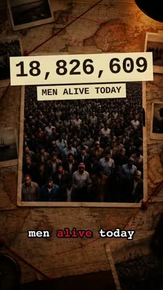](https://github.com/inematds/filme-em-codigo/releases/download/fonte-v1/style_mapdoc_julian.mp4)  
[▶ Ver o vídeo: style_mapdoc_julian.mp4](https://github.com/inematds/filme-em-codigo/releases/download/fonte-v1/style_mapdoc_julian.mp4)

*Mesa de mapas documental (estilo Johnny Harris)*

### Mesa de mapas documental

**Mesmo estilo, sua ideia**

> Crie um curta animado vertical de 10 a 20 segundos sobre [SUA IDEIA AQUI]. Tom: uma breve história ou narrativa científica com uma reviravolta. Primeiro, escreva um roteiro de 5 ou 6 linhas (40 a 55 palavras, com menos de 20 segundos de fala), verifique cada afirmação na web e liste as fontes. Escreva os números por extenso na fala e em algarismos nas legendas. Estrutura dos momentos: uma frase de abertura com um número grande sobre uma imagem ampla de contexto; uma frase de apresentação; uma frase de evidência com uma estatística mostrada como uma grade de símbolos, com um deles acendendo; uma frase com mapa ou diagrama em um painel estilizado sobre um quadro-chave desfocado e escurecido; uma frase de reviravolta em que uma afirmação é riscada; e uma pergunta final. Planeje cerca de sete quadros-chave, um por momento. Estilo de cada quadro-chave: cena de documentário explicativo sobre uma mesa de mapas de papel antigo, linhas vermelhas desenhadas à mão, alfinetes e barbante vermelho, fotos polaroid e recortes de arquivo presos com fita, iluminação quente e prática de mesa, fotografia de mesa vista de cima. Escreva cada prompt de quadro-chave começando pelo tema, depois a frase de estilo e, em seguida, "Composição vertical 9:16, com o tema principal no centro do quadro e o quarto inferior mais calmo. Sem texto, letras, logotipos ou marca-d'água." e gere as imagens em 9:16. Anime cada quadro-chave em um shader WebGL: crie um mapa de profundidade com um modelo de profundidade monocular, desloque a consulta pela profundidade para uma câmera com paralaxe, balance o primeiro plano próximo, mantenha o céu parado e não use line boil (line boil é uma pequena distorção ruidosa que muda 8 vezes por segundo). Câmera: panorâmica e zoom lentos (zoom de 1.02 a 1.12, com movimento lateral que alterna de direção a cada segmento). Transições: dissolução cruzada de 0.4 s. Identificações sobre as palavras correspondentes: fonte monoespaçada em negrito, maiúscula, estilo máquina de escrever, em marrom-escuro #1b1410 sobre uma caixa de pergaminho presa com fita, rgba(240,226,180,0.94), girada menos 2 graus; vermelho de destaque #c8102e. Painéis e sobreposições: a mesma paleta, mais vinheta quente e granulação fina. Legendas: fonte monoespaçada estilo máquina de escrever (estilo Courier) em 92 px, branca com contorno preto de 8 px, duas ou três palavras por página perto da parte inferior; a palavra falada em #C8102E. Música: frases suaves de flauta em escala pentatônica sobre notas graves e lentas de cítara. Efeitos sonoros: batidas de tambor grave na abertura, na reviravolta e na revelação, e um brilho sonoro na estatística principal. Crie o vídeo em Remotion (React) com three.js, em 1080x1920 a 30 fps, sincronizando cada corte, evento e som com as marcas de tempo das palavras da voz. Sintetize toda a música e os efeitos em código, com a música cerca de 20 dB abaixo da voz e os efeitos logo abaixo dela.

<details><summary>Prompt original (inglês)</summary>

```text
Make a 10 to 20 second vertical animated short about [YOUR IDEA HERE]. Tone: a short history or science story with one twist. First write a 5 or 6 line script (40 to 55 words, under 20 seconds spoken), fact-check every claim on the web and list the sources. Write numbers as words for the voice and digits in the captions. Beat structure: a hook line with a big number over a wide establishing image; a hero line; an evidence line with a statistic shown as a grid of tokens where one lights up; a map or diagram line on a styled panel over a blurred, darkened keyframe; a reversal line where a claim gets struck through; and a payoff question. Plan about seven keyframes, one per beat. Style for every keyframe: documentary explainer shot on a vintage paper map table, hand-drawn red marker lines, push pins and red string, taped polaroid photos and archival clippings, warm practical desk lighting, top-down tabletop photography. Write each keyframe prompt as the subject, then that style sentence, then "Vertical 9:16 portrait composition with the main subject in the middle of the frame and a calmer lower quarter. No text, no letters, no logos, no watermark." and generate them at 9:16. Animate each keyframe in one WebGL shader: make a depth map with a monocular depth model, offset the lookup by depth for a parallax camera, sway the near foreground, keep the sky still, and use no line boil (a line boil is a small noise warp that steps 8 times a second). Camera: a slow pan-and-zoom (zoom 1.02 to 1.12 with a sideways pan that alternates direction every segment). Transitions: a 0.4 s cross dissolve. Labels on their words: an uppercase bold typewriter monospace in dark brown #1b1410 on a taped parchment box rgba(240,226,180,0.94) rotated minus 2 degrees, accent red #c8102e. Panels and overlays: the same palette, plus a warm vignette and fine grain. Captions: a monospaced typewriter face (Courier style) at 92 px, white with an 8 px black outline, two or three words per page near the bottom, spoken word in #C8102E. Music: breathy flute phrases on a pentatonic scale over slow low zither plucks. Sound effects: deep drum hits on the hook, the reversal and the reveal, and a shimmer on the key statistic. Build it in Remotion (React) with three.js, 1080x1920 at 30 fps, keying every cut, event and sound to word timestamps from the voice. Synthesise all music and effects in code, with the music about 20 dB under the voice and the effects just below it.
```

</details>

**Copiar este filme exato · Prompt exato**

> Recrie este curta vertical de 26 segundos sobre os descendentes de Genghis Khan com um visual ilustrado consistente, exatamente como descrito. Narração, palavra por palavra (cerca de 26 segundos): "Cerca de vinte milhões de homens vivos hoje talvez descendam de um homem: Genghis Khan. Em 2003, geneticistas descobriram que um em cada doze homens em uma enorme região da Ásia tinha quase o mesmo cromossomo Y. Parecia que ele havia se espalhado com o Império Mongol, o maior império terrestre da história. Caso encerrado? Ainda não. O DNA de túmulos mongóis da época dele revelou uma linhagem diferente. Então, a árvore genealógica mais famosa do mundo talvez pertença a outra pessoa." Visual: cena de documentário explicativo sobre uma mesa de mapas de papel antigo, linhas vermelhas desenhadas à mão, alfinetes e barbante vermelho, fotos polaroid e recortes de arquivo presos com fita, iluminação quente e prática de mesa, fotografia de mesa vista de cima. Primeiro, gere sete imagens de quadros-chave em 9:16 (1080x1920) com estes prompts exatos, na ordem dos momentos: 1. multidão: "uma vasta multidão de centenas de homens comuns de várias origens, lado a lado em uma ampla planície que se estende até o horizonte, vista de um pouco acima. Cena de documentário explicativo sobre uma mesa de mapas de papel antigo, linhas vermelhas desenhadas à mão, alfinetes e barbante vermelho, fotos polaroid e recortes de arquivo presos com fita, iluminação quente e prática de mesa, fotografia de mesa vista de cima. Vertical 9:16, tema centralizado, quarto inferior simples, sem texto ou logotipos." 2. khan: "Genghis Khan, governante mongol do século XIII, com um capacete pontudo enfeitado de pele, bigode longo e fino e túnica deel, sentado com orgulho em um cavalo robusto das estepes, numa colina gramada, ângulo heroico baixo, ao centro. Cena de documentário explicativo sobre uma mesa de mapas de papel antigo, linhas vermelhas desenhadas à mão, alfinetes e barbante vermelho, fotos polaroid e recortes de arquivo presos com fita, iluminação quente e prática de mesa, fotografia de mesa vista de cima. Vertical 9:16, tema centralizado, quarto inferior simples, sem texto ou logotipos." 3. laboratório: "dois geneticistas de jaleco branco em um laboratório moderno de genética, estudando um grande modelo luminoso de dupla hélice de DNA, com estantes de tubos de ensaio, um microscópio e bandejas de amostras. Cena de documentário explicativo sobre uma mesa de mapas de papel antigo, linhas vermelhas desenhadas à mão, alfinetes e barbante vermelho, fotos polaroid e recortes de arquivo presos com fita, iluminação quente e prática de mesa, fotografia de mesa vista de cima. Vertical 9:16, tema centralizado, quarto inferior simples, sem texto ou logotipos." 4. exército: "uma longa coluna de cavaleiros mongóis com estandartes atravessando as intermináveis estepes da Eurásia, nuvens de poeira, montanhas distantes, sensação épica de escala. Cena de documentário explicativo sobre uma mesa de mapas de papel antigo, linhas vermelhas desenhadas à mão, alfinetes e barbante vermelho, fotos polaroid e recortes de arquivo presos com fita, iluminação quente e prática de mesa, fotografia de mesa vista de cima. Vertical 9:16, tema centralizado, quarto inferior simples, sem texto ou logotipos." 5. caso: "mesa de madeira de um detetive sob uma luminária, com uma pasta grossa e fechada, uma lupa, uma xícara de chá e um mapa antigo da Ásia, clima sombrio e misterioso. Cena de documentário explicativo sobre uma mesa de mapas de papel antigo, linhas vermelhas desenhadas à mão, alfinetes e barbante vermelho, fotos polaroid e recortes de arquivo presos com fita, iluminação quente e prática de mesa, fotografia de mesa vista de cima. Vertical 9:16, tema centralizado, quarto inferior simples, sem texto ou logotipos." 6. túmulo: "arqueólogos escavando um antigo túmulo mongol ao anoitecer, com um esqueleto parcialmente descoberto na escavação, pincéis e espátulas, e uma tênue fita de DNA luminosa saindo da sepultura. Cena de documentário explicativo sobre uma mesa de mapas de papel antigo, linhas vermelhas desenhadas à mão, alfinetes e barbante vermelho, fotos polaroid e recortes de arquivo presos com fita, iluminação quente e prática de mesa, fotografia de mesa vista de cima. Vertical 9:16, tema centralizado, quarto inferior simples, sem texto ou logotipos." 7. árvore: "uma gigantesca árvore genealógica antiga, com galhos que se espalham por todo o céu, centenas de pequenos medalhões com retratos pendurados nos galhos e, na raiz, uma misteriosa silhueta encapuzada. Cena de documentário explicativo sobre uma mesa de mapas de papel antigo, linhas vermelhas desenhadas à mão, alfinetes e barbante vermelho, fotos polaroid e recortes de arquivo presos com fita, iluminação quente e prática de mesa, fotografia de mesa vista de cima. Vertical 9:16, tema centralizado, quarto inferior simples, sem texto ou logotipos." Anime cada quadro-chave em um shader WebGL: crie um mapa de profundidade com um modelo de profundidade monocular, desloque a consulta pela profundidade para uma câmera com paralaxe, balance o primeiro plano próximo, mantenha o céu parado e não use line boil (line boil é uma pequena distorção ruidosa que muda 8 vezes por segundo). Câmera em cada quadro-chave: panorâmica e zoom lentos (zoom de 1.02 a 1.12, com movimento lateral que alterna de direção a cada segmento). Transição entre segmentos: dissolução cruzada de 0.4 s. Identificações na tela: fonte monoespaçada em negrito, maiúscula, estilo máquina de escrever, em marrom-escuro #1b1410 sobre uma caixa de pergaminho presa com fita, rgba(240,226,180,0.94), girada menos 2 graus; vermelho de destaque #c8102e. Visual do painel de mapa: moldura de couro marrom #6b4a2c, terra em pergaminho #ead9b0, linhas marrons #5a4630, região e império em vermelho suave, pontos vermelhos #c8102e, arcos desenhados com marcador vermelho partindo da Mongólia até as bordas do império e um alfinete vermelho pulsante. Sobreposições de textura: vinheta quente e granulação fina. Linha do tempo: de 0 a 2.3 s, multidão: um contador sobe até 20,000,000 de "About" até "today", com "men alive today" em "men". De 2.3 a 5.05 s, khan: "Genghis Khan" em "Genghis". De 5.05 a 7.6 s, laboratório: "2003" e "geneticists" em suas palavras. De 7.6 a 8.45 s, multidão ampliada para 1.35x: "1 em 12" sobre uma grade de 6 por 2 cápsulas arredondadas surgindo na tela; a oitava brilha na cor de destaque em "twelve". De 8.45 a 12.6 s, exército desfocado e escurecido atrás de um painel de mapa arredondado da Ásia: a região amostrada aparece da direita para a esquerda em "huge" e os pontos surgem em "carried", com "a huge stretch of Asia" e "o mesmo cromossomo Y" em "Y". De 12.6 a 14.45 s, exército nítido: "Império Mongol". De 14.45 a 16.55 s, mapa novamente: o império se expande a partir de um marcador pulsante na Mongólia, com "maior império terrestre" e "24 milhões de km²". De 16.55 a 18.6 s, caso: "CASO ENCERRADO?", riscado por uma barra de destaque em "Not", enquanto "Ainda não." aparece em destaque. De 18.6 a 22.15 s, túmulo: "túmulos mongóis", "1130 a 1250" em "time" e "uma linhagem diferente" em destaque. De 22.15 s até o fim, árvore: "árvore genealógica mais famosa", substituída em "someone" por "outra pessoa?" em destaque. As identificações aparecem com fade e subida ao longo de 0.2 s. Legendas: grave na imagem legendas palavra por palavra, em fonte monoespaçada estilo máquina de escrever (estilo Courier), 92 px, brancas com contorno preto de 8 px e sombra de 3 px, duas ou três palavras por página, centralizadas a cerca de 330 px da parte inferior, com a palavra falada em #C8102E. Música: frases suaves de flauta de bambu em escala pentatônica de Lá menor sobre notas graves e lentas de cítara a cada 1.2 segundos. Efeitos sonoros: batidas profundas de taiko no início e em "Khan", aos 12.6 s, em "closed", "Not", "different" e "someone"; brilho sonoro em "twelve" e um trote de cascos discreto durante o exército. Configuração técnica: Remotion (React) com three.js, 1080x1920 a 30 fps, cerca de 26 segundos. Gere a voz com qualquer mecanismo de conversão de texto em fala, obtenha as marcas de tempo das palavras e sincronize cada corte, evento e som com o início da palavra correspondente. Grave as legendas no vídeo. Sintetize toda a música e os efeitos em código, sem amostras. Mixe a música cerca de 20 dB abaixo da voz e reduza seu volume durante a fala; os efeitos devem ficar logo abaixo da voz.

<details><summary>Prompt original (inglês)</summary>

```text
Recreate this 26 second vertical short about Genghis Khan's descendants in one consistent illustrated look, exactly as described. Narration, word for word (about 26 seconds): "About twenty million men alive today may descend from one man: Genghis Khan. In 2003, geneticists found that one in twelve men across a huge stretch of Asia carried almost the same Y chromosome. It seemed to spread with the Mongol Empire, the largest land empire in history. Case closed? Not quite. DNA from Mongol graves of his time showed a different line. So the world's most famous family tree might belong to someone else." Look: documentary explainer shot on a vintage paper map table, hand-drawn red marker lines, push pins and red string, taped polaroid photos and archival clippings, warm practical desk lighting, top-down tabletop photography. First generate seven keyframe images at 9:16 (1080x1920) with these exact prompts, in beat order: 1. crowd: "a vast crowd of hundreds of ordinary men of many different backgrounds standing shoulder to shoulder across a wide plain, the crowd stretching all the way to the horizon, seen from slightly above. documentary explainer shot on a vintage paper map table, hand-drawn red marker lines, push pins and red string, taped polaroid photos and archival clippings, warm practical desk lighting, top-down tabletop photography. Vertical 9:16, subject centred, simple lower quarter, no text or logos." 2. khan: "Genghis Khan, the 13th century Mongol ruler, with a fur-trimmed pointed helmet, long thin moustache and a deel robe, sitting proudly on a sturdy steppe horse on a grassy hill, heroic low angle, centred. documentary explainer shot on a vintage paper map table, hand-drawn red marker lines, push pins and red string, taped polaroid photos and archival clippings, warm practical desk lighting, top-down tabletop photography. Vertical 9:16, subject centred, simple lower quarter, no text or logos." 3. lab: "two geneticists in white lab coats in a modern genetics laboratory, studying a large glowing DNA double helix model, racks of test tubes, a microscope and sample trays. documentary explainer shot on a vintage paper map table, hand-drawn red marker lines, push pins and red string, taped polaroid photos and archival clippings, warm practical desk lighting, top-down tabletop photography. Vertical 9:16, subject centred, simple lower quarter, no text or logos." 4. army: "a long column of Mongol horsemen with banners riding out across the endless Eurasian steppe, clouds of dust, distant mountains, epic sense of scale. documentary explainer shot on a vintage paper map table, hand-drawn red marker lines, push pins and red string, taped polaroid photos and archival clippings, warm practical desk lighting, top-down tabletop photography. Vertical 9:16, subject centred, simple lower quarter, no text or logos." 5. case: "a detective's wooden desk under a lamp with a thick closed case file folder, a magnifying glass, a cup of tea and an old map of Asia, moody and mysterious. documentary explainer shot on a vintage paper map table, hand-drawn red marker lines, push pins and red string, taped polaroid photos and archival clippings, warm practical desk lighting, top-down tabletop photography. Vertical 9:16, subject centred, simple lower quarter, no text or logos." 6. grave: "archaeologists excavating an ancient Mongol burial mound at dusk, a skeleton partly uncovered in the dig, brushes and trowels, a faint glowing DNA strand rising out of the grave. documentary explainer shot on a vintage paper map table, hand-drawn red marker lines, push pins and red string, taped polaroid photos and archival clippings, warm practical desk lighting, top-down tabletop photography. Vertical 9:16, subject centred, simple lower quarter, no text or logos." 7. tree: "a gigantic ancient family tree whose branches spread across the whole sky, hundreds of tiny portrait medallions hanging from the branches, and at the root a mysterious hooded silhouette. documentary explainer shot on a vintage paper map table, hand-drawn red marker lines, push pins and red string, taped polaroid photos and archival clippings, warm practical desk lighting, top-down tabletop photography. Vertical 9:16, subject centred, simple lower quarter, no text or logos." Animate each keyframe in one WebGL shader: make a depth map with a monocular depth model, offset the lookup by depth for a parallax camera, sway the near foreground, keep the sky still, and use no line boil (a line boil is a small noise warp that steps 8 times a second). Camera on each keyframe: a slow pan-and-zoom (zoom 1.02 to 1.12 with a sideways pan that alternates direction every segment). Transition between segments: a 0.4 s cross dissolve. On-screen labels: an uppercase bold typewriter monospace in dark brown #1b1410 on a taped parchment box rgba(240,226,180,0.94) rotated minus 2 degrees, accent red #c8102e. Map panel skin: a brown leather surround #6b4a2c, parchment land #ead9b0, brown lines #5a4630, a faint red region and empire, red dots #c8102e, red marker arcs drawn from Mongolia to the edges of the empire and a pulsing red pin. Texture overlays: a warm vignette and fine grain. Timeline: 0 to 2.3 s, crowd: a counter climbs to 20,000,000 from "About" to "today", with "men alive today" on "men". 2.3 to 5.05 s, khan: "Genghis Khan" on "Genghis". 5.05 to 7.6 s, lab: "2003" and "geneticists" on their words. 7.6 to 8.45 s, the crowd zoomed to 1.35x: "1 in 12" over a 6 by 2 grid of rounded pill tokens popping in, the eighth glowing in the accent colour on "twelve". 8.45 to 12.6 s, the army blurred and darkened behind a rounded map panel of Asia: the sampled region wipes in east to west on "huge" and dots pop on "carried", with "a huge stretch of Asia" and "the same Y chromosome" on "Y". 12.6 to 14.45 s, clear army: "Mongol Empire". 14.45 to 16.55 s, map again: the empire floods out from a pulsing Mongolia marker, with "largest land empire" and "24 million km²". 16.55 to 18.6 s, case: "CASE CLOSED?", struck through by an accent bar on "Not" as "Not quite." appears in the accent. 18.6 to 22.15 s, grave: "Mongol graves", "1130 to 1250" on "time" and "a different line" in the accent. 22.15 s to the end, tree: "most famous family tree", replaced on "someone" by "someone else?" in the accent. Labels fade and rise in over 0.2 s. Captions: burn in word-by-word captions in a monospaced typewriter face (Courier style) at 92 px, white with an 8 px black outline and a 3 px shadow, two or three words per page, centred about 330 px above the bottom, with the spoken word in #C8102E. Music: soft breathy bamboo-flute phrases on an A minor pentatonic scale over slow low zither plucks every 1.2 seconds. Sound effects: deep taiko hits at the start and on "Khan", at 12.6 s, "closed", "Not", "different" and "someone", a shimmer on "twelve" and a quiet hoof gallop under the army. Technical setup: Remotion (React) with three.js, 1080x1920 at 30 fps, about 26 seconds. Make the voice with any text to speech engine, get word timestamps, and key every cut, event and sound to the start of its word. Burn the captions in. Synthesise all music and effects in code, with no samples. Mix the music about 20 dB under the voice and ducked under speech, with the effects just below the voice.
```

</details>

[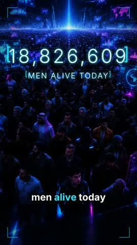](https://github.com/inematds/filme-em-codigo/releases/download/fonte-v1/style_future_julian.mp4)  
[▶ Ver o vídeo: style_future_julian.mp4](https://github.com/inematds/filme-em-codigo/releases/download/fonte-v1/style_future_julian.mp4)

*Futurista 3D (ficção científica holográfica)*

### 3D futurista

**Mesmo estilo, sua ideia**

> Crie um curta animado vertical de 10 a 20 segundos sobre [SUA IDEIA AQUI]. Tom: uma breve história ou narrativa científica com uma reviravolta. Primeiro, escreva um roteiro de 5 ou 6 linhas (40 a 55 palavras, menos de 20 segundos de fala), confira todos os fatos na web e liste as fontes. Escreva os números por extenso para a voz e em algarismos nas legendas. Estrutura das batidas: uma frase de abertura com um número grande sobre uma imagem ampla que estabeleça o cenário; uma frase sobre o protagonista; uma frase de evidência com uma estatística mostrada como uma grade de peças, com uma delas acendendo; uma frase com mapa ou diagrama em um painel estilizado sobre um quadro-chave desfocado e escurecido; uma frase de reviravolta em que uma afirmação é riscada; e uma pergunta para fechar. Planeje cerca de sete quadros-chave, um por batida. Estilo de cada quadro-chave: renderização cinematográfica 3D ultrafuturista, interfaces holográficas e painéis de dados flutuantes, luz neon ciano e magenta, superfícies de vidro e cromo, raios de luz volumétricos, escuridão azul profunda, ficção científica sofisticada. Escreva cada prompt de quadro-chave nesta ordem: o assunto, depois a frase de estilo, depois "Composição vertical 9:16 em retrato, com o assunto principal no meio do quadro e o quarto inferior mais tranquilo. Sem texto, letras, logotipos ou marca-d'água." e gere em 9:16. Anime cada quadro-chave em um shader WebGL: crie um mapa de profundidade com um modelo de profundidade monocular, desloque a amostragem conforme a profundidade para uma câmera com paralaxe, balance o primeiro plano próximo, desloque o céu distante muito levemente para o lado e não use line boil (line boil é uma pequena distorção causada por ruído que avança em 8 etapas por segundo). Câmera: panorâmica e zoom lentos (zoom de 1.02 a 1.12, com movimento lateral alternando de direção a cada segmento). Transições: glitch de 0.25 s (8 etapas de cintilação com deslocamentos laterais e mudança de matiz). Identificadores sobre as palavras correspondentes: Inter Light em maiúsculas, branco-gelo #e8fbff com espaçamento entre letras de 0.12 em, brilho ciano #29e3ff e colchetes quadrados ciano em cada lado, destaque em ciano #29e3ff. Painéis e sobreposições: a mesma paleta, mais colchetes de canto de HUD ciano, código de tempo REC no canto superior esquerdo, uma linha de varredura em movimento, linhas de varredura horizontais e vinheta. Legendas: Inter a 92 px, brancas com contorno preto de 8 px, duas ou três palavras por página perto da parte inferior, palavra falada em #29E3FF. Música: arpejo de sintetizador sombrio, por volta de 116 bpm, que para na reviravolta. Efeitos sonoros: tiques durante a contagem, crescendos e brilhos nos números-chave, som de disco riscado na reviravolta e uma nota grave de sintetizador na surpresa. Crie em Remotion (React) com three.js, 1080x1920 a 30 fps, marcando cada corte, evento e som pelo tempo das palavras da voz. Sintetize toda a música e os efeitos no código, com a música cerca de 20 dB abaixo da voz e os efeitos logo abaixo dela.

<details><summary>Prompt original (inglês)</summary>

```text
Make a 10 to 20 second vertical animated short about [YOUR IDEA HERE]. Tone: a short history or science story with one twist. First write a 5 or 6 line script (40 to 55 words, under 20 seconds spoken), fact-check every claim on the web and list the sources. Write numbers as words for the voice and digits in the captions. Beat structure: a hook line with a big number over a wide establishing image; a hero line; an evidence line with a statistic shown as a grid of tokens where one lights up; a map or diagram line on a styled panel over a blurred, darkened keyframe; a reversal line where a claim gets struck through; and a payoff question. Plan about seven keyframes, one per beat. Style for every keyframe: ultra futuristic cinematic 3D render, holographic interfaces and floating data panels, neon cyan and magenta light, glass and chrome surfaces, volumetric light rays, deep blue darkness, high-end sci-fi. Write each keyframe prompt as the subject, then that style sentence, then "Vertical 9:16 portrait composition with the main subject in the middle of the frame and a calmer lower quarter. No text, no letters, no logos, no watermark." and generate them at 9:16. Animate each keyframe in one WebGL shader: make a depth map with a monocular depth model, offset the lookup by depth for a parallax camera, sway the near foreground, drift the far sky sideways very slightly, and use no line boil (a line boil is a small noise warp that steps 8 times a second). Camera: a slow pan-and-zoom (zoom 1.02 to 1.12 with a sideways pan that alternates direction every segment). Transitions: a 0.25 s glitch (8 flicker steps with sideways offsets and a hue shift). Labels on their words: Inter Light uppercase in ice white #e8fbff with 0.12 em tracking, a cyan #29e3ff glow and cyan square brackets either side, accent cyan #29e3ff. Panels and overlays: the same palette, plus cyan HUD corner brackets, a REC timecode in the top left, a sweeping scan line, horizontal scanlines and a vignette. Captions: Inter at 92 px, white with an 8 px black outline, two or three words per page near the bottom, spoken word in #29E3FF. Music: a dark synth arpeggio around 116 bpm that drops out for the reversal. Sound effects: ticks under the counter, risers and shimmers on the key numbers, a record scratch on the reversal and a low synth stab on the twist. Build it in Remotion (React) with three.js, 1080x1920 at 30 fps, keying every cut, event and sound to word timestamps from the voice. Synthesise all music and effects in code, with the music about 20 dB under the voice and the effects just below it.
```

</details>

**Copiar este filme exato · Prompt exato**

> Recrie este curta vertical de 26 segundos sobre os descendentes de Genghis Khan, mantendo um estilo ilustrado uniforme, exatamente como descrito. Narração, palavra por palavra (cerca de 26 segundos): "Cerca de vinte milhões de homens vivos hoje podem descender de um só homem: Genghis Khan. Em 2003, geneticistas descobriram que um em cada doze homens, em uma vasta região da Ásia, tinha quase o mesmo cromossomo Y. Parecia que ele se espalhou com o Império Mongol, o maior império terrestre da história. Caso encerrado? Ainda não. O DNA de túmulos mongóis da época dele revelou uma linhagem diferente. Então, a árvore genealógica mais famosa do mundo talvez pertença a outra pessoa." Visual: renderização cinematográfica 3D ultrafuturista, interfaces holográficas e painéis de dados flutuantes, luz neon ciano e magenta, superfícies de vidro e cromo, raios de luz volumétricos, escuridão azul profunda, ficção científica sofisticada. Primeiro, gere sete imagens de quadro-chave em 9:16 (1080x1920) com estes prompts exatos, na ordem das batidas: 1. multidão: "uma vasta multidão de centenas de homens comuns de muitas origens diferentes, lado a lado numa ampla planície, estendendo-se até o horizonte, vista de um ângulo ligeiramente elevado. renderização cinematográfica 3D ultrafuturista, interfaces holográficas e painéis de dados flutuantes, luz neon ciano e magenta, superfícies de vidro e cromo, raios de luz volumétricos, escuridão azul profunda, ficção científica sofisticada. Vertical 9:16, assunto centralizado, quarto inferior simples, sem texto nem logotipos." 2. khan: "Genghis Khan, governante mongol do século XIII, com capacete pontudo com acabamento de pele, bigode longo e fino e uma túnica deel, sentado com orgulho num cavalo robusto das estepes, numa colina gramada, ângulo heroico de baixo para cima, centralizado. renderização cinematográfica 3D ultrafuturista, interfaces holográficas e painéis de dados flutuantes, luz neon ciano e magenta, superfícies de vidro e cromo, raios de luz volumétricos, escuridão azul profunda, ficção científica sofisticada. Vertical 9:16, assunto centralizado, quarto inferior simples, sem texto nem logotipos." 3. laboratório: "dois geneticistas de jaleco branco em um laboratório moderno de genética, estudando um grande modelo luminoso de dupla hélice de DNA, estantes de tubos de ensaio, um microscópio e bandejas de amostras. renderização cinematográfica 3D ultrafuturista, interfaces holográficas e painéis de dados flutuantes, luz neon ciano e magenta, superfícies de vidro e cromo, raios de luz volumétricos, escuridão azul profunda, ficção científica sofisticada. Vertical 9:16, assunto centralizado, quarto inferior simples, sem texto nem logotipos." 4. exército: "uma longa coluna de cavaleiros mongóis com estandartes avançando pela interminável estepe eurasiática, nuvens de poeira, montanhas distantes, sensação épica de escala. renderização cinematográfica 3D ultrafuturista, interfaces holográficas e painéis de dados flutuantes, luz neon ciano e magenta, superfícies de vidro e cromo, raios de luz volumétricos, escuridão azul profunda, ficção científica sofisticada. Vertical 9:16, assunto centralizado, quarto inferior simples, sem texto nem logotipos." 5. caso: "uma escrivaninha de madeira de detetive sob uma luminária, com uma pasta grossa de arquivo fechada, uma lupa, uma xícara de chá e um mapa antigo da Ásia, atmosfera sombria e misteriosa. renderização cinematográfica 3D ultrafuturista, interfaces holográficas e painéis de dados flutuantes, luz neon ciano e magenta, superfícies de vidro e cromo, raios de luz volumétricos, escuridão azul profunda, ficção científica sofisticada. Vertical 9:16, assunto centralizado, quarto inferior simples, sem texto nem logotipos." 6. túmulo: "arqueólogos escavando um antigo túmulo mongol ao anoitecer, um esqueleto parcialmente descoberto na escavação, pincéis e espátulas, um tênue filamento de DNA luminoso subindo da cova. renderização cinematográfica 3D ultrafuturista, interfaces holográficas e painéis de dados flutuantes, luz neon ciano e magenta, superfícies de vidro e cromo, raios de luz volumétricos, escuridão azul profunda, ficção científica sofisticada. Vertical 9:16, assunto centralizado, quarto inferior simples, sem texto nem logotipos." 7. árvore: "uma gigantesca árvore genealógica antiga cujos galhos se espalham por todo o céu, centenas de pequenos medalhões com retratos pendurados nos galhos e, na raiz, uma silhueta misteriosa encapuzada. renderização cinematográfica 3D ultrafuturista, interfaces holográficas e painéis de dados flutuantes, luz neon ciano e magenta, superfícies de vidro e cromo, raios de luz volumétricos, escuridão azul profunda, ficção científica sofisticada. Vertical 9:16, assunto centralizado, quarto inferior simples, sem texto nem logotipos." Anime cada quadro-chave em um shader WebGL: crie um mapa de profundidade com um modelo de profundidade monocular, desloque a amostragem conforme a profundidade para uma câmera com paralaxe, balance o primeiro plano próximo, desloque o céu distante muito levemente para o lado e não use line boil (line boil é uma pequena distorção causada por ruído que avança em 8 etapas por segundo). Câmera em cada quadro-chave: panorâmica e zoom lentos (zoom de 1.02 a 1.12, com movimento lateral alternando de direção a cada segmento). Transição entre segmentos: glitch de 0.25 s (8 etapas de cintilação com deslocamentos laterais e mudança de matiz). Identificadores na tela: Inter Light em maiúsculas, branco-gelo #e8fbff com espaçamento entre letras de 0.12 em, brilho ciano #29e3ff e colchetes quadrados ciano em cada lado, destaque em ciano #29e3ff. Aparência do painel de mapa: azul-marinho profundo #030a1c com grade ciano de 30 px, área terrestre ciano translúcida rgba(41,227,255,0.08), linhas ciano de 2 px, região magenta rgba(255,46,186,0.55), império ciano rgba(41,227,255,0.35), pontos magenta #ff2eba. Sobreposições de textura: colchetes de canto de HUD ciano, código de tempo REC no canto superior esquerdo, uma linha de varredura em movimento, linhas de varredura horizontais e vinheta. Linha do tempo: 0 a 2.3 s, multidão: um contador sobe até 20,000,000 de "About" até "today", com "men alive today" em "men". 2.3 a 5.05 s, Khan: "Genghis Khan" em "Genghis". 5.05 a 7.6 s, laboratório: "2003" e "geneticists" nas palavras correspondentes. 7.6 a 8.45 s, multidão ampliada para 1.35x: "1 in 12" sobre uma grade de 6 por 2 peças arredondadas que aparecem uma a uma, com a oitava brilhando na cor de destaque em "twelve". 8.45 a 12.6 s, exército desfocado e escurecido atrás de um painel de mapa arredondado da Ásia: a região amostrada surge da esquerda para a direita em "huge" e os pontos aparecem em "carried", com "a huge stretch of Asia" e "the same Y chromosome" em "Y". 12.6 a 14.45 s, exército nítido: "Império Mongol". 14.45 a 16.55 s, mapa novamente: o império se expande a partir de um marcador pulsante na Mongólia, com "maior império terrestre" e "24 million km²". 16.55 a 18.6 s, caso: "CASO ENCERRADO?", riscado por uma barra de destaque em "Not", quando "Ainda não." aparece na cor de destaque. 18.6 a 22.15 s, túmulo: "túmulos mongóis", "1130 to 1250" em "time" e "linhagem diferente" no destaque. 22.15 s até o final, árvore: "árvore genealógica mais famosa", substituída em "someone" por "outra pessoa?" no destaque. Os identificadores aparecem subindo e desaparecendo ao longo de 0.2 s. Legendas: grave legendas palavra por palavra em Inter a 92 px, brancas com contorno preto de 8 px e sombra de 3 px, duas ou três palavras por página, centralizadas a cerca de 330 px acima da parte inferior, com a palavra falada em #29E3FF. Música: arpejo sombrio em Lá menor, com ondas dente de serra desafinadas passando por um filtro passa-baixas a 116 bpm e uma nota grave de baixo a cada compasso, silenciando em "Ainda não". Efeitos sonoros: sequência rápida de tiques enquanto o contador sobe, crescendo de ruído até "twelve" com um brilho intenso, crescendo em "spread", som de disco riscado em "Not", nota grave de sintetizador em "different" e um brilho longo em "someone". Configuração técnica: Remotion (React) com three.js, 1080x1920 a 30 fps, cerca de 26 segundos. Gere a voz com qualquer mecanismo de síntese de voz, obtenha os tempos das palavras e marque cada corte, evento e som no início da palavra correspondente. Grave as legendas no vídeo. Sintetize toda a música e os efeitos no código, sem amostras. Mixe a música cerca de 20 dB abaixo da voz e reduza o volume durante a fala, com os efeitos logo abaixo da voz.

<details><summary>Prompt original (inglês)</summary>

```text
Recreate this 26 second vertical short about Genghis Khan's descendants in one consistent illustrated look, exactly as described. Narration, word for word (about 26 seconds): "About twenty million men alive today may descend from one man: Genghis Khan. In 2003, geneticists found that one in twelve men across a huge stretch of Asia carried almost the same Y chromosome. It seemed to spread with the Mongol Empire, the largest land empire in history. Case closed? Not quite. DNA from Mongol graves of his time showed a different line. So the world's most famous family tree might belong to someone else." Look: ultra futuristic cinematic 3D render, holographic interfaces and floating data panels, neon cyan and magenta light, glass and chrome surfaces, volumetric light rays, deep blue darkness, high-end sci-fi. First generate seven keyframe images at 9:16 (1080x1920) with these exact prompts, in beat order: 1. crowd: "a vast crowd of hundreds of ordinary men of many different backgrounds standing shoulder to shoulder across a wide plain, the crowd stretching all the way to the horizon, seen from slightly above. ultra futuristic cinematic 3D render, holographic interfaces and floating data panels, neon cyan and magenta light, glass and chrome surfaces, volumetric light rays, deep blue darkness, high-end sci-fi. Vertical 9:16, subject centred, simple lower quarter, no text or logos." 2. khan: "Genghis Khan, the 13th century Mongol ruler, with a fur-trimmed pointed helmet, long thin moustache and a deel robe, sitting proudly on a sturdy steppe horse on a grassy hill, heroic low angle, centred. ultra futuristic cinematic 3D render, holographic interfaces and floating data panels, neon cyan and magenta light, glass and chrome surfaces, volumetric light rays, deep blue darkness, high-end sci-fi. Vertical 9:16, subject centred, simple lower quarter, no text or logos." 3. lab: "two geneticists in white lab coats in a modern genetics laboratory, studying a large glowing DNA double helix model, racks of test tubes, a microscope and sample trays. ultra futuristic cinematic 3D render, holographic interfaces and floating data panels, neon cyan and magenta light, glass and chrome surfaces, volumetric light rays, deep blue darkness, high-end sci-fi. Vertical 9:16, subject centred, simple lower quarter, no text or logos." 4. army: "a long column of Mongol horsemen with banners riding out across the endless Eurasian steppe, clouds of dust, distant mountains, epic sense of scale. ultra futuristic cinematic 3D render, holographic interfaces and floating data panels, neon cyan and magenta light, glass and chrome surfaces, volumetric light rays, deep blue darkness, high-end sci-fi. Vertical 9:16, subject centred, simple lower quarter, no text or logos." 5. case: "a detective's wooden desk under a lamp with a thick closed case file folder, a magnifying glass, a cup of tea and an old map of Asia, moody and mysterious. ultra futuristic cinematic 3D render, holographic interfaces and floating data panels, neon cyan and magenta light, glass and chrome surfaces, volumetric light rays, deep blue darkness, high-end sci-fi. Vertical 9:16, subject centred, simple lower quarter, no text or logos." 6. grave: "archaeologists excavating an ancient Mongol burial mound at dusk, a skeleton partly uncovered in the dig, brushes and trowels, a faint glowing DNA strand rising out of the grave. ultra futuristic cinematic 3D render, holographic interfaces and floating data panels, neon cyan and magenta light, glass and chrome surfaces, volumetric light rays, deep blue darkness, high-end sci-fi. Vertical 9:16, subject centred, simple lower quarter, no text or logos." 7. tree: "a gigantic ancient family tree whose branches spread across the whole sky, hundreds of tiny portrait medallions hanging from the branches, and at the root a mysterious hooded silhouette. ultra futuristic cinematic 3D render, holographic interfaces and floating data panels, neon cyan and magenta light, glass and chrome surfaces, volumetric light rays, deep blue darkness, high-end sci-fi. Vertical 9:16, subject centred, simple lower quarter, no text or logos." Animate each keyframe in one WebGL shader: make a depth map with a monocular depth model, offset the lookup by depth for a parallax camera, sway the near foreground, drift the far sky sideways very slightly, and use no line boil (a line boil is a small noise warp that steps 8 times a second). Camera on each keyframe: a slow pan-and-zoom (zoom 1.02 to 1.12 with a sideways pan that alternates direction every segment). Transition between segments: a 0.25 s glitch (8 flicker steps with sideways offsets and a hue shift). On-screen labels: Inter Light uppercase in ice white #e8fbff with 0.12 em tracking, a cyan #29e3ff glow and cyan square brackets either side, accent cyan #29e3ff. Map panel skin: deep navy #030a1c with a cyan 30 px grid, translucent cyan land rgba(41,227,255,0.08), cyan 2 px lines, a magenta region rgba(255,46,186,0.55), a cyan empire rgba(41,227,255,0.35), magenta dots #ff2eba. Texture overlays: cyan HUD corner brackets, a REC timecode in the top left, a sweeping scan line, horizontal scanlines and a vignette. Timeline: 0 to 2.3 s, crowd: a counter climbs to 20,000,000 from "About" to "today", with "men alive today" on "men". 2.3 to 5.05 s, khan: "Genghis Khan" on "Genghis". 5.05 to 7.6 s, lab: "2003" and "geneticists" on their words. 7.6 to 8.45 s, the crowd zoomed to 1.35x: "1 in 12" over a 6 by 2 grid of rounded pill tokens popping in, the eighth glowing in the accent colour on "twelve". 8.45 to 12.6 s, the army blurred and darkened behind a rounded map panel of Asia: the sampled region wipes in east to west on "huge" and dots pop on "carried", with "a huge stretch of Asia" and "the same Y chromosome" on "Y". 12.6 to 14.45 s, clear army: "Mongol Empire". 14.45 to 16.55 s, map again: the empire floods out from a pulsing Mongolia marker, with "largest land empire" and "24 million km²". 16.55 to 18.6 s, case: "CASE CLOSED?", struck through by an accent bar on "Not" as "Not quite." appears in the accent. 18.6 to 22.15 s, grave: "Mongol graves", "1130 to 1250" on "time" and "a different line" in the accent. 22.15 s to the end, tree: "most famous family tree", replaced on "someone" by "someone else?" in the accent. Labels fade and rise in over 0.2 s. Captions: burn in word-by-word captions in Inter at 92 px, white with an 8 px black outline and a 3 px shadow, two or three words per page, centred about 330 px above the bottom, with the spoken word in #29E3FF. Music: a dark A minor synth arpeggio of detuned saw waves through a low-pass filter at 116 bpm with a deep bass note every bar, ducking out for "Not quite". Sound effects: a fast run of ticks while the counter climbs, a noise riser into "twelve" with a bright shimmer, a riser on "spread", a record scratch on "Not", a low synth stab on "different" and a long shimmer on "someone". Technical setup: Remotion (React) with three.js, 1080x1920 at 30 fps, about 26 seconds. Make the voice with any text to speech engine, get word timestamps, and key every cut, event and sound to the start of its word. Burn the captions in. Synthesise all music and effects in code, with no samples. Mix the music about 20 dB under the voice and ducked under speech, with the effects just below the voice.
```

</details>

[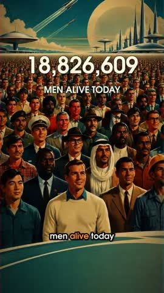](https://github.com/inematds/filme-em-codigo/releases/download/fonte-v1/style_retro_julian.mp4)  
[▶ Ver o vídeo: style_retro_julian.mp4](https://github.com/inematds/filme-em-codigo/releases/download/fonte-v1/style_retro_julian.mp4)

*Futurismo retrô (era atômica dos anos 1950 e 60)*

### Futurismo retrô

**Mesmo estilo, sua ideia**

> Crie um curta animado vertical de 10 a 20 segundos sobre [SUA IDEIA AQUI]. Tom: uma breve história ou narrativa científica com uma reviravolta. Primeiro, escreva um roteiro de 5 ou 6 linhas (40 a 55 palavras, menos de 20 segundos de narração), verifique os fatos de cada afirmação na web e liste as fontes. Escreva os números por extenso para a narração e com algarismos nas legendas. Estrutura dos momentos: uma frase de impacto com um número grande sobre uma imagem panorâmica de apresentação; uma frase sobre o protagonista; uma frase de evidência com uma estatística mostrada como uma grade de símbolos, com um deles acendendo; uma frase com mapa ou diagrama em um painel estilizado sobre um quadro-chave desfocado e escurecido; uma frase de reviravolta em que uma afirmação é riscada; e uma pergunta de encerramento. Planeje cerca de sete quadros-chave, um por momento. Estilo de cada quadro-chave: ilustração de pôster de ficção científica futurista retrô da era atômica dos anos 1960, guache e aerógrafo, formas cromadas arredondadas, paleta em tons de verde-azulado, creme e laranja, granulação de impressão em meio-tom, design otimista da era espacial. Escreva o prompt de cada quadro-chave nesta ordem: o tema, depois a frase de estilo e, em seguida, "Composição vertical em retrato 9:16, com o tema principal no meio do quadro e o quarto inferior mais tranquilo. Sem texto, letras, logotipos ou marca-d'água." e gere as imagens em 9:16. Anime cada quadro-chave em um único shader WebGL: crie um mapa de profundidade com um modelo de profundidade monocular, desloque a amostragem pela profundidade para uma câmera com paralaxe, balance o primeiro plano próximo, faça o céu distante se mover de lado em ritmo moderado e não use oscilação de linhas (uma oscilação de linhas é uma pequena distorção com ruído que muda oito vezes por segundo). Câmera: panorâmica e zoom lentos (zoom de 1.02 a 1.12 com movimento lateral que alterna de direção a cada segmento). Transições: uma transição circular de 0,45 s que se abre a partir do centro. Rótulos sobre as palavras correspondentes: fonte geométrica sem serifa em maiúsculas, na cor creme #fff3dc, com contorno de 6 px em verde-azulado escuro #0e3b43 e destaque em laranja #ff8a1f. Painéis e sobreposições: a mesma paleta, além de linhas de varredura, franjas cromáticas vermelhas e ciano nas bordas, granulação e vinheta. Legendas: fonte geométrica arredondada (estilo Avant Garde) de 92 px, brancas com contorno preto de 8 px, duas ou três palavras por tela, perto da parte inferior; a palavra narrada em #FF8A1F. Música: arpejo de sintetizador sombrio em torno de 116 bpm, que para na reviravolta. Efeitos sonoros: tiques durante a contagem, crescendos e brilhos nos números-chave, arranhão de disco na reviravolta e nota grave de sintetizador na surpresa. Crie no Remotion (React) com three.js, em 1080x1920 a 30 fps, marcando cada corte, evento e som nos tempos das palavras da narração. Sintetize toda a música e os efeitos em código, com a música cerca de 20 dB abaixo da voz e os efeitos logo abaixo dela.

<details><summary>Prompt original (inglês)</summary>

```text
Make a 10 to 20 second vertical animated short about [YOUR IDEA HERE]. Tone: a short history or science story with one twist. First write a 5 or 6 line script (40 to 55 words, under 20 seconds spoken), fact-check every claim on the web and list the sources. Write numbers as words for the voice and digits in the captions. Beat structure: a hook line with a big number over a wide establishing image; a hero line; an evidence line with a statistic shown as a grid of tokens where one lights up; a map or diagram line on a styled panel over a blurred, darkened keyframe; a reversal line where a claim gets struck through; and a payoff question. Plan about seven keyframes, one per beat. Style for every keyframe: 1960s atomic age retro-futurist sci-fi poster illustration, gouache and airbrush, rounded chrome shapes, teal, cream and orange palette, halftone print grain, optimistic space-age design. Write each keyframe prompt as the subject, then that style sentence, then "Vertical 9:16 portrait composition with the main subject in the middle of the frame and a calmer lower quarter. No text, no letters, no logos, no watermark." and generate them at 9:16. Animate each keyframe in one WebGL shader: make a depth map with a monocular depth model, offset the lookup by depth for a parallax camera, sway the near foreground, drift the far sky sideways at a medium pace, and use no line boil (a line boil is a small noise warp that steps 8 times a second). Camera: a slow pan-and-zoom (zoom 1.02 to 1.12 with a sideways pan that alternates direction every segment). Transitions: a 0.45 s iris wipe opening from the centre. Labels on their words: an uppercase geometric sans in cream #fff3dc with a 6 px deep teal #0e3b43 stroke, accent orange #ff8a1f. Panels and overlays: the same palette, plus scanlines, red and cyan chromatic edge fringes, grain and a vignette. Captions: a geometric rounded sans (Avant Garde style) at 92 px, white with an 8 px black outline, two or three words per page near the bottom, spoken word in #FF8A1F. Music: a dark synth arpeggio around 116 bpm that drops out for the reversal. Sound effects: ticks under the counter, risers and shimmers on the key numbers, a record scratch on the reversal and a low synth stab on the twist. Build it in Remotion (React) with three.js, 1080x1920 at 30 fps, keying every cut, event and sound to word timestamps from the voice. Synthesise all music and effects in code, with the music about 20 dB under the voice and the effects just below it.
```

</details>

**Copiar este filme exato · Prompt exato**

> Recrie este curta vertical de 26 segundos sobre os descendentes de Genghis Khan com um estilo ilustrado consistente, exatamente como descrito. Narração, palavra por palavra (cerca de 26 segundos): "Cerca de vinte milhões de homens vivos hoje talvez descendam de um homem: Genghis Khan. Em 2003, geneticistas descobriram que um em cada doze homens em uma vasta região da Ásia tinha praticamente o mesmo cromossomo Y. Parecia que ele se espalhara com o Império Mongol, o maior império terrestre da história. Caso encerrado? Ainda não. O DNA de túmulos mongóis da época dele revelou uma linhagem diferente. Então a árvore genealógica mais famosa do mundo talvez pertença a outra pessoa." Visual: ilustração de pôster de ficção científica futurista retrô da era atômica dos anos 1960, guache e aerógrafo, formas cromadas arredondadas, paleta em tons de verde-azulado, creme e laranja, granulação de impressão em meio-tom, design otimista da era espacial. Primeiro, gere sete imagens de quadros-chave em 9:16 (1080x1920) com estes prompts exatos, na ordem dos momentos: 1. multidão: "uma vasta multidão de centenas de homens comuns de muitas origens diferentes, lado a lado em uma ampla planície, estendendo-se até o horizonte, vista de um ponto ligeiramente elevado. Ilustração de pôster de ficção científica futurista retrô da era atômica dos anos 1960, guache e aerógrafo, formas cromadas arredondadas, paleta em tons de verde-azulado, creme e laranja, granulação de impressão em meio-tom, design otimista da era espacial. Vertical 9:16, tema centralizado, quarto inferior simples, sem texto ou logotipos." 2. Khan: "Genghis Khan, governante mongol do século XIII, com um capacete pontudo com acabamento de pele, bigode longo e fino e uma túnica deel, sentado com orgulho em um cavalo robusto das estepes, em uma colina gramada, ângulo baixo heroico, centralizado. Ilustração de pôster de ficção científica futurista retrô da era atômica dos anos 1960, guache e aerógrafo, formas cromadas arredondadas, paleta em tons de verde-azulado, creme e laranja, granulação de impressão em meio-tom, design otimista da era espacial. Vertical 9:16, tema centralizado, quarto inferior simples, sem texto ou logotipos." 3. laboratório: "dois geneticistas de jaleco branco em um laboratório moderno de genética, estudando um grande modelo brilhante de dupla hélice de DNA, estantes de tubos de ensaio, um microscópio e bandejas de amostras. Ilustração de pôster de ficção científica futurista retrô da era atômica dos anos 1960, guache e aerógrafo, formas cromadas arredondadas, paleta em tons de verde-azulado, creme e laranja, granulação de impressão em meio-tom, design otimista da era espacial. Vertical 9:16, tema centralizado, quarto inferior simples, sem texto ou logotipos." 4. exército: "uma longa coluna de cavaleiros mongóis com estandartes avançando pelas intermináveis estepes da Eurásia, nuvens de poeira, montanhas distantes, escala épica. Ilustração de pôster de ficção científica futurista retrô da era atômica dos anos 1960, guache e aerógrafo, formas cromadas arredondadas, paleta em tons de verde-azulado, creme e laranja, granulação de impressão em meio-tom, design otimista da era espacial. Vertical 9:16, tema centralizado, quarto inferior simples, sem texto ou logotipos." 5. caso: "uma escrivaninha de madeira de detetive sob uma luminária, com uma pasta grossa de caso fechada, uma lupa, uma xícara de chá e um mapa antigo da Ásia, clima sombrio e misterioso. Ilustração de pôster de ficção científica futurista retrô da era atômica dos anos 1960, guache e aerógrafo, formas cromadas arredondadas, paleta em tons de verde-azulado, creme e laranja, granulação de impressão em meio-tom, design otimista da era espacial. Vertical 9:16, tema centralizado, quarto inferior simples, sem texto ou logotipos." 6. túmulo: "arqueólogos escavando um antigo túmulo mongol ao anoitecer, com um esqueleto parcialmente descoberto na escavação, pincéis e colheres de pedreiro, um tênue filamento de DNA brilhante saindo do túmulo. Ilustração de pôster de ficção científica futurista retrô da era atômica dos anos 1960, guache e aerógrafo, formas cromadas arredondadas, paleta em tons de verde-azulado, creme e laranja, granulação de impressão em meio-tom, design otimista da era espacial. Vertical 9:16, tema centralizado, quarto inferior simples, sem texto ou logotipos." 7. árvore: "uma árvore genealógica antiga e gigantesca, com galhos que se espalham por todo o céu, centenas de pequenos medalhões com retratos pendurados nos galhos e, na raiz, uma misteriosa silhueta encapuzada. Ilustração de pôster de ficção científica futurista retrô da era atômica dos anos 1960, guache e aerógrafo, formas cromadas arredondadas, paleta em tons de verde-azulado, creme e laranja, granulação de impressão em meio-tom, design otimista da era espacial. Vertical 9:16, tema centralizado, quarto inferior simples, sem texto ou logotipos." Anime cada quadro-chave em um único shader WebGL: crie um mapa de profundidade com um modelo de profundidade monocular, desloque a amostragem pela profundidade para uma câmera com paralaxe, balance o primeiro plano próximo, faça o céu distante se mover de lado em ritmo moderado e não use oscilação de linhas (uma oscilação de linhas é uma pequena distorção com ruído que muda oito vezes por segundo). Câmera em cada quadro-chave: panorâmica e zoom lentos (zoom de 1.02 a 1.12 com movimento lateral que alterna de direção a cada segmento). Transição entre segmentos: uma transição circular de 0,45 s que se abre a partir do centro. Rótulos na tela: fonte geométrica sem serifa em maiúsculas, na cor creme #fff3dc, com contorno de 6 px em verde-azulado escuro #0e3b43 e destaque em laranja #ff8a1f. Aparência do painel do mapa: mar em verde-azulado escuro #0e3b43, terra creme #f5e6c8, linhas verde-azuladas de 3 px, uma região laranja rgba(255,138,31,0.85), um império vermelho rgba(232,72,48,0.6), pontos laranja. Sobreposições de textura: linhas de varredura, franjas cromáticas vermelhas e ciano nas bordas, granulação e vinheta. Linha do tempo: de 0 a 2,3 s, multidão: um contador sobe até 20.000.000 de "About" a "today", com "men alive today" em "men". De 2,3 a 5,05 s, Khan: "Genghis Khan" em "Genghis". De 5,05 a 7,6 s, laboratório: "2003" e "geneticists" em suas respectivas palavras. De 7,6 a 8,45 s, multidão ampliada em 1,35x: "1 em 12" sobre uma grade de 6 por 2 fichas arredondadas que surgem uma a uma; a oitava brilha na cor de destaque em "twelve". De 8,45 a 12,6 s, exército desfocado e escurecido atrás de um painel de mapa arredondado da Ásia: a região destacada é revelada de leste a oeste em "huge" e os pontos surgem em "carried", com "a huge stretch of Asia" e "the same Y chromosome" em "Y". De 12,6 a 14,45 s, exército nítido: "Mongol Empire". De 14,45 a 16,55 s, mapa novamente: o império se expande a partir de um marcador pulsante na Mongólia, com "largest land empire" e "24 milhões de km²". De 16,55 a 18,6 s, caso: "CASO ENCERRADO?", riscado por uma barra de destaque em "Not", quando "Ainda não." aparece no destaque. De 18,6 a 22,15 s, túmulo: "túmulos mongóis", "1130 a 1250" em "time" e "uma linhagem diferente" no destaque. De 22,15 s até o fim, árvore: "árvore genealógica mais famosa", substituída em "someone" por "outra pessoa?" no destaque. Os rótulos aparecem subindo e desaparecendo gradualmente em 0,2 s. Legendas: insira legendas palavra por palavra em uma fonte geométrica arredondada (estilo Avant Garde) de 92 px, brancas com contorno preto de 8 px e sombra de 3 px, duas ou três palavras por tela, centralizadas a cerca de 330 px acima da parte inferior, com a palavra narrada em #FF8A1F. Música: arpejo de sintetizador em Lá menor, sombrio, com ondas dente de serra desafinadas passando por um filtro passa-baixa a 116 bpm e uma nota grave de baixo a cada compasso, diminuindo durante "Ainda não". Efeitos sonoros: sequência rápida de tiques enquanto o contador sobe, crescendo de ruído até "twelve" com um brilho agudo, crescendo em "spread", arranhão de disco em "Not", nota grave de sintetizador em "different" e um brilho longo em "someone". Configuração técnica: Remotion (React) com three.js, 1080x1920 a 30 fps, cerca de 26 segundos. Crie a voz com qualquer mecanismo de conversão de texto em fala, obtenha os tempos de cada palavra e sincronize cada corte, evento e som com o início da palavra correspondente. Insira as legendas. Sintetize toda a música e os efeitos em código, sem amostras. Mixe a música cerca de 20 dB abaixo da voz e reduza seu volume durante a fala, com os efeitos logo abaixo da voz.

<details><summary>Prompt original (inglês)</summary>

```text
Recreate this 26 second vertical short about Genghis Khan's descendants in one consistent illustrated look, exactly as described. Narration, word for word (about 26 seconds): "About twenty million men alive today may descend from one man: Genghis Khan. In 2003, geneticists found that one in twelve men across a huge stretch of Asia carried almost the same Y chromosome. It seemed to spread with the Mongol Empire, the largest land empire in history. Case closed? Not quite. DNA from Mongol graves of his time showed a different line. So the world's most famous family tree might belong to someone else." Look: 1960s atomic age retro-futurist sci-fi poster illustration, gouache and airbrush, rounded chrome shapes, teal, cream and orange palette, halftone print grain, optimistic space-age design. First generate seven keyframe images at 9:16 (1080x1920) with these exact prompts, in beat order: 1. crowd: "a vast crowd of hundreds of ordinary men of many different backgrounds standing shoulder to shoulder across a wide plain, the crowd stretching all the way to the horizon, seen from slightly above. 1960s atomic age retro-futurist sci-fi poster illustration, gouache and airbrush, rounded chrome shapes, teal, cream and orange palette, halftone print grain, optimistic space-age design. Vertical 9:16, subject centred, simple lower quarter, no text or logos." 2. khan: "Genghis Khan, the 13th century Mongol ruler, with a fur-trimmed pointed helmet, long thin moustache and a deel robe, sitting proudly on a sturdy steppe horse on a grassy hill, heroic low angle, centred. 1960s atomic age retro-futurist sci-fi poster illustration, gouache and airbrush, rounded chrome shapes, teal, cream and orange palette, halftone print grain, optimistic space-age design. Vertical 9:16, subject centred, simple lower quarter, no text or logos." 3. lab: "two geneticists in white lab coats in a modern genetics laboratory, studying a large glowing DNA double helix model, racks of test tubes, a microscope and sample trays. 1960s atomic age retro-futurist sci-fi poster illustration, gouache and airbrush, rounded chrome shapes, teal, cream and orange palette, halftone print grain, optimistic space-age design. Vertical 9:16, subject centred, simple lower quarter, no text or logos." 4. army: "a long column of Mongol horsemen with banners riding out across the endless Eurasian steppe, clouds of dust, distant mountains, epic sense of scale. 1960s atomic age retro-futurist sci-fi poster illustration, gouache and airbrush, rounded chrome shapes, teal, cream and orange palette, halftone print grain, optimistic space-age design. Vertical 9:16, subject centred, simple lower quarter, no text or logos." 5. case: "a detective's wooden desk under a lamp with a thick closed case file folder, a magnifying glass, a cup of tea and an old map of Asia, moody and mysterious. 1960s atomic age retro-futurist sci-fi poster illustration, gouache and airbrush, rounded chrome shapes, teal, cream and orange palette, halftone print grain, optimistic space-age design. Vertical 9:16, subject centred, simple lower quarter, no text or logos." 6. grave: "archaeologists excavating an ancient Mongol burial mound at dusk, a skeleton partly uncovered in the dig, brushes and trowels, a faint glowing DNA strand rising out of the grave. 1960s atomic age retro-futurist sci-fi poster illustration, gouache and airbrush, rounded chrome shapes, teal, cream and orange palette, halftone print grain, optimistic space-age design. Vertical 9:16, subject centred, simple lower quarter, no text or logos." 7. tree: "a gigantic ancient family tree whose branches spread across the whole sky, hundreds of tiny portrait medallions hanging from the branches, and at the root a mysterious hooded silhouette. 1960s atomic age retro-futurist sci-fi poster illustration, gouache and airbrush, rounded chrome shapes, teal, cream and orange palette, halftone print grain, optimistic space-age design. Vertical 9:16, subject centred, simple lower quarter, no text or logos." Animate each keyframe in one WebGL shader: make a depth map with a monocular depth model, offset the lookup by depth for a parallax camera, sway the near foreground, drift the far sky sideways at a medium pace, and use no line boil (a line boil is a small noise warp that steps 8 times a second). Camera on each keyframe: a slow pan-and-zoom (zoom 1.02 to 1.12 with a sideways pan that alternates direction every segment). Transition between segments: a 0.45 s iris wipe opening from the centre. On-screen labels: an uppercase geometric sans in cream #fff3dc with a 6 px deep teal #0e3b43 stroke, accent orange #ff8a1f. Map panel skin: deep teal sea #0e3b43, cream land #f5e6c8, teal 3 px lines, an orange region rgba(255,138,31,0.85), a red empire rgba(232,72,48,0.6), orange dots. Texture overlays: scanlines, red and cyan chromatic edge fringes, grain and a vignette. Timeline: 0 to 2.3 s, crowd: a counter climbs to 20,000,000 from "About" to "today", with "men alive today" on "men". 2.3 to 5.05 s, khan: "Genghis Khan" on "Genghis". 5.05 to 7.6 s, lab: "2003" and "geneticists" on their words. 7.6 to 8.45 s, the crowd zoomed to 1.35x: "1 in 12" over a 6 by 2 grid of rounded pill tokens popping in, the eighth glowing in the accent colour on "twelve". 8.45 to 12.6 s, the army blurred and darkened behind a rounded map panel of Asia: the sampled region wipes in east to west on "huge" and dots pop on "carried", with "a huge stretch of Asia" and "the same Y chromosome" on "Y". 12.6 to 14.45 s, clear army: "Mongol Empire". 14.45 to 16.55 s, map again: the empire floods out from a pulsing Mongolia marker, with "largest land empire" and "24 million km²". 16.55 to 18.6 s, case: "CASE CLOSED?", struck through by an accent bar on "Not" as "Not quite." appears in the accent. 18.6 to 22.15 s, grave: "Mongol graves", "1130 to 1250" on "time" and "a different line" in the accent. 22.15 s to the end, tree: "most famous family tree", replaced on "someone" by "someone else?" in the accent. Labels fade and rise in over 0.2 s. Captions: burn in word-by-word captions in a geometric rounded sans (Avant Garde style) at 92 px, white with an 8 px black outline and a 3 px shadow, two or three words per page, centred about 330 px above the bottom, with the spoken word in #FF8A1F. Music: a dark A minor synth arpeggio of detuned saw waves through a low-pass filter at 116 bpm with a deep bass note every bar, ducking out for "Not quite". Sound effects: a fast run of ticks while the counter climbs, a noise riser into "twelve" with a bright shimmer, a riser on "spread", a record scratch on "Not", a low synth stab on "different" and a long shimmer on "someone". Technical setup: Remotion (React) with three.js, 1080x1920 at 30 fps, about 26 seconds. Make the voice with any text to speech engine, get word timestamps, and key every cut, event and sound to the start of its word. Burn the captions in. Synthesise all music and effects in code, with no samples. Mix the music about 20 dB under the voice and ducked under speech, with the effects just below the voice.
```

</details>

[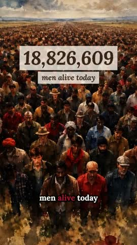](https://github.com/inematds/filme-em-codigo/releases/download/fonte-v1/style_watercolor_julian.mp4)  
[▶ Ver o vídeo: style_watercolor_julian.mp4](https://github.com/inematds/filme-em-codigo/releases/download/fonte-v1/style_watercolor_julian.mp4)

*Aquarela (pintura em aquarela)*

### Aquarela

**Mesmo estilo, sua ideia**

> Crie um curta-metragem animado vertical de dez a vinte segundos sobre [SUA IDEIA AQUI]. Tom: uma breve história ou narrativa científica com uma reviravolta. Primeiro, escreva um roteiro de cinco ou seis linhas (de quarenta a cinquenta e cinco palavras, com menos de vinte segundos de fala), confira todos os fatos na web e liste as fontes. Escreva os números por extenso para a voz e em algarismos nas legendas. Estrutura das batidas: uma frase de impacto com um número grande sobre uma imagem ampla de apresentação; uma frase sobre o protagonista; uma frase de evidência com uma estatística exibida como uma grade de fichas, com uma delas acendendo; uma frase com mapa ou diagrama em um painel estilizado sobre um quadro-chave desfocado e escurecido; uma frase de reviravolta em que uma afirmação é riscada; e uma pergunta de conclusão. Planeje cerca de sete quadros-chave, um por batida. Estilo de cada quadro-chave: pintura em aquarela solta e expressiva, lavagens úmido sobre úmido, textura visível de papel prensado a frio, bordas suaves e pigmentos que se espalham, paleta terrosa e apagada com toques de carmesim. Escreva cada prompt de quadro-chave começando pelo tema, depois a frase do estilo e, em seguida: "Composição vertical 9:16 em retrato, com o tema principal no meio do quadro e o quarto inferior mais tranquilo. Sem texto, letras, logotipos ou marca-d'água." Gere as imagens em 9:16. Anime cada quadro-chave em um único shader WebGL: crie um mapa de profundidade com um modelo monocular de profundidade, desloque a consulta pela profundidade para criar uma câmera com paralaxe, balance o primeiro plano próximo, faça o céu distante se mover totalmente para o lado e adicione uma leve vibração das linhas (uma vibração das linhas é uma pequena distorção de ruído que muda oito vezes por segundo). Câmera: movimento lento e onírico (zoom com aceleração suave de 1,06 a 1,14, leve oscilação lateral senoidal e uma subida lenta). Transições: vazamento de aquarela de 0,8 s (uma máscara radial suave que se abre como uma mancha, com desfoque). Textos nos momentos correspondentes: Lora Bold Italic em umbra escuro #3a2418 sobre uma caixa suave de papel rgba(250,244,232,0.78), com carmesim #a3172b como destaque. Painéis e sobreposições: a mesma paleta, mais uma textura de papel quente com sombra interna profunda de pigmento espalhado e granulação. Legendas: Lora Bold a 92 px, brancas com contorno preto de 8 px, duas ou três palavras por página perto da parte inferior, palavra falada em #A3172B. Música: frases suaves de flauta em uma escala pentatônica sobre dedilhados lentos e graves de cítara. Efeitos sonoros: batidas de tambor graves na frase de impacto, na reviravolta e na revelação, e um brilho sonoro na estatística principal. Faça em Remotion (React) com three.js, 1080x1920 a 30 fps, sincronizando cada corte, evento e som com as marcas de tempo das palavras da voz. Sintetize toda a música e os efeitos em código, com a música cerca de 20 dB abaixo da voz e os efeitos logo abaixo dela.

<details><summary>Prompt original (inglês)</summary>

```text
Make a 10 to 20 second vertical animated short about [YOUR IDEA HERE]. Tone: a short history or science story with one twist. First write a 5 or 6 line script (40 to 55 words, under 20 seconds spoken), fact-check every claim on the web and list the sources. Write numbers as words for the voice and digits in the captions. Beat structure: a hook line with a big number over a wide establishing image; a hero line; an evidence line with a statistic shown as a grid of tokens where one lights up; a map or diagram line on a styled panel over a blurred, darkened keyframe; a reversal line where a claim gets struck through; and a payoff question. Plan about seven keyframes, one per beat. Style for every keyframe: loose expressive watercolour painting, wet-on-wet washes, visible cold-press paper texture, soft bleeding edges and pigment blooms, muted earthy palette with splashes of crimson. Write each keyframe prompt as the subject, then that style sentence, then "Vertical 9:16 portrait composition with the main subject in the middle of the frame and a calmer lower quarter. No text, no letters, no logos, no watermark." and generate them at 9:16. Animate each keyframe in one WebGL shader: make a depth map with a monocular depth model, offset the lookup by depth for a parallax camera, sway the near foreground, drift the far sky sideways fully, and add a light line boil (a line boil is a small noise warp that steps 8 times a second). Camera: a slow dreamy drift (zoom easing from 1.06 to 1.14 with a gentle sideways sine sway and a slow rise). Transitions: a 0.8 s watercolour bleed (a soft radial mask that blooms open with a blur). Labels on their words: Lora Bold Italic in dark umber #3a2418 on a soft paper box rgba(250,244,232,0.78), accent crimson #a3172b. Panels and overlays: the same palette, plus a warm paper texture with a deep inner bleed shadow and grain. Captions: Lora Bold at 92 px, white with an 8 px black outline, two or three words per page near the bottom, spoken word in #A3172B. Music: breathy flute phrases on a pentatonic scale over slow low zither plucks. Sound effects: deep drum hits on the hook, the reversal and the reveal, and a shimmer on the key statistic. Build it in Remotion (React) with three.js, 1080x1920 at 30 fps, keying every cut, event and sound to word timestamps from the voice. Synthesise all music and effects in code, with the music about 20 dB under the voice and the effects just below it.
```

</details>

**Copiar este filme exato · Prompt exato**

> Recrie este curta vertical de vinte e seis segundos sobre os descendentes de Genghis Khan em um estilo ilustrado consistente, exatamente como descrito. Narração, palavra por palavra (cerca de vinte e seis segundos): "Cerca de vinte milhões de homens vivos hoje talvez descendam de um único homem: Genghis Khan. Em 2003, geneticistas descobriram que um em cada doze homens numa vasta região da Ásia tinha quase o mesmo cromossomo Y. Parecia ter se espalhado com o Império Mongol, o maior império terrestre da história. Caso encerrado? Ainda não. O DNA de túmulos mongóis da época dele mostrou uma linhagem diferente. Então, a árvore genealógica mais famosa do mundo talvez pertença a outra pessoa." Visual: pintura em aquarela solta e expressiva, lavagens úmido sobre úmido, textura visível de papel prensado a frio, bordas suaves e pigmentos que se espalham, paleta terrosa e apagada com toques de carmesim. Primeiro, gere sete imagens de quadros-chave em 9:16 (1080x1920) com estes prompts exatos, na ordem das batidas: 1. multidão: "uma imensa multidão de centenas de homens comuns de muitas origens diferentes, lado a lado em uma vasta planície que se estende até o horizonte, vista ligeiramente de cima. pintura em aquarela solta e expressiva, lavagens úmido sobre úmido, textura visível de papel prensado a frio, bordas suaves e pigmentos que se espalham, paleta terrosa e apagada com toques de carmesim. Vertical 9:16, tema centralizado, quarto inferior simples, sem texto ou logotipos." 2. khan: "Genghis Khan, governante mongol do século treze, com um capacete pontudo enfeitado com pele, bigode longo e fino e uma túnica deel, sentado com orgulho em um cavalo robusto das estepes sobre uma colina gramada, ângulo heroico de baixo, centralizado. pintura em aquarela solta e expressiva, lavagens úmido sobre úmido, textura visível de papel prensado a frio, bordas suaves e pigmentos que se espalham, paleta terrosa e apagada com toques de carmesim. Vertical 9:16, tema centralizado, quarto inferior simples, sem texto ou logotipos." 3. laboratório: "dois geneticistas de jaleco branco em um laboratório moderno de genética, estudando um grande modelo luminoso de dupla hélice de DNA, suportes com tubos de ensaio, um microscópio e bandejas de amostras. pintura em aquarela solta e expressiva, lavagens úmido sobre úmido, textura visível de papel prensado a frio, bordas suaves e pigmentos que se espalham, paleta terrosa e apagada com toques de carmesim. Vertical 9:16, tema centralizado, quarto inferior simples, sem texto ou logotipos." 4. exército: "uma longa coluna de cavaleiros mongóis com estandartes cruzando as intermináveis estepes eurasiáticas, nuvens de poeira, montanhas distantes, sensação épica de escala. pintura em aquarela solta e expressiva, lavagens úmido sobre úmido, textura visível de papel prensado a frio, bordas suaves e pigmentos que se espalham, paleta terrosa e apagada com toques de carmesim. Vertical 9:16, tema centralizado, quarto inferior simples, sem texto ou logotipos." 5. caso: "uma escrivaninha de madeira de detetive sob uma luminária, com uma pasta grossa de caso fechada, uma lupa, uma xícara de chá e um mapa antigo da Ásia, clima sombrio e misterioso. pintura em aquarela solta e expressiva, lavagens úmido sobre úmido, textura visível de papel prensado a frio, bordas suaves e pigmentos que se espalham, paleta terrosa e apagada com toques de carmesim. Vertical 9:16, tema centralizado, quarto inferior simples, sem texto ou logotipos." 6. túmulo: "arqueólogos escavando um antigo túmulo mongol ao anoitecer, um esqueleto parcialmente descoberto na escavação, pincéis e espátulas, uma tênue fita de DNA luminosa saindo do túmulo. pintura em aquarela solta e expressiva, lavagens úmido sobre úmido, textura visível de papel prensado a frio, bordas suaves e pigmentos que se espalham, paleta terrosa e apagada com toques de carmesim. Vertical 9:16, tema centralizado, quarto inferior simples, sem texto ou logotipos." 7. árvore: "uma gigantesca árvore genealógica antiga, com galhos que se espalham por todo o céu, centenas de pequenos medalhões com retratos pendurados nos galhos e, na raiz, uma silhueta misteriosa encapuzada. pintura em aquarela solta e expressiva, lavagens úmido sobre úmido, textura visível de papel prensado a frio, bordas suaves e pigmentos que se espalham, paleta terrosa e apagada com toques de carmesim. Vertical 9:16, tema centralizado, quarto inferior simples, sem texto ou logotipos." Anime cada quadro-chave em um único shader WebGL: crie um mapa de profundidade com um modelo monocular de profundidade, desloque a consulta pela profundidade para criar uma câmera com paralaxe, balance o primeiro plano próximo, faça o céu distante se mover totalmente para o lado e adicione uma leve vibração das linhas (uma vibração das linhas é uma pequena distorção de ruído que muda oito vezes por segundo). Câmera em cada quadro-chave: movimento lento e onírico (zoom com aceleração suave de 1,06 a 1,14, leve oscilação lateral senoidal e uma subida lenta). Transição entre segmentos: vazamento de aquarela de 0,8 s (uma máscara radial suave que se abre como uma mancha, com desfoque). Textos na tela: Lora Bold Italic em umbra escuro #3a2418 sobre uma caixa suave de papel rgba(250,244,232,0.78), com carmesim #a3172b como destaque. Aparência do painel do mapa: papel quente #f6efe2, áreas terrestres em umbra translúcido, linhas marrons de 2.5 px #5b4632, uma região carmesim rgba(163,23,43,0.45), um império índigo rgba(80,70,140,0.35), pontos carmesim, textura de papel. Sobreposições de textura: textura de papel quente com sombra interna profunda de pigmento espalhado e granulação. Linha do tempo: de 0 a 2.3 s, multidão: um contador sobe até 20,000,000 de "Cerca de" a "hoje", com "homens vivos hoje" em "homens". De 2.3 a 5.05 s, khan: "Genghis Khan" em "Genghis". De 5.05 a 7.6 s, laboratório: "2003" e "geneticistas" em suas respectivas palavras. De 7.6 a 8.45 s, multidão ampliada para 1.35x: "1 em 12" sobre uma grade 6 por 2 de fichas arredondadas que aparecem uma a uma; a oitava brilha na cor de destaque em "doze". De 8.45 a 12.6 s, exército desfocado e escurecido atrás de um painel arredondado com o mapa da Ásia: a região amostrada surge de oeste para leste em "vasta", e os pontos aparecem em "tinha", com "uma vasta região da Ásia" e "o mesmo cromossomo Y" em "Y". De 12.6 a 14.45 s, exército nítido: "Império Mongol". De 14.45 a 16.55 s, mapa novamente: o império se expande a partir de um marcador pulsante na Mongólia, com "maior império terrestre" e "24 million km²". De 16.55 a 18.6 s, caso: "CASO ENCERRADO?", riscado por uma barra de destaque em "Não", enquanto "Ainda não." aparece em destaque. De 18.6 a 22.15 s, túmulo: "túmulos mongóis", "1130 a 1250" em "época" e "uma linhagem diferente" em destaque. De 22.15 s até o fim, árvore: "árvore genealógica mais famosa", substituída em "pessoa" por "outra pessoa?" em destaque. Os textos aparecem subindo e desaparecendo gradualmente em 0.2 s. Legendas: incorpore legendas palavra por palavra em Lora Bold a 92 px, brancas com contorno preto de 8 px e sombra de 3 px, duas ou três palavras por página, centralizadas a cerca de 330 px acima da parte inferior, com a palavra falada em #A3172B. Música: frases suaves e soprosas de flauta de bambu em escala pentatônica de lá menor, sobre dedilhados lentos e graves de cítara a cada 1.2 segundos. Efeitos sonoros: batidas profundas de taiko no início e em "Khan", em 12.6 s, "encerrado", "Não", "diferente" e "pessoa"; um brilho sonoro em "doze" e um trote suave de cascos sob o exército. Configuração técnica: Remotion (React) com three.js, 1080x1920 a 30 fps, cerca de 26 segundos. Gere a voz com qualquer mecanismo de conversão de texto em fala, obtenha as marcas de tempo das palavras e sincronize cada corte, evento e som com o início da palavra correspondente. Incorpore as legendas. Sintetize toda a música e os efeitos em código, sem amostras. Mixe a música cerca de 20 dB abaixo da voz e reduza seu volume durante as falas, com os efeitos logo abaixo da voz.

<details><summary>Prompt original (inglês)</summary>

```text
Recreate this 26 second vertical short about Genghis Khan's descendants in one consistent illustrated look, exactly as described. Narration, word for word (about 26 seconds): "About twenty million men alive today may descend from one man: Genghis Khan. In 2003, geneticists found that one in twelve men across a huge stretch of Asia carried almost the same Y chromosome. It seemed to spread with the Mongol Empire, the largest land empire in history. Case closed? Not quite. DNA from Mongol graves of his time showed a different line. So the world's most famous family tree might belong to someone else." Look: loose expressive watercolour painting, wet-on-wet washes, visible cold-press paper texture, soft bleeding edges and pigment blooms, muted earthy palette with splashes of crimson. First generate seven keyframe images at 9:16 (1080x1920) with these exact prompts, in beat order: 1. crowd: "a vast crowd of hundreds of ordinary men of many different backgrounds standing shoulder to shoulder across a wide plain, the crowd stretching all the way to the horizon, seen from slightly above. loose expressive watercolour painting, wet-on-wet washes, visible cold-press paper texture, soft bleeding edges and pigment blooms, muted earthy palette with splashes of crimson. Vertical 9:16, subject centred, simple lower quarter, no text or logos." 2. khan: "Genghis Khan, the 13th century Mongol ruler, with a fur-trimmed pointed helmet, long thin moustache and a deel robe, sitting proudly on a sturdy steppe horse on a grassy hill, heroic low angle, centred. loose expressive watercolour painting, wet-on-wet washes, visible cold-press paper texture, soft bleeding edges and pigment blooms, muted earthy palette with splashes of crimson. Vertical 9:16, subject centred, simple lower quarter, no text or logos." 3. lab: "two geneticists in white lab coats in a modern genetics laboratory, studying a large glowing DNA double helix model, racks of test tubes, a microscope and sample trays. loose expressive watercolour painting, wet-on-wet washes, visible cold-press paper texture, soft bleeding edges and pigment blooms, muted earthy palette with splashes of crimson. Vertical 9:16, subject centred, simple lower quarter, no text or logos." 4. army: "a long column of Mongol horsemen with banners riding out across the endless Eurasian steppe, clouds of dust, distant mountains, epic sense of scale. loose expressive watercolour painting, wet-on-wet washes, visible cold-press paper texture, soft bleeding edges and pigment blooms, muted earthy palette with splashes of crimson. Vertical 9:16, subject centred, simple lower quarter, no text or logos." 5. case: "a detective's wooden desk under a lamp with a thick closed case file folder, a magnifying glass, a cup of tea and an old map of Asia, moody and mysterious. loose expressive watercolour painting, wet-on-wet washes, visible cold-press paper texture, soft bleeding edges and pigment blooms, muted earthy palette with splashes of crimson. Vertical 9:16, subject centred, simple lower quarter, no text or logos." 6. grave: "archaeologists excavating an ancient Mongol burial mound at dusk, a skeleton partly uncovered in the dig, brushes and trowels, a faint glowing DNA strand rising out of the grave. loose expressive watercolour painting, wet-on-wet washes, visible cold-press paper texture, soft bleeding edges and pigment blooms, muted earthy palette with splashes of crimson. Vertical 9:16, subject centred, simple lower quarter, no text or logos." 7. tree: "a gigantic ancient family tree whose branches spread across the whole sky, hundreds of tiny portrait medallions hanging from the branches, and at the root a mysterious hooded silhouette. loose expressive watercolour painting, wet-on-wet washes, visible cold-press paper texture, soft bleeding edges and pigment blooms, muted earthy palette with splashes of crimson. Vertical 9:16, subject centred, simple lower quarter, no text or logos." Animate each keyframe in one WebGL shader: make a depth map with a monocular depth model, offset the lookup by depth for a parallax camera, sway the near foreground, drift the far sky sideways fully, and add a light line boil (a line boil is a small noise warp that steps 8 times a second). Camera on each keyframe: a slow dreamy drift (zoom easing from 1.06 to 1.14 with a gentle sideways sine sway and a slow rise). Transition between segments: a 0.8 s watercolour bleed (a soft radial mask that blooms open with a blur). On-screen labels: Lora Bold Italic in dark umber #3a2418 on a soft paper box rgba(250,244,232,0.78), accent crimson #a3172b. Map panel skin: warm paper #f6efe2, translucent umber land, brown 2.5 px lines #5b4632, a crimson region rgba(163,23,43,0.45), an indigo empire rgba(80,70,140,0.35), crimson dots, paper texture. Texture overlays: a warm paper texture with a deep inner bleed shadow and grain. Timeline: 0 to 2.3 s, crowd: a counter climbs to 20,000,000 from "About" to "today", with "men alive today" on "men". 2.3 to 5.05 s, khan: "Genghis Khan" on "Genghis". 5.05 to 7.6 s, lab: "2003" and "geneticists" on their words. 7.6 to 8.45 s, the crowd zoomed to 1.35x: "1 in 12" over a 6 by 2 grid of rounded pill tokens popping in, the eighth glowing in the accent colour on "twelve". 8.45 to 12.6 s, the army blurred and darkened behind a rounded map panel of Asia: the sampled region wipes in east to west on "huge" and dots pop on "carried", with "a huge stretch of Asia" and "the same Y chromosome" on "Y". 12.6 to 14.45 s, clear army: "Mongol Empire". 14.45 to 16.55 s, map again: the empire floods out from a pulsing Mongolia marker, with "largest land empire" and "24 million km²". 16.55 to 18.6 s, case: "CASE CLOSED?", struck through by an accent bar on "Not" as "Not quite." appears in the accent. 18.6 to 22.15 s, grave: "Mongol graves", "1130 to 1250" on "time" and "a different line" in the accent. 22.15 s to the end, tree: "most famous family tree", replaced on "someone" by "someone else?" in the accent. Labels fade and rise in over 0.2 s. Captions: burn in word-by-word captions in Lora Bold at 92 px, white with an 8 px black outline and a 3 px shadow, two or three words per page, centred about 330 px above the bottom, with the spoken word in #A3172B. Music: soft breathy bamboo-flute phrases on an A minor pentatonic scale over slow low zither plucks every 1.2 seconds. Sound effects: deep taiko hits at the start and on "Khan", at 12.6 s, "closed", "Not", "different" and "someone", a shimmer on "twelve" and a quiet hoof gallop under the army. Technical setup: Remotion (React) with three.js, 1080x1920 at 30 fps, about 26 seconds. Make the voice with any text to speech engine, get word timestamps, and key every cut, event and sound to the start of its word. Burn the captions in. Synthesise all music and effects in code, with no samples. Mix the music about 20 dB under the voice and ducked under speech, with the effects just below the voice.
```

</details>

[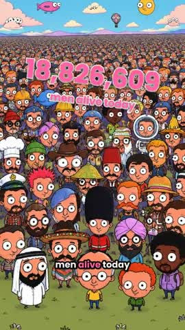](https://github.com/inematds/filme-em-codigo/releases/download/fonte-v1/style_quirky_julian.mp4)  
[▶ Ver o vídeo: style_quirky_julian.mp4](https://github.com/inematds/filme-em-codigo/releases/download/fonte-v1/style_quirky_julian.mp4)

*Cartum excêntrico e absurdo (cartum surreal)*

### Cartum absurdo e excêntrico

**Mesmo estilo, sua ideia**

> Crie um curta de animação vertical de 10 a 20 segundos sobre [SUA IDEIA AQUI]. Tom: uma breve história ou história científica com uma reviravolta. Primeiro, escreva um roteiro de 5 ou 6 linhas (40 a 55 palavras, menos de 20 segundos falados), confira os fatos de cada afirmação na web e liste as fontes. Escreva os números por extenso para a voz e em algarismos nas legendas. Estrutura das batidas: uma frase de abertura com um número grande sobre uma imagem ampla de contexto; uma frase sobre o protagonista; uma frase de evidência com uma estatística exibida como uma grade de fichas, uma delas se acende; uma frase com um mapa ou diagrama em um painel estilizado sobre um quadro-chave desfocado e escurecido; uma frase de reviravolta em que uma afirmação é riscada; e uma pergunta de encerramento. Planeje cerca de sete quadros-chave, um por batida. Estilo de todos os quadros-chave: desenho animado absurdo e excêntrico, linhas tremidas feitas à mão, olhos esbugalhados em tudo, inclusive nos objetos, cores pastéis de doce, piadas visuais surreais, personagens com corpos minúsculos e cabeças enormes. Escreva cada prompt de quadro-chave com o tema, depois a frase de estilo e, em seguida: "Composição vertical retrato 9:16, com o tema principal no meio do quadro e o quarto inferior mais tranquilo. Sem texto, letras, logotipos ou marca-d'água." e gere as imagens em 9:16. Anime cada quadro-chave em um único shader WebGL: crie um mapa de profundidade com um modelo de profundidade monocular, desloque a consulta de acordo com a profundidade para criar uma câmera com paralaxe, balance o primeiro plano próximo, mova o céu distante de lado em ritmo moderado e adicione uma forte oscilação das linhas (uma oscilação das linhas é uma pequena distorção de ruído que dá um passo 8 vezes por segundo). Câmera: um balanço elástico (uma oscilação de zoom amortecida a cada corte e uma rotação lenta de balanço de cerca de 1.2 graus). Transições: uma transição circular de 0.35 s a partir do centro. Rótulos sobre as palavras: Poppins ExtraBold em rosa #ff5fa2 com contorno branco de 12 px, girados 4 graus e balançando suavemente, com violeta #7b5cff como cor de destaque. Painéis e sobreposições: a mesma paleta, mais um balanço suave em cada rótulo. Legendas: Poppins Bold a 92 px, brancas com contorno preto de 8 px, duas ou três palavras por página perto da parte inferior, palavra falada em #FF5FA2. Música: uma melodia pentatônica saltitante de cordas dedilhadas com bateria suave, em torno de 120 bpm, que para na reviravolta. Efeitos sonoros: som de galope ou viagem durante a ação, um brilho no número principal, um arranhão de disco na reviravolta e uma batida grave na revelação. Crie em Remotion (React) com three.js, 1080x1920 a 30 fps, marcando cada corte, evento e som de acordo com os tempos das palavras na voz. Sintetize toda a música e os efeitos em código, com a música cerca de 20 dB abaixo da voz e os efeitos um pouco mais baixos que ela.

<details><summary>Prompt original (inglês)</summary>

```text
Make a 10 to 20 second vertical animated short about [YOUR IDEA HERE]. Tone: a short history or science story with one twist. First write a 5 or 6 line script (40 to 55 words, under 20 seconds spoken), fact-check every claim on the web and list the sources. Write numbers as words for the voice and digits in the captions. Beat structure: a hook line with a big number over a wide establishing image; a hero line; an evidence line with a statistic shown as a grid of tokens where one lights up; a map or diagram line on a styled panel over a blurred, darkened keyframe; a reversal line where a claim gets struck through; and a payoff question. Plan about seven keyframes, one per beat. Style for every keyframe: absurd quirky cartoon, wobbly hand-drawn lines, googly eyes on everything including objects, pastel candy colours, surreal visual jokes, characters with tiny bodies and huge heads. Write each keyframe prompt as the subject, then that style sentence, then "Vertical 9:16 portrait composition with the main subject in the middle of the frame and a calmer lower quarter. No text, no letters, no logos, no watermark." and generate them at 9:16. Animate each keyframe in one WebGL shader: make a depth map with a monocular depth model, offset the lookup by depth for a parallax camera, sway the near foreground, drift the far sky sideways at a medium pace, and add a strong line boil (a line boil is a small noise warp that steps 8 times a second). Camera: a springy bounce (a damped zoom wobble at each cut and a slow rocking rotation of about 1.2 degrees). Transitions: a 0.35 s circle wipe from the centre. Labels on their words: Poppins ExtraBold in pink #ff5fa2 with a 12 px white stroke, rotated 4 degrees and gently wobbling, accent violet #7b5cff. Panels and overlays: the same palette, plus a gentle wobble on every label. Captions: Poppins Bold at 92 px, white with an 8 px black outline, two or three words per page near the bottom, spoken word in #FF5FA2. Music: a bouncy pentatonic plucked-string melody with soft drums around 120 bpm that drops out for the reversal. Sound effects: a gallop or travel sound under the action, a shimmer on the key number, a record scratch on the reversal and a deep drum on the reveal. Build it in Remotion (React) with three.js, 1080x1920 at 30 fps, keying every cut, event and sound to word timestamps from the voice. Synthesise all music and effects in code, with the music about 20 dB under the voice and the effects just below it.
```

</details>

**Copiar este filme exato · Prompt exato**

> Recrie este curta vertical de 26 segundos sobre os descendentes de Genghis Khan com um único estilo de ilustração consistente, exatamente como descrito. Narração, palavra por palavra (cerca de 26 segundos): "Cerca de vinte milhões de homens vivos hoje talvez descendam de um homem: Genghis Khan. Em 2003, geneticistas descobriram que um em cada doze homens de uma vasta região da Ásia tinha quase o mesmo cromossomo Y. Ele parecia ter se espalhado com o Império Mongol, o maior império terrestre da história. Caso encerrado? Não exatamente. O DNA de sepulturas mongóis da época dele revelou outra linhagem. Então a árvore genealógica mais famosa do mundo talvez pertença a outra pessoa." Visual: desenho animado absurdo e excêntrico, linhas tremidas feitas à mão, olhos esbugalhados em tudo, inclusive nos objetos, cores pastéis de doce, piadas visuais surreais, personagens com corpos minúsculos e cabeças enormes. Primeiro, gere sete imagens de quadros-chave em 9:16 (1080x1920) com estes prompts exatos, na ordem das batidas: 1. multidão: "uma multidão imensa de centenas de homens comuns, de diferentes origens, lado a lado numa planície ampla, estendendo-se até o horizonte, vista de um ângulo levemente elevado. Desenho animado absurdo e excêntrico, linhas tremidas feitas à mão, olhos esbugalhados em tudo, inclusive nos objetos, cores pastéis de doce, piadas visuais surreais, personagens com corpos minúsculos e cabeças enormes. Vertical 9:16, tema centralizado, quarto inferior simples, sem texto nem logotipos." 2. khan: "Genghis Khan, o governante mongol do século 13, com um capacete pontudo com acabamento de pele, bigode longo e fino e uma túnica deel, sentado com orgulho num cavalo resistente da estepe, sobre uma colina gramada, de um ângulo heroico baixo, centralizado. Desenho animado absurdo e excêntrico, linhas tremidas feitas à mão, olhos esbugalhados em tudo, inclusive nos objetos, cores pastéis de doce, piadas visuais surreais, personagens com corpos minúsculos e cabeças enormes. Vertical 9:16, tema centralizado, quarto inferior simples, sem texto nem logotipos." 3. laboratório: "dois geneticistas de jaleco branco num laboratório moderno de genética, estudando um grande modelo luminoso de dupla hélice de DNA, estantes de tubos de ensaio, um microscópio e bandejas de amostras. Desenho animado absurdo e excêntrico, linhas tremidas feitas à mão, olhos esbugalhados em tudo, inclusive nos objetos, cores pastéis de doce, piadas visuais surreais, personagens com corpos minúsculos e cabeças enormes. Vertical 9:16, tema centralizado, quarto inferior simples, sem texto nem logotipos." 4. exército: "uma longa coluna de cavaleiros mongóis com estandartes avançando pela interminável estepe eurasiana, nuvens de poeira, montanhas ao longe, com uma sensação épica de escala. Desenho animado absurdo e excêntrico, linhas tremidas feitas à mão, olhos esbugalhados em tudo, inclusive nos objetos, cores pastéis de doce, piadas visuais surreais, personagens com corpos minúsculos e cabeças enormes. Vertical 9:16, tema centralizado, quarto inferior simples, sem texto nem logotipos." 5. caso: "a mesa de madeira de um detetive sob uma luminária, com uma pasta grossa e fechada do caso, uma lupa, uma xícara de chá e um mapa antigo da Ásia, clima sombrio e misterioso. Desenho animado absurdo e excêntrico, linhas tremidas feitas à mão, olhos esbugalhados em tudo, inclusive nos objetos, cores pastéis de doce, piadas visuais surreais, personagens com corpos minúsculos e cabeças enormes. Vertical 9:16, tema centralizado, quarto inferior simples, sem texto nem logotipos." 6. sepultura: "arqueólogos escavando um antigo túmulo mongol ao anoitecer, com um esqueleto parcialmente descoberto na escavação, escovas e espátulas, e uma fita de DNA fracamente luminosa subindo da sepultura. Desenho animado absurdo e excêntrico, linhas tremidas feitas à mão, olhos esbugalhados em tudo, inclusive nos objetos, cores pastéis de doce, piadas visuais surreais, personagens com corpos minúsculos e cabeças enormes. Vertical 9:16, tema centralizado, quarto inferior simples, sem texto nem logotipos." 7. árvore: "uma árvore genealógica antiga e gigantesca, com galhos espalhando-se pelo céu inteiro, centenas de pequenos medalhões com retratos pendurados nos galhos e, na raiz, uma silhueta misteriosa encapuzada. Desenho animado absurdo e excêntrico, linhas tremidas feitas à mão, olhos esbugalhados em tudo, inclusive nos objetos, cores pastéis de doce, piadas visuais surreais, personagens com corpos minúsculos e cabeças enormes. Vertical 9:16, tema centralizado, quarto inferior simples, sem texto nem logotipos." Anime cada quadro-chave em um único shader WebGL: crie um mapa de profundidade com um modelo de profundidade monocular, desloque a consulta de acordo com a profundidade para criar uma câmera com paralaxe, balance o primeiro plano próximo, mova o céu distante de lado em ritmo moderado e adicione uma forte oscilação das linhas (uma oscilação das linhas é uma pequena distorção de ruído que dá um passo 8 vezes por segundo). Câmera em cada quadro-chave: um balanço elástico (uma oscilação de zoom amortecida a cada corte e uma rotação lenta de balanço de cerca de 1.2 graus). Transição entre segmentos: uma transição circular de 0.35 s a partir do centro. Rótulos na tela: Poppins ExtraBold em rosa #ff5fa2 com contorno branco de 12 px, girados 4 graus e balançando suavemente, com violeta #7b5cff como cor de destaque. Estilo do painel do mapa: mar rosa-claro #ffe9f3, terra verde-menta #bff0d4, linhas roxas de 5 px #4a3b8f, uma região rosa rgba(255,95,162,0.8), um império violeta rgba(123,92,255,0.55), pontos roxos. Sobreposições de textura: um balanço suave em cada rótulo. Linha do tempo: 0 a 2.3 s, multidão: um contador sobe até 20,000,000, de "Cerca de" a "hoje", com "homens vivos hoje" em "homens". 2.3 a 5.05 s, khan: "Genghis Khan" em "Genghis". 5.05 a 7.6 s, laboratório: "2003" e "geneticistas" nas palavras correspondentes. 7.6 a 8.45 s, a multidão ampliada para 1.35x: "1 em 12" sobre uma grade de fichas arredondadas de 6 por 2 que surgem de repente; a oitava brilha na cor de destaque em "doze". 8.45 a 12.6 s, o exército desfocado e escurecido atrás de um painel de mapa arredondado da Ásia: a região amostrada surge da direita para a esquerda em "vasta" e os pontos aparecem em "tinha", com "uma vasta região da Ásia" e "o mesmo cromossomo Y" em "Y". 12.6 a 14.45 s, exército nítido: "Império Mongol". 14.45 a 16.55 s, mapa novamente: o império se espalha a partir de um marcador pulsante na Mongólia, com "maior império terrestre" e "24 milhões de km²". 16.55 a 18.6 s, caso: "CASO ENCERRADO?", riscado por uma barra de destaque em "Não", enquanto "Não exatamente." aparece na cor de destaque. 18.6 a 22.15 s, sepultura: "sepulturas mongóis", "1130 a 1250" em "época" e "outra linhagem" no destaque. 22.15 s até o fim, árvore: "árvore genealógica mais famosa", substituída por "outra pessoa?" no destaque em "pessoa". Os rótulos aparecem subindo e desaparecendo em 0.2 s. Legendas: grave as legendas palavra por palavra em Poppins Bold a 92 px, brancas com contorno preto de 8 px e sombra de 3 px, duas ou três palavras por página, centralizadas a cerca de 330 px acima da parte inferior, com a palavra falada em #FF5FA2. Música: uma melodia pentatônica em lá menor numa cítara dedilhada, com baixo de cítara e tambores suaves no estilo taiko, a 120 bpm, quase em silêncio em "Não exatamente". Efeitos sonoros: um galope suave no início e um galope longo durante o exército, um brilho cintilante em "doze" e "cromossomo", um arranhão de disco em "Não" e uma batida grave em "pessoa". Configuração técnica: Remotion (React) com three.js, 1080x1920 a 30 fps, cerca de 26 segundos. Crie a voz com qualquer mecanismo de conversão de texto em fala, obtenha os tempos das palavras e sincronize cada corte, evento e som com o início da palavra correspondente. Grave as legendas no vídeo. Sintetize toda a música e os efeitos em código, sem amostras. Mixe a música cerca de 20 dB abaixo da voz e reduza seu volume durante a fala; deixe os efeitos um pouco abaixo da voz.

<details><summary>Prompt original (inglês)</summary>

```text
Recreate this 26 second vertical short about Genghis Khan's descendants in one consistent illustrated look, exactly as described. Narration, word for word (about 26 seconds): "About twenty million men alive today may descend from one man: Genghis Khan. In 2003, geneticists found that one in twelve men across a huge stretch of Asia carried almost the same Y chromosome. It seemed to spread with the Mongol Empire, the largest land empire in history. Case closed? Not quite. DNA from Mongol graves of his time showed a different line. So the world's most famous family tree might belong to someone else." Look: absurd quirky cartoon, wobbly hand-drawn lines, googly eyes on everything including objects, pastel candy colours, surreal visual jokes, characters with tiny bodies and huge heads. First generate seven keyframe images at 9:16 (1080x1920) with these exact prompts, in beat order: 1. crowd: "a vast crowd of hundreds of ordinary men of many different backgrounds standing shoulder to shoulder across a wide plain, the crowd stretching all the way to the horizon, seen from slightly above. absurd quirky cartoon, wobbly hand-drawn lines, googly eyes on everything including objects, pastel candy colours, surreal visual jokes, characters with tiny bodies and huge heads. Vertical 9:16, subject centred, simple lower quarter, no text or logos." 2. khan: "Genghis Khan, the 13th century Mongol ruler, with a fur-trimmed pointed helmet, long thin moustache and a deel robe, sitting proudly on a sturdy steppe horse on a grassy hill, heroic low angle, centred. absurd quirky cartoon, wobbly hand-drawn lines, googly eyes on everything including objects, pastel candy colours, surreal visual jokes, characters with tiny bodies and huge heads. Vertical 9:16, subject centred, simple lower quarter, no text or logos." 3. lab: "two geneticists in white lab coats in a modern genetics laboratory, studying a large glowing DNA double helix model, racks of test tubes, a microscope and sample trays. absurd quirky cartoon, wobbly hand-drawn lines, googly eyes on everything including objects, pastel candy colours, surreal visual jokes, characters with tiny bodies and huge heads. Vertical 9:16, subject centred, simple lower quarter, no text or logos." 4. army: "a long column of Mongol horsemen with banners riding out across the endless Eurasian steppe, clouds of dust, distant mountains, epic sense of scale. absurd quirky cartoon, wobbly hand-drawn lines, googly eyes on everything including objects, pastel candy colours, surreal visual jokes, characters with tiny bodies and huge heads. Vertical 9:16, subject centred, simple lower quarter, no text or logos." 5. case: "a detective's wooden desk under a lamp with a thick closed case file folder, a magnifying glass, a cup of tea and an old map of Asia, moody and mysterious. absurd quirky cartoon, wobbly hand-drawn lines, googly eyes on everything including objects, pastel candy colours, surreal visual jokes, characters with tiny bodies and huge heads. Vertical 9:16, subject centred, simple lower quarter, no text or logos." 6. grave: "archaeologists excavating an ancient Mongol burial mound at dusk, a skeleton partly uncovered in the dig, brushes and trowels, a faint glowing DNA strand rising out of the grave. absurd quirky cartoon, wobbly hand-drawn lines, googly eyes on everything including objects, pastel candy colours, surreal visual jokes, characters with tiny bodies and huge heads. Vertical 9:16, subject centred, simple lower quarter, no text or logos." 7. tree: "a gigantic ancient family tree whose branches spread across the whole sky, hundreds of tiny portrait medallions hanging from the branches, and at the root a mysterious hooded silhouette. absurd quirky cartoon, wobbly hand-drawn lines, googly eyes on everything including objects, pastel candy colours, surreal visual jokes, characters with tiny bodies and huge heads. Vertical 9:16, subject centred, simple lower quarter, no text or logos." Animate each keyframe in one WebGL shader: make a depth map with a monocular depth model, offset the lookup by depth for a parallax camera, sway the near foreground, drift the far sky sideways at a medium pace, and add a strong line boil (a line boil is a small noise warp that steps 8 times a second). Camera on each keyframe: a springy bounce (a damped zoom wobble at each cut and a slow rocking rotation of about 1.2 degrees). Transition between segments: a 0.35 s circle wipe from the centre. On-screen labels: Poppins ExtraBold in pink #ff5fa2 with a 12 px white stroke, rotated 4 degrees and gently wobbling, accent violet #7b5cff. Map panel skin: pale pink sea #ffe9f3, mint land #bff0d4, purple 5 px lines #4a3b8f, a pink region rgba(255,95,162,0.8), a violet empire rgba(123,92,255,0.55), purple dots. Texture overlays: a gentle wobble on every label. Timeline: 0 to 2.3 s, crowd: a counter climbs to 20,000,000 from "About" to "today", with "men alive today" on "men". 2.3 to 5.05 s, khan: "Genghis Khan" on "Genghis". 5.05 to 7.6 s, lab: "2003" and "geneticists" on their words. 7.6 to 8.45 s, the crowd zoomed to 1.35x: "1 in 12" over a 6 by 2 grid of rounded pill tokens popping in, the eighth glowing in the accent colour on "twelve". 8.45 to 12.6 s, the army blurred and darkened behind a rounded map panel of Asia: the sampled region wipes in east to west on "huge" and dots pop on "carried", with "a huge stretch of Asia" and "the same Y chromosome" on "Y". 12.6 to 14.45 s, clear army: "Mongol Empire". 14.45 to 16.55 s, map again: the empire floods out from a pulsing Mongolia marker, with "largest land empire" and "24 million km²". 16.55 to 18.6 s, case: "CASE CLOSED?", struck through by an accent bar on "Not" as "Not quite." appears in the accent. 18.6 to 22.15 s, grave: "Mongol graves", "1130 to 1250" on "time" and "a different line" in the accent. 22.15 s to the end, tree: "most famous family tree", replaced on "someone" by "someone else?" in the accent. Labels fade and rise in over 0.2 s. Captions: burn in word-by-word captions in Poppins Bold at 92 px, white with an 8 px black outline and a 3 px shadow, two or three words per page, centred about 330 px above the bottom, with the spoken word in #FF5FA2. Music: an A minor pentatonic melody on a plucked zither with a low zither bass and soft taiko-style drums at 120 bpm, dropping almost to silence for "Not quite". Sound effects: a soft hoof gallop at the start and a long gallop under the army, a sparkling shimmer on "twelve" and "chromosome", a record scratch on "Not" and a deep drum hit on "someone". Technical setup: Remotion (React) with three.js, 1080x1920 at 30 fps, about 26 seconds. Make the voice with any text to speech engine, get word timestamps, and key every cut, event and sound to the start of its word. Burn the captions in. Synthesise all music and effects in code, with no samples. Mix the music about 20 dB under the voice and ducked under speech, with the effects just below the voice.
```

</details>

[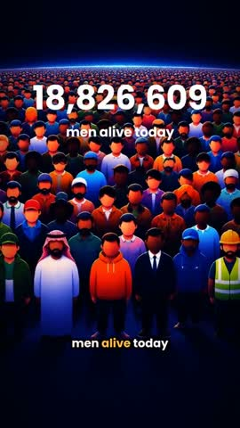](https://github.com/inematds/filme-em-codigo/releases/download/fonte-v1/style_flat_julian.mp4)  
[▶ Ver o vídeo: style_flat_julian.mp4](https://github.com/inematds/filme-em-codigo/releases/download/fonte-v1/style_flat_julian.mp4)

*Ciência em vetor plano (no estilo Kurzgesagt)*

### Ciência em vetores planos

**Mesmo estilo, sua ideia**

> Crie um vídeo curto animado vertical de 10 a 20 segundos sobre [SUA IDEIA AQUI]. Tom: uma breve história ou narrativa científica com uma reviravolta. Primeiro, escreva um roteiro de 5 ou 6 linhas (40 a 55 palavras, menos de 20 segundos falados), confira cada afirmação na web e liste as fontes. Escreva os números por extenso para a voz e em algarismos nas legendas. Estrutura das batidas: uma frase de abertura com um número grande sobre uma imagem ampla de apresentação; uma frase sobre o personagem principal; uma frase de evidência com uma estatística exibida como uma grade de símbolos, com um deles acendendo; uma frase com mapa ou diagrama em um painel estilizado sobre um quadro-chave desfocado e escurecido; uma frase de reviravolta em que uma afirmação é riscada; e uma pergunta final. Planeje cerca de sete quadros-chave, um por batida. Estilo para todos os quadros-chave: ilustração vetorial plana, formas geométricas marcantes, gradientes vibrantes e saturados sobre fundo azul-marinho escuro, personagens fofos e arredondados sem boca, estilo claro de explicação científica, brilhos suaves e sombras longas. Escreva o prompt de cada quadro-chave começando pelo tema, depois a frase de estilo e, em seguida, "Composição vertical 9:16 em retrato, com o tema principal no meio do quadro e o quarto inferior mais tranquilo. Sem texto, letras, logotipos ou marca-d'água." e gere as imagens em 9:16. Anime cada quadro-chave em um shader WebGL: crie um mapa de profundidade com um modelo monocular de profundidade, desloque a busca de acordo com a profundidade para criar uma câmera com paralaxe, balance o primeiro plano próximo, mova o céu distante para os lados em ritmo moderado e não use line boil (line boil é uma pequena distorção causada por ruído que avança em etapas 8 vezes por segundo). Câmera: movimento lento de panorâmica e zoom (zoom de 1.02 a 1.12, com panorâmica lateral que alterna de direção a cada segmento). Transições: uma transição circular de 0.4 s a partir do centro. Textos sobre as palavras correspondentes: Poppins Bold em branco, com sombra escura suave; cor de destaque âmbar #ffb547. Painéis e sobreposições: a mesma paleta, além de uma vinheta suave. Legendas: Poppins Bold em 92 px, brancas com contorno preto de 8 px, duas ou três palavras por tela perto da parte inferior; a palavra falada em #FFB547. Música: um arpejo de sintetizador sombrio em torno de 116 bpm, que para durante a reviravolta. Efeitos sonoros: tiques durante o contador, crescendos e brilhos nos números-chave, som de disco riscando na reviravolta e uma nota grave de sintetizador na surpresa. Crie em Remotion (React) com three.js, em 1080x1920 a 30 fps, sincronizando cada corte, evento e som com os tempos das palavras na voz. Sintetize toda a música e os efeitos no código, com a música cerca de 20 dB abaixo da voz e os efeitos um pouco mais baixos que ela.

<details><summary>Prompt original (inglês)</summary>

```text
Make a 10 to 20 second vertical animated short about [YOUR IDEA HERE]. Tone: a short history or science story with one twist. First write a 5 or 6 line script (40 to 55 words, under 20 seconds spoken), fact-check every claim on the web and list the sources. Write numbers as words for the voice and digits in the captions. Beat structure: a hook line with a big number over a wide establishing image; a hero line; an evidence line with a statistic shown as a grid of tokens where one lights up; a map or diagram line on a styled panel over a blurred, darkened keyframe; a reversal line where a claim gets struck through; and a payoff question. Plan about seven keyframes, one per beat. Style for every keyframe: flat vector illustration, bold geometric shapes, vibrant saturated gradients on a deep navy background, cute rounded characters with no mouths, clean science explainer style, soft glows and long shadows. Write each keyframe prompt as the subject, then that style sentence, then "Vertical 9:16 portrait composition with the main subject in the middle of the frame and a calmer lower quarter. No text, no letters, no logos, no watermark." and generate them at 9:16. Animate each keyframe in one WebGL shader: make a depth map with a monocular depth model, offset the lookup by depth for a parallax camera, sway the near foreground, drift the far sky sideways at a medium pace, and use no line boil (a line boil is a small noise warp that steps 8 times a second). Camera: a slow pan-and-zoom (zoom 1.02 to 1.12 with a sideways pan that alternates direction every segment). Transitions: a 0.4 s circle wipe from the centre. Labels on their words: Poppins Bold in white with a soft dark shadow, accent amber #ffb547. Panels and overlays: the same palette, plus a soft vignette. Captions: Poppins Bold at 92 px, white with an 8 px black outline, two or three words per page near the bottom, spoken word in #FFB547. Music: a dark synth arpeggio around 116 bpm that drops out for the reversal. Sound effects: ticks under the counter, risers and shimmers on the key numbers, a record scratch on the reversal and a low synth stab on the twist. Build it in Remotion (React) with three.js, 1080x1920 at 30 fps, keying every cut, event and sound to word timestamps from the voice. Synthesise all music and effects in code, with the music about 20 dB under the voice and the effects just below it.
```

</details>

**Copiar este filme exato · Prompt exato**

> Recrie este vídeo curto vertical de 26 segundos sobre os descendentes de Genghis Khan com um estilo ilustrado consistente, exatamente como descrito. Narração, palavra por palavra (cerca de 26 segundos): "Cerca de vinte milhões de homens vivos hoje talvez descendam de um homem: Genghis Khan. Em 2003, geneticistas descobriram que um em cada doze homens em uma vasta região da Ásia tinha quase o mesmo cromossomo Y. Parecia ter se espalhado com o Império Mongol, o maior império terrestre da história. Caso encerrado? Ainda não. O DNA de túmulos mongóis da época dele revelou uma linhagem diferente. Então a árvore genealógica mais famosa do mundo talvez pertença a outra pessoa." Estilo: ilustração vetorial plana, formas geométricas marcantes, gradientes vibrantes e saturados sobre fundo azul-marinho escuro, personagens fofos e arredondados sem boca, estilo claro de explicação científica, brilhos suaves e sombras longas. Primeiro, gere sete imagens de quadro-chave em 9:16 (1080x1920) usando estes prompts exatos, na ordem das batidas: 1. multidão: "uma vasta multidão de centenas de homens comuns de origens diversas, lado a lado em uma ampla planície, estendendo-se até o horizonte, vista ligeiramente de cima. Ilustração vetorial plana, formas geométricas marcantes, gradientes vibrantes e saturados sobre fundo azul-marinho escuro, personagens fofos e arredondados sem boca, estilo claro de explicação científica, brilhos suaves e sombras longas. Vertical 9:16, tema centralizado, quarto inferior simples, sem texto ou logotipos." 2. khan: "Genghis Khan, governante mongol do século XIII, com um capacete pontudo com acabamento de pele, bigode longo e fino e uma túnica deel, sentado com orgulho em um cavalo robusto da estepe sobre uma colina coberta de grama, ângulo baixo heroico, centralizado. Ilustração vetorial plana, formas geométricas marcantes, gradientes vibrantes e saturados sobre fundo azul-marinho escuro, personagens fofos e arredondados sem boca, estilo claro de explicação científica, brilhos suaves e sombras longas. Vertical 9:16, tema centralizado, quarto inferior simples, sem texto ou logotipos." 3. laboratório: "dois geneticistas de jaleco branco em um laboratório moderno de genética, estudando um grande modelo luminoso de dupla hélice de DNA, estantes de tubos de ensaio, um microscópio e bandejas de amostras. Ilustração vetorial plana, formas geométricas marcantes, gradientes vibrantes e saturados sobre fundo azul-marinho escuro, personagens fofos e arredondados sem boca, estilo claro de explicação científica, brilhos suaves e sombras longas. Vertical 9:16, tema centralizado, quarto inferior simples, sem texto ou logotipos." 4. exército: "uma longa coluna de cavaleiros mongóis com estandartes atravessando a infinita estepe eurasiática, nuvens de poeira, montanhas distantes, sensação épica de escala. Ilustração vetorial plana, formas geométricas marcantes, gradientes vibrantes e saturados sobre fundo azul-marinho escuro, personagens fofos e arredondados sem boca, estilo claro de explicação científica, brilhos suaves e sombras longas. Vertical 9:16, tema centralizado, quarto inferior simples, sem texto ou logotipos." 5. caso: "uma escrivaninha de madeira de detetive sob uma luminária, com uma pasta grossa de caso fechada, uma lupa, uma xícara de chá e um mapa antigo da Ásia, atmosfera sombria e misteriosa. Ilustração vetorial plana, formas geométricas marcantes, gradientes vibrantes e saturados sobre fundo azul-marinho escuro, personagens fofos e arredondados sem boca, estilo claro de explicação científica, brilhos suaves e sombras longas. Vertical 9:16, tema centralizado, quarto inferior simples, sem texto ou logotipos." 6. túmulo: "arqueólogos escavando um antigo túmulo mongol ao anoitecer, com um esqueleto parcialmente descoberto na escavação, pincéis e espátulas, e uma tênue fita de DNA luminosa saindo do túmulo. Ilustração vetorial plana, formas geométricas marcantes, gradientes vibrantes e saturados sobre fundo azul-marinho escuro, personagens fofos e arredondados sem boca, estilo claro de explicação científica, brilhos suaves e sombras longas. Vertical 9:16, tema centralizado, quarto inferior simples, sem texto ou logotipos." 7. árvore: "uma gigantesca árvore genealógica antiga, com galhos que se espalham por todo o céu, centenas de pequenos medalhões com retratos pendurados nos galhos e, na raiz, uma misteriosa silhueta encapuzada. Ilustração vetorial plana, formas geométricas marcantes, gradientes vibrantes e saturados sobre fundo azul-marinho escuro, personagens fofos e arredondados sem boca, estilo claro de explicação científica, brilhos suaves e sombras longas. Vertical 9:16, tema centralizado, quarto inferior simples, sem texto ou logotipos." Anime cada quadro-chave em um shader WebGL: crie um mapa de profundidade com um modelo monocular de profundidade, desloque a busca de acordo com a profundidade para criar uma câmera com paralaxe, balance o primeiro plano próximo, mova o céu distante para os lados em ritmo moderado e não use line boil (line boil é uma pequena distorção causada por ruído que avança em etapas 8 vezes por segundo). Câmera em cada quadro-chave: movimento lento de panorâmica e zoom (zoom de 1.02 a 1.12, com panorâmica lateral que alterna de direção a cada segmento). Transição entre segmentos: uma transição circular de 0.4 s a partir do centro. Textos na tela: Poppins Bold em branco, com sombra escura suave; cor de destaque âmbar #ffb547. Aparência do painel de mapa: azul-marinho escuro #13183f, terras em índigo #2c3a8c, linhas de 2 px em azul-pervinca #7f8cff, região âmbar rgba(255,181,71,0.9), império rosa rgba(255,86,120,0.65), pontos âmbar. Sobreposições de textura: vinheta suave. Linha do tempo: de 0 a 2.3 s, multidão: um contador sobe até 20,000,000 de "Cerca de" até "hoje", com "homens vivos hoje" em "homens". De 2.3 a 5.05 s, khan: "Genghis Khan" em "Genghis". De 5.05 a 7.6 s, laboratório: "2003" e "geneticistas" nas palavras correspondentes. De 7.6 a 8.45 s, a multidão ampliada para 1.35x: "1 em 12" sobre uma grade de 6 por 2 fichas arredondadas que aparecem; a oitava brilha na cor de destaque em "doze". De 8.45 a 12.6 s, o exército desfocado e escurecido atrás de um painel de mapa arredondado da Ásia: a região estudada surge de leste a oeste em "vasta" e os pontos aparecem em "tinha", com "uma vasta região da Ásia" e "o mesmo cromossomo Y" em "Y". De 12.6 a 14.45 s, exército nítido: "Império Mongol". De 14.45 a 16.55 s, mapa novamente: o império se espalha a partir de um marcador pulsante na Mongólia, com "maior império terrestre" e "24 milhões de km²". De 16.55 a 18.6 s, caso: "CASO ENCERRADO?", riscado por uma barra de destaque em "Ainda", enquanto "Ainda não." aparece em destaque. De 18.6 a 22.15 s, túmulo: "túmulos mongóis", "1130 a 1250" em "época" e "uma linhagem diferente" em destaque. De 22.15 s até o fim, árvore: "árvore genealógica mais famosa", substituída em "pessoa" por "outra pessoa?" em destaque. Os textos aparecem subindo e desaparecendo gradualmente ao longo de 0.2 s. Legendas: inclua legendas palavra por palavra em Poppins Bold de 92 px, brancas com contorno preto de 8 px e sombra de 3 px, duas ou três palavras por tela, centralizadas a cerca de 330 px da parte inferior, com a palavra falada em #FFB547. Música: um arpejo sombrio de sintetizador em lá menor, com ondas dente de serra desafinadas através de um filtro passa-baixa a 116 bpm e uma nota de baixo profunda a cada compasso, reduzindo o volume durante "Ainda não". Efeitos sonoros: uma sequência rápida de tiques enquanto o contador sobe, um crescendo de ruído antes de "doze", com um brilho agudo; um crescendo em "espalhado"; som de disco riscando em "Ainda"; uma nota grave de sintetizador em "diferente" e um brilho longo em "pessoa". Configuração técnica: Remotion (React) com three.js, em 1080x1920 a 30 fps, cerca de 26 segundos. Crie a voz com qualquer mecanismo de conversão de texto em fala, obtenha os tempos das palavras e sincronize cada corte, evento e som com o início da palavra correspondente. Inclua as legendas no vídeo. Sintetize toda a música e os efeitos no código, sem amostras. Mixe a música cerca de 20 dB abaixo da voz e reduza seu volume durante a fala; mantenha os efeitos um pouco abaixo da voz.

<details><summary>Prompt original (inglês)</summary>

```text
Recreate this 26 second vertical short about Genghis Khan's descendants in one consistent illustrated look, exactly as described. Narration, word for word (about 26 seconds): "About twenty million men alive today may descend from one man: Genghis Khan. In 2003, geneticists found that one in twelve men across a huge stretch of Asia carried almost the same Y chromosome. It seemed to spread with the Mongol Empire, the largest land empire in history. Case closed? Not quite. DNA from Mongol graves of his time showed a different line. So the world's most famous family tree might belong to someone else." Look: flat vector illustration, bold geometric shapes, vibrant saturated gradients on a deep navy background, cute rounded characters with no mouths, clean science explainer style, soft glows and long shadows. First generate seven keyframe images at 9:16 (1080x1920) with these exact prompts, in beat order: 1. crowd: "a vast crowd of hundreds of ordinary men of many different backgrounds standing shoulder to shoulder across a wide plain, the crowd stretching all the way to the horizon, seen from slightly above. flat vector illustration, bold geometric shapes, vibrant saturated gradients on a deep navy background, cute rounded characters with no mouths, clean science explainer style, soft glows and long shadows. Vertical 9:16, subject centred, simple lower quarter, no text or logos." 2. khan: "Genghis Khan, the 13th century Mongol ruler, with a fur-trimmed pointed helmet, long thin moustache and a deel robe, sitting proudly on a sturdy steppe horse on a grassy hill, heroic low angle, centred. flat vector illustration, bold geometric shapes, vibrant saturated gradients on a deep navy background, cute rounded characters with no mouths, clean science explainer style, soft glows and long shadows. Vertical 9:16, subject centred, simple lower quarter, no text or logos." 3. lab: "two geneticists in white lab coats in a modern genetics laboratory, studying a large glowing DNA double helix model, racks of test tubes, a microscope and sample trays. flat vector illustration, bold geometric shapes, vibrant saturated gradients on a deep navy background, cute rounded characters with no mouths, clean science explainer style, soft glows and long shadows. Vertical 9:16, subject centred, simple lower quarter, no text or logos." 4. army: "a long column of Mongol horsemen with banners riding out across the endless Eurasian steppe, clouds of dust, distant mountains, epic sense of scale. flat vector illustration, bold geometric shapes, vibrant saturated gradients on a deep navy background, cute rounded characters with no mouths, clean science explainer style, soft glows and long shadows. Vertical 9:16, subject centred, simple lower quarter, no text or logos." 5. case: "a detective's wooden desk under a lamp with a thick closed case file folder, a magnifying glass, a cup of tea and an old map of Asia, moody and mysterious. flat vector illustration, bold geometric shapes, vibrant saturated gradients on a deep navy background, cute rounded characters with no mouths, clean science explainer style, soft glows and long shadows. Vertical 9:16, subject centred, simple lower quarter, no text or logos." 6. grave: "archaeologists excavating an ancient Mongol burial mound at dusk, a skeleton partly uncovered in the dig, brushes and trowels, a faint glowing DNA strand rising out of the grave. flat vector illustration, bold geometric shapes, vibrant saturated gradients on a deep navy background, cute rounded characters with no mouths, clean science explainer style, soft glows and long shadows. Vertical 9:16, subject centred, simple lower quarter, no text or logos." 7. tree: "a gigantic ancient family tree whose branches spread across the whole sky, hundreds of tiny portrait medallions hanging from the branches, and at the root a mysterious hooded silhouette. flat vector illustration, bold geometric shapes, vibrant saturated gradients on a deep navy background, cute rounded characters with no mouths, clean science explainer style, soft glows and long shadows. Vertical 9:16, subject centred, simple lower quarter, no text or logos." Animate each keyframe in one WebGL shader: make a depth map with a monocular depth model, offset the lookup by depth for a parallax camera, sway the near foreground, drift the far sky sideways at a medium pace, and use no line boil (a line boil is a small noise warp that steps 8 times a second). Camera on each keyframe: a slow pan-and-zoom (zoom 1.02 to 1.12 with a sideways pan that alternates direction every segment). Transition between segments: a 0.4 s circle wipe from the centre. On-screen labels: Poppins Bold in white with a soft dark shadow, accent amber #ffb547. Map panel skin: deep navy #13183f, indigo land #2c3a8c, periwinkle 2 px lines #7f8cff, an amber region rgba(255,181,71,0.9), a pink empire rgba(255,86,120,0.65), amber dots. Texture overlays: a soft vignette. Timeline: 0 to 2.3 s, crowd: a counter climbs to 20,000,000 from "About" to "today", with "men alive today" on "men". 2.3 to 5.05 s, khan: "Genghis Khan" on "Genghis". 5.05 to 7.6 s, lab: "2003" and "geneticists" on their words. 7.6 to 8.45 s, the crowd zoomed to 1.35x: "1 in 12" over a 6 by 2 grid of rounded pill tokens popping in, the eighth glowing in the accent colour on "twelve". 8.45 to 12.6 s, the army blurred and darkened behind a rounded map panel of Asia: the sampled region wipes in east to west on "huge" and dots pop on "carried", with "a huge stretch of Asia" and "the same Y chromosome" on "Y". 12.6 to 14.45 s, clear army: "Mongol Empire". 14.45 to 16.55 s, map again: the empire floods out from a pulsing Mongolia marker, with "largest land empire" and "24 million km²". 16.55 to 18.6 s, case: "CASE CLOSED?", struck through by an accent bar on "Not" as "Not quite." appears in the accent. 18.6 to 22.15 s, grave: "Mongol graves", "1130 to 1250" on "time" and "a different line" in the accent. 22.15 s to the end, tree: "most famous family tree", replaced on "someone" by "someone else?" in the accent. Labels fade and rise in over 0.2 s. Captions: burn in word-by-word captions in Poppins Bold at 92 px, white with an 8 px black outline and a 3 px shadow, two or three words per page, centred about 330 px above the bottom, with the spoken word in #FFB547. Music: a dark A minor synth arpeggio of detuned saw waves through a low-pass filter at 116 bpm with a deep bass note every bar, ducking out for "Not quite". Sound effects: a fast run of ticks while the counter climbs, a noise riser into "twelve" with a bright shimmer, a riser on "spread", a record scratch on "Not", a low synth stab on "different" and a long shimmer on "someone". Technical setup: Remotion (React) with three.js, 1080x1920 at 30 fps, about 26 seconds. Make the voice with any text to speech engine, get word timestamps, and key every cut, event and sound to the start of its word. Burn the captions in. Synthesise all music and effects in code, with no samples. Mix the music about 20 dB under the voice and ducked under speech, with the effects just below the voice.
```

</details>
