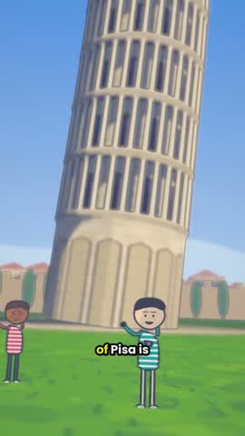
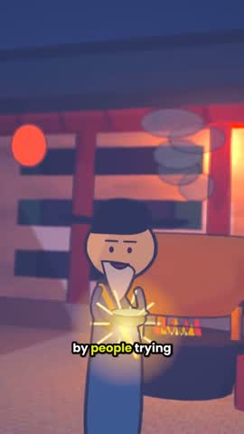
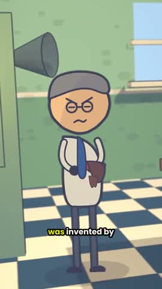
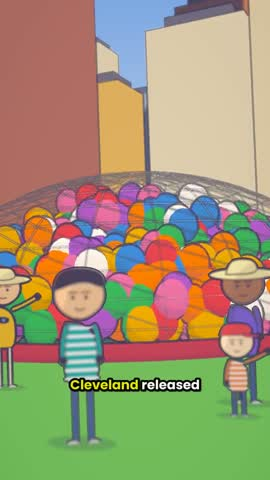
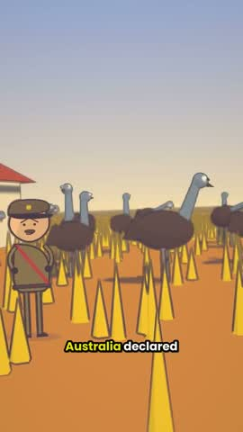

<!-- Anexo da fonte (filme-em-codigo). Tradução para o português feita pelo tradutor central (inema-traduz). Original em inglês: ../biblioteca-original/06-historias-3d.md. Crédito e licença: ../LEIA.md. -->

[← índice](../biblioteca-pt.md) · [original em inglês](../biblioteca-original/06-historias-3d.md) · [crédito e licença](../LEIA.md)

> Tradução da biblioteca de prompts de **AI Samson**. Cada prompt vem traduzido e, logo abaixo, no original em inglês: o prompt em inglês costuma funcionar melhor no modelo.

## Histórias em desenho animado 3D

[](https://github.com/inematds/filme-em-codigo/releases/download/fonte-v1/pisa_gideon.mp4)  
[▶ Ver o vídeo: pisa_gideon.mp4](https://github.com/inematds/filme-em-codigo/releases/download/fonte-v1/pisa_gideon.mp4)

*Desenho animado 3D*

### A torre que foi salva por não fazer nada

**Mesmo estilo, sua ideia**

> Crie um curta animado vertical de 10 a 20 segundos sobre [SUA IDEIA AQUI]. Use um tom divertido de mistério histórico: uma afirmação surpreendente, seguida da história contada em pequenas cenas cômicas. Primeiro, escreva um roteiro de 5 ou 6 linhas (40 a 55 palavras, menos de 20 segundos de fala), confira cada afirmação na web e liste as fontes. Escreva os números por extenso para a voz e em algarismos nas legendas. Estrutura das batidas: uma frase de abertura que apresente a afirmação surpreendente sobre um plano geral cômico; uma frase com data e lugar, acompanhada de um movimento amplo de grua pelo cenário; três momentos de tensão crescente em que algo dá errado, cada um com seu próprio corte para uma cena ou piada visual com objeto; e uma frase final que revele a ironia, terminando em um plano geral dourado que se afasta e sobe. Estilo: personagens 2D desenhados à mão em painéis voltados para a câmera (contorno de tinta ameixa #241726, preenchimentos chapados, olhos grandes e brancos, piscando) em um mundo 3D com sombreamento de desenho animado e formas geométricas simples, com uma etapa final que acrescenta linhas de tinta quase pretas de 5 px nas bordas de profundidade, desfoque de fundo nos planos fechados, sombras frias, realces quentes e vinheta suave. Céu de #4f8fdc até um horizonte pálido, mudando para dourado, crepúsculo ou azul-noturno quando o clima mudar. Câmera: um plano por batida, cada um com um movimento suave de câmera, aproximação lenta, cortes secos, rotações leves, um clarão branco depois da abertura e um tranco curto de câmera em cada grande impacto. Legendas: Poppins Bold 92 px, brancas com contorno preto de 8 px, duas ou três palavras por tela perto da parte inferior, a palavra falada em amarelo #E3E302. Música: uma melodia original e leve de dança folclórica que combine com a cultura do lugar (por exemplo, cordas dedilhadas em 6/8 com baixo no ritmo tum-tá-tá), terminando com um acorde final na última palavra. Efeitos sonoros: um som claro de desenho animado em cada palavra-chave (rangidos, pancadas, sons pastosos, boings, assobios, um estrondo no grande momento, um tilintar ou plim na piada final). Crie em Remotion (React) com three.js, 1080x1920 a 30 fps, sincronizando cada corte, evento e som com as marcações de tempo das palavras na voz. Sintetize toda a música e os efeitos em código, com a música cerca de 20 dB abaixo da voz e os efeitos um pouco abaixo dela.

<details><summary>Prompt original (inglês)</summary>

```text
Make a 10 to 20 second vertical animated short about [YOUR IDEA HERE]. Use a playful history-mystery tone: a surprising claim, then the story told in small comic scenes. First write a 5 or 6 line script (40 to 55 words, under 20 seconds spoken), fact-check every claim on the web and list the sources. Write numbers as words for the voice and digits in the captions. Beat structure: a hook line that states the surprising claim over a comic establishing shot; a date-and-place line with a wide crane glide over the setting; three escalating beats where something goes wrong, each with its own cutaway or prop gag; and a payoff line that lands the irony, ending on a golden wide shot that pulls up and back. Style: flat 2D hand-drawn characters on camera-facing billboards (plum ink outline #241726, flat fills, big white eyes, blinking) inside a 3D toon-shaded world of simple primitives, with a post pass of near-black 5 px ink lines from depth edges, background blur on close shots, cool shadows, warm highlights and a soft vignette. Sky from #4f8fdc to a pale horizon, switching to golden, dusk or night blue when the mood changes. Camera: one shot per beat, each a smootherstep glide with a slow push-in, hard cuts, gentle rolls, a white flash after the hook and a short camera kick on every big hit. Captions: Poppins Bold 92 px, white with an 8 px black outline, two or three words per page near the bottom, the spoken word in yellow #E3E302. Music: an original, light folk dance tune that suits the setting's culture (for example plucked strings in 6/8 with an oom-pa-pa bass), ending on a final chord on the last word. Sound effects: one clear cartoon sound on each key word (creaks, thunks, squelches, boings, whooshes, a boom for the big moment, a chime or plink for the punchline). Build it in Remotion (React) with three.js, 1080x1920 at 30 fps, keying every cut, event and sound to word timestamps from the voice. Synthesise all music and effects in code, with the music about 20 dB under the voice and the effects just below it.
```

</details>

**Copiar este filme exato · Prompt exato**

> Recrie este curta vertical de desenho animado de 72 segundos, "A torre que foi salva por não fazer nada", exatamente como descrito. Narração, palavra por palavra: "A Torre de Pisa só continua de pé porque seus construtores pararam de trabalhar por cem anos. É 1173, e Pisa está construindo a torre de sinos mais bonita da Itália. Cinco anos depois, por volta do quarto andar, a torre novinha já está inclinada. O terreno embaixo é de argila mole e úmida, e um dos lados da torre está afundando nela. Então, por motivos que ninguém registrou, a obra para. Por quase cem anos. Felizmente, ninguém terminou a torre. Infelizmente, ninguém também a consertou. É que a argila úmida está cheia de água e, com todo aquele peso, a água vai sendo espremida aos poucos, deixando a argila mais firme. Você já ficou parado numa praia molhada? No começo, seus pés afundam; depois, a areia se compacta e sustenta você. Mais tarde, os engenheiros descobriram que, se os construtores tivessem simplesmente continuado a obra, a torre teria caído. Quando finalmente voltaram, fizeram cada andar novo um pouco mais alto do lado baixo. Por isso, agora a torre é curva como uma banana. Em 1934, Mussolini decidiu que a inclinação era constrangedora e mandou bombear cimento para a base. Ela inclinou ainda mais. No fim, os engenheiros a salvaram retirando terra por baixo do lado mais alto e deixando-a afundar de volta para o outro lado. Assim, o erro mais famoso da Itália foi corrigido duas vezes: primeiro, sem fazer nada; depois, cavando um buraco." Visual: personagens 2D desenhados à mão em painéis voltados para a câmera (contorno de tinta ameixa #241726, preenchimentos chapados, olhos grandes e brancos, piscando, sombras ovais de contato) em um mundo 3D com sombreamento de desenho animado e formas geométricas simples, com uma faixa de sombreamento rígida de dois tons. Uma etapa final acrescenta linhas de tinta quase pretas, com cerca de 5 px de espessura, nas bordas de profundidade, desfoque de lente no fundo dos planos fechados, sombras com tom azul frio, realces quentes, 8 por cento a mais de saturação e vinheta suave. Cenário: uma praça com a torre de mármore branco em proporções reais (base com arcadas cegas, seis galerias cercadas por colunas creme e um campanário), a catedral e o batistério, um muro com ameias, casas de reboco quente e ciprestes, além de uma maquete em corte do solo e uma praia. Luz: céu diurno de #4f8fdc a #c4daf0, dourado de #ffb46a a #8a6f8a, crepúsculo de #4a5fa8 a #e8a07a e azul-noturno de #0f1d4a a #3a4f8f para a explicação. Batidas, um plano por cena: (1) Ângulo baixo: turistas fazem a pose de empurrar a torre, depois um clarão branco. (2) "1173": movimento de grua descendo até um bispo orgulhoso de vermelho diante de um começo de torre de um andar, enquanto pedreiros trabalham. (3) "Cinco anos depois": os andares sobem com pancadas até o quarto; em "inclinada", ela tomba cerca de 4 graus com um estalo, os pedreiros se assustam e a câmera dá um tranco. (4) "O terreno": um corte do solo mostra a minitorre afundando de um lado em "afundando". (5) "a obra para": os pedreiros vão embora sob um ponto de interrogação; em "quase", o céu alterna entre dia e noite enquanto o andaime some e o mato cresce. (6) "Felizmente": o começo de torre coberto de mato e um guarda dormindo, com Zzz. (7) "Infelizmente": aproximação lenta e impassível pelo começo de torre, enquanto um pássaro pousa. (8) Corte com azul-noturno: gotas de água sobem da argila, que fica mais firme em "firme". (9) Praia dourada: uma criança afunda em "afundam" e faz um sinal de positivo brilhante em "sustenta". (10) Um engenheiro com uma prancheta enquanto o fantasma da torre completa cai atrás dele em "caído", levantando uma nuvem de poeira. (11) Os construtores voltam, e os andares superiores sobem com uma inclinação compensatória; alguém ergue uma banana em "banana". (12) Crepúsculo, 1934: um oficial convencido, de quepe escuro, ao lado de uma betoneira vermelha, fica sério em "constrangedora"; em "mais", a torre dá um solavanco e ele entra em pânico. (13) Engenheiros de coletes laranja perfuram o lado mais alto, a pilha de terra cresce e a torre se endireita aos poucos em "afundar de volta". (14) Plano geral dourado: turistas posando, um construtor tirando uma soneca numa rede, o engenheiro ao lado do buraco; a câmera sobe e se afasta. Câmera: cada plano tem um movimento suave de câmera e uma aproximação lenta, com cortes secos entre os planos, rotações de 2 a 4 graus e um tranco de câmera de 7 quadros que diminui após grandes impactos. Legendas: Poppins Bold 92 px, brancas com contorno preto de 8 px e sombra de 3 px, cerca de 330 px acima da parte inferior, duas ou três palavras por tela, a palavra falada em amarelo #E3E302. Música: uma tarantela em lá menor, em 6/8 a cerca de 112, com dedilhados em tremolo de bandolim, baixo no ritmo tum-tá-tá e pandeiro, terminando com um acorde em "buraco". Efeitos sonoros: pancadas nos andares, rangido em "inclinada", sons pastosos em "afundando" e "afundam", rangidos metálicos em "para", tiques rápidos em "quase", bater de asas, tilintar em "sustenta", rangido, assobio e estrondo na queda, boing em "banana", ronco e pancada da betoneira em "mais", zumbido da furadeira, ronco em "nada" e plim em "buraco". Configuração técnica: Remotion (React) com three.js, 1080x1920 a 30 fps, cerca de 72 segundos. Gere a voz com qualquer mecanismo de texto para fala, obtenha as marcações de tempo das palavras e sincronize o início de cada corte, evento e som com a palavra correspondente. Insira as legendas no vídeo. Sintetize toda a música e os efeitos em código, sem usar amostras. Mixe a música cerca de 20 dB abaixo da voz e reduza o volume durante a fala; mantenha os efeitos um pouco abaixo da voz.

<details><summary>Prompt original (inglês)</summary>

```text
Recreate this 72 second vertical cartoon short, "The Tower That Was Saved by Doing Nothing", exactly as described. Narration, word for word: "The Leaning Tower of Pisa is only still standing because its builders stopped working for a hundred years. It's 1173, and Pisa is building the most beautiful bell tower in Italy. Five years in, around the fourth floor, the brand new tower is already leaning. The ground underneath is soft, wet clay, and one side of the tower is sinking into it. Then, for reasons nobody wrote down, work stops. For almost a hundred years. Luckily, nobody finished the tower. Unluckily, nobody fixed it either. You see, wet clay is full of water, and under all that weight, the water slowly squeezes out and the clay gets firmer. Ever stood still on a wet beach? Your feet sink at first, then the sand packs down and holds you. Engineers later worked out that if the builders had just kept going, the tower would have fallen over. When they finally came back, they made each new floor a little taller on the low side, so now the tower is curved like a banana. In 1934, Mussolini decided the lean was embarrassing and had the base pumped full of cement. It leaned more. In the end, engineers saved it by drilling soil out from under the high side, and letting it sink back the other way. So the most famous mistake in Italy was rescued twice: once by doing nothing, and once by digging a hole." Look: flat 2D hand-drawn characters on camera-facing billboards (plum ink outline #241726, flat fills, big white eyes, blinking, oval contact shadows) inside a 3D toon-shaded world of simple primitives with a hard two-tone shading ramp. A post pass adds near-black ink lines about 5 px thick from depth edges, background lens blur on close shots, a cool blue lift in the shadows, warm highlights, 8 percent extra saturation and a soft vignette. World: a piazza with the white marble tower at real proportions (blind-arcade base, six loggias ringed by cream columns, a belfry), the cathedral and baptistery, a crenellated wall, warm plaster houses and cypresses, plus a soil cutaway diorama and a beach. Light: day sky #4f8fdc to #c4daf0, golden #ffb46a to #8a6f8a, dusk #4a5fa8 to #e8a07a, and night blue #0f1d4a to #3a4f8f for the explanation. Beats, one shot each: (1) Low angle: tourists do the pushing-the-tower pose, then a white flash. (2) "1173": a crane glide down to a proud bishop in red before a one-storey stub as masons work. (3) "Five years in": storeys thunk up to the fourth floor; on "leaning" it tips about 4 degrees with a crack, the masons gasp and the camera kicks. (4) "The ground": a strata cutaway where the mini tower sinks on one side on "sinking". (5) "work stops": masons walk off under a question mark; on "almost" the sky flickers day and night as the scaffold vanishes and weeds grow. (6) "Luckily": the overgrown stub and a sleeping guard with Zzz. (7) "Unluckily": a deadpan push up the stub as a bird lands. (8) Night blue cutaway: water drops rise out of the clay, which firms on "firmer". (9) Golden beach: a kid sinks on "sink" and gives a sparkly thumbs up on "holds". (10) An engineer with a clipboard as a ghost of the full tower topples behind him on "fallen" into a dust cloud. (11) Builders return and the top floors rise with a counter-tilt; one holds up a banana on "banana". (12) Dusk, 1934: a smug official in a dark peaked cap by a red cement mixer, stern on "embarrassing"; on "more" the tower lurches and he panics. (13) Engineers in orange vests drill the high side, a spoil heap grows, and the tower eases back on "sink back". (14) Golden wide: posing tourists, a builder napping in a hammock, the engineer by the hole, craning up and back. Camera: each shot is a smootherstep glide with a slow creeping push-in, hard cuts between shots, 2 to 4 degree rolls, and a 7-frame decaying camera kick on big hits. Captions: Poppins Bold 92 px, white with an 8 px black outline and a 3 px shadow, about 330 px above the bottom, two or three words per page, the spoken word in yellow #E3E302. Music: an A minor tarantella in 6/8 at about 112 with mandolin tremolo plucks, an oom-pa-pa bass and tambourine, ending on a chord at "hole". Sound effects: thunks for storeys, a creak on "leaning", squelches on "sinking" and "sink", clanks on "stops", fast ticks on "almost", a wing flutter, a chime on "holds", a creak, whoosh and boom for the fall, a boing on "banana", a mixer chug and thunk on "more", a drill whine, a snore on "nothing" and a plink on "hole". Technical setup: Remotion (React) with three.js, 1080x1920 at 30 fps, about 72 seconds. Make the voice with any text to speech engine, get word timestamps, and key every cut, event and sound to the start of its word. Burn the captions in. Synthesise all music and effects in code, with no samples. Mix the music about 20 dB under the voice and ducked under speech, with the effects just below the voice.
```

</details>

[](https://github.com/inematds/filme-em-codigo/releases/download/fonte-v1/gunpowder_gideon.mp4)  
[▶ Ver o vídeo: gunpowder_gideon.mp4](https://github.com/inematds/filme-em-codigo/releases/download/fonte-v1/gunpowder_gideon.mp4)

*Desenho animado 3D*

### A receita que você nunca deve fazer

**Mesmo estilo, sua ideia**

> Crie um curta animado vertical de 10 a 20 segundos sobre [SUA IDEIA AQUI]. Tom: uma invenção acidental contada como uma fábula cômica. Primeiro, escreva um roteiro de 5 ou 6 linhas (40 a 55 palavras, menos de 20 segundos falados), verifique os fatos de cada afirmação na web e liste as fontes. Escreva os números por extenso para a voz e em algarismos nas legendas. Estrutura das batidas: uma frase de abertura com a afirmação irônica sobre um close do herói com um objeto brilhante; uma frase sobre tempo e lugar em um plano aberto noturno; uma frase em lista, em que cada ingrediente ou etapa aparece junto com sua palavra e sua própria nuvem colorida; uma frase de escalada que culmina em uma explosão de desenho animado com um clarão branco; uma frase sobre as consequências, com personagens cobertos de fuligem e um prédio em chamas; e um desfecho impassível ao amanhecer. Estilo: personagens 2D desenhados à mão e planos, em painéis voltados para a câmera (contorno de tinta cor de ameixa #241726, preenchimentos planos, olhos grandes e brancos, piscando), dentro de um mundo 3D com sombreamento de desenho animado e formas geométricas simples, com um passe de pós-processamento de linhas de tinta quase pretas de 5 px nas bordas de profundidade, desfoque do fundo nos closes, sombras frias, realces quentes e vinheta suave. Céu de #4f8fdc até um horizonte pálido, mudando para dourado, crepúsculo ou azul noturno quando o clima mudar. Para a noite, use um céu azul profundo (#0c1638 a #34407a), com lanternas vermelhas e luz do fogo que aquece conforme a tensão aumenta. Câmera: um plano por batida, cada um deslizando suavemente com smootherstep e um zoom lento, cortes secos, inclinações suaves, um clarão branco após a abertura e um breve tranco de câmera a cada grande impacto. Legendas: Poppins Bold 92 px, brancas com contorno preto de 8 px, duas ou três palavras por tela perto da parte inferior, a palavra falada em amarelo #E3E302. Música: melodia pentatônica de cordas dedilhadas com pulso de bloco de madeira, crescendo em tremolo, silêncio na explosão e um final esparso e irônico. Efeitos sonoros: som ambiente contínuo, rugido que cresce até o clímax, estrondo com cauda de gongo e um pequeno efeito sonoro na última frase. Produza no Remotion (React) com three.js, em 1080x1920 e 30 fps, sincronizando cada corte, evento e som com os tempos das palavras da voz. Sintetize toda a música e os efeitos em código, com a música cerca de 20 dB abaixo da voz e os efeitos um pouco abaixo dela.

<details><summary>Prompt original (inglês)</summary>

```text
Make a 10 to 20 second vertical animated short about [YOUR IDEA HERE]. Tone: an accidental invention told as a comic fable. First write a 5 or 6 line script (40 to 55 words, under 20 seconds spoken), fact-check every claim on the web and list the sources. Write numbers as words for the voice and digits in the captions. Beat structure: a hook line stating the ironic claim over a close shot of the hero with a glowing prop; a time-and-place line on a wide night shot; a list line where each ingredient or step lands on its word with its own coloured puff; an escalation line that builds to a cartoon explosion with a white flash; a consequences line with sooty characters and a burning building; and a deadpan payoff at dawn. Style: flat 2D hand-drawn characters on camera-facing billboards (plum ink outline #241726, flat fills, big white eyes, blinking) inside a 3D toon-shaded world of simple primitives, with a post pass of near-black 5 px ink lines from depth edges, background blur on close shots, cool shadows, warm highlights and a soft vignette. Sky from #4f8fdc to a pale horizon, switching to golden, dusk or night blue when the mood changes. For night use a deep blue sky (#0c1638 to #34407a) with red lanterns and fire light that warms as tension rises. Camera: one shot per beat, each a smootherstep glide with a slow push-in, hard cuts, gentle rolls, a white flash after the hook and a short camera kick on every big hit. Captions: Poppins Bold 92 px, white with an 8 px black outline, two or three words per page near the bottom, the spoken word in yellow #E3E302. Music: a pentatonic plucked-string tune with a woodblock pulse, a tremolo build, silence on the blast and a sparse wry ending. Sound effects: an ambient bed, a roar into the climax, a boom with a gong tail and one small foley sound on the last line. Build it in Remotion (React) with three.js, 1080x1920 at 30 fps, keying every cut, event and sound to word timestamps from the voice. Synthesise all music and effects in code, with the music about 20 dB under the voice and the effects just below it.
```

</details>

**Copiar este filme exato · Prompt exato**

> Recrie exatamente como descrito este curta de desenho animado vertical de 18 segundos, “A receita que você nunca deve fazer”. Narração, palavra por palavra: “A pólvora foi inventada por pessoas que tentavam viver para sempre. China do século IX. Alquimistas estão preparando um elixir da vida eterna. Salitre, enxofre, um pouco de mel. Aumente o fogo. Mãos queimadas, rostos queimados e a casa pegando fogo. Então, um dos primeiros livros a mencioná-la a listou como uma receita que você nunca deve fazer.” Visual: personagens 2D desenhados à mão e planos, em painéis voltados para a câmera (contorno de tinta cor de ameixa #241726, preenchimentos planos, olhos grandes e brancos, piscando, sombras de contato ovais), dentro de um mundo 3D com sombreamento de desenho animado e formas geométricas simples, com uma rampa de sombreamento de dois tons bem definida. Um passe de pós-processamento adiciona linhas de tinta quase pretas com cerca de 5 px de espessura nas bordas de profundidade, desfoque de lente no fundo dos closes, realce azul frio nas sombras, realces quentes, 8 por cento mais saturação e vinheta suave. O mundo: pátio de um alquimista da era Tang à noite, com telhados curvos de telhas cinzentas (#3d4a52), salões de madeira vermelha (#9a3b2c), lanternas vermelhas lançando luz quente (#ff7a50), lua pálida #fff4d0, montanhas distantes e pinheiros, terra batida (#b89a72) e lajes, caldeirão de bronze sobre três pernas em um braseiro e três potes de ingredientes em um banco baixo: salitre branco, enxofre amarelo e mel âmbar. Céu noturno de #0c1638 a #34407a, com luar azul frio; a última batida é o amanhecer, #6f86c8 a #f2b48a. Os personagens são três alquimistas de túnica (um ancião com chapéu escuro de oficial e barba branca, dois com coques no alto da cabeça), cujos rostos ficam cobertos de fuligem após a explosão; a luz do fogo os deixa mais dourados conforme o calor aumenta. Batidas: (1) “A pólvora foi inventada”: close do ancião orgulhoso segurando uma tigela brilhante com uma pequena faísca. Um clarão branco. (2) “China do século IX”: deslize panorâmico alto sobre o pátio; o ancião está com as mãos na cintura e um cozinheiro abana o fogo. (3) “Alquimistas estão preparando”: o ancião aponta, o cozinheiro abana o fogo alegremente e um ajudante segura uma tigela. (4) “Salitre, enxofre, um pouco de mel”: cada pote se inclina sobre o caldeirão exatamente quando sua palavra é dita, e uma nuvem colorida (branca, amarela, âmbar) sobe. (5) “Aumente o fogo”: o cozinheiro abana o fogo com ar convencido enquanto as chamas crescem; cerca de 0,6 segundos depois de “fogo”, o caldeirão explode com um estrondo de desenho animado e um clarão branco. A câmera dá dois trancos, e os dois alquimistas levantam os braços assustados. (6) “Mãos queimadas, rostos queimados”: close dos dois, cobertos de fuligem, com fumaça subindo de suas cabeças. (7) “e a casa pegando fogo”: plano aberto do salão com chamas percorrendo o telhado e uma enorme coluna de fumaça; a câmera dá um tranco em “casa”. (8) Amanhecer, “Então, um dos primeiros livros”: o ancião está à mesa do escriba, entre vigas carbonizadas, segurando um pergaminho e pensativo; fica sério em “nunca”. Câmera: cada plano desliza suavemente com smootherstep e um zoom lento e gradual, cortes secos entre os planos, inclinações de 2 a 4 graus e um tranco de câmera decrescente de 7 quadros nos grandes impactos. Legendas: Poppins Bold 92 px, brancas com contorno preto de 8 px e sombra de 3 px, cerca de 330 px acima da parte inferior, duas ou três palavras por tela, com a palavra falada em amarelo #E3E302. Música: melodia pentatônica em Sol maior numa cítara dedilhada, com uma leve oscilação de corda, baixo de cítara grave e pulso de bloco de madeira a 96 bpm; um tremolo rápido cresce em “fogo”, a música para de repente na explosão e depois vem uma frase esparsa, levemente dissonante, para a piada final, com um final grave de duas notas em “fazer”. Efeitos sonoros: crepitar baixo e contínuo de fogueira, fogo rugindo em “fogo”, um grande estrondo com cauda de gongo e um efeito de whoosh, telhado estalando em “casa” e pincel riscando o papel em “listou”. Configuração técnica: Remotion (React) com three.js, 1080x1920 a 30 fps, cerca de 18 segundos. Crie a voz com qualquer mecanismo de texto para fala, obtenha os tempos das palavras e sincronize cada corte, evento e som com o início da palavra correspondente. Grave as legendas no vídeo. Sintetize toda a música e os efeitos em código, sem amostras. Mixe a música cerca de 20 dB abaixo da voz e reduza seu volume durante a fala; deixe os efeitos um pouco abaixo da voz.

<details><summary>Prompt original (inglês)</summary>

```text
Recreate this 18 second vertical cartoon short, "The Recipe You Should Never Make", exactly as described. Narration, word for word: "Gunpowder was invented by people trying to live forever. Ninth-century China. Alchemists are cooking up an elixir of eternal life. Saltpetre, sulphur, a little honey. Turn up the heat. Burned hands, burned faces, and the house burned down. So one of the first books to mention it listed it as a recipe you should never make." Look: flat 2D hand-drawn characters on camera-facing billboards (plum ink outline #241726, flat fills, big white eyes, blinking, oval contact shadows) inside a 3D toon-shaded world of simple primitives with a hard two-tone shading ramp. A post pass adds near-black ink lines about 5 px thick from depth edges, background lens blur on close shots, a cool blue lift in the shadows, warm highlights, 8 percent extra saturation and a soft vignette. The world: a Tang-era alchemist's courtyard at night with curved grey tiled roofs (#3d4a52), red timber halls (#9a3b2c), red lanterns casting warm light (#ff7a50), a pale moon #fff4d0, distant mountains and pines, packed earth (#b89a72) and flagstones, a bronze cauldron on three legs over a brazier, and three ingredient jars on a low bench: white saltpetre, yellow sulphur and amber honey. Night sky from #0c1638 to #34407a with cool blue moonlight; the last beat is dawn, #6f86c8 to #f2b48a. Characters are three robed alchemists (one elder with a dark official's hat and white beard, two with topknots) whose faces turn sooty after the blast; the fire light makes them glow warmer as the heat rises. Beats: (1) "Gunpowder was invented": close on the proud elder holding a glowing bowl with a little spark. A white flash. (2) "Ninth-century China": a high wide glide over the courtyard, the elder with hands on hips and a cook fanning the fire. (3) "Alchemists are cooking up": the elder points, the cook fans happily and a helper holds a bowl. (4) "Saltpetre, sulphur, a little honey": each jar tips over the cauldron exactly on its word and a coloured puff (white, yellow, amber) rises. (5) "Turn up the heat": the cook fans smugly as the fire grows; about 0.6 seconds after "heat" the cauldron explodes in a cartoon boom with a white flash and a double camera kick, and both alchemists throw up their arms in shock. (6) "Burned hands, burned faces": close on the two of them, sooty, smoke curling off their heads. (7) "and the house burned down": a wide of the hall with flames running along the roof and a huge smoke column, with a camera kick on "house". (8) Dawn, "So one of the first books": the elder at a scribe's desk among charred timbers holding a scroll, thinking, then stern on "never". Camera: each shot is a smootherstep glide with a slow creeping push-in, hard cuts between shots, 2 to 4 degree rolls, and a 7-frame decaying camera kick on big hits. Captions: Poppins Bold 92 px, white with an 8 px black outline and a 3 px shadow, about 330 px above the bottom, two or three words per page, the spoken word in yellow #E3E302. Music: a G major pentatonic tune on a plucked zither with a gentle string-bend wobble, a low zither bass and a woodblock pulse at 96 bpm, a fast tremolo build on "heat", stopping dead on the boom, then a sparse slightly sour phrase for the punchline with a low two-note ending on "make". Sound effects: a quiet campfire crackle bed, the fire roaring up on "heat", a big boom with a gong tail and a whoosh, the roof crackling up on "house", and a brush scratching on paper on "listed". Technical setup: Remotion (React) with three.js, 1080x1920 at 30 fps, about 18 seconds. Make the voice with any text to speech engine, get word timestamps, and key every cut, event and sound to the start of its word. Burn the captions in. Synthesise all music and effects in code, with no samples. Mix the music about 20 dB under the voice and ducked under speech, with the effects just below the voice.
```

</details>

[](https://github.com/inematds/filme-em-codigo/releases/download/fonte-v1/microwave_gideon.mp4)  
[▶ Ver o vídeo: microwave_gideon.mp4](https://github.com/inematds/filme-em-codigo/releases/download/fonte-v1/microwave_gideon.mp4)

*Desenho animado 3D*

### Dois dólares pelo micro-ondas

**Mesmo estilo, sua ideia**

> Crie um curta animado vertical de 10 a 20 segundos sobre [SUA IDEIA AQUI]. Tom: um golpe de sorte de um inventor, contado em cenas rápidas de pastelão. Primeiro, escreva um roteiro de 5 ou 6 linhas (40 a 55 palavras, menos de 20 segundos de fala), confira na web todos os fatos e liste as fontes. Escreva os números por extenso para a voz e em algarismos nas legendas. Estrutura das cenas: uma frase de abertura que nomeia a causa estranha da invenção, com um close do herói e do objeto principal; uma frase de apresentação com um plano aberto do local de trabalho; depois, três cenas de experimentos em intensidade crescente, cada uma com uma piada visual que acontece junto com a palavra correspondente (a segunda termina com uma meleca espirrando num colega, com um clarão branco e um tranco de câmera); e uma frase final com o herói mostrando uma recompensa absurdamente pequena. Estilo: personagens 2D desenhados à mão, planos e em painéis voltados para a câmera (contorno de tinta ameixa #241726, preenchimentos chapados, olhos grandes e brancos, piscando), dentro de um mundo 3D com sombreamento de desenho animado e formas geométricas simples. Na pós-produção, aplique linhas de tinta quase pretas de 5 px nas bordas de profundidade, desfoque no fundo dos closes, sombras frias, realces quentes e uma vinheta suave. Céu em gradiente de #4f8fdc até um horizonte claro, mudando para tons dourados, crepúsculo ou azul-noturno quando o clima mudar. A cena se passa num local de trabalho de época, iluminado, com fundo azul-claro, piso xadrez, paredes pintadas e uma máquina que brilha e zumbe, pulsando com anéis ondulados desenhados. Câmera: um plano por cena, cada um com um movimento suave smootherstep e uma aproximação lenta, cortes secos, giros suaves, um clarão branco após a abertura e um tranco curto de câmera a cada grande impacto. Legendas: Poppins Bold 92 px, brancas com contorno preto de 8 px, duas ou três palavras por tela perto da parte inferior, com a palavra falada em amarelo #E3E302. Música: swing leve, adequado à época, com baixo marcado e caixa tocada com vassourinhas, diminuindo na grande piada. Efeitos sonoros: zumbido baixo contínuo e, depois, um som de desenho animado por experimento (som de algo viscoso, uma sequência de estalos, um assobio e um respingo), além de um ding no final. Crie em Remotion (React) com three.js, em 1080x1920 a 30 fps, sincronizando cada corte, evento e som com as marcas de tempo das palavras na voz. Sintetize toda a música e os efeitos em código, com a música cerca de 20 dB abaixo da voz e os efeitos um pouco mais baixos que ela.

<details><summary>Prompt original (inglês)</summary>

```text
Make a 10 to 20 second vertical animated short about [YOUR IDEA HERE]. Tone: an inventor's lucky accident told in quick slapstick scenes. First write a 5 or 6 line script (40 to 55 words, under 20 seconds spoken), fact-check every claim on the web and list the sources. Write numbers as words for the voice and digits in the captions. Beat structure: a hook line naming the strange cause of the invention over a close shot of the hero with the key prop; a setup line with a wide shot of the workplace; then three escalating experiment beats, each with a visual gag landing on its word (the second one ends in a messy splat on a colleague with a white flash and camera kick); and a payoff line with the hero holding up an absurdly small reward. Style: flat 2D hand-drawn characters on camera-facing billboards (plum ink outline #241726, flat fills, big white eyes, blinking) inside a 3D toon-shaded world of simple primitives, with a post pass of near-black 5 px ink lines from depth edges, background blur on close shots, cool shadows, warm highlights and a soft vignette. Sky from #4f8fdc to a pale horizon, switching to golden, dusk or night blue when the mood changes. Place it in a bright period workplace with a pale sky-blue background, a checkered floor, painted walls and one glowing, humming machine that pulses with drawn wave rings. Camera: one shot per beat, each a smootherstep glide with a slow push-in, hard cuts, gentle rolls, a white flash after the hook and a short camera kick on every big hit. Captions: Poppins Bold 92 px, white with an 8 px black outline, two or three words per page near the bottom, the spoken word in yellow #E3E302. Music: period-appropriate light swing with a walking bass and brushed snare that dips for the big gag. Sound effects: a low hum bed, then one cartoon sound per experiment (squelch, a patter of pops, a whoosh and splat) and a ding for the payoff. Build it in Remotion (React) with three.js, 1080x1920 at 30 fps, keying every cut, event and sound to word timestamps from the voice. Synthesise all music and effects in code, with the music about 20 dB under the voice and the effects just below it.
```

</details>

**Copiar este filme exato · Prompt exato**

> Recrie exatamente como descrito este curta vertical de desenho animado de 15 segundos, "Dois dólares pelo micro-ondas". Narração, palavra por palavra: "O forno de micro-ondas foi inventado por causa de uma barra de chocolate derretida. Nos anos 1940, um engenheiro chamado Percy Spencer está ao lado de uma máquina de radar, e o chocolate no bolso dele derrete. Então ele tenta fazer pipoca. Ela estoura. Depois, tenta um ovo. Ele explode no rosto do colega. A empresa pagou dois dólares pela ideia." Aparência: personagens 2D desenhados à mão, planos e em painéis voltados para a câmera (contorno de tinta ameixa #241726, preenchimentos chapados, olhos grandes e brancos, piscando, sombras ovais de contato), dentro de um mundo 3D com sombreamento de desenho animado e formas geométricas simples, com uma faixa de sombreamento rígida de dois tons. Na pós-produção, adicione linhas de tinta quase pretas com cerca de 5 px de espessura nas bordas de profundidade, desfoque de lente no fundo dos closes, sombras com um leve tom azul frio, realces quentes, 8 por cento mais saturação e uma vinheta suave. Os personagens têm um tom quente #fff6ea. O cenário: um laboratório de radar iluminado dos anos 1940, com fundo azul-céu #bfe0ff e piso xadrez (#2f4a5a e #e8e0cc), paredes verde-sálvia (#9fc2a8 sobre #7da48a) com um friso creme, janelas claras, um gabinete de radar alto de aço cinza-esverdeado #6f8a80 com três mostradores creme e ponteiros vermelhos, botões vermelhos, amarelos e verdes e um traço verde de osciloscópio, um magnetron de latão e uma corneta apontada para uma bancada de madeira #8a5a34 com uma panela de pipoca, uma chaleira de aço e um ovo, potes nas prateleiras, um arquivo e uma luminária de teto de esmalte verde. O radar zumbe com um brilho quente pulsante e anéis ondulados desenhados. Personagens: Spencer tem cabelos grisalhos, óculos, camisa branca e gravata azul; o colega tem bigode, camisa branca e gravata vermelha e carrega uma prancheta. Cenas: (1) "O forno de micro-ondas": close de Spencer segurando uma barra de chocolate que pinga, preocupado e depois assustado. Um clarão branco. (2) "Nos anos 1940": movimento aberto pelo laboratório enquanto Spencer caminha até o gabinete de radar, com o colega e a prancheta ao lado; os anéis do radar começam a pulsar em "radar". (3) "e o chocolate no bolso dele derrete": plano médio de Spencer ao lado da corneta, com os anéis do radar; o chocolate pinga e, em "derrete", ele pula com os braços erguidos, assustado, enquanto a câmera gira. (4) "Então ele tenta fazer pipoca": diante da bancada, Spencer aponta, pensativo; em "estoura", a pipoca sai da panela aos pulos e ele comemora, com um tranco de câmera. (5) "Depois, tenta um ovo": o colega se inclina sobre o ovo; em "explode", ele espirra no rosto do colega com uma meleca amarela, clarão branco e tranco de câmera; o colega fica assustado e coberto de gema, enquanto Spencer posa com as mãos na cintura, convencido. (6) "A empresa pagou": Spencer ergue uma nota de dois dólares, sério; depois fica carrancudo em "dólares", enquanto o colega coberto de gema parece preocupado. Câmera: cada plano tem um movimento smootherstep com uma aproximação lenta e gradual, cortes secos entre planos, giros de 2 a 4 graus e um tranco de câmera que decai ao longo de 7 quadros nos grandes impactos. Legendas: Poppins Bold 92 px, brancas, com contorno preto de 8 px e sombra de 3 px, a cerca de 330 px da parte inferior, duas ou três palavras por tela, com a palavra falada em amarelo #E3E302. Música: swing dos anos 1940 a 140 bpm, com baixo marcado, acordes tocados nos contratempos e caixa com vassourinhas, diminuindo na explosão e terminando com duas notas, uma aguda e outra grave, em "ideia". Efeitos sonoros: zumbido elétrico baixo contínuo, som viscoso em "derrete", sequência rápida de estouros de pipoca em "estoura", assobio e respingo molhado em "explode" e um ding brilhante de caixa registradora em "dólares". Configuração técnica: Remotion (React) com three.js, 1080x1920 a 30 fps, cerca de 15 segundos. Gere a voz com qualquer mecanismo de conversão de texto em fala, obtenha as marcas de tempo das palavras e sincronize cada corte, evento e som com o início da palavra correspondente. Insira as legendas no vídeo. Sintetize toda a música e os efeitos em código, sem amostras. Misture a música cerca de 20 dB abaixo da voz e reduza seu volume durante a fala; deixe os efeitos um pouco abaixo da voz.

<details><summary>Prompt original (inglês)</summary>

```text
Recreate this 15 second vertical cartoon short, "Two Dollars for the Microwave", exactly as described. Narration, word for word: "The microwave oven was invented by a melted candy bar. In the 1940s, an engineer called Percy Spencer is standing next to a radar machine, and the candy in his pocket melts. So he tries popcorn. It pops. Then he tries an egg. It explodes in his colleague's face. His company paid him two dollars for the idea." Look: flat 2D hand-drawn characters on camera-facing billboards (plum ink outline #241726, flat fills, big white eyes, blinking, oval contact shadows) inside a 3D toon-shaded world of simple primitives with a hard two-tone shading ramp. A post pass adds near-black ink lines about 5 px thick from depth edges, background lens blur on close shots, a cool blue lift in the shadows, warm highlights, 8 percent extra saturation and a soft vignette. Characters are tinted a warm #fff6ea. The world: a bright 1940s radar lab under a sky-blue background #bfe0ff, with a checkered floor (#2f4a5a and #e8e0cc), sage green walls (#9fc2a8 over #7da48a) with a cream rail, bright windows, a tall grey-green steel radar cabinet #6f8a80 with three cream dials with red needles, red, yellow and green buttons and a green oscilloscope trace, a brass magnetron and a horn aimed at a wooden workbench #8a5a34 with a popcorn pan, a steel kettle and an egg, jars on shelves, a filing cabinet and a green enamel ceiling lamp. The radar hums with a pulsing warm glow and drawn wavy radar rings. Characters: Spencer is grey-haired with glasses, a white shirt and a blue tie; his colleague has a moustache, a white shirt and a red tie and carries a clipboard. Beats: (1) "The microwave oven": a close shot of Spencer holding a candy bar that drips chocolate, worried, then shocked. A white flash. (2) "In the 1940s": a wide glide across the lab as Spencer walks up to the radar cabinet with the colleague and his clipboard beside him; radar rings start pulsing on "radar". (3) "and the candy in his pocket melts": medium on Spencer beside the horn with radar rings; the candy drips and on "melts" he jumps with his arms up in shock and the camera rolls. (4) "So he tries popcorn": at the bench Spencer points, thinking, then on "pops" popcorn bursts out of the pan and he cheers, with a camera kick. (5) "Then he tries an egg": the colleague leans in over the egg; on "explodes" it bursts in a yellow splat across his face with a white flash and a kick, the colleague shocked and yolky, Spencer smug with hands on hips. (6) "His company paid him": Spencer holds up a two dollar bill, neutral, then stern on "dollars", while the yolky colleague looks worried. Camera: each shot is a smootherstep glide with a slow creeping push-in, hard cuts between shots, 2 to 4 degree rolls, and a 7-frame decaying camera kick on big hits. Captions: Poppins Bold 92 px, white with an 8 px black outline and a 3 px shadow, about 330 px above the bottom, two or three words per page, the spoken word in yellow #E3E302. Music: 1940s swing at 140 bpm with a walking bass, off-beat chord plucks and a brushed snare, dipping on the explosion, ending on a high and low two-note button on "idea". Sound effects: a low electrical hum bed, a sticky squelch on "melts", a rapid patter of popcorn pops on "pops", a whoosh and a wet splat on "explodes", and a bright cash-register ding on "dollars". Technical setup: Remotion (React) with three.js, 1080x1920 at 30 fps, about 15 seconds. Make the voice with any text to speech engine, get word timestamps, and key every cut, event and sound to the start of its word. Burn the captions in. Synthesise all music and effects in code, with no samples. Mix the music about 20 dB under the voice and ducked under speech, with the effects just below the voice.
```

</details>

[](https://github.com/inematds/filme-em-codigo/releases/download/fonte-v1/new_balloon_julian.mp4)  
[▶ Ver o vídeo: new_balloon_julian.mp4](https://github.com/inematds/filme-em-codigo/releases/download/fonte-v1/new_balloon_julian.mp4)

*Desenho animado 3D*

### A soltura dos balões que deu errado

**Mesmo estilo, sua ideia**

> Crie um curta animado vertical de 10 a 20 segundos sobre [SUA IDEIA AQUI]. Tom: um evento alegre que dá hilariamente errado. Primeiro, escreva um roteiro de 5 ou 6 linhas (40 a 55 palavras, menos de 20 segundos falados), confira todos os fatos na web e liste as fontes. Escreva os números por extenso para a voz e em algarismos nas legendas. Estrutura das cenas: uma frase de abertura com a data, o lugar e o grande plano, mostrando uma multidão em volta da estrutura, que se solta na palavra-chave; uma frase de triunfo num plano alto e aberto; uma frase de reviravolta, quando o tempo ou a sorte mudam, com um clarão, um tranco de câmera e uma gradação de cor mais escura; três tomadas rápidas mostrando as consequências, uma por oração, cada uma acontecendo na palavra correspondente; e uma frase final com luz clara e um desfecho irônico. Estilo: personagens 2D desenhados à mão em placas voltadas para a câmera (contorno em tinta ameixa #241726, preenchimentos chapados, olhos grandes e brancos, piscando) dentro de um mundo 3D sombreado em estilo cartoon, feito de formas simples, com uma camada de pós-processamento de linhas de tinta quase pretas de 5 px nas bordas de profundidade, desfoque de fundo nos planos próximos, sombras frias, realces quentes e uma vinheta suave. Céu de #4f8fdc a um horizonte pálido, mudando para dourado, crepúsculo ou azul-noturno quando o clima mudar. Use malhas instanciadas para grandes multidões de objetos (defina frustumCulled como false em tudo que se mover) e anime-as como um único bando. Câmera: uma tomada por cena, cada uma com um movimento smootherstep e aproximação lenta, cortes secos, giros suaves, um clarão branco após a abertura e um breve tranco de câmera em cada impacto importante. Legendas: Poppins Bold 92 px, brancas com contorno preto de 8 px, duas ou três palavras por tela perto da parte inferior, a palavra falada em amarelo #E3E302. Música: uma melodia alegre, de notas destacadas, em tom maior, por volta de 120 bpm, que passa para tom menor durante a reviravolta ruim. Efeitos sonoros: sequência rápida de whooshes para a soltura, um toque de sinos para o triunfo, trovões e chuva para a reviravolta, um som de Foley por consequência (buzinas, motores) e um boing com uma pancada no desfecho. Faça no Remotion (React) com three.js, 1080x1920 a 30 fps, sincronizando cada corte, evento e som com as marcações de tempo das palavras na voz. Sintetize toda a música e os efeitos em código, com a música cerca de 20 dB abaixo da voz e os efeitos logo abaixo dela.

<details><summary>Prompt original (inglês)</summary>

```text
Make a 10 to 20 second vertical animated short about [YOUR IDEA HERE]. Tone: a feel-good event that goes hilariously wrong. First write a 5 or 6 line script (40 to 55 words, under 20 seconds spoken), fact-check every claim on the web and list the sources. Write numbers as words for the voice and digits in the captions. Beat structure: a hook line with the date, place and the big plan, shown as a crowd around the setup that releases on the key word; a triumph line on a wide high shot; a turn line where the weather or luck flips with a flash, a camera kick and a darker grade; three quick consequence shots, one per clause, each landing on its word; and a payoff line in clear light with the ironic outcome. Style: flat 2D hand-drawn characters on camera-facing billboards (plum ink outline #241726, flat fills, big white eyes, blinking) inside a 3D toon-shaded world of simple primitives, with a post pass of near-black 5 px ink lines from depth edges, background blur on close shots, cool shadows, warm highlights and a soft vignette. Sky from #4f8fdc to a pale horizon, switching to golden, dusk or night blue when the mood changes. Use instanced meshes for big crowds of objects (set frustumCulled to false on anything that moves) and animate them as one flock. Camera: one shot per beat, each a smootherstep glide with a slow push-in, hard cuts, gentle rolls, a white flash after the hook and a short camera kick on every big hit. Captions: Poppins Bold 92 px, white with an 8 px black outline, two or three words per page near the bottom, the spoken word in yellow #E3E302. Music: a bright plucked major-key melody around 120 bpm that turns minor during the bad turn. Sound effects: a whoosh flurry for the release, a chime for the triumph, thunder and rain for the turn, one foley sound per consequence (horns, engines) and a boing with a thump for the payoff. Build it in Remotion (React) with three.js, 1080x1920 at 30 fps, keying every cut, event and sound to word timestamps from the voice. Synthesise all music and effects in code, with the music about 20 dB under the voice and the effects just below it.
```

</details>

**Copiar este filme exato · Prompt exato**

> Recrie este curta vertical de desenho animado, com 19 segundos, sobre o Balloonfest '86, exatamente como descrito. Narração, palavra por palavra: "Em 1986, Cleveland soltou um milhão e meio de balões para arrecadar fundos para caridade. Bateu um recorde mundial. Então, uma tempestade fez cada um deles voltar ao chão. Os balões cobriram o lago, embolaram o trânsito e fecharam uma pista de aeroporto. A arrecadação de fundos mais bonita de todas acabou em dois processos judiciais." Visual: personagens 2D desenhados à mão em placas voltadas para a câmera (contorno em tinta ameixa #241726, preenchimentos chapados, olhos grandes e brancos, piscando, sombras de contato ovais) dentro de um mundo 3D sombreado em estilo cartoon, feito de formas simples com uma rampa de sombreamento rígida em dois tons. Uma camada de pós-processamento adiciona linhas de tinta quase pretas, com cerca de 5 px de espessura, nas bordas de profundidade, desfoque de lente no fundo dos planos próximos, tons de azul frios nas sombras, realces quentes, 8 por cento a mais de saturação e uma vinheta suave. O mundo: uma praça urbana pavimentada (#d8d2c4), com um parque verde e um lago azul (#3f8fd0) de um lado, blocos urbanos grandes em estilo cartoon (#e8c07a, #c9805a, #9fb4c8, #e8e0cc, #b0705a) com telhados cinza, uma torre creme em degraus com uma agulha, uma rua com sete carros grandes em estilo cartoon (vermelho, azul, amarelo, verde) e uma pista à beira do lago com um avião branco pequeno de cauda vermelha. Na praça, uma cúpula de rede branca em wireframe, com um aro vermelho, contém 1,400 balões instanciados em oito cores (#e8423a, #f2b632, #3f8fe0, #4cbf6a, #b05ad0, #f07ab0, #ffffff, #ff8a2a), que balançam suavemente. Céu de #4f8fdc a #d8e6f2. Cenas: (1) 0 s: plano baixo de um círculo de 14 turistas alegres e uma criança ao redor da cúpula, alguns apontando; em "soltou", a rede desaparece aos poucos, todos os balões sobem e se afastam formando uma nuvem crescente, a multidão acena com os braços erguidos e a câmera inclina para cima para acompanhar. (2) "Bateu um recorde mundial": plano alto e aberto da enorme nuvem de balões sobre a cidade, com um brilho suave pulsando em "recorde". (3) "Então, uma tempestade": clarão branco e tranco de câmera em "tempestade"; o céu escurece para tons de ardósia (#3a4152 a #7d8696), o sol perde o brilho, riscos de chuva caem ao redor da câmera, a saturação diminui e os balões descem da nuvem. (4) "Os balões cobriram o lago": o lago coberto por um tapete de balões flutuantes. (5) "embolaram o trânsito": a rua cheia de balões entre os carros; um motorista ergue os braços, chocado, e outro está preocupado. (6) "e fecharam uma pista de aeroporto": pista cheia de balões, com um piloto sério, de uniforme azul, ao lado do avião, sob um ponto de interrogação. (7) "A arrecadação de fundos mais bonita": a tempestade dá lugar ao sol; plano próximo de dois advogados de terno escuro segurando pergaminhos, com expressão séria e presunçosa em "processos judiciais", enquanto uma criança preocupada fica ao lado deles. Câmera: cada tomada tem um movimento smootherstep com aproximação lenta e gradual, cortes secos entre tomadas, giros de 2 a 4 graus e um tranco de câmera que diminui ao longo de 7 quadros nos impactos importantes. Legendas: Poppins Bold 92 px, brancas, com contorno preto de 8 px e sombra de 3 px, cerca de 330 px acima da parte inferior, duas ou três palavras por tela, com a palavra falada em amarelo #E3E302. Música: melodia alegre em dó maior, com baixo destacado e bumbo suave a 120 bpm, que ganha um tom menor e mais sombrio durante a tempestade e desaparece no final. Efeitos sonoros: três whooshes e uma sequência rápida de guinchos elásticos de balão em "soltou", duas notas de sinos em "recorde", um trovão prolongado e um estrondo em "tempestade", chiado de chuva até "acabou", duas buzinas de carro em "trânsito", ronco do motor de um avião em "pista" e um boing com uma pancada forte em "processos judiciais". Configuração técnica: Remotion (React) com three.js, 1080x1920 a 30 fps, cerca de 19 segundos. Faça a voz com qualquer mecanismo de conversão de texto em fala, obtenha as marcações de tempo das palavras e sincronize cada corte, evento e som com o início da palavra correspondente. Grave as legendas no vídeo. Sintetize toda a música e os efeitos em código, sem samples. Mixe a música cerca de 20 dB abaixo da voz e reduza seu volume durante a fala; deixe os efeitos logo abaixo da voz.

<details><summary>Prompt original (inglês)</summary>

```text
Recreate this 19 second vertical cartoon short about Balloonfest '86 exactly as described. Narration, word for word: "In 1986, Cleveland released one and a half million balloons for charity. It set a world record. Then a storm pushed every single one back down. Balloons covered the lake, tangled the traffic, and shut an airport runway. The most beautiful fundraiser ever ended in two lawsuits." Look: flat 2D hand-drawn characters on camera-facing billboards (plum ink outline #241726, flat fills, big white eyes, blinking, oval contact shadows) inside a 3D toon-shaded world of simple primitives with a hard two-tone shading ramp. A post pass adds near-black ink lines about 5 px thick from depth edges, background lens blur on close shots, a cool blue lift in the shadows, warm highlights, 8 percent extra saturation and a soft vignette. The world: a paved city plaza (#d8d2c4) with a green park, a blue lake (#3f8fd0) to one side, chunky toon city blocks (#e8c07a, #c9805a, #9fb4c8, #e8e0cc, #b0705a) with grey roofs, a stepped cream tower with a spire, a road with seven chunky cars (red, blue, yellow, green), and a lakefront runway with a small white plane with a red tail. In the plaza a white wireframe net dome with a red ring holds 1,400 instanced balloons in eight colours (#e8423a, #f2b632, #3f8fe0, #4cbf6a, #b05ad0, #f07ab0, #ffffff, #ff8a2a) that bob gently. Sky #4f8fdc to #d8e6f2. Beats: (1) 0 s: a low shot of a ring of 14 cheerful tourists and a kid around the dome, some pointing; on "released" the net fades, every balloon floats up and outward in a rising cloud, the crowd waves with arms up, and the camera tilts up to follow. (2) "It set a world record": a wide high shot of the huge balloon cloud over the city with a soft glow pulsing in it on "record". (3) "Then a storm": a white flash and a camera kick on "storm"; the sky darkens to slate (#3a4152 to #7d8696), the sun dims, rain streaks fall around the camera, saturation drops, and the balloons sink back down out of the cloud. (4) "Balloons covered the lake": the lake carpeted with floating balloons. (5) "tangled the traffic": the road full of balloons between the cars, one driver with arms up in shock and another worried. (6) "and shut an airport runway": the runway littered with balloons, a stern pilot in a blue uniform beside the plane under a question mark. (7) "The most beautiful fundraiser": the storm clears to sunshine, a close two-shot of two lawyers in dark suits holding scrolls, stern and smug on "lawsuits", with a worried kid beside them. Camera: each shot is a smootherstep glide with a slow creeping push-in, hard cuts between shots, 2 to 4 degree rolls, and a 7-frame decaying camera kick on big hits. Captions: Poppins Bold 92 px, white with an 8 px black outline and a 3 px shadow, about 330 px above the bottom, two or three words per page, the spoken word in yellow #E3E302. Music: a bright C major plucked melody with a plucked bass and a soft kick at 120 bpm that slips into a darker minor colour during the storm and fades out at the end. Sound effects: three whooshes and a flurry of rubbery balloon squeaks on "released", a two-note chime on "record", a thunder roll and crack on "storm" and a rain hiss until "ended", two car horns on "traffic", a plane engine drone on "runway", and a boing with a heavy thump on "lawsuits". Technical setup: Remotion (React) with three.js, 1080x1920 at 30 fps, about 19 seconds. Make the voice with any text to speech engine, get word timestamps, and key every cut, event and sound to the start of its word. Burn the captions in. Synthesise all music and effects in code, with no samples. Mix the music about 20 dB under the voice and ducked under speech, with the effects just below the voice.
```

</details>

[](https://github.com/inematds/filme-em-codigo/releases/download/fonte-v1/new_emu_julian.mp4)  
[▶ Ver o vídeo: new_emu_julian.mp4](https://github.com/inematds/filme-em-codigo/releases/download/fonte-v1/new_emu_julian.mp4)

*Desenho animado 3D*

### A Guerra que a Austrália Perdeu para as Emas

**Mesmo estilo, sua ideia**

> Faça um curta animado vertical de 10 a 20 segundos sobre [SUA IDEIA AQUI]. Tom: um absurdo histórico real contado com seriedade. Primeiro, escreva um roteiro de 5 ou 6 linhas (40 a 55 palavras, com menos de 20 segundos de fala), confira os fatos de cada afirmação na web e liste as fontes. Escreva os números por extenso para a voz e em algarismos nas legendas. Estrutura dos momentos: uma frase de abertura com a data e a declaração absurda, em um close de um funcionário sério; uma frase sobre o problema, com um plano aberto e alto dos adversários; uma frase de escalada, quando chega a resposta pesada; uma frase de ação cheia de barulho e caos; uma frase de reviravolta, em que nada muda; e uma conclusão curta e impassível, com um close heroico do vencedor improvável. Estilo: personagens 2D desenhados à mão e planos, em painéis voltados para a câmera (contorno de tinta ameixa #241726, preenchimento plano, olhos brancos grandes e piscando), em um mundo 3D com toon shading e formas geométricas simples, com um passe de pós-processamento de linhas de tinta quase pretas de 5 px nas bordas de profundidade, desfoque no fundo em closes, sombras frias, realces quentes e vinheta suave. Céu de #4f8fdc até um horizonte claro, mudando para tons dourados, crepúsculo ou azul-noturno quando o clima mudar. Crie animais e veículos como modelos 3D robustos com toon shading, feitos de formas geométricas simples e animações em loop simples (bicando, correndo, rodas), e deixe a gradação de cor quente para um cenário ensolarado ao ar livre. Câmera: um plano por momento, cada um com um movimento suave de smootherstep e uma aproximação lenta, cortes secos, inclinações suaves, um clarão branco após a abertura e um pequeno tremor de câmera a cada impacto forte. Legendas: Poppins Bold 92 px, brancas com contorno preto de 8 px, duas ou três palavras por tela perto da parte de baixo, palavra falada em amarelo #E3E302. Música: melodia alegre em tom maior, tocada com cordas dedilhadas, por volta de 112 bpm, com um chocalho marcial durante a ação. Efeitos sonoros: buzina e pancada na declaração, motor na chegada, chocalho na ação, sons de correria no caos e uma buzina triste com um boing na conclusão. Crie em Remotion (React) com three.js, em 1080x1920 a 30 fps, sincronizando cada corte, evento e som com as marcações de tempo das palavras na voz. Sintetize toda a música e os efeitos em código, com a música cerca de 20 dB abaixo da voz e os efeitos um pouco abaixo dela.

<details><summary>Prompt original (inglês)</summary>

```text
Make a 10 to 20 second vertical animated short about [YOUR IDEA HERE]. Tone: a real historical absurdity told with a straight face. First write a 5 or 6 line script (40 to 55 words, under 20 seconds spoken), fact-check every claim on the web and list the sources. Write numbers as words for the voice and digits in the captions. Beat structure: a hook line with the date and the absurd declaration over a close shot of a stern official; a problem line on a wide high shot of the opponents; an escalation line where the heavy response arrives; an action line full of noise and chaos; a reversal line where nothing changes; and a short deadpan payoff with a close hero shot of the unlikely winner. Style: flat 2D hand-drawn characters on camera-facing billboards (plum ink outline #241726, flat fills, big white eyes, blinking) inside a 3D toon-shaded world of simple primitives, with a post pass of near-black 5 px ink lines from depth edges, background blur on close shots, cool shadows, warm highlights and a soft vignette. Sky from #4f8fdc to a pale horizon, switching to golden, dusk or night blue when the mood changes. Build animals and vehicles as chunky 3D toon models from primitives with simple looping animations (pecking, running, wheels), and push the grade warm for a sunny outdoor setting. Camera: one shot per beat, each a smootherstep glide with a slow push-in, hard cuts, gentle rolls, a white flash after the hook and a short camera kick on every big hit. Captions: Poppins Bold 92 px, white with an 8 px black outline, two or three words per page near the bottom, the spoken word in yellow #E3E302. Music: a jaunty plucked major-key melody around 112 bpm with a march rattle under the action. Sound effects: a horn and thump on the declaration, an engine for the arrival, a rattle for the action, scurrying for the chaos, and a sad horn with a boing for the payoff. Build it in Remotion (React) with three.js, 1080x1920 at 30 fps, keying every cut, event and sound to word timestamps from the voice. Synthesise all music and effects in code, with the music about 20 dB under the voice and the effects just below it.
```

</details>

**Copiar este filme exato · Prompt exato**

> Recrie exatamente como descrito este curta de desenho animado vertical de 20 segundos sobre a Grande Guerra das Emas. Narração, palavra por palavra: "Em 1932, a Austrália declarou guerra às emas. Vinte mil delas estavam comendo o trigo dos agricultores. Então, o exército enviou soldados com duas metralhadoras. Eles dispararam quase dez mil balas. As emas se espalharam, voltaram e continuaram comendo. O exército foi embora. As emas venceram." Aparência: personagens 2D desenhados à mão e planos, em painéis voltados para a câmera (contorno de tinta ameixa #241726, preenchimento plano, olhos brancos grandes e piscando, sombras de contato ovais), em um mundo 3D com toon shading, formas geométricas simples e uma rampa de sombreamento com dois tons bem marcados. Um passe de pós-processamento adiciona linhas de tinta quase pretas com cerca de 5 px de espessura nas bordas de profundidade, desfoque de lente no fundo em closes, um tom azul nas sombras, realces quentes, 8 por cento a mais de saturação e vinheta suave. A gradação de cor é quente (realces puxados para o âmbar, saturação aumentada em 12 por cento) e os personagens são tingidos de #fff4e4. O mundo: uma fazenda de trigo ensolarada na Austrália Ocidental, com chão dourado #e2b862, uma faixa de terra vermelha #c98a52, cerca de 2.600 pequenos cones de espigas douradas de trigo #f2cf62, uma casa de fazenda creme com telhado vermelho, um moinho de vento cinza e alto com pás giratórias, uma cerca longa de madeira e um céu que vai de #3f86d8 a um horizonte quente #f0dcb4. As emas são aves 3D robustas com toon shading (corpo de penas marrom-escuro #4a3a2e, pescoço e cabeça cinza-azulados #7f93a8, pernas cinzas, olhos brancos grandes com pupilas pretas e bico escuro) que bicam em loop, além de 400 silhuetas distantes de emas no horizonte. Há um caminhão militar verde-oliva #6b7a3e, com uma metralhadora preta na traseira e uma caixa. Personagens: um oficial corpulento de uniforme cáqui, com bigode e quepe, um fazendeiro barbudo de camisa azul e chapéu de sol e dois soldados de uniforme cáqui com chapéus slouch. Momentos: (1) "Em 1932": close do oficial, convencido, com as mãos na cintura, apontando com firmeza ao dizer "guerra". (2) "Vinte mil": plano aberto e alto de 36 emas bicando no trigo, com centenas de outras no horizonte e o fazendeiro preocupado, que ergue os braços ao dizer "trigo". (3) "Então, o exército": o caminhão entra pela esquerda e para pouco antes de "armas", com os soldados na traseira e o oficial apontando. (4) "Eles dispararam": por trás do caminhão, a arma gira e dispara em rajadas, com clarões na boca do cano, nuvens de poeira no campo, pequenos tremores de câmera a cada rajada, cápsulas vazias se acumulam ao lado do caminhão e as emas ziguezagueiam em pânico. (5) "As emas se espalharam": ao dizer "espalharam", elas correm em todas as direções; em "voltaram", correm de volta; e em "continuaram", se acomodam e voltam a bicar. Os soldados ficam chocados. (6) "O exército foi embora": close heroico de uma ema grande, parada com orgulho sobre a caixa enquanto o caminhão vai embora atrás dela ao dizer "embora". Depois, um brilho suave pulsa atrás da ema ao dizer "venceram" e a câmera se inclina um pouco. Câmera: cada plano tem um movimento suave de smootherstep com uma aproximação lenta e gradual, cortes secos entre os planos, inclinações de 2 a 4 graus e um tremor de câmera que diminui ao longo de 7 quadros nos impactos fortes. Legendas: Poppins Bold 92 px, brancas com contorno preto de 8 px e sombra de 3 px, cerca de 330 px acima da parte de baixo, duas ou três palavras por tela, com a palavra falada em amarelo #E3E302. Música: melodia alegre em Sol maior, tocada com cordas dedilhadas e baixo dedilhado a 112 bpm, com um chocalho marcial parecido com caixa entrando de "exército" até "espalharam". Efeitos sonoros: toque de buzina e pancada em "guerra", cliques rápidos de bicadas em "comendo", motor do caminhão em "exército", rajadas de metralhadora de "dispararam" até "espalharam", passos correndo em "espalharam", motor saindo em "embora" e uma buzina triste de duas notas com um boing em "venceram". Configuração técnica: Remotion (React) com three.js, 1080x1920 a 30 fps, cerca de 20 segundos. Crie a voz com qualquer mecanismo de conversão de texto em fala, obtenha as marcações de tempo das palavras e sincronize cada corte, evento e som com o início da palavra correspondente. Grave as legendas no vídeo. Sintetize toda a música e os efeitos em código, sem amostras. Misture a música cerca de 20 dB abaixo da voz e reduza seu volume durante as falas, deixando os efeitos um pouco abaixo da voz.

<details><summary>Prompt original (inglês)</summary>

```text
Recreate this 20 second vertical cartoon short about the Great Emu War exactly as described. Narration, word for word: "In 1932, Australia declared war on emus. Twenty thousand of them were eating the farmers' wheat. So the army sent soldiers with two machine guns. They fired nearly ten thousand bullets. The emus scattered, came back, and kept eating. The army went home. The emus won." Look: flat 2D hand-drawn characters on camera-facing billboards (plum ink outline #241726, flat fills, big white eyes, blinking, oval contact shadows) inside a 3D toon-shaded world of simple primitives with a hard two-tone shading ramp. A post pass adds near-black ink lines about 5 px thick from depth edges, background lens blur on close shots, a cool blue lift in the shadows, warm highlights, 8 percent extra saturation and a soft vignette. The grade is warm (highlights pushed towards amber, saturation up 12 percent) and characters are tinted #fff4e4. The world: a sunny wheat farm in Western Australia with golden ground #e2b862, a strip of red dirt #c98a52, about 2,600 little golden wheat-stalk cones #f2cf62, a cream farmhouse with a red roof, a tall grey windmill with spinning blades, a long wooden fence, and a sky from #3f86d8 to a warm horizon #f0dcb4. The emus are chunky 3D toon birds (dark brown feather body #4a3a2e, blue-grey neck and head #7f93a8, grey legs, big white eyes with black pupils, a dark beak) that peck in a loop, plus 400 distant emu blobs on the horizon. There is an olive army truck #6b7a3e with a black machine gun on the back and a crate. Characters: a stout officer in khaki with a moustache and peaked cap, a bearded farmer in a blue shirt and sun hat, and two soldiers in khaki slouch hats. Beats: (1) "In 1932": a close shot of the officer, smug with hands on hips, pointing sternly on "war". (2) "Twenty thousand": a wide high shot of 36 emus pecking in the wheat with hundreds more on the horizon and the worried farmer, who throws up his arms on "wheat". (3) "So the army": the truck drives in from the left and parks just before "guns", with the soldiers in the back and the officer pointing. (4) "They fired": from behind the truck, the gun swings and rattles with muzzle flashes, dust puffs kick up in the field, little camera kicks with each burst, spent brass cartridges pile up beside the truck, and the emus zigzag in panic. (5) "The emus scattered": on "scattered" they run off in every direction, on "back" they run back, and on "kept" they settle and peck again; the soldiers look shocked. (6) "The army went home": a close hero shot of one big emu standing proudly on the crate while the truck drives away behind it on "home", then a soft glow pulses behind the emu on "won" and the camera rolls slightly. Camera: each shot is a smootherstep glide with a slow creeping push-in, hard cuts between shots, 2 to 4 degree rolls, and a 7-frame decaying camera kick on big hits. Captions: Poppins Bold 92 px, white with an 8 px black outline and a 3 px shadow, about 330 px above the bottom, two or three words per page, the spoken word in yellow #E3E302. Music: a jaunty G major plucked melody with a plucked bass at 112 bpm, with a snare-like march rattle added from "army" to "scattered". Sound effects: a horn blast and a thump on "war", quick pecking clicks on "eating", a truck engine on "army", a machine gun rattle from "fired" to "scattered", scurrying feet on "scattered", the engine leaving on "home", and a sad two-note horn with a boing on "won". Technical setup: Remotion (React) with three.js, 1080x1920 at 30 fps, about 20 seconds. Make the voice with any text to speech engine, get word timestamps, and key every cut, event and sound to the start of its word. Burn the captions in. Synthesise all music and effects in code, with no samples. Mix the music about 20 dB under the voice and ducked under speech, with the effects just below the voice.
```

</details>

---

Feito por AI Samson. Filmes e prompts gratuitos para usar como ponto de partida para o seu próprio trabalho.
